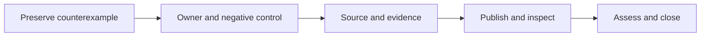

# Atlas source depth, execution identity and review axes

Baseline: ATF_AI `eb610a7471200ff8e7783d34e23848258219ac67` and the
source-bound AI/J1 complete-01 reports. The earlier G-009, G-010, K-001 and D-005
closures retain their documented scope and scores. Their checks established
declared consistency, complete single-file delivery and the then-current policy
contract. They did not establish automatic semantic completeness or a global
framework grade. This review records newly reproduced gaps separately.

The selected J1 tree has concurrent local changes. Its captured source hashes
and observed dirty state matter; neither its commit alone nor an earlier passing
governance report establishes the state of every current file. This task reads
that source without editing it. Existing tests may be inspected or rerun within
their declared scope; no product/E2E scenario or emulator is added.

## Scope and sequence



<details>
<summary>Legend: relationships and proof boundary</summary>

Arrows show the review sequence. A passing mechanical gate verifies its declared
structure and provenance; the reviewer still checks the source-to-prose meaning.
Feedback remains IN PROGRESS until its stated gates complete. Priority and
quality use the separate rubrics in the [register](README.md); neither is a
test pass rate. Baseline quality remains preserved when delivered quality is
later recorded.

</details>

<a id="g-012"></a>
## G-012: Exact execution, local graph and knowledge trace

- Owner: Atlas execution binding, complete bundle, publisher and knowledge receipt.
- Priority: 93, from impact/risk/urgency 95/90/90.
- Baseline quality: 61, from correctness/verification/clarity 65/55/60.
- Observation: a private fixture marked an oracle EXECUTED/PASSED using XML for
  `different.project.UnrelatedTest/doesNotExerciseTheResponse`. Matching hashes
  showed that the oracle file existed during the run, but did not identify an
  executed case. Other fixtures passed with a graph edge outside its flow's
  claimIds, swapped graph kinds and a counterfeit optional knowledge record with
  fabricated citation/ranking/provenance alongside a genuine corpus digest.
- Consequence: a mechanically consistent report can overstate execution scope
  or display requirements that were never retrieved from the canonical corpus.
- Correction: require executionSubjects for EXECUTED claims used by behavior or
  oracle links; bind exact retained XML/TAP identities, quoted owner paths and
  outcomes while retaining existing source-manifest checks. Enforce local edge
  membership and graph kinds. Compare the complete canonical retrieval receipt
  and retain full knowledge-source bytes, including optional records and citations.
- Acceptance: independent negative controls reject unrelated/missing/ambiguous/
  duplicated/skipped subjects, incorrect outcomes, unsupported proof, mismatched
  source/target, forged optional policy, altered ranking/citations and borrowed
  graph claims. Both live and portable validators use the same execution gate.
  Source-only/no-test projects remain valid without invented execution. Original
  failures and successful repairs remain separately recoverable.
- Independent review also reproduced testcase markup inside XML processing
  instructions/output containers, illegal raw XML identities, mixed-suite verdict
  conflation and a semantically equal corpus with rewritten byte provenance.
  Structural parsing rejects fake identities and malformed XML; a selected test
  keeps its own verdict beside the untouched suite verdict. Full receipt checks
  require the canonical original corpus byte digest as well as semantic identity.
- The retained Node 02 integration run had 109 cases and three failures: two
  historical optional-inventory fixtures encountered the newly required flow-ID
  guard too early, and an existing CLI subprocess exceeded its unchanged ten
  second startup budget during concurrent builds. The inventory guard now applies
  after the historical optional path. Node03 passed 110 cases with serial test-file
  scheduling to isolate CLI startup from cross-file process contention; it does
  not widen a product timeout or replace the original failed evidence. The final
  Node04 selection passed 111 cases after full canonical-receipt metadata controls.
- Evidence: private baseline probes and controls audit under
  `${ATF_WORK_ROOT}/reviews/20261125-atlas-depth/`; maintained checks are
  `tools/atlas-execution.test.mjs`, `tools/atlas-bundle.test.mjs`,
  `tools/verify-atlas.test.mjs` and `tools/atlas-report.test.mjs`.
- State: CLOSED. Delivered quality: 95, from correctness/verification/clarity 95/95/94.
- Verified result: The final 111-case maintenance selection passed. Original failed fixtures, Node02, the successful Node03 and final Node04 remain separately retained. Real J1 XML binds four passed catalog-negative subjects and the separate failed change-control subject without changing the whole-suite verdict. Canonical retrieval equality covers all metadata and original corpus bytes. Both existing 211-case Java selections passed after their separately retained README repair.
- Closure receipts: `${ATF_WORK_ROOT}/runs/atlas-depth-acceptance-publication-audit.json`, original run XML/TAP/source manifests and `${ATF_WORK_ROOT}/reviews/20261125-atlas-depth/new-render-acceptance-01/metrics.json`. Final synchronized readers are recaptured and audited separately against their exact source.

<a id="g-013"></a>
## G-013: Declared source breadth and honest gaps

- Owner: understanding schema, source inventory and authoring reviewer.
- Priority: 88, from impact/risk/urgency 90/85/85.
- Baseline quality: 61, from correctness/verification/clarity 65/55/60.
- Observation: the initial AI report indexed its project but explained three
  behavior flows; J1 explained one Shop component/report flow. Full byte
  inventory and a complete reader file did not provide an auditable declaration
  of reviewed owners, remaining areas or facet depth.
- Consequence: a useful selected example can appear to explain the whole project,
  and later retrieval-assisted authoring can repeat that omission without a
  machine-visible gap.
- Correction: renderVersion 2 requires analysis.understanding schemaVersion 1,
  PROJECT/SELECTED scope, scopeStatement, inventoryClaimIds and actual owner units.
  Units own scopePaths, claims, explicit shared references, flows, limits and all
  seven facets: purpose, structure, behavior, data, configuration, failure and
  verification. REVIEWED/PARTIAL need supported source claims; UNKNOWN and
  NOT_APPLICABLE need honest explanations. Architecture nodes and unit/flow
  ownership cross-reference each other.
- Acceptance: controls reject fictitious scope paths, borrowed owner evidence,
  missing facets, unsupported reviewed status, dangling/asymmetric links and
  unexplained architecture/unit mismatch. A no-Git/no-test single component
  remains valid; missing behavior or verification is disclosed without adding
  product tests. Facet counts are review declarations, never semantic-coverage
  percentages. Old renderer-version history remains preserved at its original scope.
- Independent review rejected a shared-only unit marked entirely REVIEWED.
  Each reviewed/partial facet now needs its owner's source claim; verification
  alone may point to an explicitly shared oracle. UNKNOWN units remain honest gaps.
- Evidence: `tools/atlas-understanding.test.mjs`, current report contract and
  newly captured per-project understanding inventories outside maintained source.
- State: CLOSED. Delivered quality: 92, from correctness/verification/clarity 94/92/90.
- Verified result: Both fresh inventories passed source, owner, seven-facet and bidirectional flow checks. AI has five owners, eight flows and 48 claims; J1 has five owners, six flows and 37 claims. AI retains 11 REVIEWED/24 PARTIAL facets and J1 5 REVIEWED/30 PARTIAL facets. Meaningful mutation controls reject foreign/shared-only ownership, missing facets and unsupported flow/node scope. These counts remain declarations, not semantic coverage.
- Closure receipts: `${ATF_WORK_ROOT}/runs/atlas-depth-acceptance-publication-audit.json`, original run XML/TAP/source manifests and `${ATF_WORK_ROOT}/reviews/20261125-atlas-depth/new-render-acceptance-01/metrics.json`. Final synchronized readers are recaptured and audited separately against their exact source.

<a id="d-006"></a>
## D-006: Deeper project explanations and coherent reader delivery

- Owner: source reviewer, target documentation owners and Atlas reader contract.
- Priority: 86, from impact/risk/urgency 90/80/85.
- Baseline quality: 61, from correctness/verification/clarity 65/60/55.
- Observation: the complete-01 AI/J1 artifacts preserve their declared inputs
  and one-file reader delivery. Their selected behavior examples leave actual
  framework/consumer responsibilities, state, defaults, failure handling and
  verification ownership unevenly explained.
- Consequence: readers need another manual source pass to distinguish a genuine
  contract from an incidental component example or a historical proof snapshot.
- Correction: inspect current source owner by owner; expand existing behavior
  and oracle narratives, data/configuration/failure explanations and maintained
  guide selection. Preserve the essential AI living architecture in Markdown and
  HTML. Keep J1 binary-library ownership separate from consumer-owned source and
  distinguish current dirty code from retained qualification evidence.
- Acceptance: each delivered source claim and quote resolves against its capture;
  every reviewed unit declares all seven facets; existing flows explain actors,
  operations, values and observable outcomes. The one final HTML contains all
  declared inputs, canonical embedded CSS, clear diagrams, full source/evidence
  provenance and explicit gaps. Inspect desktop rendering, disclosure, navigation
  and offline behavior. Code/comments and canonical documentation remain English;
  the main_RO README hierarchy remains 1:1 with main.
- Evidence: fresh AI/J1 inputs, exact source captures, one reader HTML per project
  and desktop review records under the caller-selected artifacts/review roots.
- State: CLOSED. Delivered quality: 89, from correctness/verification/clarity 90/85/90.
- Verified result: The accepted AI/J1 readers retain 20/23 maintained source documents plus complete declared analysis/source/evidence inputs. Four real desktop Chromium records at 1440 and 1920 inspected 32 diagrams with no network/script/page error, clipping, overlap or header occlusion. Concrete transition labels and their source claims replaced generic arrow verbs. One complete HTML per target was copied alone for review; no product journey, E2E or emulator was added.
- Closure receipts: `${ATF_WORK_ROOT}/runs/atlas-depth-acceptance-publication-audit.json`, original run XML/TAP/source manifests and `${ATF_WORK_ROOT}/reviews/20261125-atlas-depth/new-render-acceptance-01/metrics.json`. Final synchronized readers are recaptured and audited separately against their exact source.

<a id="a-001"></a>
## A-001: Evidence-bound 1–100 review axes

- Owner: assessment reviewer, rubric and validation contract.
- Priority: 81, from impact/risk/urgency 85/75/80.
- Baseline quality: 53, from correctness/verification/clarity 60/45/50.
- Observation: the request asks for suitable separate 1–100 axes. Existing
  feedback scores assess narrow corrected findings; they cannot stand in for
  current project or Atlas grades. Source consistency and passing governance
  selections do not supply a rubric or prove every behavior.
- Consequence: reusing a closure score as a global quality score hides scope,
  uncertainty, evidence age and unexecuted contracts.
- Correction: optional EVIDENCE_BOUND_REVIEW declares reviewer, scope, limits and
  separate project-quality/atlas-quality groups. Every axis has correctness,
  verification and clarity inputs, the rounded 40/30/30 score, an integer weight,
  reviewed claimIds, evidenceIds, reason and limits. Weights sum to 100 per group.
  The group is the rounded weighted mean; NOT_ASSESSED remains valid when no
  assessment is requested or supported.
- Acceptance: reject out-of-range/fractional inputs, incorrect computed scores,
  weights not totaling 100, unsupported claims/evidence and missing scope or
  limitations. Explain project-specific axes using current source and retained
  outcomes; explain common publisher controls consistently across targets.
  No score is inferred from file/test counts, lexical ranking or gate success.
- Evidence: `tools/atlas-understanding.test.mjs`, review narratives and the fresh
  per-project assessment records embedded in their one-file reader artifacts.
- State: CLOSED. Delivered quality: 92, from correctness/verification/clarity 92/94/90.
- Verified result: Both explicit assessments passed their source/evidence references and 40/30/30 arithmetic, integer ranges and weights. Six comparable project-source axes and six Atlas/RAG axes keep separate totals: AI 90/90 and J1 87/89. The J1 change-control failure affects current compliance/readiness and stays visible. These authored Codex-assisted review judgments do not presume human approval, full runtime acceptance or automatic semantic certification.
- Closure receipts: `${ATF_WORK_ROOT}/runs/atlas-depth-acceptance-publication-audit.json`, original run XML/TAP/source manifests and `${ATF_WORK_ROOT}/reviews/20261125-atlas-depth/new-render-acceptance-01/metrics.json`. Final synchronized readers are recaptured and audited separately against their exact source.

<a id="g-014"></a>
## G-014: Current J1 change-control compliance stays open

- Owner: J1 test-change owner. This is an external project observation, not an
  ATF_AI runtime correction or authority to edit concurrent J1 work.
- Priority: 84, from impact/risk/urgency 85/85/80.
- Baseline quality: 68, from correctness/verification/clarity 65/50/90.
- Observation: the isolated existing WholeAtfGovernanceSuiteTest selection
  captured the J1 dirty tree at base `4e3cac10061c95ea2b9b32cc18a6d4add1007a1e`.
  Its 35 XML reports reconcile to 211 tests, 210 passed, one failure and no errors
  or skips. TestChangeGovernanceTest.moduleTestChangesRequireAnExplicitControlRecord
  correctly reports two TEST-CHANGE-REQUIRED violations: the modified
  WholeAtfGovernanceSuiteTest.java and added
  governance/release/ConsumerEvidenceCatalogGovernanceTest.java lack eligible
  ACTIVE/VERIFIED controls for that exact baseline and those paths.
- Interpretation: J1 documents the requirement in its test guide and implements
  the guard. The current changes do not satisfy it. The new catalog's six tests
  passed; that scoped result does not turn the whole suite into PASSED. At review,
  the captured raw source hashes still matched live J1. Later changes require a
  new capture; a commit alone cannot identify a dirty tree.
- Required action: the J1 owner records justified structured testChanges for the
  two exact paths and baseline, including reason, proof and expiry, then runs the
  existing governance selection with a new immutable run ID. Do not weaken the
  rule, invent retrospective approval or amend the original failed XML.
- Evidence: `${ATF_WORK_ROOT}/runs/j1-atlas-depth-governance-01.log`, its original
  source manifest and XML; classification under
  `${ATF_WORK_ROOT}/reviews/20261125-atlas-depth/j1-governance-failure-01.md`.
  The new J1 Atlas embeds the original failure and its captured-source comparison.
- State: TODO. No J1 source or control record was changed by this review. This
  finding remains open independently of the completed Atlas delivery gates.

## Verification and closure route

Run the focused maintenance selection from the project root:

```powershell
node --test tools/verify-atlas.test.mjs tools/atlas-report.test.mjs tools/atlas-knowledge.test.mjs tools/atlas-bundle.test.mjs tools/atlas-execution.test.mjs tools/atlas-understanding.test.mjs
```

Follow [Development](../Development.md) for isolated existing Java documentation
and architecture governance and README-edition parity. Preserve the exact
commands, source manifests, original XML/TAP, failed observations and successful
reruns in the caller-selected artifact area. A copied report is not another run.
Keep generated maps outside source-owned areas that prohibit them. Close each
item only after its own acceptance checks complete, then record delivered quality
with its component inputs and add a concise verified-register receipt. Preserve
these baseline observations and avoid retrospective global rescoring.

## Scoped reviewer scores

The same six axes are used per group. Full weights, correctness/verification/clarity
inputs, source claims, original execution IDs, rationale and limits remain in each
complete reader. These are representative review judgments, not coverage or pass
percentages. Source and Atlas quality are not merged into one grade.

### Project source qualities

| Axis | AI (1-100) | J1 (1-100) |
|---|---:|---:|
| Architecture and ownership | 92 | 92 |
| Governance precision and repair guidance | 92 | 88 |
| Configuration and failure discipline | 85 | 87 |
| Existing oracle quality and stability evidence | 89 | 76 |
| Documentation contracts and clarity | 90 | 91 |
| Maintainability and portability | 89 | 89 |
| Weighted group | 90 | 87 |

### Atlas and RAG qualities

| Axis | AI (1-100) | J1 (1-100) |
|---|---:|---:|
| Declared coverage and project depth | 86 | 84 |
| Behavior and negative-outcome explanation | 87 | 86 |
| Evidence honesty and provenance | 95 | 93 |
| Generation governance and repair diagnostics | 94 | 92 |
| Retrieval and source-grounded authoring discipline | 88 | 88 |
| Offline delivery and reader structure | 91 | 91 |
| Weighted group | 90 | 89 |

The two original AI governance attempt01 runs each failed one README-edition
check: wrapping `schemaVersion 1` before `1. Declare` accidentally created an
English ordered-list item. Correcting the paragraph restored the declared
translation structure; both attempt02 selections passed all 211 cases. Their
failed reports remain immutable alongside the repaired results. G-014 remains
TODO for the independently owned J1 change-control records.

## D-011

Status: VERIFIED. Owner: Atlas documentation and maintenance-tool owners.
Priority 88; baseline quality 58. Priority inputs: impact 90, exposure 85,
urgency 85. Quality inputs: correctness 65, verification 45, clarity 60.
These are scoped reader-presentation judgments, not framework-wide scores.

The captured AI/J1 readers used generic column allocation and rendered source
Markdown lists/tables as separate literal paragraphs. A dense case comparison
could put long preconditions beside short identifiers without a reading-space
contract. Existing byte-consistency checks could not establish visual balance.

- Preserve the original reader and every captured source/evidence identity.
- Govern semantic blocks, adjacent diagram legends and complete vertical cases.
- Check bounded column allocation and real rendered geometry with negative,
  repaired and valid controls; retain helpful owned failure diagnostics.
- Keep native desktop review distinct from product/E2E execution and emulation.

Evidence is retained under `${ATF_WORK_ROOT}/reviews/20261126-atlas-presentation`.
Closure requires the complete Node selection, paired documentation governance,
native AI/J1 rendering at declared widths and exact captured-bundle comparison.
The finite geometry heuristic and Markdown subset do not prove semantic
completeness or perfect visual design. No new product journey is authorized.

Delivered quality: 93 (correctness 94 / verification 92 / clarity 92).
The assessment covers the owned reader presentation contract and reviewed AI/J1
captures; it is not a global framework or semantic-completeness score.

| Verification | Retained result and limit |
|---|---|
| Maintenance components | 203/203 per edition after the inline repair; original complete selections remain retained |
| Existing Java governance | EN 315/315; RO 315/315; four existing owners, with unchanged Java/POM/resource identities |
| Complete paired documents | 51 source-bound entries, language/meaning/facts/links/diagrams/disclosures and three compilable example owners |
| Native table review | 12 desktop records, including four original, four refreshed and four negative/repaired controls; 586 refreshed project table observations at 1440/900 CSS px |
| Diagram review | Four desktop records and 46 diagram observations; label overlap controls, offline resources, navigation and disclosure pass |
| Capture identity | Only renderVersion changes; original analysis, source, documents, knowledge, claims and native evidence remain exact |

At both widths, the original AI reader gave two directed witnesses 60 CSS px,
producing 45/71 lines. An adjacent 670 CSS px oracle column used three lines.
The original J1 reader also overflowed the page at 900 CSS px. The repaired
readers pass the finite layout signals. Screenshots of case records, source
tables, legends and overview were inspected; this is scoped visual review.

The first paired-document attempt failed because this record used REVIEWING,
which is outside the owned active-status vocabulary. IN PROGRESS repairs that
record; the original failure remains in documents-01. A deterministic J1
re-render also exposed mixed emphasis/code handling. Independent literal-marker
and mixed-format controls repair it while keeping both inspected HTMLs exact.

Compact wording already authored in the retained analysis remains visible, and
Mermaid source is retained honestly rather than executed as an arbitrary script.
Future authoring still needs human review of meaning and typography. The
current-publication refresh preserves the complete prior selection in immutable
external history and keeps every original execution-report byte unchanged.
