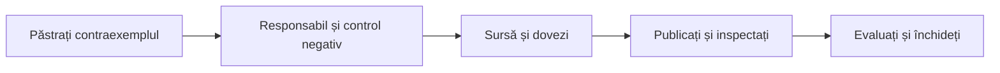

<a id="atlas-source-depth-execution-identity-and-review-axes"></a>
# Profunzimea surselor Atlas, identitatea execuțiilor și axele de revizie

Referință inițială: ATF_AI `eb610a7471200ff8e7783d34e23848258219ac67` și
rapoartele complete-01 AI/J1 legate de surse. Închiderile anterioare G-009, G-010, K-001 și D-005
își păstrează domeniul și notele documentate. Verificările lor au stabilit
consistența declarată, livrarea completă într-un singur fișier și contractul de politici
valabil atunci. Nu au stabilit completitudinea semantică automată sau o notă globală
a framework-ului. Această revizie înregistrează separat lacunele nou reproduse.

Arborele J1 selectat are modificări locale concurente. Contează hash-urile surselor sale capturate
și starea observată cu modificări locale; nici commit-ul său singur, nici un raport anterior de guvernanță
cu rezultat reușit nu stabilește starea fiecărui fișier curent. Această sarcină citește
sursele fără a le edita. Testele existente pot fi inspectate sau rerulate în
domeniul lor declarat; nu se adaugă scenarii de produs/E2E sau emulatoare.

<a id="scope-and-sequence"></a>
## Domeniu și succesiune



<details>
<summary>Legendă: relații și limita dovezii</summary>

Săgețile arată succesiunea reviziei. Un control mecanic trecut verifică structura
și proveniența declarate; revizorul verifică în continuare sensul de la sursă la proză.
Feedback-ul rămâne IN PROGRESS până când verificările sale declarate se finalizează. Prioritatea și
calitatea folosesc grilele separate din [registru](README.md); niciuna nu reprezintă o
rată de trecere a testelor. Calitatea inițială rămâne păstrată când calitatea livrată este
înregistrată ulterior.

</details>

<a id="g-012"></a>
<a id="g-012-exact-execution-local-graph-and-knowledge-trace"></a>
## G-012: Execuție exactă, graf local și trasabilitatea cunoștințelor

- Responsabil: legarea execuțiilor Atlas, pachetul complet, publicatorul și înregistrarea recuperării cunoștințelor.
- Prioritate: 93, din impact/risc/urgență 95/90/90.
- Calitate inițială: 61, din corectitudine/verificare/claritate 65/55/60.
- Observație: un fixture privat marca un oracol EXECUTED/PASSED folosind XML pentru
  `different.project.UnrelatedTest/doesNotExerciseTheResponse`. Hash-urile identice
  arătau că fișierul oracolului exista în timpul rulării, dar nu identificau un
  caz executat. Alte fixture-uri treceau cu o muchie de graf în afara claimIds
  ale fluxului său, tipuri de graf inversate și o înregistrare opțională falsificată de cunoștințe cu
  citare/clasificare/proveniență fabricate alături de un rezumat criptografic autentic al corpusului.
- Consecință: un raport consistent mecanic poate exagera domeniul execuției
  sau afișa cerințe care nu au fost niciodată recuperate din corpusul canonic.
- Corecție: cerința executionSubjects pentru afirmațiile EXECUTED folosite de legăturile de comportament sau
  oracol; legarea identităților exacte XML/TAP păstrate, a căilor citate ale responsabililor și
  a rezultatelor, păstrând verificările existente ale manifestului surselor. Impunerea apartenenței locale a
  muchiilor și a tipurilor de graf. Compararea înregistrării canonice complete de recuperare
  și păstrarea integrală a octeților surselor de cunoștințe, inclusiv a înregistrărilor opționale și citărilor.
- Acceptanță: controalele negative independente resping subiecții fără legătură/lipsă/ambigui/
  duplicați/omiși, rezultatele incorecte, dovezile nesusținute, sursa/ținta
  nepotrivită, politicile opționale falsificate, clasificarea/citările modificate și afirmațiile
  împrumutate ale grafului. Validatorii live și portabil folosesc același control al execuției.
  Proiectele bazate doar pe surse/fără teste rămân valide fără execuții inventate. Eșecurile
  originale și remedierile reușite rămân recuperabile separat.
- Revizia independentă a reprodus și marcaje testcase în instrucțiuni de procesare XML/
  containere de ieșire, identități XML brute nelegale, confundarea verdictelor din suite mixte
  și un corpus egal semantic, dar cu proveniența octeților rescrisă.
  Parsarea structurală respinge identitățile false și XML-ul malformat; un test selectat
  își păstrează propriul verdict alături de verdictul neatins al suitei. Verificările înregistrării complete
  cer rezumatul criptografic canonic al octeților corpusului original, precum și identitatea semantică.
- Rularea de integrare Node 02 păstrată avea 109 cazuri și trei eșecuri: două
  fixture-uri istorice ale inventarului opțional au întâlnit prea devreme noul control obligatoriu al ID-ului de
  flux, iar un subproces CLI existent a depășit bugetul său neschimbat de pornire de zece
  secunde în timpul compilărilor concurente. Controlul inventarului se aplică acum
  după calea opțională istorică. Node03 a trecut 110 cazuri cu planificare serială a fișierelor
  de test pentru a izola pornirea CLI de concurența proceselor între fișiere; nu
  mărește un termen-limită al produsului și nu înlocuiește dovezile originale de eșec. Selecția finală
  Node04 a trecut 111 cazuri după controalele complete ale metadatelor înregistrării canonice.
- Dovezi: sondele private de referință inițială și auditul controalelor sub
  `${ATF_WORK_ROOT}/reviews/20261125-atlas-depth/`; verificările întreținute sunt
  `tools/atlas-execution.test.mjs`, `tools/atlas-bundle.test.mjs`,
  `tools/verify-atlas.test.mjs` și `tools/atlas-report.test.mjs`.
- Stare: CLOSED. Calitate livrată: 95, din corectitudine/verificare/claritate 95/95/94.
- Rezultat verificat: selecția finală de întreținere cu 111 cazuri a trecut. Fixture-urile originale eșuate, Node02, Node03 reușit și Node04 final rămân păstrate separat. XML-ul J1 real leagă patru subiecți trecuți ai cazurilor negative de catalog și subiectul separat eșuat al controlului schimbărilor, fără a schimba verdictul întregii suite. Egalitatea recuperării canonice acoperă toate metadatele și octeții originali ai corpusului. Ambele selecții Java existente cu 211 cazuri au trecut după remedierea README păstrată separat.
- Înregistrări de închidere: `${ATF_WORK_ROOT}/runs/atlas-depth-acceptance-publication-audit.json`, manifestele originale XML/TAP/sursă ale rulărilor și `${ATF_WORK_ROOT}/reviews/20261125-atlas-depth/new-render-acceptance-01/metrics.json`. Documentele finale sincronizate pentru cititor sunt recapturate și auditate separat față de sursele lor exacte.

<a id="g-013"></a>
<a id="g-013-declared-source-breadth-and-honest-gaps"></a>
## G-013: Amploarea declarată a surselor și lacune oneste

- Responsabil: schema de înțelegere, inventarul surselor și revizorul redactării.
- Prioritate: 88, din impact/risc/urgență 90/85/85.
- Calitate inițială: 61, din corectitudine/verificare/claritate 65/55/60.
- Observație: raportul AI inițial își indexa proiectul, dar explica trei
  fluxuri de comportament; J1 explica un flux Shop de componentă/raport. Inventarul
  complet de octeți și un fișier complet pentru cititor nu furnizau o declarație auditabilă
  a responsabililor revizuiți, a zonelor rămase sau a profunzimii fațetelor.
- Consecință: un exemplu selectat util poate părea că explică întregul proiect,
  iar redactarea ulterioară asistată de recuperare poate repeta acea omisiune fără o
  lacună vizibilă pentru mașină.
- Corecție: renderVersion 2 cere analysis.understanding schemaVersion 1,
  domeniul PROJECT/SELECTED, scopeStatement, inventoryClaimIds și unități reale de responsabilitate.
  Unitățile dețin scopePaths, afirmații, referințe partajate explicite, fluxuri, limite și toate
  cele șapte fațete: scop, structură, comportament, date, configurație, eșec și
  verificare. REVIEWED/PARTIAL necesită afirmații susținute de surse; UNKNOWN și
  NOT_APPLICABLE necesită explicații oneste. Nodurile de arhitectură și proprietatea unităților/fluxurilor
  se referențiază reciproc.
- Acceptanță: controalele resping căile de domeniu fictive, dovezile împrumutate de la alți responsabili,
  fațetele lipsă, starea de revizie nesusținută, legăturile fără țintă/asimetrice și
  nepotrivirea neexplicată arhitectură/unitate. O singură componentă fără Git/fără teste
  rămâne validă; lipsa comportamentului sau verificării este declarată fără adăugarea
  testelor de produs. Numerele de fațete sunt declarații de revizie, niciodată procente de
  acoperire semantică. Istoricul versiunilor vechi ale randorului rămâne păstrat în domeniul său original.
- Revizia independentă a respins o unitate bazată exclusiv pe referințe partajate, marcată integral REVIEWED.
  Fiecare fațetă revizuită/parțială necesită acum afirmația sursă a responsabilului său; doar verificarea
  poate indica un oracol explicit partajat. Unitățile UNKNOWN rămân lacune oneste.
- Dovezi: `tools/atlas-understanding.test.mjs`, contractul curent al raportului și
  inventarele de înțelegere nou capturate per proiect, în afara surselor întreținute.
- Stare: CLOSED. Calitate livrată: 92, din corectitudine/verificare/claritate 94/92/90.
- Rezultat verificat: ambele inventare noi au trecut verificările de sursă, responsabil, șapte fațete și flux bidirecțional. AI are cinci responsabili, opt fluxuri și 48 de afirmații; J1 are cinci responsabili, șase fluxuri și 37 de afirmații. AI păstrează 11 fațete REVIEWED/24 PARTIAL, iar J1 5 REVIEWED/30 PARTIAL. Controalele relevante de mutație resping proprietatea străină/bazată exclusiv pe referințe partajate, fațetele lipsă și domeniul nesusținut al fluxurilor/nodurilor. Aceste numere rămân declarații, nu acoperire semantică.
- Înregistrări de închidere: `${ATF_WORK_ROOT}/runs/atlas-depth-acceptance-publication-audit.json`, manifestele originale XML/TAP/sursă ale rulărilor și `${ATF_WORK_ROOT}/reviews/20261125-atlas-depth/new-render-acceptance-01/metrics.json`. Documentele finale sincronizate pentru cititor sunt recapturate și auditate separat față de sursele lor exacte.

<a id="d-006"></a>
<a id="d-006-deeper-project-explanations-and-coherent-reader-delivery"></a>
## D-006: Explicații mai profunde ale proiectului și livrare coerentă pentru cititor

- Responsabil: revizorul surselor, responsabilii documentației țintă și contractul documentului Atlas pentru cititor.
- Prioritate: 86, din impact/risc/urgență 90/80/85.
- Calitate inițială: 61, din corectitudine/verificare/claritate 65/60/55.
- Observație: artefactele complete-01 AI/J1 păstrează intrările declarate
  și livrarea într-un singur fișier pentru cititor. Exemplele lor selectate de comportament lasă explicate
  neuniform responsabilitățile efective framework/consumator, starea, valorile implicite, tratarea eșecurilor și
  responsabilitatea verificării.
- Consecință: cititorii au nevoie de încă o parcurgere manuală a surselor pentru a distinge un contract
  real de un exemplu incidental de componentă sau de un instantaneu istoric de dovezi.
- Corecție: inspectarea surselor curente, responsabil cu responsabil; extinderea explicațiilor existente despre comportament
  și oracole, a explicațiilor despre date/configurație/eșec și a selecției ghidurilor
  întreținute. Păstrarea arhitecturii esențiale Living AI în Markdown și
  HTML. Păstrarea proprietății bibliotecilor binare J1 separat de sursele deținute de consumatori și
  distingerea codului curent cu modificări locale de dovezile de calificare păstrate.
- Acceptanță: fiecare afirmație sursă și citat livrat se rezolvă față de captura sa;
  fiecare unitate revizuită declară toate cele șapte fațete; fluxurile existente explică actorii,
  operațiile, valorile și rezultatele observabile. HTML-ul final unic conține toate
  intrările declarate, CSS-ul canonic încorporat, diagrame clare, proveniența completă a surselor/dovezilor
  și lacune explicite. Inspectarea randării desktop, a detaliilor expandabile, a navigării
  și a comportamentului offline. Codul/comentariile și documentația canonică rămân în engleză;
  ierarhia README main_RO rămâne 1:1 cu main.
- Dovezi: intrări AI/J1 noi, capturi exacte de surse, câte un HTML pentru cititor per proiect
  și înregistrări ale reviziei desktop sub rădăcinile de artefacte/revizie selectate de apelant.
- Stare: CLOSED. Calitate livrată: 89, din corectitudine/verificare/claritate 90/85/90.
- Rezultat verificat: documentele AI/J1 acceptate pentru cititor păstrează 20/23 de documente sursă întreținute, plus intrările complete declarate de analiză/surse/dovezi. Patru înregistrări reale Chromium desktop la 1440 și 1920 au inspectat 32 de diagrame fără erori de rețea/script/pagină, tăieri, suprapuneri sau acoperirea titlurilor. Etichete concrete de tranziție și afirmațiile lor sursă au înlocuit verbele generice ale săgeților. Un HTML complet per țintă a fost copiat singur pentru revizie; nu s-a adăugat niciun parcurs de produs, E2E sau emulator.
- Înregistrări de închidere: `${ATF_WORK_ROOT}/runs/atlas-depth-acceptance-publication-audit.json`, manifestele originale XML/TAP/sursă ale rulărilor și `${ATF_WORK_ROOT}/reviews/20261125-atlas-depth/new-render-acceptance-01/metrics.json`. Documentele finale sincronizate pentru cititor sunt recapturate și auditate separat față de sursele lor exacte.

<a id="a-001"></a>
<a id="a-001-evidence-bound-1100-review-axes"></a>
## A-001: Axe de revizie 1–100 legate de dovezi

- Responsabil: revizorul evaluării, grila și contractul de validare.
- Prioritate: 81, din impact/risc/urgență 85/75/80.
- Calitate inițială: 53, din corectitudine/verificare/claritate 60/45/50.
- Observație: cererea solicită axe separate 1–100 potrivite. Notele existente
  din feedback evaluează constatări corectate înguste; nu pot înlocui notele
  curente ale proiectelor sau ale Atlas-ului. Consistența surselor și selecțiile de guvernanță
  trecute nu furnizează o grilă și nu dovedesc fiecare comportament.
- Consecință: reutilizarea unei note de închidere ca notă globală de calitate ascunde domeniul,
  incertitudinea, vechimea dovezilor și contractele neexecutate.
- Corecție: EVIDENCE_BOUND_REVIEW opțional declară revizorul, domeniul, limitele și
  grupurile separate project-quality/atlas-quality. Fiecare axă are intrări de corectitudine,
  verificare și claritate, nota rotunjită 40/30/30, o pondere întreagă,
  claimIds revizuite, evidenceIds, motiv și limite. Ponderile însumează 100 per grup.
  Grupul este media ponderată rotunjită; NOT_ASSESSED rămâne valid când nu este
  cerută sau susținută nicio evaluare.
- Acceptanță: respingerea intrărilor în afara intervalului/fracționare, a notelor calculate incorect,
  a ponderilor care nu însumează 100, a afirmațiilor/dovezilor nesusținute și a domeniului sau
  limitărilor lipsă. Explicarea axelor specifice proiectului folosind sursele curente și rezultatele
  păstrate; explicarea consecventă a controalelor comune ale publicatorului între ținte.
  Nicio notă nu este dedusă din numărul fișierelor/testelor, clasificarea lexicală sau succesul controalelor.
- Dovezi: `tools/atlas-understanding.test.mjs`, explicațiile reviziei și înregistrările noi
  de evaluare per proiect încorporate în artefactele lor de lectură într-un singur fișier.
- Stare: CLOSED. Calitate livrată: 92, din corectitudine/verificare/claritate 92/94/90.
- Rezultat verificat: ambele evaluări explicite au trecut verificările referințelor lor la surse/dovezi și ale aritmeticii 40/30/30, intervalelor întregi și ponderilor. Șase axe comparabile ale surselor proiectului și șase axe Atlas/RAG păstrează totaluri separate: AI 90/90 și J1 87/89. Eșecul controlului schimbărilor J1 afectează conformitatea/pregătirea curentă și rămâne vizibil. Aceste judecăți de revizie redactate cu asistență Codex nu presupun aprobare umană, acceptanță completă la execuție sau certificare semantică automată.
- Înregistrări de închidere: `${ATF_WORK_ROOT}/runs/atlas-depth-acceptance-publication-audit.json`, manifestele originale XML/TAP/sursă ale rulărilor și `${ATF_WORK_ROOT}/reviews/20261125-atlas-depth/new-render-acceptance-01/metrics.json`. Documentele finale sincronizate pentru cititor sunt recapturate și auditate separat față de sursele lor exacte.

<a id="g-014"></a>
<a id="g-014-current-j1-change-control-compliance-stays-open"></a>
## G-014: Conformitatea curentă J1 privind controlul schimbărilor rămâne deschisă

- Responsabil: responsabilul schimbărilor de teste J1. Aceasta este o observație asupra unui proiect extern, nu o
  corecție de execuție ATF_AI sau o autorizare de a edita lucrul concurent J1.
- Prioritate: 84, din impact/risc/urgență 85/85/80.
- Calitate inițială: 68, din corectitudine/verificare/claritate 65/50/90.
- Observație: selecția izolată existentă WholeAtfGovernanceSuiteTest
  a capturat arborele J1 cu modificări locale la baza `4e3cac10061c95ea2b9b32cc18a6d4add1007a1e`.
  Cele 35 de rapoarte XML ale sale se reconciliază la 211 teste, 210 trecute, un eșec și fără erori
  sau omiteri. TestChangeGovernanceTest.moduleTestChangesRequireAnExplicitControlRecord
  raportează corect două încălcări TEST-CHANGE-REQUIRED: fișierul modificat
  WholeAtfGovernanceSuiteTest.java și fișierul adăugat
  governance/release/ConsumerEvidenceCatalogGovernanceTest.java nu au controale
  ACTIVE/VERIFIED eligibile pentru acea bază exactă și acele căi.
- Interpretare: J1 documentează cerința în ghidul său de testare și implementează
  controlul. Modificările curente nu o satisfac. Cele șase teste ale noului catalog
  au trecut; acel rezultat delimitat nu transformă întreaga suită în PASSED. La revizie,
  hash-urile brute ale surselor capturate corespundeau încă J1 live. Schimbările ulterioare necesită o
  captură nouă; un commit singur nu poate identifica un arbore cu modificări locale.
- Acțiune necesară: responsabilul J1 înregistrează testChanges structurate și justificate pentru
  cele două căi exacte și baza exactă, incluzând motivul, dovada și expirarea, apoi rulează
  selecția existentă de guvernanță cu un nou ID imuabil de rulare. Nu slăbiți
  regula, nu inventați aprobare retrospectivă și nu modificați XML-ul original eșuat.
- Dovezi: `${ATF_WORK_ROOT}/runs/j1-atlas-depth-governance-01.log`, manifestul său original
  de surse și XML-ul; clasificarea sub
  `${ATF_WORK_ROOT}/reviews/20261125-atlas-depth/j1-governance-failure-01.md`.
  Noul Atlas J1 încorporează eșecul original și comparația sa cu sursele capturate.
- Stare: TODO. Această revizie nu a schimbat nicio sursă J1 sau înregistrare de control. Această
  constatare rămâne deschisă independent de verificările finalizate ale livrării Atlas.

<a id="verification-and-closure-route"></a>
## Calea de verificare și închidere

Rulați selecția focalizată de întreținere din rădăcina proiectului:

```powershell
node --test tools/verify-atlas.test.mjs tools/atlas-report.test.mjs tools/atlas-knowledge.test.mjs tools/atlas-bundle.test.mjs tools/atlas-execution.test.mjs tools/atlas-understanding.test.mjs
```

Urmați [Dezvoltarea](../Development.md) pentru guvernanța izolată existentă a documentației
și arhitecturii Java și pentru paritatea edițiilor README. Păstrați comenzile
exacte, manifestele surselor, XML/TAP original, observațiile de eșec și rerulările
reușite în zona de artefacte selectată de apelant. Un raport copiat nu este o altă rulare.
Păstrați hărțile generate în afara zonelor deținute de surse care le interzic. Închideți fiecare
element numai după finalizarea propriilor verificări de acceptanță, apoi înregistrați calitatea livrată
cu intrările componentelor sale și adăugați o înregistrare concisă în registrul verificat. Păstrați
aceste observații inițiale și evitați renotarea globală retrospectivă.

<a id="scoped-reviewer-scores"></a>
## Note de revizor cu domeniu delimitat

Aceleași șase axe sunt folosite per grup. Ponderile complete, intrările de corectitudine/verificare/claritate,
afirmațiile sursă, ID-urile originale ale execuțiilor, justificarea și limitele rămân în fiecare
document complet pentru cititor. Acestea sunt judecăți reprezentative de revizie, nu procente de acoperire sau
de trecere. Calitatea surselor și calitatea Atlas nu sunt unite într-o singură notă.

<a id="project-source-qualities"></a>
### Calitățile surselor proiectului

| Axă | AI (1-100) | J1 (1-100) |
|---|---:|---:|
| Arhitectură și responsabilitate | 92 | 92 |
| Precizia guvernanței și îndrumarea pentru remediere | 92 | 88 |
| Disciplina configurației și a eșecurilor | 85 | 87 |
| Calitatea oracolelor existente și dovezile de stabilitate | 89 | 76 |
| Contractele și claritatea documentației | 90 | 91 |
| Mentenabilitate și portabilitate | 89 | 89 |
| Grup ponderat | 90 | 87 |

<a id="atlas-and-rag-qualities"></a>
### Calitățile Atlas și RAG

| Axă | AI (1-100) | J1 (1-100) |
|---|---:|---:|
| Acoperire declarată și profunzimea proiectului | 86 | 84 |
| Explicarea comportamentului și a rezultatelor negative | 87 | 86 |
| Onestitatea dovezilor și proveniența | 95 | 93 |
| Guvernanța generării și diagnosticele de remediere | 94 | 92 |
| Disciplina recuperării și a redactării ancorate în surse | 88 | 88 |
| Livrare offline și structura pentru cititor | 91 | 91 |
| Grup ponderat | 90 | 89 |

Cele două rulări originale AI de guvernanță attempt01 au eșuat fiecare la o verificare a edițiilor README:
împărțirea lui `schemaVersion 1` înainte de `1. Declare` a creat accidental un
element de listă ordonată în engleză. Corectarea paragrafului a restaurat structura
de traducere declarată; ambele selecții attempt02 au trecut toate cele 211 cazuri. Rapoartele lor
eșuate rămân imuabile alături de rezultatele reparate. G-014 rămâne
TODO pentru înregistrările J1 de control al schimbărilor, cu responsabilitate independentă.

## D-011

Stare: VERIFIED. Responsabil: proprietarii documentației Atlas și ai instrumentelor
de mentenanță. Prioritate 88; calitate inițială 58. Intrări pentru prioritate:
impact 90, expunere 85, urgență 85. Intrări pentru calitate: corectitudine 65,
verificare 45, claritate 60. Sunt evaluări delimitate ale prezentării pentru
cititor, nu note pentru întregul framework.

Cititorii capturați AI/J1 foloseau alocarea generică a coloanelor și afișau listele
și tabelele Markdown sursă ca paragrafe literale separate. O comparație densă de
cazuri putea alătura precondiții lungi și identificatori scurți fără un contract
pentru spațiul de lectură. Verificările existente de consistență a octeților nu
puteau demonstra echilibrul vizual.

- Păstrează cititorul original și fiecare identitate capturată de sursă/dovadă.
- Guvernează blocurile semantice, legendele alăturate și fișele verticale complete.
- Verifică alocarea limitată a coloanelor și geometria reală cu situații negative,
  remediate și valide; păstrează diagnostice utile cu responsabil.
- Separă revizia desktop nativă de execuția produsului/E2E și de emulare.

Dovezile se păstrează sub `${ATF_WORK_ROOT}/reviews/20261126-atlas-presentation`.
Închiderea cere selecția Node completă, guvernanța documentației pereche,
randarea nativă AI/J1 la lățimile declarate și compararea exactă a pachetului
capturat. Euristica geometrică finită și subsetul Markdown nu demonstrează
completitudine semantică sau design vizual perfect. Nu se autorizează un flux nou de produs.

Calitate livrată: 93 (corectitudine 94 / verificare 92 / claritate 92).
Evaluarea acoperă contractul responsabil de prezentare și capturile AI/J1
revizuite; nu este o notă globală a framework-ului sau a completitudinii semantice.

| Verificare | Rezultat păstrat și limită |
|---|---|
| Componente de mentenanță | 203/203 per ediție după corecția inline; selecțiile complete originale rămân păstrate |
| Guvernanță Java existentă | EN 315/315; RO 315/315; patru responsabili existenți, cu identități Java/POM/resurse neschimbate |
| Documente pereche complete | 51 intrări legate de surse, limbă/sens/fapte/legături/diagrame/secțiuni pliabile și trei responsabili de exemple compilabile |
| Revizie nativă a tabelelor | 12 înregistrări desktop, dintre care patru originale, patru actualizate și patru controale negative/remediate; 586 observații de tabele în proiectele actualizate la 1440/900 CSS px |
| Revizia diagramelor | Patru înregistrări desktop și 46 observații de diagrame; controalele de suprapunere, resursele offline, navigarea și secțiunile pliabile trec |
| Identitatea capturii | Se schimbă numai renderVersion; analiza, sursa, documentele, cunoștințele, afirmațiile și dovezile native originale rămân exacte |

La ambele lățimi, cititorul original AI a alocat 60 CSS px pentru două dovezi
direcționate, producând 45/71 linii. Coloana alăturată de criterii, de 670 CSS px,
folosea trei linii. Cititorul original J1 depășea și pagina la 900 CSS px.
Cititorii reparați trec semnalele finite de aranjare. Au fost inspectate capturile
fișelor de caz, tabelelor sursă, legendelor și prezentării generale; revizia vizuală
are un domeniu delimitat.

Prima încercare pentru documente a eșuat deoarece această înregistrare folosea
REVIEWING, în afara vocabularului stărilor active acceptate. IN PROGRESS repară
înregistrarea; eșecul original rămâne în documents-01. O rerandare deterministă J1
a descoperit și tratarea combinației de evidențiere și cod. Controalele independente
pentru marcatori literali și format mixt o repară păstrând exact ambele HTML-uri inspectate.

Formulările compacte deja redactate în analiza păstrată rămân vizibile, iar sursa
Mermaid este reținută onest, fără execuție ca script arbitrar. Redactările viitoare
cer în continuare revizie umană a sensului și tipografiei. Actualizarea publicării
curente păstrează selecția anterioară completă în istoric extern imuabil și fiecare
octet original al rapoartelor de execuție rămâne neschimbat.
