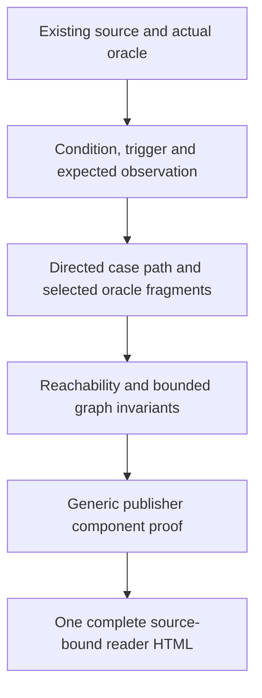

# Behavior cases, negative observations and component proof scope

Baseline: ATF_AI `8fc368f`. This review deepens existing behavior explanations,
RAG-style authoring governance and maintenance tests. It adds no product/E2E
scenario, emulator or Java runtime feature. Earlier Atlas delivery, provenance,
breadth and assessment closures retain their original scope and scores. G-014
remains an independent open observation about the captured J1 change-control
failure; Atlas consistency cannot close or relabel that failure.

The private mutation results are retained under
`${ATF_WORK_ROOT}/reviews/20261125-atlas-behavior/`. A valid generic baseline and
an independent dangling-endpoint control distinguish actual accepted model gaps
from a broken probe. Matching source bytes and a passing publisher prove declared
consistency; they do not automatically prove coherent behavior or prose truth.



Arrows show evidence assembly and maintenance checks. They do not introduce a
new product flow. Human review remains responsible for whether each case
describes the actual implementation and assertion.

<a id="g-015"></a>
## G-015: Reachable outcomes and exact case/oracle bindings

- Owner: Atlas behavior model, graph traversal and source/oracle evidence.
- Priority: 93, from impact/risk/urgency 95/90/90.
- Baseline quality: 62, from correctness/verification/clarity 65/55/65.
- Observation: reversing the generic fixture's sole INTENT-to-OUTCOME edge still
  published successfully. Adding a disconnected ACTION-to-OUTCOME lobe also
  passed. A flow could identify its implementation-only source claim as its
  SOURCE_REVIEWED oracle after removing all governance references. A separate
  negative behavior/oracle claim and REVIEWED failure facet still admitted a
  positive-only graph. The dangling-endpoint negative control correctly failed.
- Consequence: exact endpoint and source identities do not establish a path to
  the observation, an actual independent oracle or a described negative case.
- Correction: new renderVersion 3 captures declare caseAnalysis, an entry,
  stable edge IDs, positive/negative case walks, exact selected oracle source
  references and explicit negative scope. Every behavior node is reachable from
  entry and can reach an OUTCOME; every outcome has a case witness. Preserve
  reviewed source and retained execution scope. NOT_FOUND uses UNKNOWN oracle
  identity with reviewed search evidence. No word-based oracle/case classifier
  substitutes for source review.
- Acceptance: intended controls reject reversed/disconnected/trapped paths,
  noncontiguous case edges, unobserved outcomes, unsupported local claims,
  unrelated oracle reference indices and undisclosed negative gaps. Supported
  cycles, shared positive/negative terminals and explicit no-test search gaps
  remain valid. Dependency graphs keep their separate topology semantics.
- Evidence: `behavior-probe-results.json` and private complete artifacts in the
  review root; maintained `tools/atlas-behavior.test.mjs` and publisher/bundle
  component controls record the corrected contract.
- State: CLOSED. Delivered quality: 95, from correctness/verification/clarity 96/95/94.
- Verified result: The final 138-case Node selection passed. Directed reachability and reverse outcome escape reject reversed, disconnected and trapped paths; finite cycles and self-loops with escape remain valid. Every declared outcome has a finite positive/negative witness, and exact selected oracle fragments stay independent of implementation. Full-publisher mutations now reject case-variant paths and hardlink/copy aliases by verified content identity, including permitted text normalization. Original false-pass probes and corrected rejection receipts remain preserved. Both edition selections passed 232/232 Java cases.
- Closure receipts: `${ATF_WORK_ROOT}/runs/atlas-behavior-acceptance-publication-audit.json`, original Java XML/Node TAP and source manifests, and `${ATF_WORK_ROOT}/reviews/20261125-atlas-behavior/new-render-acceptance-04/metrics.json`. Final synchronized readers are recaptured and audited separately against their exact source.

<a id="d-007"></a>
## D-007: Existing branches and negative observations in the reader

- Owner: selected-project source reviewer and actual code/test owners.
- Priority: 86, from impact/risk/urgency 90/80/85.
- Baseline quality: 59, from correctness/verification/clarity 65/55/55.
- Observation: representative operation diagrams did not identify each existing
  rejection/failure observation with its precondition, trigger, path and exact
  assertion source. A negative claim could appear in a facet ledger without
  becoming an understandable behavior case.
- Consequence: readers still had to rediscover failure boundaries, and a generic
  arrow label could hide whether a step invokes an operation, returns an
  observation or preserves an original failure.
- Correction: review existing positive and meaningful negative source cases,
  including supported validation, retry/budget, configuration, lifecycle,
  cleanup and observation boundaries. Write source-specific transition labels,
  expected observations and selected existing assertion references. Preserve
  partial or searched gaps rather than requesting additional E2E coverage.
- Acceptance: case conditions, triggers, observations and graph paths match the
  captured source. Representative versus declared-edge coverage is explicit.
  A negative result is not relabeled as product failure when the test correctly
  expects rejection. Source review is not promoted to a fresh execution. Deliver
  one complete HTML per project with readable diagrams, actual oracle fragments,
  canonical embedded style and retained limitations. Keep English main and all
  Romanian README paths aligned 1:1 on main_RO.
- Evidence: fresh source-bound AI/J1 case inputs, original proof records and
  inspected desktop reader captures in the caller-selected artifact area.
- State: CLOSED. Delivered quality: 92, from correctness/verification/clarity 94/88/94.
- Verified result: The two captured readers explain AI: 11 / J1: 10 existing behavior flows with AI: 25 / J1: 28 cases, 24 positive and 29 negative in total. Each case states precondition, trigger, expected observation, directed walk, assertion and limitations; six AI missing-oracle cases remain explicit searched gaps. Twenty-one AI and 23 J1 source documents are embedded. Four real desktop Chromium records at 1440/1920 inspected 46 diagrams against exact isolated reader bytes. Negative application observations remain distinct from failed tests. J1 original 211/1 governance outcome remains historical and FAILED; no J1 test was rerun.
- Closure receipts: `${ATF_WORK_ROOT}/runs/atlas-behavior-acceptance-publication-audit.json`, original Java XML/Node TAP and source manifests, and `${ATF_WORK_ROOT}/reviews/20261125-atlas-behavior/new-render-acceptance-04/metrics.json`. Final synchronized readers are recaptured and audited separately against their exact source.

<a id="a-002"></a>
## A-002: Algorithm, component and runtime proof remain distinct

- Owner: Atlas maintenance tests, retrieval policy and proof-scope reviewer.
- Priority: 84, from impact/risk/urgency 85/80/85.
- Baseline quality: 66, from correctness/verification/clarity 70/55/70.
- Observation: field-presence and identity checks did not exercise outcome
  reachability, reverse outcome escape, case continuity or their invariance under
  harmless model transformations. Authentic policy fallback for a query with no
  lexical match was valid, but it was not semantic project retrieval.
- Consequence: increasing a structural test count can look like deeper behavior
  assurance without testing the properties that support that claim.
- Correction: combine focused traversal/case checks, metamorphic mutation controls
  and generic publisher component fixtures. Reorder or consistently rename a
  valid model without changing the result; remove its sole outcome path and
  require the intended failure. Keep bounded cycles and source-only/no-test
  projects valid. Retain complete canonical receipts and distinguish policy
  context from project source facts and original runtime outcomes.
- Acceptance: each corrupted fixture fails for the intended rule, and a repaired
  valid fixture passes. Node/edge order, consistent renaming and valid layout
  changes preserve logical results. Publisher components enforce the same graph
  contract as the pure algorithm. Tests do not promise automatic semantic
  completeness, classify cases from names or manufacture a runtime acceptance
  verdict. Any optional 1–100 review axes retain their separate evidence scopes.
- Evidence: focused behavior tests, publisher/bundle component results, exact
  XML/TAP/source captures and reviewed negative controls outside source-owned code.
- State: CLOSED. Delivered quality: 94, from correctness/verification/clarity 95/94/92.
- Verified result: Pure graph traversal, metamorphic ordering/renaming/cut-path controls, a 12000-node nonrecursive chain and publisher/bundle components passed in the 138-case maintenance cohort. Five new invocations in the existing API component class independently verify transport versus status verdict, original assertion identity, no false PASS event and default delay versus positive-header cap. No HTTP, browser, product/E2E scenario or emulator is used by those component checks. Original Node01 compatibility failures, Node02 prior pass and Node03 stale corpus citation failures retain their own TAP/source snapshots; Node05 is the final 138-case pass.
- Closure receipts: `${ATF_WORK_ROOT}/runs/atlas-behavior-acceptance-publication-audit.json`, original Java XML/Node TAP and source manifests, and `${ATF_WORK_ROOT}/reviews/20261125-atlas-behavior/new-render-acceptance-04/metrics.json`. Final synchronized readers are recaptured and audited separately against their exact source.

<a id="f-011"></a>
## F-011: UI teardown exception and interaction-tracker cleanup

- Owner: Core UI base teardown and thread-owned interaction state.
- Priority: 82, from impact/risk/urgency 85/80/75.
- Baseline quality: 66, from correctness/verification/clarity 70/40/85.
- Observation: source review of
  [BaseTestUI](../../atf-core/src/main/java/com/ai/ui/core/runtime/BaseTestUI.java)
  shows that tearDown calls DriverManager.quitEngine before
  UiInteractionTracker.clear. A quit exception can bypass that later clear call.
  [DriverManager](../../atf-core/src/main/java/com/ai/ui/core/runtime/DriverManager.java)
  removes its ENGINE reference in finally, which is a separate cleanup contract.
  The existing
  [BaseTestUIContractTest](../../atf-tests/src/test/java/com/ai/atf/core/support/base/BaseTestUIContractTest.java)
  checks lifecycle hooks/source ownership rather than this failure observation.
- Proof limit: this is a source-supported control-flow gap. No component execution
  in this review reproduces retained tracker state or establishes a runtime leak.
  Passing architecture or Atlas checks cannot promote that missing observation
  into a verified teardown guarantee.
- Required next evidence: a bounded pure component oracle that independently
  observes interaction-tracker state and engine ownership when quit throws,
  while preserving the original exception. It belongs to the existing UI base
  lifecycle contract, not a new product/E2E journey or emulator.
- Current action: retain the gap and exact source/oracle limits in the Atlas.
  This phase makes no Core Java runtime correction and does not close the item.
- State: OPEN source-review gap; TODO in the active register. A future bounded
  component observation and an authorized correction are needed before closure.

## Verification and closure

Use the project root and keep generated results in the selected artifact area:

```powershell
node --test tools/verify-atlas.test.mjs tools/atlas-report.test.mjs tools/atlas-knowledge.test.mjs tools/atlas-bundle.test.mjs tools/atlas-execution.test.mjs tools/atlas-understanding.test.mjs tools/atlas-behavior.test.mjs
```

Follow [Development](../Development.md) for isolated existing Java governance,
compiled documentation examples and README-edition parity. Preserve original
failed observations and successful reruns. Close each item only after its stated
acceptance passes, record exact commands/source/evidence and delivered quality
with component inputs, then add its concise verified-register receipt. Keep the
baseline judgments above. A copied artifact or regenerated catalog is not a new
test execution, and success in one proof scope does not close G-014.

## Scoped review grades and remaining gaps

The same six axes per group separate the framework source from Atlas/RAG quality.
Scores are authored review judgments, not test coverage, pass rates or presumed
human approval. Each axis combines correctness 40%, verification 30% and clarity 30%;
full claim references, weights and limitations are embedded in each reader.

### Project source qualities

| Axis | AI (1-100) | J1 (1-100) |
|---|---:|---:|
| Architecture and ownership | 92 | 92 |
| Governance precision and repair guidance | 92 | 88 |
| Configuration and failure discipline | 85 | 87 |
| Existing oracle quality and stability evidence | 89 | 76 |
| Documentation contracts and clarity | 90 | 91 |
| Maintainability and portability | 89 | 89 |
| Weighted group | 90 | 87 |

### Atlas and RAG qualities

| Axis | AI (1-100) | J1 (1-100) |
|---|---:|---:|
| Declared coverage and project depth | 87 | 85 |
| Behavior and negative-outcome explanation | 89 | 89 |
| Evidence honesty and provenance | 95 | 93 |
| Generation governance and repair diagnostics | 94 | 92 |
| Retrieval and source-grounded authoring discipline | 89 | 89 |
| Offline delivery and reader structure | 91 | 91 |
| Weighted group | 91 | 90 |

G-014 remains TODO for J1-owned change controls. F-011 remains a source-only
UI cleanup gap: no component proof establishes a tracker leak or a completed fix.
Representative case witnesses expose declared-edge gaps and cannot establish
exhaustive branch coverage, prose truth or semantic RAG recall. The policy corpus
contains 19 records, 16 mandatory; exact cited fragments and complete canonical
receipts are governed independently of target-source evidence.

The Node03 citation failure correctly detected an obsolete verbatim requirement
after the owning assessment contract was clarified from presumed human review to
authored review. Aligning the exact knowledge quote repaired the inconsistency;
no citation check was weakened. Node01 caught a historical/source-only input
compatibility regression, repaired while preserving mandatory V3 case validation.

The first desktop acceptance retained two findings in the AI polling graph, at
both widths: bypass arrows crossed two failure nodes and a label. Moving those
two nodes to the free right lane repaired presentation only. Exact case paths,
claims, edge directions, assertions and source limits were unchanged; the failed
HTML/metrics and the accepted new capture are retained separately.

## Presentation checks for a new project capture

Use actual native desktop DOM bounds for node collisions, clipped labels, edges
through unrelated nodes, label-to-node collisions and edge-label pairs. Require
an explicit empty `edgeLabelPairOverlaps` array for every observed SVG. A missing
array is NOT_ASSESSED and requires the current document component gate.

Keep a known overlapping-label control, its repaired non-overlapping control
and a touching-boundary control separate from the delivered report. Touching
bounds have zero intersection area; they are accepted. For a real collision,
shorten the precise condition label or move the outcome to a free lane, then
recheck the complete graph inventory and unchanged source/case bindings.
Preserve original failures, the fresh HTML hashes and both desktop widths.

Manual inspection of the J1 listener graph also found a label-pair collision
that the earlier label-to-node check could not detect. Shortening the two
condition labels preserved their meaning. The new document component gate
checks label pairs with native font metrics and independent negative, repaired
and touching controls. The earlier geometry pass retains its narrower scope.

The canonical Git source audit twice exceeded its original 10-second subprocess
deadline on this host. The isolated probe observed normal main calls around
7.5 seconds and a J1 HEAD timeout at 10.7 seconds. Increasing only the two
existing Git deadlines to 60 seconds preserves HEAD, inventory and byte checks.
The final Node05 cohort rechecks the changed verifier; Node04 remains a prior
passing snapshot. Java/POM/resources remain byte-identical to the accepted
232-case selections. No fake Git metadata, source emulator or product service
substitutes for canonical source verification.
