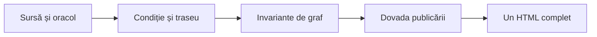

<a id="behavior-cases-negative-observations-and-component-proof-scope"></a>
# Cazuri de comportament, observații negative și domeniul dovezilor de componentă

Referință inițială: ATF_AI `8fc368f`. Această revizie aprofundează explicațiile comportamentale existente,
guvernanța redactării de tip RAG și testele de întreținere. Nu adaugă scenarii de produs/E2E,
emulatoare sau funcționalități Java de execuție. Închiderile anterioare privind livrarea Atlas, proveniența,
amploarea și evaluarea își păstrează domeniul și notele originale. G-014
rămâne o observație deschisă independentă asupra eșecului capturat al controlului schimbărilor J1;
consistența Atlas nu poate închide sau reeticheta acel eșec.

Rezultatele private ale mutațiilor sunt păstrate sub
`${ATF_WORK_ROOT}/reviews/20261125-atlas-behavior/`. O referință generică validă și
un control independent de capăt fără țintă disting lacunele efective ale modelului acceptat
de o sondă defectă. Octeții sursă identici și o publicare reușită dovedesc consistența
declarată; nu dovedesc automat coerența comportamentului sau adevărul prozei.



<details>
<summary>Legendă: relații și limita dovezii</summary>

Săgețile arată asamblarea dovezilor și verificările de întreținere. Nu introduc un
flux nou de produs. Revizia umană rămâne responsabilă pentru a stabili dacă fiecare caz
descrie implementarea și aserțiunea efective.

</details>

<a id="g-015"></a>
<a id="g-015-reachable-outcomes-and-exact-caseoracle-bindings"></a>
## G-015: Rezultate accesibile și legături exacte caz/oracol

- Responsabil: modelul comportamental Atlas, traversarea grafului și dovezile sursă/oracol.
- Prioritate: 93, din impact/risc/urgență 95/90/90.
- Calitate inițială: 62, din corectitudine/verificare/claritate 65/55/65.
- Observație: inversarea singurei muchii de la INTENT la OUTCOME din fixture-ul generic permitea în continuare
  publicarea cu succes. Adăugarea unui subgraf deconectat de la ACTION la OUTCOME
  trecea, de asemenea. Un flux putea identifica afirmația sa sursă, exclusiv de implementare, ca
  oracol SOURCE_REVIEWED după eliminarea tuturor referințelor de guvernanță. O afirmație separată
  de comportament/oracol negativ și o fațetă de eșec REVIEWED admiteau încă un
  graf exclusiv pozitiv. Controlul negativ pentru capăt fără țintă eșua corect.
- Consecință: identitățile exacte ale capetelor și surselor nu stabilesc o cale către
  observație, un oracol efectiv independent sau un caz negativ descris.
- Corecție: capturile noi renderVersion 3 declară caseAnalysis, o intrare,
  ID-uri stabile ale muchiilor, trasee de caz pozitive/negative, referințe sursă exacte ale oracolului
  selectat și un domeniu negativ explicit. Fiecare nod de comportament este accesibil de la
  intrare și poate ajunge la un OUTCOME; fiecare rezultat are un caz martor. Păstrarea
  surselor revizuite și a domeniului execuțiilor păstrate. NOT_FOUND folosește identitatea de oracol UNKNOWN
  cu dovezi revizuite ale căutării. Niciun clasificator de oracole/cazuri bazat pe cuvinte
  nu înlocuiește revizia surselor.
- Acceptanță: controalele intenționate resping căile inversate/deconectate/fără ieșire,
  muchiile necontigue ale cazurilor, rezultatele neobservate, afirmațiile locale nesusținute,
  indicii de referință fără legătură ai oracolului și lacunele negative nedeclarate. Ciclurile susținute,
  terminalele partajate pozitive/negative și lacunele explicite de căutare fără teste
  rămân valide. Grafurile de dependențe își păstrează semantica topologică separată.
- Dovezi: `behavior-probe-results.json` și artefactele private complete în
  rădăcina de revizie; `tools/atlas-behavior.test.mjs` întreținut și controalele de componentă
  ale publicatorului/pachetului înregistrează contractul corectat.
- Stare: CLOSED. Calitate livrată: 95, din corectitudine/verificare/claritate 96/95/94.
- Rezultat verificat: selecția finală Node cu 138 de cazuri a trecut. Accesibilitatea orientată și căutarea inversă a unei ieșiri către rezultat resping căile inversate, deconectate și fără ieșire; ciclurile finite și buclele proprii cu ieșire rămân valide. Fiecare rezultat declarat are un martor finit pozitiv/negativ, iar fragmentele exacte ale oracolului selectat rămân independente de implementare. Mutațiile prin publicatorul complet resping acum variantele de capitalizare ale căilor și aliasurile prin legături fizice/copii pe baza identității verificate a conținutului, inclusiv normalizarea permisă a textului. Sondele originale cu rezultat fals pozitiv și înregistrările respingerilor corectate rămân păstrate. Ambele selecții ale edițiilor au trecut 232/232 de cazuri Java.
- Înregistrări de închidere: `${ATF_WORK_ROOT}/runs/atlas-behavior-acceptance-publication-audit.json`, XML-ul Java/TAP-ul Node și manifestele sursă originale și `${ATF_WORK_ROOT}/reviews/20261125-atlas-behavior/new-render-acceptance-04/metrics.json`. Documentele finale sincronizate pentru cititor sunt recapturate și auditate separat față de sursele lor exacte.

<a id="d-007"></a>
<a id="d-007-existing-branches-and-negative-observations-in-the-reader"></a>
## D-007: Ramuri existente și observații negative în documentul pentru cititor

- Responsabil: revizorul surselor proiectului selectat și responsabilii efectivi ai codului/testelor.
- Prioritate: 86, din impact/risc/urgență 90/80/85.
- Calitate inițială: 59, din corectitudine/verificare/claritate 65/55/55.
- Observație: diagramele reprezentative ale operațiilor nu identificau fiecare observație existentă
  de respingere/eșec cu precondiția, declanșatorul, calea și sursa exactă a
  aserțiunii sale. O afirmație negativă putea apărea într-un registru de fațete fără
  a deveni un caz de comportament ușor de înțeles.
- Consecință: cititorii încă trebuiau să redescopere limitele eșecurilor, iar o etichetă
  generică de săgeată putea ascunde dacă un pas invocă o operație, returnează o
  observație sau păstrează un eșec original.
- Corecție: revizuirea cazurilor sursă pozitive și a celor negative relevante existente,
  inclusiv a limitelor susținute de validare, reîncercare/buget, configurație, ciclu de viață,
  curățare și observație. Redactarea etichetelor de tranziție specifice surselor,
  a observațiilor așteptate și a referințelor selectate la aserțiuni existente. Păstrarea
  lacunelor parțiale sau căutate în locul solicitării unei acoperiri E2E suplimentare.
- Acceptanță: condițiile, declanșatorii, observațiile și căile de graf ale cazurilor corespund
  surselor capturate. Distincția dintre acoperirea reprezentativă și cea a muchiilor declarate este explicită.
  Un rezultat negativ nu este reetichetat ca eșec al produsului când testul așteaptă corect
  respingerea. Revizia surselor nu este promovată la execuție nouă. Livrarea
  unui HTML complet per proiect cu diagrame lizibile, fragmente reale de oracol,
  stil canonic încorporat și limitări păstrate. Păstrarea main în engleză și a tuturor
  căilor README românești aliniate 1:1 pe main_RO.
- Dovezi: intrări noi de caz AI/J1 legate de surse, înregistrări originale de dovezi și
  capturi inspectate ale documentelor desktop pentru cititor în zona de artefacte selectată de apelant.
- Stare: CLOSED. Calitate livrată: 92, din corectitudine/verificare/claritate 94/88/94.
- Rezultat verificat: cele două documente capturate explică AI: 11 / J1: 10 fluxuri de comportament existente cu AI: 25 / J1: 28 de cazuri, 24 pozitive și 29 negative în total. Fiecare caz declară precondiția, declanșatorul, observația așteptată, traseul orientat, aserțiunea și limitările; șase cazuri AI fără oracol rămân lacune căutate explicite. Sunt încorporate douăzeci și unu de documente sursă AI și 23 J1. Patru înregistrări reale Chromium desktop la 1440/1920 au inspectat 46 de diagrame față de octeții exacți ai documentelor izolate pentru cititor. Observațiile negative ale aplicației rămân distincte de testele eșuate. Rezultatul original J1 de guvernanță 211/1 rămâne istoric și FAILED; niciun test J1 nu a fost rerulat.
- Înregistrări de închidere: `${ATF_WORK_ROOT}/runs/atlas-behavior-acceptance-publication-audit.json`, XML-ul Java/TAP-ul Node și manifestele sursă originale și `${ATF_WORK_ROOT}/reviews/20261125-atlas-behavior/new-render-acceptance-04/metrics.json`. Documentele finale sincronizate pentru cititor sunt recapturate și auditate separat față de sursele lor exacte.

<a id="a-002"></a>
<a id="a-002-algorithm-component-and-runtime-proof-remain-distinct"></a>
## A-002: Dovezile de algoritm, componentă și execuție rămân distincte

- Responsabil: testele de întreținere Atlas, politica de recuperare și revizorul domeniului dovezilor.
- Prioritate: 84, din impact/risc/urgență 85/80/85.
- Calitate inițială: 66, din corectitudine/verificare/claritate 70/55/70.
- Observație: verificările de prezență a câmpurilor și identitate nu exercitau accesibilitatea
  rezultatelor, căutarea inversă a ieșirii către rezultat, continuitatea cazurilor sau invarianța lor la
  transformări inofensive ale modelului. Mecanismul autentic de rezervă pentru politici, la o interogare fără
  potrivire lexicală, era valid, dar nu reprezenta recuperare semantică despre proiect.
- Consecință: creșterea numărului de teste structurale poate părea o asigurare comportamentală
  mai profundă fără a testa proprietățile care susțin acea afirmație.
- Corecție: combinarea verificărilor focalizate de traversare/caz, a controalelor metamorfice de mutație
  și a fixture-urilor generice de componentă a publicatorului. Reordonarea sau redenumirea consecventă a unui
  model valid fără a schimba rezultatul; eliminarea singurei sale căi către rezultat și
  cererea eșecului intenționat. Păstrarea validității ciclurilor delimitate și a proiectelor bazate doar pe surse/fără teste.
  Păstrarea înregistrărilor canonice complete și distingerea contextului de politici
  de faptele sursă ale proiectului și de rezultatele originale la execuție.
- Acceptanță: fiecare fixture corupt eșuează pentru regula intenționată, iar un fixture valid
  reparat trece. Ordinea nodurilor/muchiilor, redenumirea consecventă și schimbările valide de aranjare
  păstrează rezultatele logice. Componentele publicatorului impun același contract
  de graf ca algoritmul pur. Testele nu promit completitudine semantică automată,
  nu clasifică cazurile după nume și nu fabrică un verdict de acceptanță
  la execuție. Orice axe opționale de revizie 1–100 își păstrează domeniile separate ale dovezilor.
- Dovezi: teste focalizate de comportament, rezultate de componentă publicator/pachet, capturi exacte
  XML/TAP/sursă și controale negative revizuite în afara codului deținut de surse.
- Stare: CLOSED. Calitate livrată: 94, din corectitudine/verificare/claritate 95/94/92.
- Rezultat verificat: traversarea pură a grafului, controalele metamorfice de reordonare/redenumire/tăiere a căii, un lanț nerecursiv cu 12000 de noduri și componentele publicatorului/pachetului au trecut în grupul de întreținere cu 138 de cazuri. Cinci invocări noi în clasa existentă de componentă API verifică independent transportul față de verdictul de stare, identitatea aserțiunii originale, absența unui eveniment PASS fals și întârzierea implicită față de limita antetului pozitiv. Acele verificări de componentă nu folosesc HTTP, browser, scenarii de produs/E2E sau emulatoare. Eșecurile originale de compatibilitate Node01, trecerea anterioară Node02 și eșecurile Node03 privind citări învechite din corpus își păstrează propriile instantanee TAP/sursă; Node05 este trecerea finală cu 138 de cazuri.
- Înregistrări de închidere: `${ATF_WORK_ROOT}/runs/atlas-behavior-acceptance-publication-audit.json`, XML-ul Java/TAP-ul Node și manifestele sursă originale și `${ATF_WORK_ROOT}/reviews/20261125-atlas-behavior/new-render-acceptance-04/metrics.json`. Documentele finale sincronizate pentru cititor sunt recapturate și auditate separat față de sursele lor exacte.

<a id="f-011"></a>
<a id="f-011-ui-teardown-exception-and-interaction-tracker-cleanup"></a>
## F-011: Excepție la închiderea UI și curățarea urmăritorului de interacțiuni

- Responsabil: închiderea clasei de bază UI din Core și starea interacțiunilor deținută de fir.
- Prioritate: 82, din impact/risc/urgență 85/80/75.
- Calitate inițială: 66, din corectitudine/verificare/claritate 70/40/85.
- Observație istorică: BaseTestUI închidea motorul înaintea curățării urmăritorului
  de interacțiuni. Revizia originală se baza doar pe surse; blocul finally separat
  din DriverManager elimina deja referința motorului.
- Reproducere: contractul existent observă acum succesul, RuntimeException și
  Error. Ambele cazuri de eșec pică pe implementarea anterioară: motorul este
  eliminat, dar starea interacțiunilor rămâne. Identitatea excepției originale
  este verificată independent. Referința inițială combinată păstrează 25 de cazuri,
  cu 7 trecute și 18 eșuate, pentru ciclul de viață și configurație.
- Corecție: [BaseTestUI](../../atf-core/src/main/java/com/ai/ui/core/runtime/BaseTestUI.java)
  curăță starea interacțiunilor în finally. [Contractul existent](../../atf-tests/src/test/java/com/ai/atf/core/support/base/BaseTestUIContractTest.java)
  verifică identitatea exactă a erorii, eliminarea motorului, starea curățată și
  repetarea închiderii fără un al doilea apel quit.
- Dovezi curente: reactoarele complete implicite EN/RO au trecut fiecare 740/740, inclusiv 703 de cazuri atf-tests și 315 de guvernanță per ediție. Selecția focalizată a trecut 69/69; Node a trecut 203/203 per ediție. Verificarea documentelor pereche și revizia vizuală desktop au trecut.
- Calitate livrată: 94; corectitudine/verificare/claritate 95/92/94.
- Limita dovezii: observațiile controlate de componentă stabilesc aceste căi de
  curățare. Nu stabilesc acceptanța proceselor de browser sau a site-ului real.
  Capturile Atlas existente își păstrează constatarea și sursa originale.
- Stare: VERIFIED pentru contractul de componentă al închiderii. Eșecurile
  inițiale și identitățile surselor Atlas capturate rămân păstrate. Dovezile sunt în
  `${ATF_WORK_ROOT}/reviews/20261126-ui-lifecycle-config`.


<a id="verification-and-closure"></a>
## Verificare și închidere

Folosiți rădăcina proiectului și păstrați rezultatele generate în zona de artefacte selectată:

```powershell
node --test tools/verify-atlas.test.mjs tools/atlas-report.test.mjs tools/atlas-knowledge.test.mjs tools/atlas-bundle.test.mjs tools/atlas-execution.test.mjs tools/atlas-understanding.test.mjs tools/atlas-behavior.test.mjs
```

Urmați [Dezvoltarea](../Development.md) pentru guvernanța Java existentă izolată,
exemplele compilate din documentație și paritatea edițiilor README. Păstrați observațiile originale
de eșec și rerulările reușite. Închideți fiecare element numai după trecerea acceptanței sale
declarate, înregistrați comenzile/sursele/dovezile exacte și calitatea livrată
cu intrările componentelor, apoi adăugați înregistrarea sa concisă în registrul verificat. Păstrați
judecățile inițiale de mai sus. Un artefact copiat sau un catalog regenerat nu este o nouă
execuție de test, iar succesul într-un domeniu de dovadă nu închide G-014.

<a id="scoped-review-grades-and-remaining-gaps"></a>
## Note de revizie delimitate și lacune rămase

Aceleași șase axe per grup separă sursele framework-ului de calitatea Atlas/RAG.
Notele sunt judecăți de revizie redactate, nu acoperire de teste, rate de trecere sau aprobare
umană presupusă. Fiecare axă combină corectitudinea 40%, verificarea 30% și claritatea 30%;
referințele complete la afirmații, ponderile și limitările sunt încorporate în fiecare document pentru cititor.

<a id="project-source-qualities"></a>
### Calitățile surselor proiectului

| Axă | AI (1-100) | J1 (1-100) |
|---|---:|---:|
| Arhitectură și responsabilitate | 92 | 92 |
| Precizia guvernanței și îndrumarea pentru remediere | 92 | 88 |
| Disciplina configurației și a eșecurilor | 85 | 87 |
| Calitatea oracolelor existente și dovezile de stabilitate | 89 | 76 |
| Contractele și claritatea documentației | 90 | 91 |
| Mentenabilitate și portabilitate | 89 | 89 |
| Grup ponderat | 90 | 87 |

<a id="atlas-and-rag-qualities"></a>
### Calitățile Atlas și RAG

| Axă | AI (1-100) | J1 (1-100) |
|---|---:|---:|
| Acoperire declarată și profunzimea proiectului | 87 | 85 |
| Explicarea comportamentului și a rezultatelor negative | 89 | 89 |
| Onestitatea dovezilor și proveniența | 95 | 93 |
| Guvernanța generării și diagnosticele de remediere | 94 | 92 |
| Disciplina recuperării și a redactării ancorate în surse | 89 | 89 |
| Livrare offline și structura pentru cititor | 91 | 91 |
| Grup ponderat | 91 | 90 |

În captura Atlas originală, G-014 era TODO, iar F-011 era o lacună UI susținută
doar de surse, fără dovezi de componentă. Închiderea curentă F-011 este mai sus;
dovezile Atlas anterioare își păstrează aria și sursa originale.
Cazurile martor reprezentative expun lacunele muchiilor declarate și nu pot stabili
acoperire exhaustivă a ramurilor, adevărul prozei sau capacitatea semantică de recuperare RAG. Corpusul de politici
conține 19 înregistrări, 16 obligatorii; fragmentele citate exacte și înregistrările canonice
complete sunt guvernate independent de dovezile surselor țintă.

Eșecul de citare Node03 a detectat corect o cerință literală învechită
după ce contractul responsabil de evaluare a fost clarificat de la revizie umană presupusă la
revizie redactată. Alinierea citatului exact al cunoștințelor a reparat inconsistența;
nicio verificare de citare nu a fost slăbită. Node01 a detectat o regresie de compatibilitate a intrărilor istorice/bazate doar pe surse,
reparată cu păstrarea validării obligatorii V3 a cazurilor.

Prima acceptanță desktop a păstrat două constatări în graful de interogare repetată AI, la
ambele lățimi: săgețile de ocolire traversau două noduri de eșec și o etichetă. Mutarea celor
două noduri pe culoarul liber din dreapta a reparat numai prezentarea. Căile exacte ale cazurilor,
afirmațiile, direcțiile muchiilor, aserțiunile și limitele surselor au rămas neschimbate; HTML-ul/metricele
eșuate și noua captură acceptată sunt păstrate separat.

<a id="presentation-checks-for-a-new-project-capture"></a>
## Verificări de prezentare pentru o nouă captură de proiect

Folosiți limitele DOM native reale pe desktop pentru coliziunile între noduri, etichetele tăiate, muchiile
prin noduri fără legătură, coliziunile etichetă-nod și perechile de etichete ale muchiilor. Cereți
un tablou explicit gol `edgeLabelPairOverlaps` pentru fiecare SVG observat. Un tablou lipsă
este NOT_ASSESSED și necesită controlul curent de componentă a documentului.

Păstrați un control cunoscut cu etichete suprapuse, controlul său reparat fără suprapunere
și un control cu limite care se ating separat de raportul livrat. Limitele care se ating
au aria de intersecție zero; sunt acceptate. Pentru o coliziune reală,
scurtați eticheta precisă a condiției sau mutați rezultatul pe un culoar liber, apoi
reverificați inventarul complet de grafuri și legăturile sursă/caz neschimbate.
Păstrați eșecurile originale, hash-urile HTML noi și ambele lățimi desktop.

Inspecția manuală a grafului ascultătorului J1 a găsit și o coliziune între perechi de etichete
pe care verificarea anterioară etichetă-nod nu o putea detecta. Scurtarea celor două
etichete de condiție le-a păstrat sensul. Noul control de componentă a documentului
verifică perechile de etichete cu metrici native de font și controale independente negative, reparate
și de atingere. Verificarea geometrică anterioară își păstrează domeniul mai îngust.

Auditul canonic al surselor Git a depășit de două ori termenul-limită original de 10 secunde al subprocesului
pe această gazdă. Sonda izolată a observat apeluri main normale în jur de
7.5 secunde și o expirare J1 HEAD la 10.7 secunde. Mărirea numai a celor două
termene-limită Git existente la 60 de secunde păstrează verificările HEAD, ale inventarului și ale octeților.
Grupul final Node05 reverifică verificatorul schimbat; Node04 rămâne un instantaneu
trecut anterior. Java/POM/resursele rămân identice la nivel de octeți cu selecțiile acceptate
cu 232 de cazuri. Nicio metadată Git falsă, emulator de surse sau serviciu de produs
nu înlocuiește verificarea canonică a surselor.
