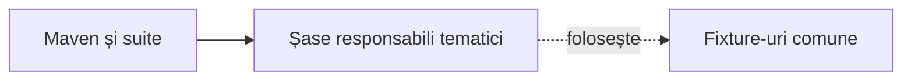

# Guvernanța codului, strategie de testare lizibilă și ediție română completă

Baza reviziei: main `3663419b34ec6adc96120b419738b77afe145e9e` și main_RO
`aebbbcfaaf32f91b87e86fdf7d7923e040202728`. J0 este inspectat numai în citire la
`96f50e5f277771ca9dfac3b7c959b47188afd0b0`; cele două modificări locale de feedback
rămân intacte. Revizia întărește guvernanța surselor, testele locale existente și
documentația. Nu adaugă fluxuri de produs, funcționalități runtime sau emulatoare.

## G-017: Regresiile existente trebuie să rămână executabile și limitate

- Responsabil: validatorul AST existent al suitelor și ConsoleSignatureContractTest.
- Prioritate: 84; impact/risc/urgență 90/80/75.
- Calitatea inițială: 76; corectitudine/verificare/claritate 80/65/80.
- Reproducere: o adnotare menținută schimbată în `@Test(enabled=false)`
  rămâne numărată ca executabilă de inventarul vechi bazat pe tipul adnotării.
  Selecția XML singură nu protejează acest contract al sursei.
- Defect independent de stabilitate: un contract de consolă selectat apelează
  `worker.join()` fără limită. Un fir de jurnalizare blocat putea bloca poarta locală.
- Corecție: inspectează atributele adnotării TestNG prin AST-ul compilatorului existent.
  Atributul enabled omis și literalul true sunt acceptate; indirectarea eșuează explicit,
  fără a pretinde că parsarea rezolvă constante Java externe.
- Fixture-urile imbricate/manuale existente își păstrează limitele revizuite. Comentariile,
  șirurile, adnotările fără legătură și tipurile Test locale sunt controale pozitive.
- Limitează așteptarea și curățarea firului existent, propagă eșecul original
  și păstrează resetarea destinației de test în finally.
- Calitate livrată: 93; corectitudine/verificare/claritate 94/92/92.
- Stare: VERIFIED pentru selecția locală observată și contractul limitat al firului;
  dovezile native local-02 de mai jos definesc afirmația de execuție.

## D-010: Strategie întâi, traducere completă și revizie bazată pe surse

- Responsabil: regulile documentației, testele de componentă pentru lizibilitate și politica edițiilor.
- Prioritate: 88; impact/risc/urgență 90/85/85.
- Calitatea inițială: 68; corectitudine/verificare/claritate 65/60/80.
- Defect observat de utilizator: main_RO/docs/Testing.md era în engleză la începutul reviziei. Politica veche
  permite deliberat traducerea numai pentru README-uri; rezultatul ei verde de paritate
  certifică astfel o ediție română incompletă a documentației.
- Semnal inițial executat: noul control local al limbii identifică exact acea cale
  Testing și alte 26 de documente englezești înaintea traducerii. Dovada inițială
  este păstrată extern; reprezintă un defect reprodus, nu o rulare finală eșuată.
- Strategia testării: păstrează selecția, ariile dovezilor API, identitatea browserului,
  observațiile independente și limitele dovezilor în Testing.md. Mută cele zece
  blocuri originale de execuție neschimbate în Testing_Commands.md, în secțiuni
  pliate cu rezumate utile. Ancorele de intrare existente se păstrează.
- Lizibilitate: adoptă principiul J0 al deciziilor clare, distingând explicit rolurile.
  Strategia folosește limita de 3 propoziții/100 de cuvinte pe paragraf logic;
  referințele operaționale detaliate folosesc 100 de cuvinte și limita de 45 pe propoziție.
  Acestea declanșează revizia; nu sunt note, cote de diagrame sau lungimi de rând.
- Toate ghidurile operaționale primesc controalele de proză acceptate; înregistrările
  istorice își păstrează forma dovezilor. Blocurile Maven executabile rămân supuse
  guvernanței plierii în ambele zone. Comenzile inline de diagnostic rămân vizibile.
- Traducere: fiecare document Markdown menținut și proiecția HTML Living primesc
  un corespondent românesc la calea identică, inclusiv feedback-ul istoric.
  Codul, comenzile, datele de cunoștințe, identificatorii, stările și literalii
  canonici citați ai politicilor rămân exacți. Rapoartele generate originale își păstrează limba.
- Controalele deterministe identifică markerii românești absenți, blocurile englezești
  semnificative neschimbate, abaterile structurale/tehnice și amprentele de revizie expirate.
  Nu pot certifica fiecare propoziție tradusă sau detecta orice inversare de sens.
- Revizie asistată de RAG: păstrează dovada recuperării deterministe existente a politicilor,
  adaugă responsabilii reali ai edițiilor/politicilor și citește fiecare pereche EN/RO completă.
  Verifică condițiile, negațiile, cronologia, actorii, limitele dovezilor și legendele.
  XML-ul comun leagă fiecare document de ambele amprente normalizate și declară
  revizorul/dimensiunile. Actualizarea amprentelor fără lectură nu înseamnă acceptanță.
- Limita parserului: paritatea structurală cere încă etichete de legătură pe un
  singur rând și poziționare canonică în listele reașezate. Două corecții ale
  traducerilor păstrează forma acceptată; nu se pretinde un parser Markdown complet.
- Calitate livrată: 92; corectitudine/verificare/claritate 94/90/92.
- Stare: VERIFIED pentru inventarul documentelor menținute, revizuirea completă
  declarată, controalele native între ediții și domeniul desktop capturat de mai jos.

## G-016: Revizuiește eliminarea unei metode de regresie existente

- Responsabil: politica de mentenanță a testelor și modulul testului modificat.
- Prioritate: 75; impact/risc/urgență 80/70/70.
- Calitatea inițială: 69; corectitudine/verificare/claritate 75/50/80.
- Calitatea livrată: 94; corectitudine/verificare/claritate 95/94/94.
- Observație: inventarul suitelor proteja selecția claselor, dar nu și
  identitatea unei metode eliminate dintr-o clasă încă selectată.
- Referință J0: TestChangeGovernanceTest și GitTestChanges separă baza imuabilă,
  calea exactă modificată, raționamentul revizorului și dovada verificării. Păstrează
  principiul fără a copia cataloage de consumatori sau a inventa cereri de aprobare.
- Corecție: responsabilul existent de guvernanță a framework-ului compară acum
  un inventar ordonat al identităților TestNG executabile, extras din AST (tip
  declarant, metodă și tipuri de parametri), cu o bază fixată prin SHA-256.
  `TEST-METHOD-REMOVED` și `TEST-METHOD-UNREGISTERED` păstrează semnături
  acționabile și trimit la responsabilul canonic.
- Acceptanță: fixture-ul negativ controlat elimină o metodă păstrând clasa,
  adaugă o înlocuitoare neînregistrată și verifică ambele constatări și indiciul
  de remediere. Inventarul menținut corespunde sursei curente de teste.

| Dovadă | Engleză | Română | Limită |
|---|---:|---:|---|
| `FrameworkArchitectureGovernanceTest` | 114/114 PASS | 114/114 PASS | Include validarea inventarului real și constatări controlate la eliminarea/adăugarea metodelor |
| Reactor local implicit complet | 742/742 PASS | 742/742 PASS | 705 verificări atf-tests și 37 de bibliotecă; zero eșecuri, erori sau omisiuni |
| Suita existentă de mentenanță Node | 203/203 PASS | 203/203 PASS | Instrumente de guvernanță/componente; fără browser sau parcurs de aplicație |
| Revizia documentelor pereche | 51/51 actuale | 51/51 actuale | Revizie EN/RO cu amprente ancorate în sursă și verificări semantice pe perechile schimbate |

Dovezi externe: `${ATF_WORK_ROOT}/reviews/20261126-method-governance/`.
Prima rulare completă în engleză a respins corect cinci amprente de documente
învechite; după revizuirea perechilor modificate și actualizarea registrului,
ambele reactoare locale complete au trecut. Nu s-a folosit selecție E2E sau emulator.
- Limită: baza detectează deriva identităților, dar nu clasifică schimbările Git,
  nu este o poartă de aprobare, nu dovedește calitatea corpului metodei și nici
  executarea fiecărei metode. Schimbările intenționate cer revizuirea explicită
  a diferenței de semnături, inventarului și amprentei împreună cu regresia responsabilă.
- Stare: VERIFICAT în limitele declarate ale guvernanței sursei. Nota inițială
  rămâne înregistrată separat în registrul de feedback.

## Note comparabile ale reviziei surselor

Acestea sunt aprecieri 1–100 ale maturității surselor pe aceleași axe inspectate.
J0 nu a fost compilat sau executat; notele nu stabilesc repetabilitatea sau acoperirea.
Diagnosticele și limitele existente sunt evaluate independent de numărul testelor.

| Axă | Pondere | AI inițial | Sursa AI corectată | Sursa J0 inspectată |
|---|---:|---:|---:|---:|
| Limitele modulelor și responsabilitățile | 25% | 92 | 92 | 94 |
| Acoperirea guvernanței executabile | 25% | 88 | 90 | 92 |
| Căi negative și criterii independente de verificare | 20% | 90 | 91 | 94 |
| Așteptări limitate și curățare | 20% | 85 | 87 | 92 |
| Diagnostice utile pentru corecții | 10% | 94 | 94 | 88 |
| Evaluarea ponderată a surselor | 100% | 89.4 | 90.5 | 92.5 |

AI îmbunătățește selecția executabilă și un responsabil al concurenței limitate.
J0 păstrează controale mai puternice ale schimbărilor și agregării ciclului de viață;
AI păstrează observații emise mai bune, distincția cauză/remediere și reverificări exacte.
F-011 era deschis în acea comparație; închiderea curentă urmează mai jos. Notele
mari cer dovezi mai puternice, nu afirmații mai largi nesusținute.

## Dovezi de acceptanță

Rădăcina externă a reviziei este `${ATF_WORK_ROOT}/reviews/20261125-code-and-documentation-governance`.
Rulările native și manifestele surselor folosesc `${ATF_WORK_ROOT}/runs/` și reactoare
izolate separate. Publicația curentă ignorată existentă își păstrează aria capturată.

- Baza: baseline-translation-language.log consemnează documentul Testing realmente
  netradus înaintea corecției. Contraexemplele de lizibilitate păstrează proza densă
  a strategiei, comenzile deschise implicit și etichetele false din literali.
- Selecțiile finale implicite local-02 ale reactorului: engleză 690/690
  și română 690/690 trecute, cu 0 eșecuri,
  0 erori și 0 cazuri omise în fiecare ediție. Fiecare include 315 cazuri de guvernanță. Toate cele cinci module s-au executat;
  selecțiile atf-tests conțin 678 și 678
  cazuri. XML-urile Surefire originale păstrate, jurnalele Maven finalizate,
  manifestele sursei și înregistrările ieșirii definesc numărătorile, nu rezumatele copiate ale rapoartelor.
- Surse executate: engleză 1b939695c7a29355bf5e67f50ccbaa0121314c9e și română
  bfa1bcc341cd4540b8f5ef70457b8483695f0d6c. Rezumatul nativ local-02 finalizat leagă înregistrările
  local-02 finalizate și rezultatele reale ale cazurilor. 29 de cazuri
  API locale existente și cazul firului de consolă limitat au trecut în fiecare ediție;
  observațiile API locale nu stabilesc acceptanța aplicației GoRest.
- Controale Node de mentenanță existente: 182/182 trecute în fiecare ediție capturată la
  a064e9f18f3528c17e109f2119b81808c32ce2e8 și
  669c2baecd3552a71651283c9eb44021e264e3de. Fiecare manifest păstrat leagă 23 de fișiere:
  19 instrumente și 4 intrări de contract, neschimbate față de sursele native finale.
  Aceasta păstrează domeniul Node capturat; nu afirmă o execuție Node nouă la commit-ul final.
- Revizuire completă a documentelor: translation-review.xml comun leagă 51 de
  documente revizuite, cuprinzând 50 de căi Markdown menținute și perechea HTML Living.
  Dovada reală a regăsirii lexicale a politicii păstrează 16 înregistrări obligatorii
  și 18 selectate. Lectura EN/RO completă, bazată pe surse, acoperă limba, sensul,
  condițiile, faptele, legăturile, diagramele și plierile; nu se afirmă recuperare semantică.
- Revizuirea nativă desktop finală a documentelor combină visual02 cu remedierea
  Architecture delimitată din visual03: 32 de înregistrări, 56 de observații SVG și
  98 de capturi selectate la lățimi 1440/900. Hash-urile surselor capturate corespund;
  constatările geometrice, erorile de pagină/consolă, cererile externe și depășirea
  documentului sunt 0. Figurile Living late folosesc derulare conținută. Randarea
  dovedește componentele documentului, nu acceptanța aplicației în framework/browser
  sau accesibilitatea universală.
- Baza inițială netradusă și prima execuție completă rămân păstrate mai jos.
  Nu s-au adăugat scenarii E2E, emulatoare sau funcționalități runtime. G-016, G-014
  și F-011 erau TODO atunci; sincronizarea era dovedită prin identitățile reale ale
  ramurilor, remote și live după verificarea închiderii exclusiv documentare.

## Prima execuție completă păstrată

Prima selecție completă implicită a reactorului trece în engleză. Modulul atf-tests
consemnează 678 de cazuri trecute. Rularea română consemnează 677 de cazuri trecute
și un control documentar pozitiv eșuat; niciun caz nu este omis. Controlul caută
un titlu HTML englezesc înainte de a insera un exemplu HTML codificat ca text, astfel că nu
modifică titlul românesc tradus integral.

Testul existent localizează acum ID-ul stabil al secțiunii retained-principles,
inserează același exemplu literal și păstrează aceeași aserțiune de proiecție.
Aserțiunile booleene ale precondițiilor evită afișarea întregului HTML la eșecul
inserării. Ambele rulări native originale rămân intacte la locațiile local-01.
Execuțiile local-02 acceptate, consemnate în dovezile de acceptanță, păstrează eșecul
anterior și stabilesc sursele și rezultatele proprii capturate separat.

## F-012: Opțiuni UI stricte și așteptare configurată comună

- Responsabil: configurația UI tipizată și utilitarele de așteptare din Core.
- Prioritate: 87, din impact/risc/urgență 90/85/80.
- Calitate inițială: 71, din corectitudine/verificare/claritate 75/60/75.
- Observație: textul boolean UI malformat devenea false fără avertizare; erau
  acceptate așteptări zero, negative sau prea mari pentru milisecunde. Conversia
  motorului dependentă de limbă și parsarea duplicată slăbeau validarea.
- Corecție: ConfigManager și UiRuntimeOptions existente dețin cititorii stricți
  pentru booleeni și așteptarea configurată. Opțiunile sesiunii și WaitUtils îi
  folosesc împreună. Motoarele necunoscute sunt respinse înaintea achiziției.
  Valorile implicite, precedența, suprasarcinile Duration explicite și normalizarea
  acceptată a măririi paginii rămân neschimbate.
- Criteriile existente acoperă șase chei booleene, valori malformate, ambele chei
  de așteptare, precedența canonică, limitele inferioară/superioară și limba turcă
  implicită. Erorile identifică cheia și valoarea reale; respingerea așteptării
  precede evaluarea repetată a condiției.
- Contract stabil: [configurația și curățarea Core](../../atf-core/README.md#validated-ui-configuration-and-cleanup).
- Stare: VERIFIED pentru limita de configurație a componentei. Calitate livrată: 94; corectitudine/verificare/claritate 95/93/94. Dovezile complete pentru ambele ediții urmează mai jos.

## F-013: Curățarea achiziției parțiale a sesiunii UI

- Responsabil: clasele existente de sesiune/furnizor Playwright și Selenium.
- Prioritate: 82, din impact/risc/urgență 85/80/75.
- Calitate inițială: 65, din corectitudine/verificare/claritate 65/50/80.
- Observație: eșecul constructorului după alocarea resurselor nu avea o cale de
  curățare deținută. Erorile imbricate la închiderea Playwright puteau înlocui
  prima eroare. Observația inițială se bazează pe surse, nu dovedește procese rămase.
- Corecție: eliberarea resurselor dobândite în ordinea inversă a deținerii,
  păstrarea RuntimeException sau Error originale și a cauzelor distincte de
  curățare ca excepții suprimate. Contextul persistent Playwright deține închiderea
  browserului; profilurile temporare sunt șterse. Eșecul fabricii Selenium nu are
  un driver dobândit pentru care să apeleze quit.
- Clasele existente de componentă injectează eșecuri pe etape fără pornirea unui
  browser: Playwright are 16 cazuri și Selenium are 12, inclusiv achiziție reușită,
  ordinea curățării, identitatea cauzei și controale împotriva auto-suprimării.
- Contracte stabile: [Playwright](../../atf-playwright/README.md#acquisition-failure-and-cleanup)
  și [Selenium](../../atf-selenium/README.md#acquisition-failure-and-cleanup).
- Stare: VERIFIED pentru căile de componentă ale achiziției și curățării. Calitate livrată: 93; corectitudine/verificare/claritate 94/92/93. Dovezile complete pentru ambele ediții urmează mai jos.

## Dovezile curente pentru mentenanța UI

Rădăcina externă este `${ATF_WORK_ROOT}/reviews/20261126-ui-lifecycle-config`.
Sursa inițială, XML-ul nativ al eșecurilor și execuția Maven focalizată rămân
separate. Selecția focalizată dovedește doar contractele selectate și nu înlocuiește
reactorul local complet. Nu se adaugă clase E2E, parcursuri de produs sau emulatoare.
Secțiunile istorice de acceptanță de mai sus își păstrează sursa și numerele capturate;
lucrarea curentă F-011 înlocuiește rezumatul anterior privind starea deschisă.

Prima selecție completă local-01 păstrează 703 de cazuri atf-tests per ediție,
cu 702 trecute și un eșec al fixture-ului invoice. Configurația acelui fixture
folosea zero; acum folosește o secundă validă. Cele trei controale negative existente
verifică și mesajul exact al rândului lipsă, astfel încât un eșec anterior de
configurație/navigare să nu satisfacă aserțiunea. Verificările de factură rămân
componente controlate, fără browser sau parcurs de produs.

## Acceptanța corecțiilor UI și notele reviziei curente

Reactoarele locale implicite complete au trecut 740/740 în fiecare ediție,
inclusiv 703 de cazuri atf-tests, 37 de bibliotecă și 315 de guvernanță.
Cele 29 de cazuri API locale existente au trecut în fiecare ediție. Fiecare
execuție are zero eșecuri, erori sau cazuri omise. Aceasta este acceptanța
framework-ului/componentelor; scrierile GoRest, E2E de produs și emulatoarele sunt
în afara acestei execuții.

| Dovadă | Rezultat | Sursă asociată sau locație păstrată |
|---|---|---|
| Reactor implicit englez | 740/740 PASS | 6a90e248e09e3b553f77bd8cb5764a6f9b427614 |
| Reactor implicit român | 740/740 PASS | 10d8974f69530c370932643a8227b73a9999decc |
| UI/configurație/furnizori focalizați | 69/69 PASS | modules-code-documentation-ui-lifecycle-focused-01 |
| Mentenanță Node | 203/203 PASS per ediție | en-node-01 și ro-node-01 |
| Referință negativă originală | 7 trecute, 18 eșuate; rezultat așteptat | baseline/native/testng-results.xml |

Manifestele complete, XML-ul nativ, jurnalele încheiate și native-summary.json
rămân în rădăcina externă a reviziei. Sursa/POM/resursele sunt fixate independent
de închiderea ulterioară a feedback-ului. Verificările finale de documentație și
guvernanță pereche asociază textul închiderii. Revizia nativă desktop acoperă
perechile Core/Living schimbate la 1440/900 CSS px, cu 8 înregistrări și 32 de
observații de diagramă. Derularea conținută a figurilor Living late este
intenționată. Este randare de fișiere, nu acceptanță de procese sau de aplicație.

Judecățile următoare de la 1–100 folosesc aceleași axe și ponderi ca în comparația
live anterioară. Ponderile însumează 100; numerele testelor nu determină notele.
Referința este revizia din 2026-11-26 la 14daf233e8039049cf6d8ba2db7421fb48c4c5be.

| Axă | Pondere | Inițial | Curent | Dovezi și limite rămase |
|---|---:|---:|---:|---|
| Arhitectură și responsabilități | 15 | 92 | 92 | Aceleași cinci module; fără clase de execuție sau funcționalități de produs noi |
| Mentenabilitate | 10 | 88 | 91 | Cititor comun de așteptare; șase responsabili tematici pentru testele de documentație sunt înregistrați în ambele suite |
| Configurație | 10 | 82 | 93 | Booleeni stricți, așteptări limitate și validare a motorului independentă de limbă |
| Ciclul de viață la eșec | 10 | 84 | 94 | Identitatea exactă a cauzei, curățare în finally și eliberarea resurselor dobândite |
| Guvernanța codului/testelor | 15 | 91 | 94 | Selecția claselor plus identități de metode fixate prin AST; constatări la eliminare/adăugare controlată |
| Stabilitate demonstrată | 15 | 90 | 92 | Responsabil focalizat 114/114 și selecții locale complete pereche; fără execuție nouă de produs |
| Documentație și ediții | 15 | 94 | 94 | Contracte EN/RO menținute, diagrame și formate Living pereche |
| Feedback și proveniență | 10 | 93 | 95 | Notele inițiale și livrate pentru G-016 rămân distincte; dovezi pereche și limite consemnate |

Maturitatea ponderată crește de la 89.75 la 93.10, rotunjită de la 90 la 93.
Niciun rezultat nu este procent de acoperire sau garanție completă a execuției.

## Revizie ATF_AI și atf-j1 pe aceleași axe

Aceste judecăți 1–100 folosesc aceleași opt axe și ponderi. ATF_AI reflectă
revizia pereche curentă a surselor. Referința atf-j1 este sursa comisă la
`4e3cac10061c95ea2b9b32cc18a6d4add1007a1e`; spațiul său de lucru separat, cu
modificări, a rămas nemodificat și a fost exclus din nota sursei. Testele J1 nu
au fost executate sau reevaluate în această corecție.

| Axă | Pondere | ATF_AI | atf-j1 | Diferență |
|---|---:|---:|---:|---:|
| Arhitectură și responsabilități | 15 | 92 | 94 | -2 |
| Mentenabilitate | 10 | 91 | 90 | +1 |
| Configurație | 10 | 93 | 90 | +3 |
| Ciclul de viață la eșec | 10 | 94 | 93 | +1 |
| Guvernanța codului/testelor | 15 | 94 | 89 | +5 |
| Stabilitate demonstrată | 15 | 92 | 80 | +12 |
| Documentație și ediții | 15 | 94 | 91 | +3 |
| Feedback și proveniență | 10 | 95 | 87 | +8 |
| **Notă ponderată** | **100** | **93.10** | **89.10** | **+4.00** |

ATF_AI conduce această comparație delimitată pe șapte din opt axe după închiderea
G-018; mentenabilitatea este cu un punct mai mare. atf-j1 păstrează un avantaj de două
puncte la arhitectură. Diferențele de guvernanță și stabilitate reflectă sursele și
dovezile capturate, nu o afirmație că testele J1 au fost rerulate aici.

Controlul G-016 pentru pierderea identităților metodelor este acum verificat în
limita declarată a sursei. G-018 de mai jos închide următoarea constatare de
mentenabilitate înregistrată. Nu este necesar niciun scenariu de produs nou.
G-014 păstrează o observație externă J1, în afara registrului activ de implementare ATF_AI.

## G-018: Responsabili tematici pentru testele de documentație, înregistrați explicit

Stare: VERIFICAT. Responsabil: guvernanța testelor de documentație ATF_AI.
Prioritate 70; calitate inițială 62. Intrări pentru prioritate: impact 70,
expunere 75, urgență 60. Intrări pentru calitate: corectitudine 75, verificare
45, claritate 60. Versiunea inițială avea o singură clasă
`DocumentationGovernanceTest` de 1.297 de linii, care amesteca șase domenii
distincte de revizuire, configurarea fixture-urilor și selectorul Maven public.
Aceasta era o problemă de mentenanță a testelor; niciun comportament de produs
nu eșuase.

Metodele existente sunt acum organizate în șase clase TestNG cu responsabilități
clare: README-ul rădăcină, edițiile engleză/română, principiile living, structura
Markdown, feedback-ul și publicarea HTML/configurația. `DocumentationGovernanceTest`
verifică responsabilii diagnosticelor; nu generează implicit teste. Fiecare
responsabil tematic apare exact o dată în ambele suite menținute, iar selecțiile
Maven documentate îi enumeră explicit. Fixture-urile și aserțiunile comune au un
singur responsabil la nivelul pachetului. Inventarul revizuit conține în
continuare 573 de metode executabile; 60 de identități ale metodelor de
documentație au fost reașezate la noii responsabili, fără metode adăugate sau
eliminate.

În revizia pe aceleași axe, aceste dovezi cresc cu un punct mentenabilitatea
ATF_AI, de la 90 la 91: cele șase domenii de revizuire au acum responsabili
separați și intrări explicite în suite, iar toate cele 573 de metode existente
rămân inventariate. Aceasta nu afirmă o acoperire mai largă a produsului.

Legendă: relații și limita dovezii

Săgețile continue arată selecțiile Maven sau ale suitei; cele punctate arată
utilizarea fixture-urilor comune. Comenzile de reverificare diagnostică enumeră
direct aceiași responsabili. Nu s-au adăugat metode E2E, emulatoare,
funcționalități runtime sau metode de test noi.

Calitate livrată: 92 (corectitudine 94 / verificare 90 / claritate 92).
Selecția pereche de documentație, lizibilitate și limbă a surselor a trecut
205/205 cazuri pentru fiecare ediție. Verificările exacte ale suitei și ale
inventarului de metode au trecut 2/2 pentru fiecare ediție. Aceste rezultate
validează responsabilii testelor, selecțiile explicite și păstrarea metodelor;
nu pretind o acoperire mai bună a produsului și nu afirmă că testele atf-j1 au
fost executate.

## D-012: Strategie de testare cu limite comparabile pentru transporturi

Stare: VERIFICAT. Responsabil: guvernanța lizibilității documentației și Testing.md.
Prioritate 84 (impact 90 / expunere 80 / urgență 75).
Calitate inițială 63 (corectitudine 70 / verificare 40 / claritate 75).

Revizia folosește commitul J0 `96f50e5f277771ca9dfac3b7c959b47188afd0b0`,
bunele practici de documentație și responsabilii existenți pentru guvernanța
diagramelor/prozei/structurii/stilului și legăturilor. Cele două fișiere J0 de
feedback cu modificări necomise au rămas neatinse. Principiile sunt adaptate
verificărilor TestNG și responsabilității sursei acestui proiect.

| Principiu J0 | Adoptare ATF_AI | Limita reviziei |
|---|---|---|
| O diagramă, o întrebare | Căile de execuție separate de secvența reviziei | Fără săgeți amestecate de dependență/dovadă |
| Flux LR compact și legendă imediată | Regulă explicită pentru direcția strategiei și legende adiacente | Ceilalți responsabili aprobați își păstrează aranjarea |
| Decizii înainte de pregătire | Comparație API/Playwright/Selenium cu legături spre responsabili | Detaliile de versiuni/cache/configurație rămân în ghidul comenzilor |
| Proză, structură, stil și legături | Controale existente pentru toate documentele și mutații specifice strategiei | Forma sursei nu poate certifica adevărul semantic |
| Eșec de guvernanță acționabil | Cale observată, sens, corecție, responsabil și reverificare executabilă | O corecție propusă nu este dovadă de execuție |

Rularea inițială izolată a lizibilității a executat 30 de cazuri: 29 au trecut și
unul a eșuat conform așteptării. Cele patru constatări identifică diagrama TB la
linia 31 și lipsa rândurilor comparative API/Playwright/Selenium. Jurnalul original
și XML-ul nativ rămân la `${ATF_WORK_ROOT}/reviews/testing-strategy-baseline-20261126.log`
și `${ATF_WORK_ROOT}/validation/testing-strategy-review-20261126-baseline`.

Două metode noi de componentă protejează mutațiile de direcție verticală/inversată/
imbricată, diagramele fictive din comentarii și literali, direcțiile lipsă/duplicate,
lipsa responsabilității, a oracolului/limitei și corecțiile reale. Inventarul revizuit
conține acum 575 de metode executabile; inventarul E2E existent este neschimbat.

Regăsirea politicilor Atlas a contribuit cu KB-TRACE, KB-EVIDENCE, KB-SEMANTICS și
KB-SCORES: inspectați sursa/aserțiunile reale, păstrați limitele dovezilor și nu
deduceți calitatea semantică din cuvinte potrivite sau controale trecute. Aceasta
a fost regăsire de politici și revizie de sursă, nu publicarea unui HTML Atlas nou
sau execuția testelor.

Acceptanța necesită verificări pereche de documentație/sursă, controalele exacte
pentru suite și inventarul metodelor, revizie EN/RO completă și inspecție nativă
desktop a celor două diagrame schimbate și a tabelelor comparative. Niciun scenariu
de produs sau emulator nu face parte din această acceptanță.

Calitate livrată 93 (corectitudine 94 / verificare 92 / claritate 94). Selecția
pereche de documentație/sursă și două controale arhitecturale exacte au trecut
209/209 de cazuri per ediție în acceptance-01. Selecția finală de închidere leagă
ultimele controale pentru literali/details și acest text în closure-02.
Cele două identități noi cresc inventarul revizuit de la 573 la 575 de metode.

Revizia nativă desktop a produs patru înregistrări EN/RO la 1440 și 900 CSS px,
cu opt observații de diagramă și capturi ale tabelelor comparative. Măsurătorile
originale arată zero depășiri ale paginii, etichete tăiate, suprapuneri între
noduri sau între etichete/noduri; nu s-au observat erori de pagină sau cereri
externe. Capturile au fost inspectate pentru citire orizontală și coloane
proporționate. Dovezile sunt la
`${ATF_WORK_ROOT}/reviews/testing-strategy-20261126/render-01`.

Strategia separă acum execuția cererilor, paritatea furnizorilor UI, raportarea
și dovezile aplicației; pregătirea rămâne în ghidul comenzilor existent. Această
evaluare editorială delimitată nu reevaluează axele fără legătură ale proiectului
și nu afirmă o nouă execuție API/browser a aplicației. Copiile finale ale sursei,
diferențele, jurnalele și XML-ul rămân la
`${ATF_WORK_ROOT}/reviews/testing-strategy-20261126/closure-02` și
`${ATF_WORK_ROOT}/validation/testing-strategy-20261126-en-02` /
`${ATF_WORK_ROOT}/validation/testing-strategy-20261126-ro-02`.

## D-013: Guvernanță comună a prezentării pentru inventarul documentelor

Stare: VERIFICAT. Responsabil: guvernanța prezentării/lizibilității documentației.
Prioritate 83 (impact 85 / expunere 85 / urgență 75).
Calitate inițială 66 (corectitudine 75 / verificare 45 / claritate 75).

Revizia acoperă toate cele 50 de documente Markdown întreținute și ambele proiecții
HTML Living, folosind responsabilii J0 pentru diagrame/proză/structură/stil/legături
la commitul `96f50e5f277771ca9dfac3b7c959b47188afd0b0`. Cele două modificări locale
J0 de feedback rămân neatinse. Practicile sunt adaptate contractelor și TestNG-ului
acestui depozit.

Proba inițială păstrată raportează 55 de constatări: fluxuri verticale și lipsa
legendelor adiacente închise. Referința conține toate cele 50 de perechi EN/RO la
`${ATF_WORK_ROOT}/reviews/documentation-presentation-20261126/baseline`;
observațiile originale sunt în baseline-findings.log lângă acel director.

- Fiecare diagramă existentă primește o legendă adiacentă explicată și pliată.
  Fluxurile secvențiale și de responsabilitate se citesc orizontal; secvențele își păstrează sensul.
- Fluxurile de ansamblu lungi grupează operațiile înrudite. Raportarea și testele
  primesc hărți concise; ghidurile mici păstrează listele/tabelele scurte existente.
- Deciziile README dense devin o propoziție introductivă și verificări paralele.
  Literalii, condițiile, legăturile, comenzile și cronologia dovezilor se păstrează.
- Proza tabelelor normative primește limitele existente de 140 de caractere/22 de
  cuvinte; feedback-ul istoric păstrează forma tabelelor cu dovezi capturate.
- Rândurile principiilor Living păstrează legăturile sursă/test, stările și limitele
  explicite ale curățării. Proiecțiile HTML păstrează CSS-ul și metadatele sursei.
- Trei metode de componentă verifică legende defecte, orientare verticală, exemple
  literale fictive, densitatea celulelor normative și corecțiile cu indicații și responsabil.
  Inventarul revizuit crește de la 575 la 578 de metode; nu se adaugă E2E.

Acceptanța cere selecția completă pereche de documentație/sursă, controalele exacte
pentru suite/inventarul metodelor și revizie nativă desktop la 1440/900 CSS px.
Controalele sursei stabilesc structura susținută; revizorul verifică sensul,
proporțiile coloanelor și etichetele randate. Nici dimensiunea sursei, nici un
control trecut nu dovedesc lizibilitate universală sau acceptanța aplicației.

Calitate livrată 93 (corectitudine 94 / verificare 92 / claritate 94).
Selecția documentară inițială a trecut 212/212 în EN și 210/212 în RO; cele două
eșecuri RO au expus celule Living dense. Dovezile originale rămân în
documentation-presentation-20261126/acceptance-01. Rândurile corectate păstrează
responsabilitatea UIActions, distincția așteptărilor Selenium/Playwright și limita
verdictului WaitUtils; două schimburi deliberate între rânduri protejează aceste
asocieri. Revizuirea manuală a verificat și negațiile față de sursa activă,
dincolo de potrivirea numelor responsabililor.

- Controlul comun al direcției acoperă direcțiile explicite ale subgrafurilor și
  antetele fluxurilor. Exemplele comentate/literale și sensul secvențelor rămân date.
- Randarea nativă render-04 a revizuit toate cele 50 de perechi și ambele proiecții
  HTML: 204 înregistrări de pagină și 176 de observații de diagramă la 1440/900
  CSS px. Nu s-au găsit depășiri de pagină, etichete SVG tăiate sau suprapuneri
  măsurate; nu au apărut erori de pagină sau cereri externe. Figurile de referință
  late păstrează derularea locală documentată.
- Render-05 adaugă 8 înregistrări/32 de observații de diagramă după corectarea
  finală a formulării README-ului testelor și inspectează direct figurile/tabelele HTML Living.
- Acceptance-04 trece aceleași 72 de clase locale prin suita agregată: 699/699 de
  cazuri între module și 37/37 de cazuri native ale bibliotecilor în fiecare ediție.
  Selecția finală de închidere leagă registrul actualizat și revizuirea textului integral.

Dovezile sunt sub ${ATF_WORK_ROOT}/reviews/documentation-presentation-20261126
și ${ATF_WORK_ROOT}/reviews/extent-only-20261126. Retragerea ulterioară R-002 aduce
inventarul revizuit la 561. Geometria și controalele finite de sursă susțin această
evaluare limitată a prezentării; nu certifică orice randare posibilă, traducerea
semantică sau rezultatul aplicației.

## R-002: Raportare întreținută exclusiv prin Extent

Stare: VERIFICAT. Responsabil: raportare/runtime și guvernanța framework-ului.
Prioritate 84 (impact 90 / expunere 80 / urgență 75).
Calitate inițială 60 (corectitudine 60 / verificare 60 / claritate 60).

Utilizatorul a restrâns domeniul întreținut la Extent. Allure era suportat în
versiunea inițială capturată și în main_mcp; această decizie de domeniu nu
demonstrează un defect Allure. Dovezile istorice descriu sursa înregistrată atunci.

- Eliminăm dependențele SDK Allure, adaptorul, curățarea ciclului de viață, suita
  activă și comenzile de publicare. Configurația raportării acceptă extent;
  valorile retrase allure, both și cele necunoscute produc eroare cu proprietatea
  și valoarea observată.
- Păstrăm explicite setările de dezactivare a agregării. Modelul agregat folosește
  tipul neutru de stare existent, fără SDK de furnizor pentru colectarea testelor.
- Actualizăm descrierile contractelor active și ambele ediții documentare,
  inclusiv proiecțiile HTML Living. Eliminăm profilurile, grupurile și ID-urile
  descrierilor retrase.
- Păstrăm aserțiunea Extent existentă pentru payload gol, mutând-o din clasa mixtă
  retrasă în ExtentAdapterTest.
- Fixăm inventarul revizuit la 561 de metode: 578 după D-013, minus 17 identități
  Allure retrase. Un contract de comandă este redenumit și o metodă Extent este
  mutată; aceste schimbări sunt revizuite separat de eliminări. Cele 16 metode
  E2E de produs rămân identice. Nu folosim trasee de aplicație noi sau emulatoare.
- Respingem dependențele retrase în gestionarea dependențelor și profilurile
  rădăcinii/modulelor. Mutațiile arhitecturale existente verifică diagnosticarea
  cu responsabil clar și reparațiile efective.

Colectorul generic de artefacte recunoaște în continuare date Allure istorice sau
externe. Clasificarea formatului nu activează un motor de raportare. Rapoartele
capturate nu sunt reetichetate ca dovezi Extent curente. Compilarea din compile-01
a reușit; singură, această dovadă nu validează execuția sau raportul.

Acceptanța cere reactoare locale pereche, publicarea agregată existentă,
verificările componentei de mentenanță și randarea nativă a documentelor. Sursa
inițială, eliminările revizuite, patch-urile și dovezile rămân sub
${ATF_WORK_ROOT}/reviews/extent-only-20261126.

Calitate livrată 93 (corectitudine 95 / verificare 92 / claritate 92).
Nota inițială măsoară alinierea cu domeniul nou restrâns, nu corectitudinea
istorică Allure. Acceptance-01 a expus un import Path lipsă; acceptance-02 nu are
dovadă de finalizare și este exclusă din acceptanță.

Ambele reactoare implicite complete din acceptance-03 au trecut 37 de cazuri
native ale bibliotecilor și 697/699 de cazuri între module. Eșecurile au identificat
un element tradus în plus/aliasuri de titlu lipsă și aserțiunea veche care cerea
exclusiv majuscule în diagnosticul enumului. Corecția restabilește structura EN/RO
și verifică proprietatea, valoarea invalidă originală, absența unui cache fals și
recuperarea reușită pe Extent pentru valori necunoscute, allure și both. Niciun
eșec original nu este reetichetat drept PASS.

Acceptance-04 execută aceleași 72 de clase locale cu publicare agregată: 736/736
de cazuri native per ediție, inclusiv 699/699 în atf-tests. Ambii cititori Extent
generați trec inspectorul existent de publicabilitate agregată și afișează 699 de
cazuri, în acord cu suita nativă și manifestul agregat. Căile claselor de execuție
nu conțin SDK-ul retras. Dovada reconcilierii native/publicării și jurnalul
inspecției cititorului rămân lângă suprapunerile exacte de sursă și XML-ul original.

Cele trei clase componente existente pentru capturi/zoom trec 15/15 cazuri în
browsere desktop Selenium și Playwright reale în browser-01. Intrările fixate
pentru browser, driver, SDK și cache offline sunt înregistrate acolo. Fixture-urile
locale nu dovedesc acceptanța E2E a produsului. Toate cele 203 cazuri Node de
mentenanță trec per ediție; sursele instrumentelor rămân identice în încercările ulterioare.

Regăsirea politicilor Atlas a contribuit limite citate pentru comportament,
dovezi, trasabilitate și note. Este context lexical determinist de politici, fără
pretenție de regăsire semantică și fără publicare Atlas nouă. Selecția finală de
închidere verifică ambele ediții documentare, diagnosticarea constructivă și inventarul revizuit.

## G-019: Reconcilierea feedback-ului fără lucrări de implementare artificiale

Stare: VERIFICAT. Responsabil: guvernanța feedback-ului/documentației.
Prioritate 80 (impact 80 / expunere 85 / urgență 70).
Calitate inițială 72 (corectitudine 75 / verificare 65 / claritate 75).

Reperul sursei este 0e7495353b414c592c404a1731facbadfb8b894d. Revizuirea acoperă
toate cele 18 documente de feedback din ambele ediții. Registrul activ conținea
o observație externă J1; trei înregistrări ulterioare foloseau încă formulări TODO
la prezent pentru F-011, deși închiderea componentei era legată. Un al patrulea
rezumat de publicare descria și el lacuna rezolvată ca deschisă independent.

- F-011 rămâne verificat; observațiile anterioare de eșec/doar din sursă își păstrează
  sursa și numerele înregistrate, cu legături explicite spre corecția ulterioară.
- G-014 devine EXTERNAL_OBSERVATION în afara registrului de implementare ATF_AI.
  Eșecul J1 capturat nu este reparat sau promovat prin această curățare.
- LD-11 rămâne PARTIAL: ștergerea datelor aplicației lipsește. Nu se adaugă trasee
  de produs noi, emulatoare, acceptanță invoice/admin sau implementarea curățării.
- Allure rămâne retras prin R-002. Tratarea generică a arhivelor istorice rămâne
  distinctă de o implementare activă a raportării.
- Tabelele istorice inițiale și verificate devin blocuri pliate denumite.
  Indexul activ păstrează vizibile schema, domeniul curent și traseele dovezilor.

Fixture-ul inițial accepta atât un registru gol nedeclarat, cât și unul populat
care se declara gol. Observațiile originale rămân în
`${ATF_WORK_ROOT}/reviews/feedback-reconciliation-20261126/baseline-empty-register.log`.
Metoda componentă existentă de feedback verifică acum ambele refuzuri, un marcaj
într-un exemplu delimitat, unul în afara TODO-urilor active, declarații duplicate
și reparațiile efective. Un registru gol cere un singur marcaj separat
`<!-- feedback:empty -->` și păstrează antetul tabelului. Nu certifică surse
fără defecte sau finalizarea lucrului extern.

J4 la a4dfc3dfdbc0a91fe566c4665417bab6c2290479 a oferit calibrare doar prin citire:
FeedbackIndexRules și zeroThroughNineOpenItemsCanCompleteWithoutFillingAQuota
admit starea fără elemente deschise. Acest depozit își păstrează schema proprie
cu șapte coloane, Prioritate/Calitate separate și responsabilii TestNG. Nu se
pretind execuții sau comparații de note J4; domeniile sale mai largi Android/release
sunt în afara acestei evaluări.

Acceptanța cere guvernanță pereche a documentației/sursei, reactoarele locale
existente, componentele Node întreținute și revizuirea randării indexului schimbat.
Java runtime, POM-urile, algoritmii RAG și inventarul revizuit de 561 de metode
rămân identice. Extinderea unei metode componente existente nu adaugă metode E2E.

Calitate livrată 94 (corectitudine 95 / verificare 93 / claritate 94).
Prima încercare de acceptanță a eșuat la compilarea testelor deoarece noul
diagnostic omitea argumentul selecției de reverificare. Jurnalul original este
păstrat; argumentul este reparat fără schimbarea unei aserțiuni sau implementări
runtime. Acceptance-02 trece 736/736 de cazuri per ediție: 37 native ale modulelor
și 699 între module, fără eșecuri, erori sau omiteri. Toate cele 203 cazuri Node
componente întreținute trec per ediție în acceptance-01; sursele instrumentelor
sunt identice în suprapunerea finală. Proba curentă de paritate completă EN/RO trece.

Selecția finală de închidere leagă registrul finalizat și evaluarea de mai jos.
Suprapunerile exacte de sursă, comenzile, XML/TAP nativ, observațiile inițiale și
citările sursei J4 rămân sub `${ATF_WORK_ROOT}/reviews/feedback-reconciliation-20261126`.
Dovezile existente pentru cele 15 cazuri desktop reale de capturi/zoom și cititorul
agregat cu 699 de cazuri din R-002 se leagă în continuare de runtime-ul identic;
sunt execuții anterioare păstrate, nu rulări browser/E2E noi ale acestei revizii.

## G-020: Sigiliul metodelor executabile independent de finalurile de linie

Stare: VERIFICAT pentru limita componentei responsabile. Responsabil: guvernanța inventarului testelor.
Prioritate 74 (impact 75 / expunere 70 / urgență 75).
Calitate inițială 75 (corectitudine 70 / verificare 70 / claritate 85).
Calitate livrată 94 (corectitudine 95 / verificare 94 / claritate 93).

Sigiliul anterior calcula amprenta octeților bruți ai inventarului. Reproducerea
exactă la nivel de sursă arată aceleași 561 de identități acceptate cu CRLF și
respinse cu LF. Rezultatul depinde de conversia la checkout, inclusiv de setări
Git Windows legitime; nu presupune un defect runtime pe alt sistem de operare.

- Normalizează doar CRLF la LF în amprenta UTF-8 și fixează SHA-256 canonic
  rezultat. Fișierul inventarului, identitățile și ordinea metodelor nu se schimbă.
- Metoda existentă a responsabilului inventarului acceptă ambele variante, respinge
  metadate și spații finale schimbate și păstrează controalele metodelor eliminate/neînregistrate.
- Proba directă a metodei responsabile trece. Selecția nativă finală include întregul
  responsabil al guvernanței arhitecturii, responsabilii documentației și scannerul.
- Nu se schimbă implementări runtime, dependențe sau teste de produs. Aceasta este
  dovadă de guvernanță independentă de checkout, nu acceptanță runtime Linux/macOS.

Reproducerea originală pe octeți este în line-ending-baseline.json; execuția efectivă
a metodei responsabile este în line-ending-owner-method.log sub rădăcina reviziei
G-019. Reactoarele existente cu 736 de cazuri preced această corecție finală în
două fișiere de guvernanță; închiderea nativă finală califică responsabilii schimbați,
fără să redenumească sursa veche drept o execuție completă nouă.

## Evaluarea curentă ATF AI

Revizuit la 2026-11-26 față de reperul runtime live
0e7495353b414c592c404a1731facbadfb8b894d și suprapunerea revizuită de guvernanță/
documentație. Notele acoperă domeniul suportat HTTP, UI desktop, Extent și Atlas.
Responsabilii runtime critici au fost inspectați direct; controalele statice ale
întregii surse și execuția reprezentativă sunt niveluri distincte de dovadă. Aceasta
este o evaluare redactată, nu procent automat de acoperire sau certificat universal de corectitudine.

C înseamnă corectitudine, V verificare și Cl claritate. Fiecare intrare și rezultat
folosește 1-100. Aplică formula reproductibilă a registrului:
`round(0.40 × C + 0.30 × V + 0.30 × Cl)`. Axele separate nu primesc o notă globală inventată.

| Axă | C / V / Cl | Calitate (1-100) |
|---|---|---:|
| Cod și arhitectură | 94 / 93 / 92 | 93 |
| Documentație și ediții | 94 / 93 / 94 | 94 |
| Atlas și RAG | 90 / 94 / 89 | 91 |
| Ciclul de viață al feedback-ului | 95 / 93 / 94 | 94 |
| Guvernanța codului și testelor | 95 / 94 / 93 | 94 |
| Stabilitatea testelor existente | 93 / 94 / 90 | 92 |
| Configurație și tratarea erorilor | 93 / 94 / 90 | 92 |
| Auditabilitate și raportare | 94 / 94 / 92 | 93 |
| Mentenabilitate | 92 / 92 / 91 | 92 |
| Dovezi de portabilitate | 88 / 86 / 92 | 89 |
| Extensibilitatea furnizorilor | 92 / 90 / 92 | 91 |

Responsabilii surselor, verificarea și limitele fiecărei axe

- **Cod și arhitectură:** [Registru](../../atf-core/src/main/java/com/ai/ui/core/engine/UiEngineRegistry.java). Responsabilități neutre ale modulelor, descoperirea furnizorilor și căile actuale de eșec. API-ul framework-ului și revizuirea sursei; nu o demonstrație exhaustivă a corectitudinii.
- **Documentație și ediții:** [Politica documentelor](../governance/Code_And_Documentation_Policy.md). 50 de perechi Markdown întreținute, HTML Living, controale de compilare, limbă și prezentare. Controale finite și randări revizuite; traducerea semantică necesită în continuare revizuire.
- **Atlas și RAG:** [Regăsire și proveniență](../../tools/atlas-knowledge.mjs). Regăsire citată, dovezi exacte, oracole independente, căi negative și livrare într-un HTML. Context lexical de politici; redactarea și completitudinea semantică nu sunt certificate automat.
- **Ciclul de viață al feedback-ului:** [Controale de feedback](../../atf-tests/src/test/java/com/ai/atf/governance/FeedbackGovernanceTest.java). 18 înregistrări bilingve reconciliate; stare goală explicită, închidere istorică și domeniu extern. Zero sarcini acceptate nu înseamnă zero defecte sau finalizarea implementării externe.
- **Guvernanța codului și testelor:** [Arhitectură și inventare](../../atf-tests/src/test/java/com/ai/atf/governance/FrameworkArchitectureGovernanceTest.java). Indicații cu responsabil, contraexemple, suite exacte și inventar revizuit de 561 de metode. Invariantele de politici/sursă completează revizuirea; potrivirea unui simbol nu este dovadă semantică.
- **Stabilitatea testelor existente:** [Contractele existente de jurnalizare](../../atf-tests/src/test/java/com/ai/atf/core/reporting/regression/StepLoggerContractTest.java). Comportament delimitat al lucrătorilor/HTTP, observații independente și selecții native finalizate. Execuție la un moment dat, nu o rată măsurată a instabilității CI pe termen lung.
- **Configurație și tratarea erorilor:** [Opțiuni UI](../../atf-core/src/main/java/com/ai/core/support/config/UiRuntimeOptions.java). Setări UI tipizate, limite ale reîncercării, închidere și revenire după achiziție parțială. Acreditările apelantului, starea mediului și erorile arbitrare ale furnizorului rămân separate.
- **Auditabilitate și raportare:** [Inspector Extent](../../atf-reporting/src/main/java/com/ai/core/reporting/adapters/extent/inspection/ExtentPublishedOverviewInspector.java). Ciclu de viață Extent, pași așteptat/observat, XML original și cititori agregați inspectați. Capturile originale își păstrează sursa; mascarea nu curăță orice jurnal arbitrar.
- **Mentenabilitate:** [Reguli de responsabilitate a sursei](../../atf-tests/src/test/java/com/ai/atf/governance/FrameworkArchitectureRules.java). Responsabili focalizați, fixture-uri reutilizabile, dependențe explicite și ghiduri introductive concise. Cataloagele ample și configurația globală procesului cer în continuare revizuire coordonată.
- **Dovezi de portabilitate:** [Matrice și relocare înregistrate](Browser_Compatibility_And_Portability.md). Căi relative proiectului, rădăcini alese de apelant și matricea desktop browser/CDP înregistrată. Dovezile actuale vizează Windows; alte combinații OS/browser necesită dovezi proprii.
- **Extensibilitatea furnizorilor:** [Contractul furnizorului](../../atf-core/src/main/java/com/ai/ui/core/engine/UiEngineProvider.java). Limite SPI Core și implementări separate Playwright, Selenium și Extent. Un furnizor suplimentar cere acceptanța contractului/parității; nu există garanție universală de extensie.

Revizuirea regăsirii validează 19 înregistrări de cunoștințe, 16 politici obligatorii
și trei obiecte arhivate fixate. Domeniul declarat este context lexical determinist
de politici; regăsirea semantică rămâne NOT_CLAIMED. Aceste verificări nu implică o
generare Atlas nouă sau acceptanța aplicației. Dimensiunea sursei și numărul testelor
identifică domeniul; intrările declarate ale revizuirii determină aceste note.

Tabelele comparative AI/J1 și cititorii Atlas publicați își păstrează reperele și
notele originale. J4 este o referință de guvernanță a feedback-ului doar prin citire,
nu un concurent proaspăt executat sau notat. Nota mai mică a portabilității reflectă
matricea Windows înregistrată, nu un defect runtime observat între platforme.
