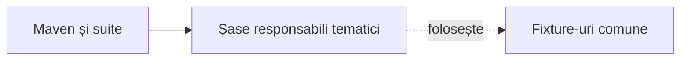
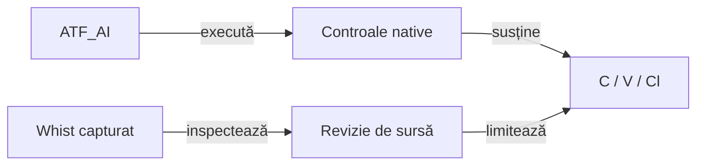

# Guvernanța codului, strategie de testare lizibilă și ediție română completă

Baza reviziei: main `3663419b34ec6adc96120b419738b77afe145e9e` și main_RO
`aebbbcfaaf32f91b87e86fdf7d7923e040202728`. J0 este inspectat numai în citire la
`96f50e5f277771ca9dfac3b7c959b47188afd0b0`; cele două modificări locale de feedback
rămân intacte. Revizia întărește guvernanța surselor, testele locale existente și
documentația. Nu adaugă fluxuri de produs, funcționalități runtime sau emulatoare.

## G-017: Regresiile existente trebuie să rămână executabile și limitate

- Responsabil: validatorul AST existent al suitelor și ConsoleSignatureContractTest.
- Prioritate: 84; impact/risc/urgență 90/80/75.
- Calitatea inițială: 76; corectitudine/verificare/claritate 80/65/80.
- Reproducere: o adnotare menținută schimbată în `@Test(enabled=false)`
  rămâne numărată ca executabilă de inventarul vechi bazat pe tipul adnotării.
  Selecția XML singură nu protejează acest contract al sursei.
- Defect independent de stabilitate: un contract de consolă selectat apelează
  `worker.join()` fără limită. Un fir de jurnalizare blocat putea bloca poarta locală.
- Corecție: inspectează atributele adnotării TestNG prin AST-ul compilatorului existent.
  Atributul enabled omis și literalul true sunt acceptate; indirectarea eșuează explicit,
  fără a pretinde că parsarea rezolvă constante Java externe.
- Fixture-urile imbricate/manuale existente își păstrează limitele revizuite. Comentariile,
  șirurile, adnotările fără legătură și tipurile Test locale sunt controale pozitive.
- Limitează așteptarea și curățarea firului existent, propagă eșecul original
  și păstrează resetarea destinației de test în finally.
- Calitate livrată: 93; corectitudine/verificare/claritate 94/92/92.
- Stare: VERIFIED pentru selecția locală observată și contractul limitat al firului;
  dovezile native local-02 de mai jos definesc afirmația de execuție.

## D-010: Strategie întâi, traducere completă și revizie bazată pe surse

- Responsabil: regulile documentației, testele de componentă pentru lizibilitate și politica edițiilor.
- Prioritate: 88; impact/risc/urgență 90/85/85.
- Calitatea inițială: 68; corectitudine/verificare/claritate 65/60/80.
- Defect observat de utilizator: main_RO/docs/Testing.md era în engleză la începutul reviziei. Politica veche
  permite deliberat traducerea numai pentru README-uri; rezultatul ei verde de paritate
  certifică astfel o ediție română incompletă a documentației.
- Semnal inițial executat: noul control local al limbii identifică exact acea cale
  Testing și alte 26 de documente englezești înaintea traducerii. Dovada inițială
  este păstrată extern; reprezintă un defect reprodus, nu o rulare finală eșuată.
- Strategia testării: păstrează selecția, ariile dovezilor API, identitatea browserului,
  observațiile independente și limitele dovezilor în Testing.md. Mută cele zece
  blocuri originale de execuție neschimbate în Testing_Commands.md, în secțiuni
  pliate cu rezumate utile. Ancorele de intrare existente se păstrează.
- Lizibilitate: adoptă principiul J0 al deciziilor clare, distingând explicit rolurile.
  Strategia folosește limita de 3 propoziții/100 de cuvinte pe paragraf logic;
  referințele operaționale detaliate folosesc 100 de cuvinte și limita de 45 pe propoziție.
  Acestea declanșează revizia; nu sunt note, cote de diagrame sau lungimi de rând.
- Toate ghidurile operaționale primesc controalele de proză acceptate; înregistrările
  istorice își păstrează forma dovezilor. Blocurile Maven executabile rămân supuse
  guvernanței plierii în ambele zone. Comenzile inline de diagnostic rămân vizibile.
- Traducere: fiecare document Markdown menținut și proiecția HTML Living primesc
  un corespondent românesc la calea identică, inclusiv feedback-ul istoric.
  Codul, comenzile, datele de cunoștințe, identificatorii, stările și literalii
  canonici citați ai politicilor rămân exacți. Rapoartele generate originale își păstrează limba.
- Controalele deterministe identifică markerii românești absenți, blocurile englezești
  semnificative neschimbate, abaterile structurale/tehnice și amprentele de revizie expirate.
  Nu pot certifica fiecare propoziție tradusă sau detecta orice inversare de sens.
- Revizie asistată de RAG: păstrează dovada recuperării deterministe existente a politicilor,
  adaugă responsabilii reali ai edițiilor/politicilor și citește fiecare pereche EN/RO completă.
  Verifică condițiile, negațiile, cronologia, actorii, limitele dovezilor și legendele.
  XML-ul comun leagă fiecare document de ambele amprente normalizate și declară
  revizorul/dimensiunile. Actualizarea amprentelor fără lectură nu înseamnă acceptanță.
- Limita parserului: paritatea structurală cere încă etichete de legătură pe un
  singur rând și poziționare canonică în listele reașezate. Două corecții ale
  traducerilor păstrează forma acceptată; nu se pretinde un parser Markdown complet.
- Calitate livrată: 92; corectitudine/verificare/claritate 94/90/92.
- Stare: VERIFIED pentru inventarul documentelor menținute, revizuirea completă
  declarată, controalele native între ediții și domeniul desktop capturat de mai jos.

## G-016: Revizuiește eliminarea unei metode de regresie existente

- Responsabil: politica de mentenanță a testelor și modulul testului modificat.
- Prioritate: 75; impact/risc/urgență 80/70/70.
- Calitatea inițială: 69; corectitudine/verificare/claritate 75/50/80.
- Calitatea livrată: 94; corectitudine/verificare/claritate 95/94/94.
- Observație: inventarul suitelor proteja selecția claselor, dar nu și
  identitatea unei metode eliminate dintr-o clasă încă selectată.
- Referință J0: TestChangeGovernanceTest și GitTestChanges separă baza imuabilă,
  calea exactă modificată, raționamentul revizorului și dovada verificării. Păstrează
  principiul fără a copia cataloage de consumatori sau a inventa cereri de aprobare.
- Corecție: responsabilul existent de guvernanță a framework-ului compară acum
  un inventar ordonat al identităților TestNG executabile, extras din AST (tip
  declarant, metodă și tipuri de parametri), cu o bază fixată prin SHA-256.
  `TEST-METHOD-REMOVED` și `TEST-METHOD-UNREGISTERED` păstrează semnături
  acționabile și trimit la responsabilul canonic.
- Acceptanță: fixture-ul negativ controlat elimină o metodă păstrând clasa,
  adaugă o înlocuitoare neînregistrată și verifică ambele constatări și indiciul
  de remediere. Inventarul menținut corespunde sursei curente de teste.

| Dovadă | Engleză | Română | Limită |
|---|---:|---:|---|
| `FrameworkArchitectureGovernanceTest` | 114/114 PASS | 114/114 PASS | Include validarea inventarului real și constatări controlate la eliminarea/adăugarea metodelor |
| Reactor local implicit complet | 742/742 PASS | 742/742 PASS | 705 verificări atf-tests și 37 de bibliotecă; zero eșecuri, erori sau omisiuni |
| Suita existentă de mentenanță Node | 203/203 PASS | 203/203 PASS | Instrumente de guvernanță/componente; fără browser sau parcurs de aplicație |
| Revizia documentelor pereche | 51/51 actuale | 51/51 actuale | Revizie EN/RO cu amprente ancorate în sursă și verificări semantice pe perechile schimbate |

Dovezi externe: `${ATF_WORK_ROOT}/reviews/20261126-method-governance/`.
Prima rulare completă în engleză a respins corect cinci amprente de documente
învechite; după revizuirea perechilor modificate și actualizarea registrului,
ambele reactoare locale complete au trecut. Nu s-a folosit selecție E2E sau emulator.
- Limită: baza detectează deriva identităților, dar nu clasifică schimbările Git,
  nu este o poartă de aprobare, nu dovedește calitatea corpului metodei și nici
  executarea fiecărei metode. Schimbările intenționate cer revizuirea explicită
  a diferenței de semnături, inventarului și amprentei împreună cu regresia responsabilă.
- Stare: VERIFICAT în limitele declarate ale guvernanței sursei. Nota inițială
  rămâne înregistrată separat în registrul de feedback.

## Note comparabile ale reviziei surselor

Acestea sunt aprecieri 1–100 ale maturității surselor pe aceleași axe inspectate.
J0 nu a fost compilat sau executat; notele nu stabilesc repetabilitatea sau acoperirea.
Diagnosticele și limitele existente sunt evaluate independent de numărul testelor.

| Axă | Pondere | AI inițial | Sursa AI corectată | Sursa J0 inspectată |
|---|---:|---:|---:|---:|
| Limitele modulelor și responsabilitățile | 25% | 92 | 92 | 94 |
| Acoperirea guvernanței executabile | 25% | 88 | 90 | 92 |
| Căi negative și criterii independente de verificare | 20% | 90 | 91 | 94 |
| Așteptări limitate și curățare | 20% | 85 | 87 | 92 |
| Diagnostice utile pentru corecții | 10% | 94 | 94 | 88 |
| Evaluarea ponderată a surselor | 100% | 89.4 | 90.5 | 92.5 |

AI îmbunătățește selecția executabilă și un responsabil al concurenței limitate.
J0 păstrează controale mai puternice ale schimbărilor și agregării ciclului de viață;
AI păstrează observații emise mai bune, distincția cauză/remediere și reverificări exacte.
F-011 era deschis în acea comparație; închiderea curentă urmează mai jos. Notele
mari cer dovezi mai puternice, nu afirmații mai largi nesusținute.

## Dovezi de acceptanță

Rădăcina externă a reviziei este `${ATF_WORK_ROOT}/reviews/20261125-code-and-documentation-governance`.
Rulările native și manifestele surselor folosesc `${ATF_WORK_ROOT}/runs/` și reactoare
izolate separate. Publicația curentă ignorată existentă își păstrează aria capturată.

- Baza: baseline-translation-language.log consemnează documentul Testing realmente
  netradus înaintea corecției. Contraexemplele de lizibilitate păstrează proza densă
  a strategiei, comenzile deschise implicit și etichetele false din literali.
- Selecțiile finale implicite local-02 ale reactorului: engleză 690/690
  și română 690/690 trecute, cu 0 eșecuri,
  0 erori și 0 cazuri omise în fiecare ediție. Fiecare include 315 cazuri de guvernanță. Toate cele cinci module s-au executat;
  selecțiile atf-tests conțin 678 și 678
  cazuri. XML-urile Surefire originale păstrate, jurnalele Maven finalizate,
  manifestele sursei și înregistrările ieșirii definesc numărătorile, nu rezumatele copiate ale rapoartelor.
- Surse executate: engleză 1b939695c7a29355bf5e67f50ccbaa0121314c9e și română
  bfa1bcc341cd4540b8f5ef70457b8483695f0d6c. Rezumatul nativ local-02 finalizat leagă înregistrările
  local-02 finalizate și rezultatele reale ale cazurilor. 29 de cazuri
  API locale existente și cazul firului de consolă limitat au trecut în fiecare ediție;
  observațiile API locale nu stabilesc acceptanța aplicației GoRest.
- Controale Node de mentenanță existente: 182/182 trecute în fiecare ediție capturată la
  a064e9f18f3528c17e109f2119b81808c32ce2e8 și
  669c2baecd3552a71651283c9eb44021e264e3de. Fiecare manifest păstrat leagă 23 de fișiere:
  19 instrumente și 4 intrări de contract, neschimbate față de sursele native finale.
  Aceasta păstrează domeniul Node capturat; nu afirmă o execuție Node nouă la commit-ul final.
- Revizuire completă a documentelor: translation-review.xml comun leagă 51 de
  documente revizuite, cuprinzând 50 de căi Markdown menținute și perechea HTML Living.
  Dovada reală a regăsirii lexicale a politicii păstrează 16 înregistrări obligatorii
  și 18 selectate. Lectura EN/RO completă, bazată pe surse, acoperă limba, sensul,
  condițiile, faptele, legăturile, diagramele și plierile; nu se afirmă recuperare semantică.
- Revizuirea nativă desktop finală a documentelor combină visual02 cu remedierea
  Architecture delimitată din visual03: 32 de înregistrări, 56 de observații SVG și
  98 de capturi selectate la lățimi 1440/900. Hash-urile surselor capturate corespund;
  constatările geometrice, erorile de pagină/consolă, cererile externe și depășirea
  documentului sunt 0. Figurile Living late folosesc derulare conținută. Randarea
  dovedește componentele documentului, nu acceptanța aplicației în framework/browser
  sau accesibilitatea universală.
- Baza inițială netradusă și prima execuție completă rămân păstrate mai jos.
  Nu s-au adăugat scenarii E2E, emulatoare sau funcționalități runtime. G-016, G-014
  și F-011 erau TODO atunci; sincronizarea era dovedită prin identitățile reale ale
  ramurilor, remote și live după verificarea închiderii exclusiv documentare.

## Prima execuție completă păstrată

Prima selecție completă implicită a reactorului trece în engleză. Modulul atf-tests
consemnează 678 de cazuri trecute. Rularea română consemnează 677 de cazuri trecute
și un control documentar pozitiv eșuat; niciun caz nu este omis. Controlul caută
un titlu HTML englezesc înainte de a insera un exemplu HTML codificat ca text, astfel că nu
modifică titlul românesc tradus integral.

Testul existent localizează acum ID-ul stabil al secțiunii retained-principles,
inserează același exemplu literal și păstrează aceeași aserțiune de proiecție.
Aserțiunile booleene ale precondițiilor evită afișarea întregului HTML la eșecul
inserării. Ambele rulări native originale rămân intacte la locațiile local-01.
Execuțiile local-02 acceptate, consemnate în dovezile de acceptanță, păstrează eșecul
anterior și stabilesc sursele și rezultatele proprii capturate separat.

## F-012: Opțiuni UI stricte și așteptare configurată comună

- Responsabil: configurația UI tipizată și utilitarele de așteptare din Core.
- Prioritate: 87, din impact/risc/urgență 90/85/80.
- Calitate inițială: 71, din corectitudine/verificare/claritate 75/60/75.
- Observație: textul boolean UI malformat devenea false fără avertizare; erau
  acceptate așteptări zero, negative sau prea mari pentru milisecunde. Conversia
  motorului dependentă de limbă și parsarea duplicată slăbeau validarea.
- Corecție: ConfigManager și UiRuntimeOptions existente dețin cititorii stricți
  pentru booleeni și așteptarea configurată. Opțiunile sesiunii și WaitUtils îi
  folosesc împreună. Motoarele necunoscute sunt respinse înaintea achiziției.
  Valorile implicite, precedența, suprasarcinile Duration explicite și normalizarea
  acceptată a măririi paginii rămân neschimbate.
- Criteriile existente acoperă șase chei booleene, valori malformate, ambele chei
  de așteptare, precedența canonică, limitele inferioară/superioară și limba turcă
  implicită. Erorile identifică cheia și valoarea reale; respingerea așteptării
  precede evaluarea repetată a condiției.
- Contract stabil: [configurația și curățarea Core](../../atf-core/README.md#validated-ui-configuration-and-cleanup).
- Stare: VERIFIED pentru limita de configurație a componentei. Calitate livrată: 94; corectitudine/verificare/claritate 95/93/94. Dovezile complete pentru ambele ediții urmează mai jos.

## F-013: Curățarea achiziției parțiale a sesiunii UI

- Responsabil: clasele existente de sesiune/furnizor Playwright și Selenium.
- Prioritate: 82, din impact/risc/urgență 85/80/75.
- Calitate inițială: 65, din corectitudine/verificare/claritate 65/50/80.
- Observație: eșecul constructorului după alocarea resurselor nu avea o cale de
  curățare deținută. Erorile imbricate la închiderea Playwright puteau înlocui
  prima eroare. Observația inițială se bazează pe surse, nu dovedește procese rămase.
- Corecție: eliberarea resurselor dobândite în ordinea inversă a deținerii,
  păstrarea RuntimeException sau Error originale și a cauzelor distincte de
  curățare ca excepții suprimate. Contextul persistent Playwright deține închiderea
  browserului; profilurile temporare sunt șterse. Eșecul fabricii Selenium nu are
  un driver dobândit pentru care să apeleze quit.
- Clasele existente de componentă injectează eșecuri pe etape fără pornirea unui
  browser: Playwright are 16 cazuri și Selenium are 12, inclusiv achiziție reușită,
  ordinea curățării, identitatea cauzei și controale împotriva auto-suprimării.
- Contracte stabile: [Playwright](../../atf-playwright/README.md#acquisition-failure-and-cleanup)
  și [Selenium](../../atf-selenium/README.md#acquisition-failure-and-cleanup).
- Stare: VERIFIED pentru căile de componentă ale achiziției și curățării. Calitate livrată: 93; corectitudine/verificare/claritate 94/92/93. Dovezile complete pentru ambele ediții urmează mai jos.

## Dovezile curente pentru mentenanța UI

Rădăcina externă este `${ATF_WORK_ROOT}/reviews/20261126-ui-lifecycle-config`.
Sursa inițială, XML-ul nativ al eșecurilor și execuția Maven focalizată rămân
separate. Selecția focalizată dovedește doar contractele selectate și nu înlocuiește
reactorul local complet. Nu se adaugă clase E2E, parcursuri de produs sau emulatoare.
Secțiunile istorice de acceptanță de mai sus își păstrează sursa și numerele capturate;
lucrarea curentă F-011 înlocuiește rezumatul anterior privind starea deschisă.

Prima selecție completă local-01 păstrează 703 de cazuri atf-tests per ediție,
cu 702 trecute și un eșec al fixture-ului invoice. Configurația acelui fixture
folosea zero; acum folosește o secundă validă. Cele trei controale negative existente
verifică și mesajul exact al rândului lipsă, astfel încât un eșec anterior de
configurație/navigare să nu satisfacă aserțiunea. Verificările de factură rămân
componente controlate, fără browser sau parcurs de produs.

## Acceptanța corecțiilor UI și notele reviziei curente

Reactoarele locale implicite complete au trecut 740/740 în fiecare ediție,
inclusiv 703 de cazuri atf-tests, 37 de bibliotecă și 315 de guvernanță.
Cele 29 de cazuri API locale existente au trecut în fiecare ediție. Fiecare
execuție are zero eșecuri, erori sau cazuri omise. Aceasta este acceptanța
framework-ului/componentelor; scrierile GoRest, E2E de produs și emulatoarele sunt
în afara acestei execuții.

| Dovadă | Rezultat | Sursă asociată sau locație păstrată |
|---|---|---|
| Reactor implicit englez | 740/740 PASS | 6a90e248e09e3b553f77bd8cb5764a6f9b427614 |
| Reactor implicit român | 740/740 PASS | 10d8974f69530c370932643a8227b73a9999decc |
| UI/configurație/furnizori focalizați | 69/69 PASS | modules-code-documentation-ui-lifecycle-focused-01 |
| Mentenanță Node | 203/203 PASS per ediție | en-node-01 și ro-node-01 |
| Referință negativă originală | 7 trecute, 18 eșuate; rezultat așteptat | baseline/native/testng-results.xml |

Manifestele complete, XML-ul nativ, jurnalele încheiate și native-summary.json
rămân în rădăcina externă a reviziei. Sursa/POM/resursele sunt fixate independent
de închiderea ulterioară a feedback-ului. Verificările finale de documentație și
guvernanță pereche asociază textul închiderii. Revizia nativă desktop acoperă
perechile Core/Living schimbate la 1440/900 CSS px, cu 8 înregistrări și 32 de
observații de diagramă. Derularea conținută a figurilor Living late este
intenționată. Este randare de fișiere, nu acceptanță de procese sau de aplicație.

Judecățile următoare de la 1–100 folosesc aceleași axe și ponderi ca în comparația
live anterioară. Ponderile însumează 100; numerele testelor nu determină notele.
Referința este revizia din 2026-11-26 la 14daf233e8039049cf6d8ba2db7421fb48c4c5be.

| Axă | Pondere | Inițial | Curent | Dovezi și limite rămase |
|---|---:|---:|---:|---|
| Arhitectură și responsabilități | 15 | 92 | 92 | Aceleași cinci module; fără clase de execuție sau funcționalități de produs noi |
| Mentenabilitate | 10 | 88 | 91 | Cititor comun de așteptare; șase responsabili tematici pentru testele de documentație sunt înregistrați în ambele suite |
| Configurație | 10 | 82 | 93 | Booleeni stricți, așteptări limitate și validare a motorului independentă de limbă |
| Ciclul de viață la eșec | 10 | 84 | 94 | Identitatea exactă a cauzei, curățare în finally și eliberarea resurselor dobândite |
| Guvernanța codului/testelor | 15 | 91 | 94 | Selecția claselor plus identități de metode fixate prin AST; constatări la eliminare/adăugare controlată |
| Stabilitate demonstrată | 15 | 90 | 92 | Responsabil focalizat 114/114 și selecții locale complete pereche; fără execuție nouă de produs |
| Documentație și ediții | 15 | 94 | 94 | Contracte EN/RO menținute, diagrame și formate Living pereche |
| Feedback și proveniență | 10 | 93 | 95 | Notele inițiale și livrate pentru G-016 rămân distincte; dovezi pereche și limite consemnate |

Maturitatea ponderată crește de la 89.75 la 93.10, rotunjită de la 90 la 93.
Niciun rezultat nu este procent de acoperire sau garanție completă a execuției.

## Revizie ATF_AI și atf-j1 pe aceleași axe

Aceste judecăți 1–100 folosesc aceleași opt axe și ponderi. ATF_AI reflectă
revizia pereche curentă a surselor. Referința atf-j1 este sursa comisă la
`4e3cac10061c95ea2b9b32cc18a6d4add1007a1e`; spațiul său de lucru separat, cu
modificări, a rămas nemodificat și a fost exclus din nota sursei. Testele J1 nu
au fost executate sau reevaluate în această corecție.

| Axă | Pondere | ATF_AI | atf-j1 | Diferență |
|---|---:|---:|---:|---:|
| Arhitectură și responsabilități | 15 | 92 | 94 | -2 |
| Mentenabilitate | 10 | 91 | 90 | +1 |
| Configurație | 10 | 93 | 90 | +3 |
| Ciclul de viață la eșec | 10 | 94 | 93 | +1 |
| Guvernanța codului/testelor | 15 | 94 | 89 | +5 |
| Stabilitate demonstrată | 15 | 92 | 80 | +12 |
| Documentație și ediții | 15 | 94 | 91 | +3 |
| Feedback și proveniență | 10 | 95 | 87 | +8 |
| **Notă ponderată** | **100** | **93.10** | **89.10** | **+4.00** |

ATF_AI conduce această comparație delimitată pe șapte din opt axe după închiderea
G-018; mentenabilitatea este cu un punct mai mare. atf-j1 păstrează un avantaj de două
puncte la arhitectură. Diferențele de guvernanță și stabilitate reflectă sursele și
dovezile capturate, nu o afirmație că testele J1 au fost rerulate aici.

Controlul G-016 pentru pierderea identităților metodelor este acum verificat în
limita declarată a sursei. G-018 de mai jos închide următoarea constatare de
mentenabilitate înregistrată. Nu este necesar niciun scenariu de produs nou.
G-014 păstrează o observație externă J1, în afara registrului activ de implementare ATF_AI.

## G-018: Responsabili tematici pentru testele de documentație, înregistrați explicit

Stare: VERIFICAT. Responsabil: guvernanța testelor de documentație ATF_AI.
Prioritate 70; calitate inițială 62. Intrări pentru prioritate: impact 70,
expunere 75, urgență 60. Intrări pentru calitate: corectitudine 75, verificare
45, claritate 60. Versiunea inițială avea o singură clasă
`DocumentationGovernanceTest` de 1.297 de linii, care amesteca șase domenii
distincte de revizuire, configurarea fixture-urilor și selectorul Maven public.
Aceasta era o problemă de mentenanță a testelor; niciun comportament de produs
nu eșuase.

Metodele existente sunt acum organizate în șase clase TestNG cu responsabilități
clare: README-ul rădăcină, edițiile engleză/română, principiile living, structura
Markdown, feedback-ul și publicarea HTML/configurația. `DocumentationGovernanceTest`
verifică responsabilii diagnosticelor; nu generează implicit teste. Fiecare
responsabil tematic apare exact o dată în ambele suite menținute, iar selecțiile
Maven documentate îi enumeră explicit. Fixture-urile și aserțiunile comune au un
singur responsabil la nivelul pachetului. Inventarul revizuit conține în
continuare 573 de metode executabile; 60 de identități ale metodelor de
documentație au fost reașezate la noii responsabili, fără metode adăugate sau
eliminate.

În revizia pe aceleași axe, aceste dovezi cresc cu un punct mentenabilitatea
ATF_AI, de la 90 la 91: cele șase domenii de revizuire au acum responsabili
separați și intrări explicite în suite, iar toate cele 573 de metode existente
rămân inventariate. Aceasta nu afirmă o acoperire mai largă a produsului.

Legendă: relații și limita dovezii

Săgețile continue arată selecțiile Maven sau ale suitei; cele punctate arată
utilizarea fixture-urilor comune. Comenzile de reverificare diagnostică enumeră
direct aceiași responsabili. Nu s-au adăugat metode E2E, emulatoare,
funcționalități runtime sau metode de test noi.

Calitate livrată: 92 (corectitudine 94 / verificare 90 / claritate 92).
Selecția pereche de documentație, lizibilitate și limbă a surselor a trecut
205/205 cazuri pentru fiecare ediție. Verificările exacte ale suitei și ale
inventarului de metode au trecut 2/2 pentru fiecare ediție. Aceste rezultate
validează responsabilii testelor, selecțiile explicite și păstrarea metodelor;
nu pretind o acoperire mai bună a produsului și nu afirmă că testele atf-j1 au
fost executate.

## D-012: Strategie de testare cu limite comparabile pentru transporturi

Stare: VERIFICAT. Responsabil: guvernanța lizibilității documentației și Testing.md.
Prioritate 84 (impact 90 / expunere 80 / urgență 75).
Calitate inițială 63 (corectitudine 70 / verificare 40 / claritate 75).

Revizia folosește commitul J0 `96f50e5f277771ca9dfac3b7c959b47188afd0b0`,
bunele practici de documentație și responsabilii existenți pentru guvernanța
diagramelor/prozei/structurii/stilului și legăturilor. Cele două fișiere J0 de
feedback cu modificări necomise au rămas neatinse. Principiile sunt adaptate
verificărilor TestNG și responsabilității sursei acestui proiect.

| Principiu J0 | Adoptare ATF_AI | Limita reviziei |
|---|---|---|
| O diagramă, o întrebare | Căile de execuție separate de secvența reviziei | Fără săgeți amestecate de dependență/dovadă |
| Flux LR compact și legendă imediată | Regulă explicită pentru direcția strategiei și legende adiacente | Ceilalți responsabili aprobați își păstrează aranjarea |
| Decizii înainte de pregătire | Comparație API/Playwright/Selenium cu legături spre responsabili | Detaliile de versiuni/cache/configurație rămân în ghidul comenzilor |
| Proză, structură, stil și legături | Controale existente pentru toate documentele și mutații specifice strategiei | Forma sursei nu poate certifica adevărul semantic |
| Eșec de guvernanță acționabil | Cale observată, sens, corecție, responsabil și reverificare executabilă | O corecție propusă nu este dovadă de execuție |

Rularea inițială izolată a lizibilității a executat 30 de cazuri: 29 au trecut și
unul a eșuat conform așteptării. Cele patru constatări identifică diagrama TB la
linia 31 și lipsa rândurilor comparative API/Playwright/Selenium. Jurnalul original
și XML-ul nativ rămân la `${ATF_WORK_ROOT}/reviews/testing-strategy-baseline-20261126.log`
și `${ATF_WORK_ROOT}/validation/testing-strategy-review-20261126-baseline`.

Două metode noi de componentă protejează mutațiile de direcție verticală/inversată/
imbricată, diagramele fictive din comentarii și literali, direcțiile lipsă/duplicate,
lipsa responsabilității, a oracolului/limitei și corecțiile reale. Inventarul revizuit
conține acum 575 de metode executabile; inventarul E2E existent este neschimbat.

Regăsirea politicilor Atlas a contribuit cu KB-TRACE, KB-EVIDENCE, KB-SEMANTICS și
KB-SCORES: inspectați sursa/aserțiunile reale, păstrați limitele dovezilor și nu
deduceți calitatea semantică din cuvinte potrivite sau controale trecute. Aceasta
a fost regăsire de politici și revizie de sursă, nu publicarea unui HTML Atlas nou
sau execuția testelor.

Acceptanța necesită verificări pereche de documentație/sursă, controalele exacte
pentru suite și inventarul metodelor, revizie EN/RO completă și inspecție nativă
desktop a celor două diagrame schimbate și a tabelelor comparative. Niciun scenariu
de produs sau emulator nu face parte din această acceptanță.

Calitate livrată 93 (corectitudine 94 / verificare 92 / claritate 94). Selecția
pereche de documentație/sursă și două controale arhitecturale exacte au trecut
209/209 de cazuri per ediție în acceptance-01. Selecția finală de închidere leagă
ultimele controale pentru literali/details și acest text în closure-02.
Cele două identități noi cresc inventarul revizuit de la 573 la 575 de metode.

Revizia nativă desktop a produs patru înregistrări EN/RO la 1440 și 900 CSS px,
cu opt observații de diagramă și capturi ale tabelelor comparative. Măsurătorile
originale arată zero depășiri ale paginii, etichete tăiate, suprapuneri între
noduri sau între etichete/noduri; nu s-au observat erori de pagină sau cereri
externe. Capturile au fost inspectate pentru citire orizontală și coloane
proporționate. Dovezile sunt la
`${ATF_WORK_ROOT}/reviews/testing-strategy-20261126/render-01`.

Strategia separă acum execuția cererilor, paritatea furnizorilor UI, raportarea
și dovezile aplicației; pregătirea rămâne în ghidul comenzilor existent. Această
evaluare editorială delimitată nu reevaluează axele fără legătură ale proiectului
și nu afirmă o nouă execuție API/browser a aplicației. Copiile finale ale sursei,
diferențele, jurnalele și XML-ul rămân la
`${ATF_WORK_ROOT}/reviews/testing-strategy-20261126/closure-02` și
`${ATF_WORK_ROOT}/validation/testing-strategy-20261126-en-02` /
`${ATF_WORK_ROOT}/validation/testing-strategy-20261126-ro-02`.

## D-013: Guvernanță comună a prezentării pentru inventarul documentelor

Stare: VERIFICAT. Responsabil: guvernanța prezentării/lizibilității documentației.
Prioritate 83 (impact 85 / expunere 85 / urgență 75).
Calitate inițială 66 (corectitudine 75 / verificare 45 / claritate 75).

Revizia acoperă toate cele 50 de documente Markdown întreținute și ambele proiecții
HTML Living, folosind responsabilii J0 pentru diagrame/proză/structură/stil/legături
la commitul `96f50e5f277771ca9dfac3b7c959b47188afd0b0`. Cele două modificări locale
J0 de feedback rămân neatinse. Practicile sunt adaptate contractelor și TestNG-ului
acestui depozit.

Proba inițială păstrată raportează 55 de constatări: fluxuri verticale și lipsa
legendelor adiacente închise. Referința conține toate cele 50 de perechi EN/RO la
`${ATF_WORK_ROOT}/reviews/documentation-presentation-20261126/baseline`;
observațiile originale sunt în baseline-findings.log lângă acel director.

- Fiecare diagramă existentă primește o legendă adiacentă explicată și pliată.
  Fluxurile secvențiale și de responsabilitate se citesc orizontal; secvențele își păstrează sensul.
- Fluxurile de ansamblu lungi grupează operațiile înrudite. Raportarea și testele
  primesc hărți concise; ghidurile mici păstrează listele/tabelele scurte existente.
- Deciziile README dense devin o propoziție introductivă și verificări paralele.
  Literalii, condițiile, legăturile, comenzile și cronologia dovezilor se păstrează.
- Proza tabelelor normative primește limitele existente de 140 de caractere/22 de
  cuvinte; feedback-ul istoric păstrează forma tabelelor cu dovezi capturate.
- Rândurile principiilor Living păstrează legăturile sursă/test, stările și limitele
  explicite ale curățării. Proiecțiile HTML păstrează CSS-ul și metadatele sursei.
- Trei metode de componentă verifică legende defecte, orientare verticală, exemple
  literale fictive, densitatea celulelor normative și corecțiile cu indicații și responsabil.
  Inventarul revizuit crește de la 575 la 578 de metode; nu se adaugă E2E.

Acceptanța cere selecția completă pereche de documentație/sursă, controalele exacte
pentru suite/inventarul metodelor și revizie nativă desktop la 1440/900 CSS px.
Controalele sursei stabilesc structura susținută; revizorul verifică sensul,
proporțiile coloanelor și etichetele randate. Nici dimensiunea sursei, nici un
control trecut nu dovedesc lizibilitate universală sau acceptanța aplicației.

Calitate livrată 93 (corectitudine 94 / verificare 92 / claritate 94).
Selecția documentară inițială a trecut 212/212 în EN și 210/212 în RO; cele două
eșecuri RO au expus celule Living dense. Dovezile originale rămân în
documentation-presentation-20261126/acceptance-01. Rândurile corectate păstrează
responsabilitatea UIActions, distincția așteptărilor Selenium/Playwright și limita
verdictului WaitUtils; două schimburi deliberate între rânduri protejează aceste
asocieri. Revizuirea manuală a verificat și negațiile față de sursa activă,
dincolo de potrivirea numelor responsabililor.

- Controlul comun al direcției acoperă direcțiile explicite ale subgrafurilor și
  antetele fluxurilor. Exemplele comentate/literale și sensul secvențelor rămân date.
- Randarea nativă render-04 a revizuit toate cele 50 de perechi și ambele proiecții
  HTML: 204 înregistrări de pagină și 176 de observații de diagramă la 1440/900
  CSS px. Nu s-au găsit depășiri de pagină, etichete SVG tăiate sau suprapuneri
  măsurate; nu au apărut erori de pagină sau cereri externe. Figurile de referință
  late păstrează derularea locală documentată.
- Render-05 adaugă 8 înregistrări/32 de observații de diagramă după corectarea
  finală a formulării README-ului testelor și inspectează direct figurile/tabelele HTML Living.
- Acceptance-04 trece aceleași 72 de clase locale prin suita agregată: 699/699 de
  cazuri între module și 37/37 de cazuri native ale bibliotecilor în fiecare ediție.
  Selecția finală de închidere leagă registrul actualizat și revizuirea textului integral.

Dovezile sunt sub ${ATF_WORK_ROOT}/reviews/documentation-presentation-20261126
și ${ATF_WORK_ROOT}/reviews/extent-only-20261126. Retragerea ulterioară R-002 aduce
inventarul revizuit la 561. Geometria și controalele finite de sursă susțin această
evaluare limitată a prezentării; nu certifică orice randare posibilă, traducerea
semantică sau rezultatul aplicației.

## R-002: Raportare întreținută exclusiv prin Extent

Stare: VERIFICAT. Responsabil: raportare/runtime și guvernanța framework-ului.
Prioritate 84 (impact 90 / expunere 80 / urgență 75).
Calitate inițială 60 (corectitudine 60 / verificare 60 / claritate 60).

Utilizatorul a restrâns domeniul întreținut la Extent. Allure era suportat în
versiunea inițială capturată și în main_mcp; această decizie de domeniu nu
demonstrează un defect Allure. Dovezile istorice descriu sursa înregistrată atunci.

- Eliminăm dependențele SDK Allure, adaptorul, curățarea ciclului de viață, suita
  activă și comenzile de publicare. Configurația raportării acceptă extent;
  valorile retrase allure, both și cele necunoscute produc eroare cu proprietatea
  și valoarea observată.
- Păstrăm explicite setările de dezactivare a agregării. Modelul agregat folosește
  tipul neutru de stare existent, fără SDK de furnizor pentru colectarea testelor.
- Actualizăm descrierile contractelor active și ambele ediții documentare,
  inclusiv proiecțiile HTML Living. Eliminăm profilurile, grupurile și ID-urile
  descrierilor retrase.
- Păstrăm aserțiunea Extent existentă pentru payload gol, mutând-o din clasa mixtă
  retrasă în ExtentAdapterTest.
- Fixăm inventarul revizuit la 561 de metode: 578 după D-013, minus 17 identități
  Allure retrase. Un contract de comandă este redenumit și o metodă Extent este
  mutată; aceste schimbări sunt revizuite separat de eliminări. Cele 16 metode
  E2E de produs rămân identice. Nu folosim trasee de aplicație noi sau emulatoare.
- Respingem dependențele retrase în gestionarea dependențelor și profilurile
  rădăcinii/modulelor. Mutațiile arhitecturale existente verifică diagnosticarea
  cu responsabil clar și reparațiile efective.

Colectorul generic de artefacte recunoaște în continuare date Allure istorice sau
externe. Clasificarea formatului nu activează un motor de raportare. Rapoartele
capturate nu sunt reetichetate ca dovezi Extent curente. Compilarea din compile-01
a reușit; singură, această dovadă nu validează execuția sau raportul.

Acceptanța cere reactoare locale pereche, publicarea agregată existentă,
verificările componentei de mentenanță și randarea nativă a documentelor. Sursa
inițială, eliminările revizuite, patch-urile și dovezile rămân sub
${ATF_WORK_ROOT}/reviews/extent-only-20261126.

Calitate livrată 93 (corectitudine 95 / verificare 92 / claritate 92).
Nota inițială măsoară alinierea cu domeniul nou restrâns, nu corectitudinea
istorică Allure. Acceptance-01 a expus un import Path lipsă; acceptance-02 nu are
dovadă de finalizare și este exclusă din acceptanță.

Ambele reactoare implicite complete din acceptance-03 au trecut 37 de cazuri
native ale bibliotecilor și 697/699 de cazuri între module. Eșecurile au identificat
un element tradus în plus/aliasuri de titlu lipsă și aserțiunea veche care cerea
exclusiv majuscule în diagnosticul enumului. Corecția restabilește structura EN/RO
și verifică proprietatea, valoarea invalidă originală, absența unui cache fals și
recuperarea reușită pe Extent pentru valori necunoscute, allure și both. Niciun
eșec original nu este reetichetat drept PASS.

Acceptance-04 execută aceleași 72 de clase locale cu publicare agregată: 736/736
de cazuri native per ediție, inclusiv 699/699 în atf-tests. Ambii cititori Extent
generați trec inspectorul existent de publicabilitate agregată și afișează 699 de
cazuri, în acord cu suita nativă și manifestul agregat. Căile claselor de execuție
nu conțin SDK-ul retras. Dovada reconcilierii native/publicării și jurnalul
inspecției cititorului rămân lângă suprapunerile exacte de sursă și XML-ul original.

Cele trei clase componente existente pentru capturi/zoom trec 15/15 cazuri în
browsere desktop Selenium și Playwright reale în browser-01. Intrările fixate
pentru browser, driver, SDK și cache offline sunt înregistrate acolo. Fixture-urile
locale nu dovedesc acceptanța E2E a produsului. Toate cele 203 cazuri Node de
mentenanță trec per ediție; sursele instrumentelor rămân identice în încercările ulterioare.

Regăsirea politicilor Atlas a contribuit limite citate pentru comportament,
dovezi, trasabilitate și note. Este context lexical determinist de politici, fără
pretenție de regăsire semantică și fără publicare Atlas nouă. Selecția finală de
închidere verifică ambele ediții documentare, diagnosticarea constructivă și inventarul revizuit.

## G-019: Reconcilierea feedback-ului fără lucrări de implementare artificiale

Stare: VERIFICAT. Responsabil: guvernanța feedback-ului/documentației.
Prioritate 80 (impact 80 / expunere 85 / urgență 70).
Calitate inițială 72 (corectitudine 75 / verificare 65 / claritate 75).

Reperul sursei este 0e7495353b414c592c404a1731facbadfb8b894d. Revizuirea acoperă
toate cele 18 documente de feedback din ambele ediții. Registrul activ conținea
o observație externă J1; trei înregistrări ulterioare foloseau încă formulări TODO
la prezent pentru F-011, deși închiderea componentei era legată. Un al patrulea
rezumat de publicare descria și el lacuna rezolvată ca deschisă independent.

- F-011 rămâne verificat; observațiile anterioare de eșec/doar din sursă își păstrează
  sursa și numerele înregistrate, cu legături explicite spre corecția ulterioară.
- G-014 devine EXTERNAL_OBSERVATION în afara registrului de implementare ATF_AI.
  Eșecul J1 capturat nu este reparat sau promovat prin această curățare.
- LD-11 rămâne PARTIAL: ștergerea datelor aplicației lipsește. Nu se adaugă trasee
  de produs noi, emulatoare, acceptanță invoice/admin sau implementarea curățării.
- Allure rămâne retras prin R-002. Tratarea generică a arhivelor istorice rămâne
  distinctă de o implementare activă a raportării.
- Tabelele istorice inițiale și verificate devin blocuri pliate denumite.
  Indexul activ păstrează vizibile schema, domeniul curent și traseele dovezilor.

Fixture-ul inițial accepta atât un registru gol nedeclarat, cât și unul populat
care se declara gol. Observațiile originale rămân în
`${ATF_WORK_ROOT}/reviews/feedback-reconciliation-20261126/baseline-empty-register.log`.
Metoda componentă existentă de feedback verifică acum ambele refuzuri, un marcaj
într-un exemplu delimitat, unul în afara TODO-urilor active, declarații duplicate
și reparațiile efective. Un registru gol cere un singur marcaj separat
`<!-- feedback:empty -->` și păstrează antetul tabelului. Nu certifică surse
fără defecte sau finalizarea lucrului extern.

J4 la a4dfc3dfdbc0a91fe566c4665417bab6c2290479 a oferit calibrare doar prin citire:
FeedbackIndexRules și zeroThroughNineOpenItemsCanCompleteWithoutFillingAQuota
admit starea fără elemente deschise. Acest depozit își păstrează schema proprie
cu șapte coloane, Prioritate/Calitate separate și responsabilii TestNG. Nu se
pretind execuții sau comparații de note J4; domeniile sale mai largi Android/release
sunt în afara acestei evaluări.

Acceptanța cere guvernanță pereche a documentației/sursei, reactoarele locale
existente, componentele Node întreținute și revizuirea randării indexului schimbat.
Java runtime, POM-urile, algoritmii RAG și inventarul revizuit de 561 de metode
rămân identice. Extinderea unei metode componente existente nu adaugă metode E2E.

Calitate livrată 94 (corectitudine 95 / verificare 93 / claritate 94).
Prima încercare de acceptanță a eșuat la compilarea testelor deoarece noul
diagnostic omitea argumentul selecției de reverificare. Jurnalul original este
păstrat; argumentul este reparat fără schimbarea unei aserțiuni sau implementări
runtime. Acceptance-02 trece 736/736 de cazuri per ediție: 37 native ale modulelor
și 699 între module, fără eșecuri, erori sau omiteri. Toate cele 203 cazuri Node
componente întreținute trec per ediție în acceptance-01; sursele instrumentelor
sunt identice în suprapunerea finală. Proba curentă de paritate completă EN/RO trece.

Selecția finală de închidere leagă registrul finalizat și evaluarea de mai jos.
Suprapunerile exacte de sursă, comenzile, XML/TAP nativ, observațiile inițiale și
citările sursei J4 rămân sub `${ATF_WORK_ROOT}/reviews/feedback-reconciliation-20261126`.
Dovezile existente pentru cele 15 cazuri desktop reale de capturi/zoom și cititorul
agregat cu 699 de cazuri din R-002 se leagă în continuare de runtime-ul identic;
sunt execuții anterioare păstrate, nu rulări browser/E2E noi ale acestei revizii.

## G-020: Sigiliul metodelor executabile independent de finalurile de linie

Stare: VERIFICAT pentru limita componentei responsabile. Responsabil: guvernanța inventarului testelor.
Prioritate 74 (impact 75 / expunere 70 / urgență 75).
Calitate inițială 75 (corectitudine 70 / verificare 70 / claritate 85).
Calitate livrată 94 (corectitudine 95 / verificare 94 / claritate 93).

Sigiliul anterior calcula amprenta octeților bruți ai inventarului. Reproducerea
exactă la nivel de sursă arată aceleași 561 de identități acceptate cu CRLF și
respinse cu LF. Rezultatul depinde de conversia la checkout, inclusiv de setări
Git Windows legitime; nu presupune un defect runtime pe alt sistem de operare.

- Normalizează doar CRLF la LF în amprenta UTF-8 și fixează SHA-256 canonic
  rezultat. Fișierul inventarului, identitățile și ordinea metodelor nu se schimbă.
- Metoda existentă a responsabilului inventarului acceptă ambele variante, respinge
  metadate și spații finale schimbate și păstrează controalele metodelor eliminate/neînregistrate.
- Proba directă a metodei responsabile trece. Selecția nativă finală include întregul
  responsabil al guvernanței arhitecturii, responsabilii documentației și scannerul.
- Nu se schimbă implementări runtime, dependențe sau teste de produs. Aceasta este
  dovadă de guvernanță independentă de checkout, nu acceptanță runtime Linux/macOS.

Reproducerea originală pe octeți este în line-ending-baseline.json; execuția efectivă
a metodei responsabile este în line-ending-owner-method.log sub rădăcina reviziei
G-019. Reactoarele existente cu 736 de cazuri preced această corecție finală în
două fișiere de guvernanță; închiderea nativă finală califică responsabilii schimbați,
fără să redenumească sursa veche drept o execuție completă nouă.

## G-021: Identități JSON stricte înainte de regăsirea Atlas

Stare: VERIFIED pentru limita intrării la încărcare/regăsire. Responsabil: guvernanța framework-ului/Atlas.
Prioritate 82 (impact 85 / expunere 80 / urgență 75).
Calitate inițială 91 (corectitudine 90 / verificare 94 / claritate 89).
Calitate livrată 93 (corectitudine 93 / verificare 95 / claritate 92).

Inițial, încărcarea/regăsirea accepta ID-uri de tip tablou, identități duplicate în
tablouri și o amprentă arhivată de tip tablou. Proveniența arhivată completă era un
control ulterior separat; protecția sa nu este prezentată drept defect al întregului flux.

- Cere ID-uri de tip șir înainte de sintaxă/unicitate și amprente arhivate de tip
  șir înainte de validare. Corpusul valid, ordonarea și dovezile rămân neschimbate.
- Două cazuri componente Node exercită JSON incorect real, indicații cu responsabil
  și fișiere reparate. Selecția Node întreținută trece 205/205 pentru fiecare ediție.
- Dovada validă de regăsire este exact egală înainte/după; cele trei obiecte
  arhivate fixate se verifică în continuare. Regăsirea semantică rămâne NOT_CLAIMED.

## G-022: Parcurgerea surselor deținute și calificarea checkout-ului relocat

Stare: VERIFIED pentru parcurgerea surselor deținute și relocarea Windows. Responsabil: guvernanța sursei.
Prioritate 83 (impact 85 / expunere 85 / urgență 75).
Calitate inițială 89 (corectitudine 88 / verificare 86 / claritate 92).
Calitate livrată 92 (corectitudine 91 / verificare 92 / claritate 94).

Parcurgerea veche enumera descendenții generați înainte de filtrare și rezolva
repetat rădăcina. Acum exclude directoarele înainte de coborâre și rezolvă o singură
rădăcină canonică per scanare. Sursele deținute cu nume de rezultate rămân guvernate.

- Extinde metoda existentă a responsabilului arhitecturii: observă directoarele
  vizitate, exclude descendenții generați și păstrează resursele deținute. Niciun
  prag de timp nu înlocuiește oracolul parcurgerii.
- Compară rădăcini absolute/relative cu spații și Unicode. Checkout-uri Windows
  LF/CRLF proaspete trec 736/736 cazuri native per ediție, fără eșecuri/erori/omiteri.
- Un lansator UTF-8 controlat păstrează căile Java/Maven relocate și proprietatea
  documentației pereche. Este calificat acel lansator; nu orice script shell,
  Linux/macOS sau o matrice nouă de browsere.

## T-007: Repetabilitatea delimitată a oracolelor componente existente

Stare: VERIFIED pentru metodele componente locale selectate. Responsabil: guvernanța testelor componente.
Prioritate 70 (impact 75 / expunere 65 / urgență 65).
Calitate inițială 92 (corectitudine 93 / verificare 94 / claritate 90).
Calitate livrată 94 (corectitudine 94 / verificare 95 / claritate 93).

Două JVM-uri independente repetă trei metode păstrate de câte 20 de ori. Rapoartele
native TestNG arată 60/60 per ediție, 120/120 în total, fără omiteri, aserțiuni eșuate
sau erori de configurație. Aserțiunile originale și ciclul de viață rămân active.

| Subiect păstrat | Contract observat | Limita dovezii |
|---|---|---|
| Delegare pe fire | Delegații și adâncimea pașilor rămân izolați | Firele paralele selectate |
| Curățare repetată | Delegatul și adâncimea deschisă sunt eliminate | Metodele efective de ciclu de viață/resetare |
| Lucrători de colecții | Lucrul greu este limitat, iar restul se suprapune | Fixture-ul planificatorului păstrat |

Această repetare delimitată nu măsoară instabilitatea CI pe termen lung. Nu se
adaugă sau rulează E2E de produs; inventarul Java revizuit de 561 de metode și
bibliotecile runtime rămân neschimbate. Două cazuri componente Node adăugate duc
totalul Node întreținut la 205.

Reproducere, legarea sursei și încercări excluse pentru G-021/G-022/T-007

- Reperul sursei: fad9c29abb9ec5a7ae68b5e002907a6c054c0f86, cu suprapuneri exacte
  per ediție și amprente brute/canonice. Feedback-ul/documentele finale sunt legate
  de închiderea nativă pereche ulterioară, nu retroactiv de jurnalele anterioare.
- Rădăcina dovezilor: `${ATF_WORK_ROOT}/reviews/rag-portability-stability-20261126`.
  README.md înregistrează comenzile, gazda/uneltele, identitatea sursei și domeniul.
- acceptance-06 conține reactoarele finalizate cu 736 de cazuri față de capturile
  sursei acceptance-05. repeatability-02 păstrează cele 120 de rezultate native;
  node-final păstrează 205 cazuri Node per ediție față de uneltele finale.
- acceptance-01/02 nu au ajuns la suita nativă din cauza citării/codării lansatorului
  extern. acceptance-03/04 au fost întrerupte/suprapuse; acceptance-05 nu are dovadă
  de finalizare. Toate sunt excluse din acceptanța nativă. Primul lansator de
  repetabilitate a eșuat la încărcarea claselor; repeatability-02 folosește o cale
  de clase din manifest revizuită. Jurnalele originale rămân disponibile.
- Închiderea finală include întregul responsabil al arhitecturii, responsabilii
  documentației și scannerul. Nicio aserțiune, omitere sau XML nativ nu este rescrisă.

## G-023: JSON fără ambiguități la limitele de intrare Atlas

Stare: VERIFIED pentru limitele JSON Atlas întreținute. Responsabil: guvernanța Atlas.
Prioritate 85 (impact 90 / expunere 80 / urgență 80).
Calitate inițială 93 (corectitudine 93 / verificare 95 / claritate 92).
Calitate livrată 94 (corectitudine 95 / verificare 95 / claritate 93).

- Încărcarea/regăsirea inițială accepta membri repetați la rădăcină/în obiecte
  imbricate. Respinge numele duplicate decodate în fiecare obiect, inclusiv valori
  identice și scrieri cu escapări. Șirurile valide, obiectele independente și valorile native se păstrează.
- Folosește același control pentru corpus, analiza/inventarul brut, manifestele
  sursei executate și JSON-ul încorporat în HTML. Cazurile componente verifică
  diagnosticele cu responsabil și intrări reparate; dovezile valide de regăsire rămân exact egale.
- Selecția Node întreținută trece 209/209 per ediție. Este întărită identitatea
  intrării; regăsirea semantică și înțelegerea automată a proiectului rămân necertificate.

## G-024: Ordine a căilor artifactelor independentă de localizare

Stare: VERIFIED pentru limita ordonării colectorului. Responsabil: guvernanța artifactelor.
Prioritate 72 (impact 75 / expunere 70 / urgență 65).
Calitate inițială 92 (corectitudine 91 / verificare 92 / claritate 94).
Calitate livrată 93 (corectitudine 93 / verificare 92 / claritate 95).

- Colaționările native explicite engleză/suedeză produceau secvențe de căi diferite
  pentru intrări identice. Înlocuiește colaționarea gazdei cu comparații ordinale
  UTF-16 la parcurgerea directoarelor, modulelor și ordonarea manifestului final.
- Procese izolate verifică perechi complete cale/amprentă, inclusiv nume cu
  diacritice, spații și caractere suplimentare. Octeții originali ai rapoartelor rămân neschimbați.
- Aceasta este variație ICU nativă, nu acceptanța unei a doua localizări OS sau
  Linux/macOS. Ordinea stabilă nu face identice marcajele temporale sau rezultatele execuției.

## T-008: Număr pozitiv de execuții pentru testele întreținute

Stare: VERIFIED pentru adnotările surselor întreținute. Responsabil: guvernanța testelor.
Prioritate 87 (impact 90 / expunere 85 / urgență 80).
Calitate inițială 94 (corectitudine 94 / verificare 95 / claritate 93).
Calitate livrată 95 (corectitudine 95 / verificare 95 / claritate 94).

- O probă TestNG reală a returnat starea 0 cu o invocare obișnuită și zero invocări
  ale unei metode păstrate; guvernanța sursei inițială nu raporta lacune.
- Controalele existente resping acum numere zero, negative și indirecte la nivel
  de clasă/metodă. Literalii întregi pozitivi și atributul omis trec. Guvernanța fără
  rezolvare semantică nu rezolvă constante; diagnosticul explică această limită.
- Șapte rânduri de date adăugate exercită eșecuri și reparații reale ale adnotării,
  fără schimbarea inventarului Java de 561 de metode. Limitele imbricate/manuale și
  exemplele din comentarii/literali rămân explicite; selecțiile E2E de aplicație sunt neschimbate.

Dovezi ale sursei, acceptanță și observații excluse pentru G-023/G-024/T-008

- Rădăcina dovezilor: `${ATF_WORK_ROOT}/reviews/rag-portability-stability-20261127`.
  Intrările incorecte originale și observațiile native TestNG/ICU rămân în baseline.
- Reactoarele native locale trec 743/743 per ediție: 37 cazuri ale bibliotecilor și
  706 intermodulare, fără eșecuri/erori/omiteri. Checkout-urile Windows LF/CRLF au
  spații și Unicode prin lansatorul UTF-8 controlat; nu se califică o matrice OS/browser nouă.
- Captura sursei finale leagă 209 cazuri Node per ediție, guvernanța bilingvă și
  randarea revizuită a documentației. README.md păstrează comenzile exacte,
  amprentele brute/canonice și XML/TAP nativ original; nicio dovadă eșuată nu este rescrisă.
- Prima execuție Node a trecut 208/209: fixture-ul nou al colectorului avea o
  revizie nevalidă înaintea aserțiunilor de ordonare. Se repară doar acea metadată;
  verificarea focalizată și selecțiile complete finale păstrează rezultatele reale.
- Un caz existent de perimetru a durat neobișnuit de mult o dată, apoi a trecut în
  aproximativ 1.2 secunde neschimbat. Nu se afirmă o cauză reproductibilă sau o îmbunătățire de timp a codului.
- Prima încercare nativă nu are rezumat/dovadă de ieșire complete și este exclusă.
  Rerularea calificată este identificată separat. Nu se folosesc E2E de produs sau emulatoare.
- Acceptanța nativă acceptance-02 a expus o înregistrare duplicată a indicațiilor
  în această schimbare. Păstrează responsabilul existent pentru activarea testelor
  și înregistrează doar cheia nouă pentru invocări; XML-ul eșuat este păstrat și exclus din acceptanță.

## A-003: Comparația capturilor ATF AI și Whist

Revizie redactată la 2026-11-27, pe axele comune de control. `atf_j4` este Whist Lab, nu un al treilea framework. Captura Whist are modificări locale în lucru; execuția sa în această revizie este NOT_RUN. Notele V mai mici reflectă această limită a dovezii, nu eșecuri de test demonstrate.

Legendă: nivelurile dovezii și limitele comparației

- Săgețile arată aportul dovezilor la evaluare, nu dependențe runtime.
- ATF_AI are execuții locale noi; Whist este o captură de sursă revizuită, fără rerulare sau modificare aici.
- Nu se calculează câștigător global, scor de joc, acceptanță Android/browser sau regăsire semantică.

| Axă | ATF_AI | Whist | Baza reviziei |
|---|---:|---:|---|
| Limitele modulelor | 93 | 92 | Cinci module neutre; Whist combină adaptoare de aplicație și biblioteci comune. |
| Guvernanța codului și testelor | 95 | 94 | Controale cu responsabil și inventar; Whist leagă și schimbările protejate de controale revizuite. |
| Identitate și proveniență RAG | 94 | 94 | Contracte pentru cititorul Atlas versus evaluator de versiuni; comparăm integritatea dovezilor, nu calitatea răspunsurilor. |
| Controale de portabilitate | 93 | 93 | ATF_AI are probe de relocare/colaționare; Whist are contracte explicite pentru JVM și normalizarea sursei. |
| Stabilitatea testelor existente | 95 | 91 | Execuții ATF_AI actuale; lansatorul și controalele negative Whist sunt inspectate, fără rerulare. |
| Designul documentației | 94 | 94 | Diagrame orizontale guvernate, text concis și trimiteri către detalii cu responsabil în ambele proiecte. |
| Feedback și ciclul dovezilor | 94 | 95 | Whist distinge subcriteriile calificate de porțile de acceptanță/cercetare încă deschise. |
| Dovezi ale reviziei bilingve | 94 | 90 | Perechea ATF_AI este reverificată; Whist declară un sigiliu al edițiilor, fără execuție pereche nouă aici. |

Intrări C/V/Cl și surse revizuite

Folosește aceeași formulă 40/30/30 din registru. Fiecare intrare este 1–100; nu există medie globală între domenii diferite.

| Axă | ATF_AI C/V/Cl | Whist C/V/Cl |
|---|---|---|
| Limitele modulelor | 94 / 93 / 92 | 95 / 87 / 94 |
| Guvernanța codului și testelor | 95 / 95 / 94 | 96 / 89 / 96 |
| Identitate și proveniență RAG | 95 / 95 / 93 | 97 / 86 / 97 |
| Controale de portabilitate | 93 / 92 / 95 | 96 / 87 / 96 |
| Stabilitatea testelor existente | 95 / 95 / 94 | 95 / 82 / 94 |
| Designul documentației | 94 / 93 / 94 | 95 / 89 / 96 |
| Feedback și ciclul dovezilor | 95 / 93 / 94 | 97 / 90 / 97 |
| Dovezi ale reviziei bilingve | 94 / 93 / 94 | 94 / 81 / 95 |

- Captura Whist și amprentele celor 24 de surse revizuite sunt în `comparison/whist-source-v2.json` sub rădăcina dovezilor G-023. Reperul Git este păstrat împreună cu starea modificărilor locale; nu este o calificare a ramurii live Whist.
- Responsabilii Whist revizuiți: evaluatorul RAG și identitatea intrărilor, lansatorul JVM și cazurile sale componente, revizuirea schimbărilor de teste, regulile de text/diagrame și registrul feedback-ului.
- Regulile și cazurile negative de joc au fost doar inspectate; nu se atribuie o notă pentru corectitudinea jocului. Manifestul Whist declară 130 de documente; perechea sa EN/RO nu este rerulată aici.
- Transferurile livrate sunt G-023, G-024 și T-008. Politicile Whist de calificare a versiunilor rămân context de comparație; nu se adaugă funcționalități, coordonator LangGraph sau E2E.

## D-014: Cititor business și flux Atlas numerotat

Stare: VERIFIED pentru contractul cititorului business și captura ATF_AI selectată, înregistrată. Responsabil: guvernanța Atlas.
Prioritate 92 (impact 95 / expunere 90 / urgență 85).
Calitate inițială 65 (corectitudine 60 / verificare 70 / claritate 65).
Calitate livrată pentru publicul cititorului 94 (corectitudine 94 / verificare 95 / claritate 94); nu este o notă pentru întregul proiect.

- Rendererul 5 separă cititorul offline de auditul adiacent complet. Sursele brute, comenzile, amprentele și pachetul tehnic ascuns nu intră în HTML.
- Șase secțiuni numerotate și cazuri ierarhice corespund navigației. Modelul orizontal de funcționare are legendă adiacentă; secțiunile colapsabile native funcționează cu tastatura.
- Politica RAG obligatorie leagă publicul, responsabilitatea surselor, cazurile, necunoscutele și limitele reviziei semantice. Ghidurile curente de redactare nu pot reveni tacit la contractul rendererului anterior.
- Sursa ATF_AI curentă oferă 41 de afirmații, șase unități responsabile, opt comportamente selectate și 24 de cazuri. Afirmațiile criteriilor existente leagă 96 de identități exacte de teste trecute de manifestele originale și cinci rezultate păstrate; nu se deduce acceptanța mai largă a aplicației.
- Acceptance-02 a finalizat 743 de verificări native și 225 de componente Node pe ediție, fără eșecuri sau omiteri. Documentația finală și controlul suplimentar al ghidurilor curente sunt calificate separat în acceptance-03; capturile originale ale surselor păstrează domeniul exact al fiecărei rulări.
- Randarea nativă render-02 trece la 1440 și 900 CSS px: numerotare, ținte locale, 24 de cazuri, diagrame lizibile, operare prin tastatură și zero resurse externe. Textul mic și etichetele invizibile introduse deliberat sunt respinse; originalul reparat trece.
- Cititorul selectat de 47,961 de octeți înlocuiește prezentarea tehnică anterioară numai după recapturarea sursei curate și verificarea identității. Cititorul anterior și încercările de construcție nereușite rămân externe; captura J1 nu este recalificată.

Dovezi: `${ATF_WORK_ROOT}/reviews/business-atlas-20261127`. Controalele finite de public și recuperarea lexicală necesită revizie semantică; cazurile selectate nu dovedesc înțelegerea exhaustivă. Fără E2E noi ale aplicației, emulator sau funcționalitate Java runtime.

## D-015: Calibrarea artefactului față de proiectul live

Stare: VERIFIED pentru reparațiile responsabile și artefactul revizuit; rezultatele finale au identități separate. Responsabil: guvernanța Atlas.
Prioritate 90 (impact 92 / expunere 90 / urgență 85).
Calitate inițială a calibrării 82 (corectitudine 82 / verificare 75 / claritate 90).

- Randarea efectivă confirmă cinci legături care lasă conținutul închis la ambele lățimi.
- Șase capabilități cu fațete PARTIAL nu au profunzimea reviziei explicită în cititor.
- Cazurile executate cu eșec folosesc aceeași etichetă neutră ca verificările trecute.
- Harta liniară generală nu explică suficient arhitectura și ramurile comportamentale.
- Compararea delegării cu implementarea limitează mascarea la detaliile cunoscute; capturile și mesajele externe nu sunt automat igienizate.
- Acceptanța cere surse/documente reale, controale negative/reparații, navigare și capturi native, politici RAG și note pe axe cu limite explicite. Fără E2E noi sau emulatoare.

Dovezi: `${ATF_WORK_ROOT}/reviews/atlas-calibration-20261127`.

Calitate livrată a calibrării 95 (corectitudine 95 / verificare 95 / claritate 94).

- Auditul nativ inițial găsește opt abateri: verdicte, profunzime, navigare și diagrame la ambele lățimi. Candidatul reparat trece, cu 11 diagrame motivate și 24 de cazuri.
- Legăturile deschid conținutul nativ. Hărțile arhitecturii păstrează relațiile reale; hărțile comportamentale rămân colapsate, cu legende adiacente.
- Primul reactor nativ este respins pentru două aliasuri EN lipsă în RO; regula indică responsabilul și reparația. Aliasurile sunt restaurate, iar verificarea responsabilă trece înaintea rulării finale.
- Controalele păstrează eșecurile inițiale; 243 de componente Node pe ediție trec. Metadatele, revizia sursei și capturile nu sunt atestare semantică automată.
- Calificarea nativă finală, capturarea exactă a cititorului selectat și publicarea sunt legate în dovezi separate; nu se redenumesc rezultatele inițiale ca trecute.

| Axa Atlasului | C / V / Cl | Calitate (1-100) |
|---|---|---:|
| Înțelegere business | 95 / 93 / 96 | 95 |
| Explicarea arhitecturii | 95 / 94 / 94 | 94 |
| Comportamente și cazuri negative | 95 / 95 / 94 | 95 |
| Fidelitate față de surse și verdicte | 96 / 95 / 94 | 95 |
| Lizibilitatea randării | 95 / 95 / 95 | 95 |
| Navigare nativă | 95 / 94 / 94 | 94 |
| Guvernanță RAG și calibrare | 95 / 95 / 93 | 94 |
| Amploarea reviziei semantice | 84 / 82 / 90 | 85 |

Notele folosesc formula 40/30/30 a registrului și privesc acest Atlas, nu întregul ATF. Revizia rămâne SELECTED: șase responsabili cu fațete PARTIAL, fără acceptanță nouă de aplicație. Săgețile, metricele native și 243 de teste nu dovedesc toate sensurile sau conformitatea completă de accesibilitate.

## D-016: Revizie semantică a fațetelor, susținută de surse

Stare: VERIFIED în domeniul declarat al reviziei. Responsabil: guvernanța Atlas.
Prioritate 88 (impact 90 / expunere 85 / urgență 85).
Calitate inițială 85 (corectitudine 84 / verificare 82 / claritate 90).

- Cele șase unități folosesc explicații generice repetate pentru toate cele șapte fațete; opt comportamente nu explică suficient configurația, pregătirea API, ciclul raportării și agregarea.
- Revizia urmărește operațiile reale și criteriile existente. Promovarea unei fațete cere domeniu explicit, implementare responsabilă și verificare independentă unde se aplică; limitele rămân vizibile.
- Atlasul va explica noile observații prin comportamente deja existente, fără scenarii E2E noi sau acceptanță externă dedusă.

Calitate livrată 91 (corectitudine 90 / verificare 90 / claritate 93).

- Revizia urmărește 12 comportamente existente, 35 de cazuri și 15 diagrame: precedență și memorarea configurației, acces local API, ciclul rezultatului și publicarea rapoartelor.
- Cele 42 de fațete au explicații distincte: 32 REVIEWED în domeniul declarat și 10 PARTIAL. Fragmentele implementării responsabile și criteriile independente sunt selectate explicit; statusul nu certifică întregul proiect.
- Guvernanța refuză explicațiile repetate, lipsa limitelor, responsabilitatea străină, auto-verificarea și legăturile de execuție incorecte. Randarea compară efectiv explicațiile și limitele vizibile cu dosarul analizat.
- Selecția inițială de 255 de componente Node pe ediție trece. Eșecurile intermediare reale și corecțiile lor rămân păstrate; calificarea finală Java/Node și publicarea au dovezi separate.
- Limite păstrate: configurație memorată per proces, verificare locală diferită de acceptanța externă, rezumate de raport fără demonstrarea tuturor relațiilor numerice și combinații browser limitate.

Dovezi: `${ATF_WORK_ROOT}/reviews/semantic-atlas-20261127`.

- Calificarea Java inițială identifică două eșecuri de documentație: închiderea registrului a eliminat antetul tabelului activ. Corecția restabilește antetul și coloanele distincte chiar când lista este goală; XML-urile originale rămân păstrate înainte de reverificare.

## D-017: Identitate compactă a proiectului

Stare: VERIFIED în domeniul declarat al reviziei. Responsabil: prezentarea Atlas.
Prioritate 76 (impact 75 / expunere 80 / urgență 70).
Calitate inițială 79 (corectitudine 84 / verificare 70 / claritate 80).

- Antetul ocupă prea mult spațiu, repetă scopul și afișează inutil limba English; titlul proiectului poate sta pe linia Atlas.
- Acceptanța verifică antetul randat, fără micșorarea excesivă sau ascunderea textului. Data reviziei aparține încrederii, iar limba rămâne metadată semantică.

Calitate livrată 95 (corectitudine 96 / verificare 95 / claritate 95).

- O singură linie „Atlas · ATF AI” păstrează titlul lizibil, fără eticheta redundantă English. Data apare lângă încredere, iar limba rămâne în metadatele HTML.
- Capturile native la 1440 și 900 px confirmă un antet de 58 px, pornind la 16 px de sus, cu font de 20 px. Controlul a identificat spațiul inițial de 44 px; corecția elimină paddingul moștenit, păstrând pragul de 24 px.
- Indicațiile de remediere și contraexemplele refuză identitatea supradimensionată, geometria imposibilă, textul tăiat și etichetele de limbă redundante. Alte titluri trebuie verificate la propriile lățimi.

## D-018: Aprofundarea fațetelor parțiale

Stare: VERIFIED în domeniul declarat al reviziei. Responsabil: guvernanța Atlas.
Prioritate 87 (impact 90 / expunere 85 / urgență 80).
Calitate inițială 91 (corectitudine 90 / verificare 90 / claritate 93).

- Cele zece fațete parțiale au întrebări concrete despre date, configurație și comportament. Nicio promovare nu poate rezulta doar din restrângerea domeniului.
- Revizuiește implementările live, criteriile independente și alegerile de configurare; păstrează limitele inițiale și verdictul real al fiecărei verificări.
- Acceptanța cere un reper anterior verificabil, decizie pentru fiecare fațetă și controale negative cu indicații de remediere. Fără scenarii E2E noi, emulatoare sau Java runtime nou.

Calitate livrată 93 (corectitudine 93 / verificare 93 / claritate 94).

- Toate cele zece fațete inițial PARTIAL au întrebări, observații și fragmente suplimentare. Șase au acum revizie delimitată REVIEWED; patru rămân PARTIAL. Total: 38 REVIEWED / 4 PARTIAL, fără extinderea domeniului la întregul proiect.
- Testele existente verifică opt combinații Playwright și patru combinații Selenium prin comenzile SDK, comportamentul configurației de compatibilitate, cache-ul observatorului și diferența dintre totalurile derivate și manuale. Aceste verificări nu pornesc o aplicație sau un browser de produs.
- Datele celor două integrări browser și comportamentul/datele aplicației rămân parțiale. Criteriile citite numai din sursă nu sunt prezentate ca execuție, iar lipsa ștergerii datelor rămâne declarată.
- Guvernanța compară dosarul inițial, cere fiecare decizie, păstrează domeniul și limitele inițiale și refuză reciclarea sau redenumirea fragmentelor ca progres.
- Rularea focalizată păstrează eșecul real de ordine EN/RO a două secțiuni noi. Secțiunile și ancora istorică sunt aliniate; cele două verificări responsabile trec separat. Calificarea finală și publicarea au dovezi proprii.

Dovezi: `${ATF_WORK_ROOT}/reviews/facet-closure-20261127`.

## D-019: Calitatea diagramelor calibrată după surse

Stare: VERIFIED în domeniul declarat al reviziei. Responsabil: prezentarea Atlas.
Prioritate 86 (impact 88 / expunere 85 / urgență 82).
Calitate inițială 83 (corectitudine 85 / verificare 78 / claritate 85).

- Cerințele arhivate cer primitive comune, relații etichetate, ierarhie vizuală, legende locale și limite clare. Graful actual înlocuiește etichetele lungi cu „observe”, pierzând sensul ramurilor.
- Recuperează principiile din main_mcp, adaptate proiectului analizat și cerințelor actuale EN, fără detalii tehnice în HTML.
- Acceptanța cere controale de componentă pentru relații și rutare, comparație nativă între graf și surse, legende concise și lipsa suprapunerilor/tăierii textului.

Calitate livrată 95 (corectitudine 96 / verificare 94 / claritate 95).

- Sunt recuperate cerințele pentru primitive comune, scară coerentă, relații specifice, ierarhie și legende locale colapsate. Adaptarea păstrează publicul EN și dovezile tehnice în afara HTML-ului.
- Etichetele integrale sunt păstrate; hărțile comportamentale au condiții specifice, iar dependențele își păstrează sensul. Traseele lungi și ciclice folosesc culoare separate; nu se inventează o succesiune liniară.
- Capturile native ale prototipului la 1440/900 trec comparația celor 15 grafuri cu sursa și verificările pentru suprapuneri, tăieri, săgeți și contururi. Diagnosticele numesc graful și relația/nodul observat.
- Conturul întrerupt indică o limită sau un refuz, nu eșecul unui test. Randarea finală și contraexemplul controlat trebuie să rămână legate de octeții efectiv publicați.

## D-020: Dovezi delimitate pentru observații

Stare: VERIFIED în domeniul declarat. Responsabil: guvernanța Atlas.
Prioritate 88 (impact 90 / expunere 88 / urgență 84).
Calitate inițială 93 (corectitudine 93 / verificare 93 / claritate 94).

- Cele patru fațete parțiale privesc datele browser și comportamentul/datele aplicației. Urmărește proiecția răspunsului, limitele previzualizării, imaginile și criteriile locale existente.
- Noile componente pot inspecta contractele SDK și valorile, fără aplicații, E2E noi, emulatoare sau Java runtime nou.
- Păstrează limitele inițiale și separă observația de acceptanța externă, previzualizarea de corpul integral și conținutul imaginii de sensul pixelilor.

Calitate livrată 94 (corectitudine 94 / verificare 94 / claritate 95).

- Cinci componente noi de adaptor inspectează câmpurile observate, statusurile de eroare, previzualizările normalizate și limitate, conținutul imaginilor, erorile originale și asocierea cererilor. Nu pornesc browser, server sau aplicație.
- Ambele fațete de date browser au acum dovezi de componentă delimitate. Comportamentul/datele aplicației rămân PARTIAL: 40 REVIEWED / 2 PARTIAL, cu toate limitele inițiale păstrate.
- Registrul Selenium păstrează valorile observate anterior când noul corp este gol pentru o identitate reutilizată; nu se deduce curățarea corpului unei cereri. Citirea Chrome live și sensul pixelilor rămân limite explicite.
- Profilul BOUNDED_OBSERVATIONS_V1 cere nivelul real al dovezii, criterii originale cu verdict PASSED și limite vizibile. SOURCE_REVIEW nu se promovează printr-o etichetă; randarea compară și eticheta dovezii/lista limitelor.
- Contraexemplul RAG păstrează refuzul unei citări plasate în afara contractului canonic. Citarea este aliniată la proprietarul cerut; selecția de 62 componente relevante trece după corecție. Rulările originale rămân separate.

Dovezi: `${ATF_WORK_ROOT}/reviews/observation-facets-20261127`.

## D-021: README principal concentrat pe proiect

Stare: VERIFIED în domeniul declarat. Responsabil: documentație.
Prioritate 78 (impact 80 / expunere 75 / urgență 75).
Calitate inițială 86 (corectitudine 88 / verificare 80 / claritate 90).

- README-ul principal nu trebuie să trimită la main_RO. Administrarea edițiilor rămâne în ghidul dedicat.
- Actualizează ambele versiuni 1:1 și verifică reapariția rutelor în text, linkuri sau exemple prin guvernanță cu indicații de remediere.

Calitate livrată 95 (corectitudine 96 / verificare 95 / claritate 95).

- Secțiunea de administrare a limbilor/ramurilor este eliminată din README-ul principal în ambele ediții. Ghidul edițiilor rămâne proprietarul instrucțiunilor de întreținere.
- DOC-README-EDITION refuză rutele în text, variantele de registru, linkurile codificate, exemplele și comentariile. Cazul cu procent literal lângă o rută codificată este verificat separat în aceeași componentă existentă.
- Diagnosticul numește regula și proprietarul, oferă corecția și reverificarea. Perechea întreagă și cele două verificări focalizate de documentație trec înainte de calificarea completă.

## D-022: Limitele aplicației și păstrarea dovezilor

Stare: VERIFIED în domeniul local declarat. Responsabil: guvernanța Atlas.
Prioritate 85 (impact 88 / expunere 84 / urgență 78).
Calitate inițială 94 (corectitudine 94 / verificare 93 / claritate 95).

- Cele două fațete PARTIAL trebuie aprofundate prin codul și oracolele locale existente, fără acceptanță inventată a aplicației.
- O revizie nouă trebuie să păstreze limitele observațiilor deja revizuite și să arate întrebările rămase, închise implicit.
- Verificarea finală trebuie să lege codul, documentația, rezultatele originale și randarea HTML; evaluarea pe axe rămâne o judecată delimitată.

Calitate livrată 95 (corectitudine 96 / verificare 95 / claritate 94).

- Cele două fațete rămân PARTIAL. Verificările existente urmăresc cele 12 câmpuri ale ambelor fabrici, forma credențialelor, independența câmpurilor selectate ale copiei și o singură trimitere respinsă.
- Două verificări negative existente confirmă mesajul așteptat pentru valoarea veche a stării și factura fără legătură. O altă eroare nu poate demonstra criteriul urmărit.
- BOUNDED_OBSERVATIONS_V2 păstrează limitele revizuite anterior, cere oracole suplimentare reale și arată cinci întrebări rămase în secțiuni închise implicit. Aceste limite nu sunt ToDo-uri pentru fluxuri E2E noi.
- Cele 68 de componente Node relevante și cele zece componente existente ale aplicației trec. Corecțiile documentației acoperă starea feedback-ului, două ancore RO și metadatele narative netraduse detectate de verificarea integrală a ediției; încercările originale sunt păstrate separat.
- Calificarea completă a surselor finale, publicarea și verificarea nativă a HTML-ului au dovezi independente în dosarul reviziei; numărul testelor nu determină nota sau completitudinea semantică.

Dovezi: `${ATF_WORK_ROOT}/reviews/application-boundaries-20261127`.

## D-023: Scanarea auditului voluminos

Stare: VERIFIED în domeniul delimitat al parsării. Responsabil: guvernanța Atlas.
Prioritate 90 (impact 92 / expunere 90 / urgență 85).
Calitate inițială 90 (corectitudine 90 / verificare 85 / claritate 95).

- Auditul succesiv original producea o depășire a stivei în scanarea bazată pe expresii regulate, după scrierea cititorului și a auditului adiacent.
- Două regresii cu valori escape mari reproduc atât eroarea de citire, cât și pierderea diagnosticului așteptat pentru chei duplicate.

Calitate livrată 95 (corectitudine 96 / verificare 95 / claritate 94).

- Scanarea iterativă elimină această limită de tokenizare, păstrând sintaxa, identitatea cheilor și refuzurile cu indicații de reparare.
- Ambele regresii trec, iar auditul original care eșua este validat offline. Publicarea finală și dovezile sursei complete rămân verificări independente.
- Istoricul nu este trunchiat, iar HTML-ul de business nu primește date de construcție. Consumul de memorie al întregului istoric nu este certificat ca nelimitat.

Dovezi: `${ATF_WORK_ROOT}/reviews/application-boundaries-20261127`.

## Evaluarea curentă ATF AI

Revizuit la 2026-11-27 față de reperul runtime live
9bea4567cc352ad75e1e06f4238a2c80d467506e și suprapunerea revizuită de guvernanță/
documentație. Notele acoperă domeniul suportat HTTP, UI desktop, Extent și Atlas.
Responsabilii runtime critici au fost inspectați direct; controalele statice ale
întregii surse și execuția reprezentativă sunt niveluri distincte de dovadă. Aceasta
este o evaluare redactată, nu procent automat de acoperire sau certificat universal de corectitudine.

C înseamnă corectitudine, V verificare și Cl claritate. Fiecare intrare și rezultat
folosește 1-100. Aplică formula reproductibilă a registrului:
`round(0.40 × C + 0.30 × V + 0.30 × Cl)`. Axele separate nu primesc o notă globală inventată.

| Axă | C / V / Cl | Calitate (1-100) |
|---|---|---:|
| Cod și arhitectură | 94 / 93 / 92 | 93 |
| Documentație și ediții | 95 / 95 / 94 | 95 |
| Atlas și RAG | 95 / 95 / 94 | 95 |
| Ciclul de viață al feedback-ului | 95 / 93 / 94 | 94 |
| Guvernanța codului și testelor | 95 / 95 / 94 | 95 |
| Stabilitatea testelor existente | 95 / 95 / 94 | 95 |
| Configurație și tratarea erorilor | 93 / 94 / 90 | 92 |
| Auditabilitate și raportare | 94 / 94 / 92 | 93 |
| Mentenabilitate | 92 / 92 / 91 | 92 |
| Dovezi de portabilitate | 93 / 92 / 95 | 93 |
| Extensibilitatea furnizorilor | 92 / 90 / 92 | 91 |

Responsabilii surselor, verificarea și limitele fiecărei axe

- **Cod și arhitectură:** [Registru](../../atf-core/src/main/java/com/ai/ui/core/engine/UiEngineRegistry.java). Responsabilități neutre ale modulelor, descoperirea furnizorilor și căile actuale de eșec. API-ul framework-ului și revizuirea sursei; nu o demonstrație exhaustivă a corectitudinii.
- **Documentație și ediții:** [Politica documentelor](../governance/Code_And_Documentation_Policy.md). 51 de perechi Markdown întreținute, HTML Living, controale de compilare, limbă și prezentare. Controale finite și randări revizuite; traducerea semantică necesită în continuare revizuire.
- **Atlas și RAG:** [Regăsire și proveniență](../../tools/atlas-knowledge.mjs). Regăsire citată, dovezi exacte, oracole independente, căi negative și livrare într-un HTML. Context lexical de politici; redactarea și completitudinea semantică nu sunt certificate automat.
- **Ciclul de viață al feedback-ului:** [Controale de feedback](../../atf-tests/src/test/java/com/ai/atf/governance/FeedbackGovernanceTest.java). Înregistrări bilingve reconciliate cu indexul activ; stare goală explicită, închidere istorică și domeniu extern. Zero sarcini acceptate nu înseamnă zero defecte sau finalizarea implementării externe.
- **Guvernanța codului și testelor:** [Arhitectură și inventare](../../atf-tests/src/test/java/com/ai/atf/governance/FrameworkArchitectureGovernanceTest.java). Indicații cu responsabil, contraexemple, suite exacte și inventar revizuit de 561 de metode. Invariantele de politici/sursă completează revizuirea; potrivirea unui simbol nu este dovadă semantică.
- **Stabilitatea testelor existente:** [Contractele existente de jurnalizare](../../atf-tests/src/test/java/com/ai/atf/core/reporting/regression/StepLoggerContractTest.java). Comportament delimitat al lucrătorilor/HTTP, observații independente și selecții native finalizate. Execuție la un moment dat, nu o rată măsurată a instabilității CI pe termen lung.
- **Configurație și tratarea erorilor:** [Opțiuni UI](../../atf-core/src/main/java/com/ai/core/support/config/UiRuntimeOptions.java). Setări UI tipizate, limite ale reîncercării, închidere și revenire după achiziție parțială. Acreditările apelantului, starea mediului și erorile arbitrare ale furnizorului rămân separate.
- **Auditabilitate și raportare:** [Inspector Extent](../../atf-reporting/src/main/java/com/ai/core/reporting/adapters/extent/inspection/ExtentPublishedOverviewInspector.java). Ciclu de viață Extent, pași așteptat/observat, XML original și cititori agregați inspectați. Capturile originale își păstrează sursa; mascarea nu curăță orice jurnal arbitrar.
- **Mentenabilitate:** [Reguli de responsabilitate a sursei](../../atf-tests/src/test/java/com/ai/atf/governance/FrameworkArchitectureRules.java). Responsabili focalizați, fixture-uri reutilizabile, dependențe explicite și ghiduri introductive concise. Cataloagele ample și configurația globală procesului cer în continuare revizuire coordonată.
- **Dovezi de portabilitate:** [Matrice și relocare înregistrate](Browser_Compatibility_And_Portability.md). Căi relative proiectului, rădăcini alese de apelant și matricea desktop browser/CDP înregistrată. Dovezile actuale vizează Windows; alte combinații OS/browser necesită dovezi proprii.
- **Extensibilitatea furnizorilor:** [Contractul furnizorului](../../atf-core/src/main/java/com/ai/ui/core/engine/UiEngineProvider.java). Limite SPI Core și implementări separate Playwright, Selenium și Extent. Un furnizor suplimentar cere acceptanța contractului/parității; nu există garanție universală de extensie.

Revizuirea regăsirii validează 23 înregistrări de cunoștințe, 21 politici obligatorii
și cinci obiecte arhivate fixate. Domeniul declarat este context lexical determinist
de politici; regăsirea semantică rămâne NOT_CLAIMED. Aceste verificări nu implică o
generare Atlas nouă sau acceptanța aplicației. Dimensiunea sursei și numărul testelor
identifică domeniul; intrările declarate ale revizuirii determină aceste note.

Tabelele comparative AI/J1 și cititorii Atlas publicați își păstrează reperele și
notele originale. J4 are acum comparația A-003 legată de captura de sursă, cu execuție NOT_RUN. Nota mai mică a portabilității reflectă
matricea Windows înregistrată, nu un defect runtime observat între platforme.

## D-024: Comparații concrete și aprofundarea comportamentului existent

Stare: VERIFIED în domeniul declarat de sursă/componente și artefact. Responsabil: revizie semantică Atlas.
Prioritate 89 (impact 92 / expunere 88 / urgență 85).
Calitate inițială 91 (corectitudine 91 / verificare 89 / claritate 92).

- Revizia independentă a găsit 32 din 35 de descrieri de caz care repetau aceeași
  explicație generică. Identitatea sursei nu explică subiectul real, criteriul
  independent sau sensul unei nepotriviri.
- `SOURCE_BOUND_COMPARISONS_V1` cere acum selecțiile concrete și relația susținută.
  Tipul excepției nu este identitatea obiectului cauzei; apartenența nu este
  ordine; un indicator de callback nu este număr exact. Nu se inventează valori observate.
- Trei limite existente revizuite aprofundează povestea: așteptarea distinge prima
  potrivire de ultima valoare nepotrivită la expirare; politica imaginii finale separă
  eligibilitatea, UI absent, deduplicarea și responsabilitatea invocării; raportarea
  opțională separă lipsa furnizorului, unul instalat și refuzul duplicatelor.
- O a patra limită existentă urmărește contextul propriu al rezultatului, resetarea
  invocării și diagnosticele protejate ale hook-urilor prin aserțiunile independente.
- Schița AI curentă păstrează 16 fluxuri și 51 de cazuri, inclusiv 16 martori
  suplimentari pentru cele patru responsabilități existente. Acestea explică
  verificări menținute, nu scenarii noi de produs sau afirmații mai largi de execuție.
- Componenta existentă pentru capturi păstrează prima invocare deschisă în timp
  ce alta își verifică propria eligibilitate. Originalul și reparația trec fiecare 1/1; o
  mutație temporară cu indicator comun eșuează exact pentru al doilea context,
  cu valoarea așteptată unu și observată zero. Intercalarea delimitată nu
  certifică orice cursă; calificarea completă a sursei finale rămâne separată.
- Hook-urile protejate pentru atașarea la eșec nu stabilesc că hook-urile directe
  de stare finală sau orice eroare de logger nu blochează procesul. Limitele numai de sursă rămân explicite.

| Axă Atlas | Cititorul selectat anterior | Revizie independentă înaintea corecției |
|---|---:|---:|
| Înțelegerea proiectului/business | 93 | 92 |
| Amploare semantică | 92 | 91 |

Intrările independente sunt 93/90/92 și, respectiv, 91/89/92 conform formulei
40/30/30. Recalibrarea reflectă decizii omise și comparații generice, nu o regresie
runtime observată. Notele anterioare rămân neschimbate; numărul mai mare de cazuri
nu justifică o notă finală crescută.

Dovezi: `${ATF_WORK_ROOT}/reviews/cross-project-understanding-20261127/ai-audit`
și `${ATF_WORK_ROOT}/reviews/cross-project-understanding-20261127/screenshot-proof`.
Calitate livrată 95 (corectitudine 96 / verificare 94 / claritate 95).

- Acceptanța inițială pereche a sursei complete trece 748 de verificări native și 304 Node pe ediție. Sursa finală a închiderii are propria dovadă de acceptanță păstrată independent.
- Cititorul real asociază 76 de afirmații-oracol cu 165 de subiecți originali. Revizia nativă la 1440/900 trece cu 18 diagrame reale și 51 de comparații; responsabilitatea cu un singur nod este text.
- Două mărturii Atlas suplimentare separă omiterea cerută de politică de captura eligibilă, folosind aceleași oracole existente ale matricei. Nu se adaugă teste runtime sau fluxuri de produs.
- Eșecurile inițiale pentru proză densă, ancore RO și fixture-ul intrării curente rămân păstrate împreună cu reparațiile observate. Refuzurile hărții sursei păstrează geometria invalidă, selecțiile de fațetă duplicate și etichetele prea lungi înaintea reparației acceptate.
- Sursa originală pentru capturi și restaurarea trec; mutația temporară cu stare comună eșuează exact la a doua captură independentă.

Dovezi: acceptanța inițială calificată, calibrarea nativă inițială, revizia narativă și chitanțele finale ale sursei/publicării din dosarul comparat. Închiderea nu elimină cele două fațete parțiale ale aplicației și nu garantează orice planificare.

## D-025: Origini fidele, capturarea sursei și diagrame utile

Stare: VERIFIED în domeniul declarat de sursă/componente și artefact. Responsabil: intrări și prezentare Atlas.
Prioritate 87 (impact 90 / expunere 88 / urgență 80).
Calitate inițială 85 (corectitudine 88 / verificare 80 / claritate 85).

- Redactarea nouă prin `understand` cere împreună profilele pentru comparații,
  diagrame, captură Git și originea sursei. Compatibilitatea `publish` păstrează
  evaluarea capturată fără recertificarea implicită a cititorilor istorici.
- `SOURCE_GRAPH_V2` cere trei noduri cu sens și două relații direcționate reale,
  distincte, în fiecare figură randată. Ideile compacte folosesc `TEXT_ONLY` cu un
  motiv concret. Limita AI cu un singur nod devine text; nu se inventează un
  responsabil sau o dependență pentru a crește numărul de diagrame.
- `GIT_WORKTREE_V1` păstrează revizia reală, identitățile complete și starea
  canonică exactă a modificărilor, inclusiv spațiile inițiale. Secțiunea de încredere
  explică modificările locale nepublicate, iar detaliile de construcție rămân alături.
- `SOURCE_ORIGINS_V1` distinge cele cinci module locale J1 de bibliotecile consumate
  selectate și inspectorul separat, doar pentru citire. Șase perechi JAR/POM originale
  păstrează coordonatele și declarațiile revizuite; sursa producătorului lipsește.
- Validarea independentă este o capabilitate locală explicită, nu etapă automată
  Shop sau AutoEx. Inspectorul este în domeniul testelor, nu generează rapoarte și
  nu califică acceptanța aplicației. Câmpurile declarate de invocare a modelului nu
  atestă un apel real sau adevărul conținutului de referință.
- Intrarea J1 nouă revizuiește opt comportamente și 32 de comparații cu 30 de metode
  existente de verificare. Cele 49 de fațete delimitate rămân 30 REVIEWED, 17 PARTIAL
  și două UNKNOWN; numărul declară domeniul reviziei, nu acoperirea semantică.
- Dovezile native J1 reale disting 234 de componente pure selectate trecute de
  216 verificări ale guvernanței complete, cu o verificare eșuată pentru controale
  de responsabil lipsă pe două fișiere protejate modificate. Captura modificată
  păstrată deține eșecul. Contraexemplele care trec nu înlocuiesc verdictul complet.

Dovezi: `${ATF_WORK_ROOT}/reviews/cross-project-understanding-20261127/j1-audit`
și `${ATF_WORK_ROOT}/reviews/cross-project-understanding-20261127/j1-intake`.
Calitate livrată 96 (corectitudine 97 / verificare 96 / claritate 95).

- Publicatorul curent real refuză și repară 13 controale AI aplicabile și 12 J1; fiecare restaurare reproduce octeții cititorului original. Capturile modificate reale și perechile bibliotecilor consumate sunt verificate fără schimbarea proiectelor.
- Ambele revizii native inițiale trec la 1440/900. Cititorul J1 cu politica comună finală asociază 30 de metode-oracol existente cu 47 de subiecți originali exacți și păstrează subiectul real eșuat al guvernanței complete.
- Toate cele 684 de fișiere sursă J1 brute și starea Git exactă rămân neschimbate. Cele 234 de componente trecute nu suprascriu rezultatul separat de 216 cazuri cu un eșec.
- Publicarea AI finală curată, calificarea traducerii pereche și selecția păstrează propriile dovezi finale; cititorul inițial modificat și toate intrările eșuate/refuzate rămân păstrate.

Înregistrarea închide corecția delimitată de preluare/prezentare Atlas. Nu creează obligația modificării sursei J1, TODO-uri E2E sau cerință de emulator.

## Evaluarea comparată a sursei și Atlasului

Revizia curentă compară modificările de mentenanță AI inspectate cu sursa J1
`4e3cac10061c95ea2b9b32cc18a6d4add1007a1e` și modificările sale nepublicate
păstrate. AI deține implementarea locală a framework-ului; J1 combină consumatori
ai aplicațiilor cu biblioteci binare selectate. Domeniile diferite ale sursei nu
sunt procente de completitudine. Evaluările anterioare își păstrează reperele.

Axele proiectului și ale Atlasului rămân separate. Intrările finale legate de
sursă, justificările și dovada randării native apar în `comparison.json` și
`atlas-axis-review.json` din dosarul reviziei comparate. Folosesc aceeași regulă
40/30/30 și nu calculează un câștigător general din numărul testelor trecute.

- Revizia AI adaugă comparații concrete ale oracolelor, patru limite existente de
  comportament și profiluri stricte de preluare curentă. Cele două fațete ale
  aplicației rămân parțiale.
- J1 păstrează 234 de componente selectate trecute și un eșec real în 216 cazuri
  de guvernanță/artefacte. Două modificări protejate de teste nu au controlul de
  responsabilitate acceptat; un fixture negativ trecut nu înlocuiește poarta eșuată.
- Perechile de dependențe J1 selectate rămân artefacte brute. Observațiile
  consumatorului nu demonstrează sursa absentă a producătorului, iar metadatele
  furnizate pentru invocarea AI nu atestă independent apelarea unui model.
- Publicarea finală păstrează un cititor business HTML offline pentru fiecare
  proiect, iar sursa originală, eșecurile observate și auditul construcției stau separat.

Calificarea finală a sursei, randării native și publicării este înregistrată în
D-024/D-025; chitanțele originale ale dosarului stabilesc starea livrată exactă.
Această corecție nu include fluxuri E2E noi, emulatoare sau funcționalități Java runtime.

## D-026: Adaptarea referinței business istorice

Stare: VERIFIED în domeniul delimitat al prezentării și dovezilor. Responsabil: prezentare și guvernanță Atlas.
Prioritate 91 (impact 94 / expunere 90 / urgență 85).
Calitate inițială 82 (corectitudine 85 / verificare 78 / claritate 82).

- Cititorul actual ascunde toate diagramele în secțiuni închise și folosește un model generic scurt; notele reviziei rămân numai în audit.
- Referința din main_mcp păstrează diagrama principală deschisă, suportul colapsat, un stil comun, legende locale, dovezi pe nod și note explicate.
- Adaptarea trebuie să modeleze intenția testului, observațiile API/UI, verdictul, dovezile și raportul real; persistența aplicației rămâne parțială.
- Notele vizibile trebuie să provină din evaluarea delimitată, cu formulă, surse, scop și plafoane motivate. Nu se generează automat un scor din numărul testelor și nu se reintroduce infrastructura runtime istorică.
- Verificarea cere contraexemple și reparații, măsurarea stării inițiale în browser nativ și revizie EN/RO. Fără E2E noi sau emulatoare.

Dovezi: `${ATF_WORK_ROOT}/reviews/atlas-reference-adaptation-20261127`.

Calitate livrată 95 (corectitudine 95 / verificare 96 / claritate 94).

- Harta principală are șapte obiecte reale în trei benzi; rezultatul deținut este evidențiat, iar rezultatul aplicației păstrează PARTIAL.
- Șase carduri Atlas deschid justificările locale. Toate cele 18 axe ale proiectului și Atlasului păstrează scopuri distincte, obiective, întrebări, măsuri, intrări originale și plafoane motivate.
- Revizia nativă inițială a refuzat harta prea joasă și etichetele suprapuse. Reparația măsurată trece la 1440/900, inclusiv starea inițială, 18 diagrame, dovezile locale și navigarea notelor.
- Cele 96 de componente focalizate și verificările pereche ale documentației trec; calificarea completă finală și selecția păstrează propriile dovezi ale sursei exacte.
- Nouă obiecte Git istorice fixează proveniența regulilor și exemplelor. Selecția inițială a numărat greșit o citare comună ca obiect nou; testul a observat opt în loc de nouă. Corecția include regula reală a maturității nodurilor, fără slăbirea verificării.
- Publicarea curentă V2 cere profilul de referință; V1 rămâne verificabil istoric, fără calificare nouă implicită. Nu se restaurează servicii runtime, nu se adaugă E2E și nu se execută emulatoare.

Dovezi: `${ATF_WORK_ROOT}/reviews/atlas-reference-adaptation-20261127`. Cele două fațete parțiale și cele cinci întrebări despre aplicație rămân explicite; starea revizuită nu înseamnă înțelegere semantică exhaustivă.
