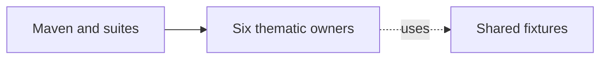
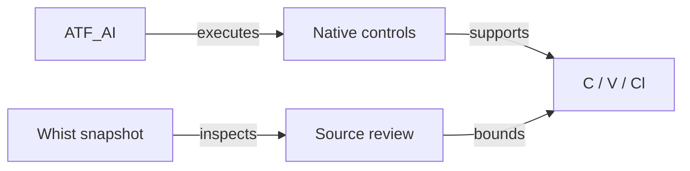

# Code governance, readable testing strategy and complete Romanian edition

Baseline: main `3663419b34ec6adc96120b419738b77afe145e9e` and main_RO
`aebbbcfaaf32f91b87e86fdf7d7923e040202728`. J0 is inspected read only at
`96f50e5f277771ca9dfac3b7c959b47188afd0b0`; its two local feedback edits remain
untouched. This review strengthens source governance, existing local tests and
documentation. It adds no product journey, runtime feature or emulator.

## G-017: Existing regressions must remain executable and bounded

- Owner: existing suite AST validator and ConsoleSignatureContractTest.
- Priority: 84; impact/risk/urgency 90/80/75.
- Baseline quality: 76; correctness/verification/clarity 80/65/80.
- Reproducer: a maintained source annotation changed to `@Test(enabled=false)`
  remains counted as executable by the old annotation-type inventory. XML
  selection alone cannot protect that source boundary.
- Independent stability defect: one selected console contract calls unbounded
  `worker.join()`. A blocked logging worker could hang the local gate.
- Repair: inspect TestNG annotation attributes through the existing compiler AST.
  Omitted enabled and literal true are supported; indirection fails explicitly
  instead of pretending parse-only inspection resolves external constants.
- Existing nested/manual fixtures retain their reviewed scope. Comments, strings,
  unrelated annotations and locally shadowed Test types are positive controls.
- Bound the existing worker rendezvous and cleanup, propagate its original
  failure, and preserve the test sink reset in finally.
- Delivered quality: 93; correctness/verification/clarity 94/92/92.
- State: VERIFIED for the observed local selection and bounded worker contract;
  the native local-02 evidence below owns the execution claim.

## D-010: Strategy first, complete translation and source-grounded review

- Owner: documentation rules, readability component tests and edition policy.
- Priority: 88; impact/risk/urgency 90/85/85.
- Baseline quality: 68; correctness/verification/clarity 65/60/80.
- Baseline user-observed defect: main_RO/docs/Testing.md was English. The old policy
  deliberately permits translation only for READMEs; its green parity result
  therefore certifies an incomplete Romanian documentation edition.
- Executed baseline signal: the new local language control identifies that exact
  Testing path and 26 other English documents before translation. The preserved
  baseline receipt is external; it is a reproduced defect, not a failed final run.
- Testing strategy: retain selection, API proof scopes, browser identity,
  independent observations and evidence limits in Testing.md. Move the ten
  unchanged original fenced execution blocks into Testing_Commands.md, inside
  closed disclosures with purposeful summaries. Existing incoming anchors remain.
- Readability: adopt J0's decision-oriented principle, with an explicit role
  distinction. The strategy uses a 3-sentence/100-word logical paragraph bound;
  detailed operational references use 100 words, with a 45-word sentence bound.
  These are review triggers, not quality metrics, diagram quotas or line lengths.
- All operational guides receive the supported prose controls; historical issue
  prose retains its evidence shape. Runnable Maven fences remain subject to
  disclosure governance in both areas. Inline diagnostic commands stay visible.
- Translation: every maintained Markdown and the Living HTML projection receives
  a Romanian counterpart at the identical path, including historical feedback.
  Code, commands, knowledge data, identifiers, status tokens and canonical cited
  policy literals remain exact. Original generated reports retain their language.
- Deterministic checks identify missing Romanian markers, unchanged meaningful
  English blocks, structural/technical drift and stale whole-file review hashes.
  They cannot certify every translated sentence or detect every inverted meaning.
- RAG-assisted review: retain the existing deterministic policy retrieval receipt,
  add the actual edition/policy owners and read each complete EN/RO pair. Review
  conditions, negations, chronology, actors, proof limits and diagram legends.
  The shared XML binds every document to both normalized hashes and declares
  the reviewer/dimensions. Hash renewal without reading is not acceptance.
- Bounded parser limit: structural parity still requires single-line link labels
  and canonical link placement on wrapped bullets. Two translation wrapping fixes
  retain that supported form; no complete Markdown parser is claimed.
- Delivered quality: 92; correctness/verification/clarity 94/90/92.
- State: VERIFIED for the maintained document inventory, complete declared review,
  explicit paired native controls and captured desktop document scope below.

## G-016: Review removal of an existing regression method

- Owner: test-maintenance policy and the changed test's module owner.
- Priority: 75; impact/risk/urgency 80/70/70.
- Baseline quality: 69; correctness/verification/clarity 75/50/80.
- Delivered quality: 94; correctness/verification/clarity 95/94/94.
- Observation: the suite inventory protected class selection, but not the
  identity of a method removed from a still-selected class.
- J0 reference: TestChangeGovernanceTest and GitTestChanges separate the immutable
  base, exact changed path, reviewer rationale and verification proof. Preserve
  that principle without copying consumer catalogs or inventing approval prompts.
- Correction: the existing framework governance owner now compares an AST-derived,
  sorted inventory of executable TestNG identities (declaring type, method and
  parameter types) with a SHA-256-pinned baseline. `TEST-METHOD-REMOVED` and
  `TEST-METHOD-UNREGISTERED` retain actionable signatures and route to the owner.
- Acceptance: its controlled negative fixture removes one method while the
  class remains present, adds an unregistered replacement, and checks both
  findings and the repair hint. The maintained inventory matches current test
  source.

| Proof | English | Romanian | Boundary |
|---|---:|---:|---|
| `FrameworkArchitectureGovernanceTest` | 114/114 PASS | 114/114 PASS | Includes real-source inventory validation and controlled method removal/addition findings |
| Complete default local reactor | 742/742 PASS | 742/742 PASS | 705 atf-tests plus 37 library checks; zero failures, errors or skips |
| Existing Node maintenance suite | 203/203 PASS | 203/203 PASS | Governance/component tools; no browser or application journey |
| Paired document review | 51/51 current | 51/51 current | Source-grounded EN/RO digest review with semantic checks on changed pairs |

External receipts: `${ATF_WORK_ROOT}/reviews/20261126-method-governance/`.
The first full English run correctly rejected five stale document digests; after
reviewing the changed pairs and refreshing their records, both complete local
reactors passed. No E2E selection or emulator was used.
- Limit: the baseline detects identity drift but is not a Git change classifier,
  approval gate, proof of method-body quality or evidence that each method ran.
  Intentional changes require explicit review of the signature delta, inventory
  and digest alongside the owning regression.
- State: VERIFIED within this source-governance boundary. The original baseline
  score remains recorded separately in the feedback register.

## Comparable source-review scores

These are 1–100 source-maturity judgments on the same inspected axes. J0 was
not built or executed; no score establishes measured repeatability or coverage.
Existing diagnostics and boundaries are assessed independently of test counts.

| Axis | Weight | AI baseline | AI repaired source | J0 inspected source |
|---|---:|---:|---:|---:|
| Module boundaries and ownership | 25% | 92 | 92 | 94 |
| Executable governance coverage | 25% | 88 | 90 | 92 |
| Negative paths and independent oracles | 20% | 90 | 91 | 94 |
| Bounded waits and cleanup | 20% | 85 | 87 | 92 |
| Actionable diagnostics | 10% | 94 | 94 | 88 |
| Weighted source assessment | 100% | 89.4 | 90.5 | 92.5 |

AI improves executable selection and one bounded concurrency owner. J0 retains
stronger change-control and lifecycle aggregation; AI retains stronger emitted
observations, cause/repair distinction and exact owned recheck routes. F-011
was open at that comparison checkpoint; the current closure follows below. High
scores require stronger evidence, not a wider unsupported claim.

## Acceptance evidence

The external review root is `${ATF_WORK_ROOT}/reviews/20261125-code-and-documentation-governance`.
Native runs and source manifests use `${ATF_WORK_ROOT}/runs/` and separate disposable
reactors. The existing ignored current publication remains at its captured scope.

- Baseline: baseline-translation-language.log records the real untranslated
  Testing document before repair. Readability counterexamples preserve actual
  dense strategy prose, default-open commands and fake tags inside literals.
- Final default local-02 reactor selections: English 690/690
  and Romanian 690/690 passed, with 0 failures,
  0 errors and 0 skipped cases in each edition. Each contains 315 governance cases. All five modules executed;
  the atf-tests selections contain 678 and 678
  cases respectively. The retained original Surefire XML, completed Maven logs,
  source manifests and exit receipts own these counts, not copied report summaries.
- Executed sources: English 1b939695c7a29355bf5e67f50ccbaa0121314c9e and Romanian
  bfa1bcc341cd4540b8f5ef70457b8483695f0d6c. The completed native local-02 summary binds the
  local-02 receipts and actual testcase outcomes. 29 existing
  local API cases and the bounded console worker case passed in each edition;
  these local API observations do not establish GoRest application acceptance.
- Existing Node maintenance controls: 182/182 passed per captured edition at
  a064e9f18f3528c17e109f2119b81808c32ce2e8 and
  669c2baecd3552a71651283c9eb44021e264e3de. Each retained manifest binds 23 files:
  19 tools and 4 contract inputs, unchanged from the final native sources. This preserves the captured
  Node scope; it is not a claim of a new Node execution at the final source commit.
- Complete document review: the shared translation-review.xml binds 51 reviewed
  documents, comprising 50 maintained Markdown paths and the Living HTML pair.
  The actual lexical policy retrieval receipt retains 16 mandatory and 18 selected
  records. Complete source-grounded EN/RO reading covers language, meaning,
  conditions, facts, links, diagrams and disclosures; no semantic recall is claimed.
- Final native desktop document review combines visual02 with the bounded
  Architecture repair in visual03: 32 records, 56 SVG observations and 98 selected
  screenshots at 1440/900 widths. Captured source hashes match; geometry findings,
  page/console errors, external requests and document overflow are 0. Wide Living
  figures use contained scrolling. Rendering is document-component evidence,
  not framework/browser application acceptance or universal accessibility proof.
- The first untranslated baseline and the first complete execution remain retained
  below. No new E2E journey, emulator or runtime feature was added. G-016, G-014
  and F-011 were TODO at that checkpoint; synchronization was evidenced by branch,
  remote and live identities after the documentation-only closure check.

## Retained first complete execution

The first complete default reactor selection passes in English. Its atf-tests
module records 678 passed cases. The Romanian run records 677 passed cases and
one failed positive documentation control; no case is skipped. The failing
control searches an English HTML heading before inserting an escaped example,
so it performs no mutation against the fully translated Romanian heading.

The existing test now locates the stable retained-principles section ID, inserts
the same literal example and preserves the same projection assertion. Boolean
precondition assertions avoid dumping the complete HTML when insertion fails.
Both original native runs remain unchanged under their local-01 locators. The
accepted local-02 runs recorded in the acceptance evidence preserve that earlier
failure and establish their own separately captured source and outcomes.

## F-012: Strict UI options and a shared configured wait

- Owner: Core typed UI configuration and wait helpers.
- Priority: 87, from impact/risk/urgency 90/85/80.
- Baseline quality: 71, from correctness/verification/clarity 75/60/75.
- Observation: malformed UI boolean text silently became false; zero, negative
  or millisecond-overflowing waits were accepted. Locale-dependent engine casing
  and duplicated wait parsing weakened the configuration boundary.
- Correction: the existing ConfigManager and UiRuntimeOptions own strict boolean
  and configured-wait readers. Both session options and WaitUtils use them.
  Unknown engines fail before acquisition. Existing defaults, override precedence,
  explicit Duration overloads and supported zoom normalization remain unchanged.
- Existing oracles cover six boolean keys, malformed values, both wait keys,
  canonical precedence, lower/upper bounds and Turkish default locale. Errors
  identify the actual key and value; wait rejection precedes condition polling.
- Stable contract: [Core configuration and cleanup](../../atf-core/README.md#validated-ui-configuration-and-cleanup).
- State: VERIFIED for the owned configuration component boundary. Delivered quality: 94; correctness/verification/clarity 95/93/94. Complete paired evidence follows below.

## F-013: Roll back partial UI session acquisition

- Owner: existing Playwright and Selenium session/provider classes.
- Priority: 82, from impact/risk/urgency 85/80/75.
- Baseline quality: 65, from correctness/verification/clarity 65/50/80.
- Observation: constructor failure after resource acquisition lacked an owned
  rollback path. Nested Playwright close failures could also replace the first
  failure. This starting observation is source-backed, not a process-leak claim.
- Correction: release acquired resources in reverse ownership order, preserve
  the original RuntimeException or Error and retain distinct suppressed cleanup
  causes. Persistent Playwright contexts own browser shutdown; temporary profiles
  are removed. A Selenium factory failure has no acquired driver to quit.
- Existing provider component classes inject stage failures without launching a
  browser: Playwright has 16 cases and Selenium has 12 cases, including positive
  acquisition, cleanup order, primary identity and self-suppression controls.
- Stable contracts: [Playwright](../../atf-playwright/README.md#acquisition-failure-and-cleanup)
  and [Selenium](../../atf-selenium/README.md#acquisition-failure-and-cleanup).
- State: VERIFIED for the owned acquisition and cleanup component paths. Delivered quality: 93; correctness/verification/clarity 94/92/93. Complete paired evidence follows below.

## Current UI maintenance evidence

The external root is `${ATF_WORK_ROOT}/reviews/20261126-ui-lifecycle-config`.
The baseline source, original failing native XML and focused Maven run remain
separate. The focused selection proves only the selected owned contracts; it
does not replace the complete local reactor. No E2E class, product journey or
emulator is added. Historical acceptance sections above retain their captured
source and counts; current F-011 work supersedes its earlier open-state summary.

The first complete local-01 selection retains 703 atf-tests cases per edition,
with 702 passed and one invoice-fixture failure. That fixture configured zero;
it now uses one valid second. The three existing negative controls also assert
the exact missing-row message, so an earlier configuration/navigation failure
cannot satisfy the oracle. Invoice checks remain controlled components without
a browser or product journey.

## UI repair acceptance and current review scores

Complete default local reactors passed 740/740 in each edition, including
703 atf-tests cases, 37 upstream library cases and 315 governance cases.
The existing 29 local API cases passed in each edition. Each run has zero
failures, errors or skipped cases. This is framework/component acceptance;
GoRest application writes, product E2Es and emulators are outside this execution.

| Evidence | Result | Bound source or retained locator |
|---|---|---|
| English default reactor | 740/740 PASS | 6a90e248e09e3b553f77bd8cb5764a6f9b427614 |
| Romanian default reactor | 740/740 PASS | 10d8974f69530c370932643a8227b73a9999decc |
| Focused UI/configuration/providers | 69/69 PASS | modules-code-documentation-ui-lifecycle-focused-01 |
| Node maintenance | 203/203 PASS per edition | en-node-01 and ro-node-01 |
| Original negative baseline | 7 passed, 18 failed; expected | baseline/native/testng-results.xml |

Full source manifests, native XML, completed logs and native-summary.json remain
in the external review root. Source/POM/resources are frozen independently of
later feedback closure. Final paired documentation and governance checks bind
the closure text. Native desktop document review covers the changed Core/Living
pairs at 1440/900 CSS px with 8 records and 32 diagram observations. Contained
scrolling in wide Living figures is intentional. This is file rendering, not
browser-process or application acceptance.

The following 1–100 judgments use the same axes and weights as the prior live
comparison. Weights sum to 100; counts do not determine grades. The baseline is
the 2026-11-26 source review at 14daf233e8039049cf6d8ba2db7421fb48c4c5be.

| Axis | Weight | Baseline | Current | Evidence and remaining limit |
|---|---:|---:|---:|---|
| Architecture and ownership | 15 | 92 | 92 | Same five modules; no new runtime class or product feature |
| Maintainability | 10 | 88 | 91 | Shared wait reader; six focused documentation-test owners are registered in both suites |
| Configuration | 10 | 82 | 93 | Strict booleans, bounded waits and locale-independent engine validation |
| Failure lifecycle | 10 | 84 | 94 | Exact primary identity, finally cleanup and acquired-resource rollback |
| Code/test governance | 15 | 91 | 94 | Existing class selection plus AST-pinned method identities; controlled removal/addition findings |
| Demonstrated test stability | 15 | 90 | 92 | Focused owner 114/114 plus paired full local selections; no new product execution |
| Documentation and editions | 15 | 94 | 94 | Maintained EN/RO contracts, diagrams and paired Living formats |
| Feedback and provenance | 10 | 93 | 95 | G-016 baseline and delivered quality remain separate; paired evidence and limits recorded |

Weighted maturity increases from 89.75 to 93.10, rounded from 90 to 93.
Neither result is a coverage percentage or a complete-runtime guarantee.

## Same-axis ATF_AI and atf-j1 review

These 1–100 judgments use the same eight axes and weights. ATF_AI reflects this
paired source review. The atf-j1 reference is the committed source at
`4e3cac10061c95ea2b9b32cc18a6d4add1007a1e`; its separate dirty workspace was
left unchanged and excluded from the scored source. J1 was not freshly executed
or regraded in this repair.

| Axis | Weight | ATF_AI | atf-j1 | Difference |
|---|---:|---:|---:|---:|
| Architecture and ownership | 15 | 92 | 94 | -2 |
| Maintainability | 10 | 91 | 90 | +1 |
| Configuration | 10 | 93 | 90 | +3 |
| Failure lifecycle | 10 | 94 | 93 | +1 |
| Code/test governance | 15 | 94 | 89 | +5 |
| Demonstrated test stability | 15 | 92 | 80 | +12 |
| Documentation and editions | 15 | 94 | 91 | +3 |
| Feedback and provenance | 10 | 95 | 87 | +8 |
| **Weighted score** | **100** | **93.10** | **89.10** | **+4.00** |

ATF_AI leads this scoped comparison in seven of eight axes after closing G-018;
maintainability is one point higher. atf-j1 retains a two-point advantage in
architecture. The governance and test-stability differences reflect the
captured source evidence and execution receipts, not a claim that the J1 tests
were rerun here.

G-016's method-identity loss control is now verified within its stated source
boundary. G-018 below closes the next recorded maintainability observation.
No new product journey is required. G-014 preserves an external J1 observation, outside the active ATF_AI implementation register.

## G-018: Focused documentation-test owners with explicit suite registration

Status: VERIFIED. Owner: ATF_AI documentation-test governance.
Priority 70; baseline quality 62. Priority inputs: impact 70, exposure 75,
urgency 60. Quality inputs: correctness 75, verification 45, clarity 60.
The baseline was one 1,297-line `DocumentationGovernanceTest` containing six
distinct documentation-review domains, shared fixture setup and the public
Maven selector. This is a test-maintenance concern; no product behavior failed.

The existing methods now live in six focused TestNG owners: root README,
English/Romanian editions, living principles, Markdown structure, feedback, and
HTML publication/configuration. `DocumentationGovernanceTest` remains the
diagnostic-owner check; it does not generate tests implicitly. Every focused
owner appears exactly once in both maintained suites, and documented Maven
selections enumerate the owners explicitly. Shared fixtures and assertions
have one package-local owner. The reviewed method inventory still contains 573
executable methods; 60 documentation method identities were re-pinned to their
new owners, with no method added or removed.

In the same-axis review, this evidence raises ATF_AI maintainability by one point,
from 90 to 91: six review domains now have focused owners and explicit suite
entries, while all 573 existing methods remain accounted for. This does not
claim broader product coverage.

Legend: relationships and proof boundary

Solid arrows show the explicit Maven or suite selection; dotted arrows show
shared fixture use. Diagnostic recheck commands name the same owners directly.
No E2E method, emulator, runtime feature or new test method was added.

Delivered quality: 92 (correctness 94 / verification 90 / clarity 92).
The paired documentation, readability and source-language selection passed
205/205 cases per edition. The exact suite-ownership and method-inventory
checks passed 2/2 per edition. This validates test ownership, explicit
selection and method preservation; it does not claim improved product coverage
or establish atf-j1 execution evidence.

## D-012: Testing strategy with comparable transport boundaries

Status: VERIFIED. Owner: documentation readability governance and Testing.md.
Priority 84 (impact 90 / exposure 80 / urgency 75).
Baseline quality 63 (correctness 70 / verification 40 / clarity 75).

The review uses J0 commit `96f50e5f277771ca9dfac3b7c959b47188afd0b0`,
its documentation best practices and the existing diagram/prose/structure/style
and link governance owners. J0's two uncommitted feedback files were left untouched.
The principles are adapted to this project's TestNG checks and source ownership.

| J0 principle | ATF_AI adoption | Review boundary |
|---|---|---|
| One diagram, one question | Separate execution paths from the review sequence | No mixed dependency/evidence arrows |
| Compact LR flow and immediate legend | Explicit strategy direction rule and adjacent legends | Other approved owners keep their own layout |
| Decisions before setup | API/Playwright/Selenium comparison with linked owners | Version/cache/configuration details stay in the cookbook |
| Prose, structure, style and links | Existing all-document controls plus strategy-specific mutations | Source shape cannot certify semantic truth |
| Actionable governance failure | Observed path, meaning, repair, owner and runnable recheck | A proposed fix is not execution proof |

The initial isolated readability run executed 30 cases: 29 passed and one
failed as expected. Its four findings identify the TB diagram at line 31 and
missing API/Playwright/Selenium comparison rows. The original log and native
XML remain under `${ATF_WORK_ROOT}/reviews/testing-strategy-baseline-20261126.log`
and `${ATF_WORK_ROOT}/validation/testing-strategy-review-20261126-baseline`.

Two new component methods protect vertical/reversed/nested direction mutations,
commented and literal diagram decoys, missing/duplicate lanes, missing ownership,
missing oracle/limit fields and the actual repairs. The reviewed inventory now
contains 575 executable methods; the existing E2E inventory is unchanged.

Atlas policy retrieval contributed KB-TRACE, KB-EVIDENCE, KB-SEMANTICS and
KB-SCORES: inspect actual source/assertions, preserve proof boundaries and do
not infer semantic quality from matching words or passing guards. This was
policy retrieval and source review, not a new Atlas HTML publication or test execution.

Acceptance requires paired documentation/source checks, the exact suite and
method-inventory controls, full EN/RO review and native desktop inspection of
the two changed diagrams and comparison tables. No product journey or emulator
is part of this acceptance.

Delivered quality 93 (correctness 94 / verification 92 / clarity 94). The paired
documentation/source selection and two exact architecture controls passed
209/209 cases per edition in acceptance-01. The final closure selection binds
the last literal/disclosure controls and this closure text in closure-02.
The two new method identities raise the reviewed inventory from 573 to 575.

Native desktop review produced four EN/RO records at 1440 and 900 CSS px, with
eight diagram observations and comparison-table captures. The original metrics
show zero page overflow, clipped labels, node overlaps or label/node overlaps;
no page errors or external requests were observed. Screenshots were inspected
for horizontal reading and proportionate columns. The evidence is under
`${ATF_WORK_ROOT}/reviews/testing-strategy-20261126/render-01`.

The strategy now separates request execution, UI provider parity, reporting and
application proof; setup stays in the existing cookbook. This scoped editorial
assessment does not regrade unrelated project axes or claim new API/browser
application execution. The final source snapshots, patches, logs and XML remain
under `${ATF_WORK_ROOT}/reviews/testing-strategy-20261126/closure-02` and
`${ATF_WORK_ROOT}/validation/testing-strategy-20261126-en-02` /
`${ATF_WORK_ROOT}/validation/testing-strategy-20261126-ro-02`.

## D-013: Shared presentation governance across the document inventory

Status: VERIFIED. Owner: documentation presentation/readability governance.
Priority 83 (impact 85 / exposure 85 / urgency 75).
Baseline quality 66 (correctness 75 / verification 45 / clarity 75).

The review covers all 50 maintained Markdown documents and both Living HTML
projections, using J0's diagram/prose/structure/style/link owners at commit
`96f50e5f277771ca9dfac3b7c959b47188afd0b0`. J0's two local feedback edits are
untouched. Its practices are adapted to this repository's contracts and TestNG.

The preserved initial presentation probe reports 55 findings: vertical flows
and missing adjacent closed legends. The source baseline contains all 50 EN/RO
pairs under `${ATF_WORK_ROOT}/reviews/documentation-presentation-20261126/baseline`;
the original observations are in baseline-findings.log beside that directory.

- Every existing diagram receives an adjacent explained closed legend. Sequential
  and ownership flows read horizontally; sequence diagrams keep their semantics.
- Long overview flows group related operations. Reporting and test ownership gain
  concise maps; small package guides keep their existing short bullets/tables.
- Dense README decisions become a lead sentence and parallel checks. Technical
  literals, conditions, links, commands and evidence chronology remain intact.
- Normative table prose receives the existing 140-character/22-word bounds;
  historical feedback evidence keeps its captured table shape.
- The Living principle rows retain all source/check routes, states and explicit
  cleanup limits. Both HTML projections retain their CSS and source metadata.
- Three component methods exercise broken legends, vertical orientation, literal
  decoys, normative cell density and real repairs with owned diagnostic hints.
  The reviewed method inventory increases from 575 to 578; no E2E is added.

Acceptance requires the complete paired documentation/source selection, exact
suite/method-inventory controls and native desktop review at 1440/900 CSS px.
Source gates establish supported structure; the reviewer checks meaning,
column proportions and rendered labels. Neither source size nor a green guard
establishes universal readability or application acceptance.

Delivered quality 93 (correctness 94 / verification 92 / clarity 94).
The initial documentation selection passed 212/212 in EN and 210/212 in RO;
the two RO failures exposed dense Living cells. Their original receipts remain
in documentation-presentation-20261126/acceptance-01. The repaired rows preserve
UIActions ownership, the Selenium/Playwright wait distinction and the WaitUtils
verdict boundary; two deliberate row swaps protect these associations. Manual
review also checked negations against live source, beyond matching owner names.

- The shared direction check covers explicit nested subgraph directions as well
  as flow headers. Commented/literal decoys and sequence semantics remain data.
- Native render-04 reviewed all 50 pairs and both HTML projections: 204 page
  records and 176 diagram observations at 1440/900 CSS px. No page overflow,
  SVG label clipping or measured overlaps were found; no page errors or external
  requests occurred. Wide reference figures retain documented local scrolling.
- Targeted render-05 adds 8 records/32 diagram observations after the final test
  README wording repair and inspects the Living HTML figures/tables directly.
- Acceptance-04 passes the same 72 local classes through the aggregate suite:
  699/699 cross-module cases plus 37/37 native library cases in each edition.
  The final closure selection binds the updated register and full-text review.

The evidence is under ${ATF_WORK_ROOT}/reviews/documentation-presentation-20261126
and ${ATF_WORK_ROOT}/reviews/extent-only-20261126. The later R-002 retirement brings
the reviewed inventory to 561. Geometry and finite source guards support this
scoped presentation assessment; they do not certify every possible rendering,
semantic translation or application outcome.

## R-002: Extent-only maintained reporting scope

Status: VERIFIED. Owner: reporting/runtime and framework governance.
Priority 84 (impact 90 / exposure 80 / urgency 75).
Baseline quality 60 (correctness 60 / verification 60 / clarity 60).

The user narrowed the maintained scope to Extent. Allure was supported in the
captured baseline and in main_mcp; this scope decision does not establish an
Allure defect. Historical receipts remain observations of their recorded source.

- Remove the Allure SDK dependencies, adapter, lifecycle cleanup, active suite and
  publication commands. Reporting configuration accepts extent; retired allure,
  both and unknown values fail with the property name and observed value.
- Keep aggregate disable settings explicit. The aggregate model uses the existing
  neutral status type, without a vendor SDK dependency for test collection.
- Update live contract narratives and both documentation editions, including the
  Living HTML projections. Remove retired profiles, groups and narrative IDs.
- Preserve the existing Extent empty-payload assertion by moving it from the
  retired mixed adapter class into ExtentAdapterTest.
- Pin the reviewed inventory at 561 methods: 578 after D-013, minus 17 retired
  Allure identities. One command contract is renamed and one Extent method moves;
  these changes are reviewed separately from removals. The 16 product E2E methods
  are unchanged. No new application journey or emulator is used.
- Reject retired dependencies in root/module dependency management and profiles.
  Existing architecture mutations verify owned diagnostics and actual repairs.

The generic artifact collector still recognizes historical/external Allure data.
That format classification does not enable a reporting backend. Captured reports
are not relabelled as current Extent proof. Compilation in compile-01 succeeded;
that receipt alone does not establish runtime or report acceptance.

Acceptance requires paired local reactors, the existing aggregate publication,
maintenance component checks and native document rendering. Original source,
reviewed removals, patches and receipts are retained under
${ATF_WORK_ROOT}/reviews/extent-only-20261126.

Delivered quality 93 (correctness 95 / verification 92 / clarity 92).
The baseline score measures alignment with the newly narrowed scope, not the
historical correctness of Allure. Acceptance-01 exposed a missing Path import;
acceptance-02 has no completion receipt and is excluded from acceptance.

Both complete default reactors in acceptance-03 passed 37 native library cases
and 697/699 cross-module cases. The failures identified an extra translated
bullet/missing heading aliases and the old uppercase-only enum diagnostic
assertion. The repair restores EN/RO structure and checks the property, original
invalid value, absent bogus cache and successful Extent recovery for unknown,
allure and both settings. None of the original failures is relabelled as PASS.

Acceptance-04 executes the same 72 local classes with aggregate publication:
736/736 native cases per edition, including 699/699 in atf-tests. Both generated
Extent readers pass the existing aggregate publishability inspector and display
699 cases, matching the native suite and aggregate manifest. Runtime classpaths
contain no retired SDK. The native/publication reconciliation receipt and reader
inspection log remain beside the exact source overlays and original XML.

The three existing screenshot/zoom component classes pass 15/15 cases against
real Selenium and Playwright desktop browsers in browser-01. The pinned browser,
driver, SDK and offline-cache inputs are recorded there. These local fixtures do
not establish product E2E acceptance. All 203 Node maintenance cases pass per
edition; their tool sources remain unchanged in the later attempts.

Atlas policy retrieval contributed cited behavior, evidence, traceability and
score boundaries. It is deterministic lexical policy context, with no semantic
recall claim and no new Atlas publication. The final closure selection checks
both documentation editions, constructive diagnostics and the reviewed inventory.

## G-019: Feedback reconciliation without artificial implementation work

Status: VERIFIED. Owner: feedback/documentation governance.
Priority 80 (impact 80 / exposure 85 / urgency 70).
Baseline quality 72 (correctness 75 / verification 65 / clarity 75).

The source checkpoint is 0e7495353b414c592c404a1731facbadfb8b894d. The review
covers all 18 feedback documents in both editions. The active register contained
one external J1 observation; three later records still used present-tense F-011
TODO wording despite the linked component closure. A fourth publication summary
also described that resolved gap as independently open.

- F-011 stays verified; earlier failed/source-only observations retain their
  recorded source and counts, with explicit links to the later correction.
- G-014 becomes EXTERNAL_OBSERVATION outside the ATF_AI implementation register.
  Its captured J1 failure is neither repaired nor upgraded by this cleanup.
- LD-11 remains PARTIAL: application-data deletion is absent. No new product
  journey, emulator, invoice/admin acceptance or cleanup implementation is added.
- Allure stays retired under R-002. Generic historical archive handling remains
  distinct from an active reporting backend.
- Historical baseline and verified tables become closed named disclosures.
  The active index keeps its schema, current scope and proof routes visible.

The baseline fixture accepted both an unmarked empty register and a populated
register declaring itself empty. The original observations remain in
`${ATF_WORK_ROOT}/reviews/feedback-reconciliation-20261126/baseline-empty-register.log`.
The existing feedback component method now checks both refusals, a fenced marker,
a marker outside Active TODOs, duplicate declarations and the actual repairs.
An empty register needs one standalone `<!-- feedback:empty -->` and retains
its table header. It does not certify defect-free source or external completion.

J4 at a4dfc3dfdbc0a91fe566c4665417bab6c2290479 supplied read-only calibration:
FeedbackIndexRules and zeroThroughNineOpenItemsCanCompleteWithoutFillingAQuota
make zero open items a valid state. This repository keeps its own seven-column
schema, separate Priority/Quality and TestNG owners. No J4 execution or score
comparison is claimed; its wider Android/release domains are outside this scope.

Acceptance requires paired documentation/source governance, the existing local
reactors, maintained Node components and review of the changed index rendering.
Runtime Java, POMs, RAG algorithms and the reviewed 561-method inventory are
unchanged. Expanding an existing component method adds no E2E method.

Delivered quality 94 (correctness 95 / verification 93 / clarity 94).
The first acceptance attempt failed test compilation because the new diagnostic
omitted its recheck-selection argument. Its original log is retained; that
argument is repaired without changing an assertion or runtime implementation.
Acceptance-02 passes 736/736 cases per edition: 37 native module cases and
699 cross-module cases, with zero failures, errors or skips. All 203 maintained
Node component cases pass per edition in acceptance-01; their tool sources are
identical in the final overlay. The current complete EN/RO parity probe passes.

The final closure selection binds the finished register and assessment below.
Exact source overlays, commands, native XML/TAP, baseline observations and J4
source citations remain under `${ATF_WORK_ROOT}/reviews/feedback-reconciliation-20261126`.
The existing 15-case real-desktop screenshot/zoom and 699-case aggregate-reader
receipts from R-002 still bind unchanged runtime source; they are retained
prior executions, not new browser/E2E runs in this review.

## G-020: Line-ending-independent executable-method seal

Status: VERIFIED for the owned component boundary. Owner: test-inventory governance.
Priority 74 (impact 75 / exposure 70 / urgency 75).
Baseline quality 75 (correctness 70 / verification 70 / clarity 85).
Delivered quality 94 (correctness 95 / verification 94 / clarity 93).

The former seal hashed raw inventory bytes. The exact source-level reproduction
shows the same 561 method identities accepted with CRLF and refused with LF.
The result depends on checkout conversion, including legitimate Windows Git
settings; it does not require a non-Windows runtime defect.

- Normalize only CRLF to LF in the UTF-8 digest and pin the resulting canonical
  SHA-256. The inventory file, method identities and ordering do not change.
- The existing inventory-owner method accepts both line-ending variants, rejects
  metadata and trailing-space changes, and retains removed/unregistered controls.
- The direct owner-method probe passes. The final native selection includes the
  entire architecture-governance owner, the documentation owners and scanner.
- No runtime implementation, dependency or product test is changed. This is
  checkout-independent governance evidence, not Linux/macOS runtime acceptance.

The original byte-level reproduction is in line-ending-baseline.json; the actual
owner-method execution is in line-ending-owner-method.log under the G-019 review
root. Existing 736-case reactors predate this final two-file governance repair;
the final native closure qualifies the changed owners rather than relabelling
the older source capture as a new complete execution.

## G-021: Strict JSON identities before Atlas retrieval

Status: VERIFIED for the loader/retrieval input boundary. Owner: framework/Atlas governance.
Priority 82 (impact 85 / exposure 80 / urgency 75).
Baseline quality 91 (correctness 90 / verification 94 / clarity 89).
Delivered quality 93 (correctness 93 / verification 95 / clarity 92).

The baseline accepted array IDs, duplicate array identities and an array archive
digest in loader/retrieval. Full archive provenance was a separate later guard;
its protection is not relabelled as a complete-pipeline defect.

- Require string IDs before syntax/uniqueness checks and string archive digests
  before digest checks. Valid corpus, ranking and receipts remain unchanged.
- Two Node component cases exercise actual malformed JSON, owned diagnostic hints
  and repaired files. The maintained Node selection passes 205/205 per edition.
- The valid retrieval receipt is exactly equal before/after; the three pinned
  archived blobs still verify. Semantic recall remains NOT_CLAIMED.

## G-022: Owned-source traversal and relocated checkout qualification

Status: VERIFIED for owned-source traversal and Windows relocation. Owner: source governance.
Priority 83 (impact 85 / exposure 85 / urgency 75).
Baseline quality 89 (correctness 88 / verification 86 / clarity 92).
Delivered quality 92 (correctness 91 / verification 92 / clarity 94).

The old walker enumerated generated descendants before filtering and resolved the
root repeatedly. It now prunes excluded directories before descending and resolves
one canonical root per scan. Owned sources with output-like names remain governed.

- Extend the existing architecture-owner method: observe visited directories,
  exclude generated descendants and retain owned resources. No timing threshold
  substitutes for the traversal oracle.
- Compare absolute/relative roots with spaces and Unicode. Fresh Windows LF/CRLF
  checkouts pass 736/736 native cases per edition, with zero failures/errors/skips.
- A controlled UTF-8 launcher preserves relocated Java/Maven paths and the paired
  documentation property. This qualifies that launcher; it does not certify every
  shell wrapper, Linux/macOS or a new browser matrix.

## T-007: Bounded repeatability of existing component oracles

Status: VERIFIED for the selected local component methods. Owner: component-test governance.
Priority 70 (impact 75 / exposure 65 / urgency 65).
Baseline quality 92 (correctness 93 / verification 94 / clarity 90).
Delivered quality 94 (correctness 94 / verification 95 / clarity 93).

Two independent JVMs repeat three retained methods 20 times each. Native TestNG
reports show 60/60 per edition, 120/120 total, with zero skips, failed assertions
or configuration errors. Original assertions and lifecycle hooks remain active.

| Retained subject | Observed contract | Proof boundary |
|---|---|---|
| Thread delegation | Delegates and step depth stay isolated | Selected parallel threads |
| Repeated cleanup | Delegate and open depth are cleared | Actual lifecycle/reset methods |
| Collection workers | Heavy work is limited while other work overlaps | Retained scheduler fixture |

This bounded repeat is not a measured long-term CI flake rate. No product E2E is
added or run; the reviewed 561-method Java inventory and runtime libraries remain
unchanged. Two added Node component cases bring the maintained Node total to 205.

Reproduction, source binding and excluded attempts for G-021/G-022/T-007

- Source checkpoint: fad9c29abb9ec5a7ae68b5e002907a6c054c0f86, with exact per-edition
  overlays and raw/canonical file hashes. Final feedback/documents are bound by
  the subsequent paired native closure, not retroactively by earlier logs.
- Evidence root: `${ATF_WORK_ROOT}/reviews/rag-portability-stability-20261126`.
  README.md records commands, host/toolchain, source identity and scope.
- acceptance-06 contains the completed 736-case reactors against acceptance-05
  source snapshots. repeatability-02 retains the actual 120 native results;
  node-final retains 205 Node cases per edition against final tool sources.
- acceptance-01/02 did not reach the native suite because of external launcher
  quoting/encoding. acceptance-03/04 were interrupted/overlapped; acceptance-05
  has no completion receipt. All are excluded from native acceptance. The first
  repeatability launcher failed class loading; repeatability-02 uses a reviewed
  manifest classpath. Original logs remain available.
- The final closure includes the entire architecture owner, documentation owners
  and scanner. No assertion, skip or original native XML is rewritten.

## G-023: Unambiguous JSON across Atlas input boundaries

Status: VERIFIED for the maintained Atlas JSON boundaries. Owner: Atlas governance.
Priority 85 (impact 90 / exposure 80 / urgency 80).
Baseline quality 93 (correctness 93 / verification 95 / clarity 92).
Delivered quality 94 (correctness 95 / verification 95 / clarity 93).

- The original loader/retrieval accepted repeated root/nested members. Reject
  decoded duplicate names in each object, including identical values and escaped
  spellings. Valid strings, independent object scopes and native values survive.
- Use the same guard for corpus, raw analysis/inventory, executed-source manifests
  and embedded HTML JSON. Component cases verify owned diagnostics and actual
  repaired inputs; valid retrieval receipts remain exactly equal.
- The maintained Node selection passes 209/209 per edition. This strengthens input
  identity; semantic recall and automatic project understanding remain unclaimed.

## G-024: Locale-independent artifact path ordering

Status: VERIFIED for the collector ordering boundary. Owner: artifact governance.
Priority 72 (impact 75 / exposure 70 / urgency 65).
Baseline quality 92 (correctness 91 / verification 92 / clarity 94).
Delivered quality 93 (correctness 93 / verification 92 / clarity 95).

- Explicit native English/Swedish collations produced different path sequences
  for identical inputs. Replace host collation with ordinal UTF-16 comparisons
  in directory traversal, module traversal and final manifest ordering.
- Isolated workers verify complete path/hash pairs, including accented, spaced
  and supplementary-character names. Original report bytes remain unchanged.
- This is native ICU variation, not a second OS-locale or Linux/macOS acceptance.
  Stable ordering does not make timestamps or execution outcomes identical.

## T-008: Positive execution counts for maintained tests

Status: VERIFIED for maintained source annotations. Owner: test governance.
Priority 87 (impact 90 / exposure 85 / urgency 80).
Baseline quality 94 (correctness 94 / verification 95 / clarity 93).
Delivered quality 95 (correctness 95 / verification 95 / clarity 94).

- A real TestNG probe returned status 0 with one normal invocation and zero
  invocations of a retained method; baseline source governance reported no gap.
- Existing controls now reject zero, negative and indirect invocation counts at
  class/method scope. Positive integer literals and omission pass. Parse-only
  governance does not resolve constants; the diagnostic explains that boundary.
- Seven added data rows exercise failures and actual annotation repairs without
  changing the 561-method Java inventory. Existing nested/manual boundaries and
  comment/literal examples stay explicit; application E2E selections are unchanged.

Source receipts, acceptance and excluded observations for G-023/G-024/T-008

- Evidence root: `${ATF_WORK_ROOT}/reviews/rag-portability-stability-20261127`.
  Original malformed inputs, native TestNG and ICU observations remain under baseline.
- Native local reactors pass 743/743 per edition: 37 library and 706 cross-module
  cases, with zero failures/errors/skips. Windows LF/CRLF checkouts use spaces and
  Unicode paths through the controlled UTF-8 launcher; no new OS/browser matrix is claimed.
- The final source capture binds 209 Node cases per edition, bilingual governance
  and the reviewed documentation rendering. README.md records exact commands,
  raw/canonical hashes and original native XML/TAP; no failed receipt is rewritten.
- The first Node run passed 208/209: the new collector fixture supplied an invalid
  revision before its ordering assertions. Repair only that fixture metadata; the
  focused repair and final complete selections retain their actual outcomes.
- One existing perimeter case took unusually long once, then passed in about 1.2
  seconds unchanged. No reproducible cause or software timing improvement is claimed.
- The first native attempt has no complete summary/exit receipt and is excluded.
  The qualified rerun is identified separately. No product E2E or emulator is used.
- Native acceptance-02 exposed a duplicate diagnostic-help registration in this
  change. Keep the existing enabled-test owner and register only the new
  invocation-count key; its failed XML is retained and excluded from acceptance.

## A-003: ATF AI and Whist snapshot comparison

Authored review on 2026-11-27 over common control axes. `atf_j4` is Whist Lab, not a third framework. Its captured tree has local work in progress; execution in this review is NOT_RUN. Lower V inputs reflect that proof boundary, not demonstrated test failures.

Legend: proof levels and comparison limits

- Arrows describe evidence contributing to the review, not runtime dependencies.
- ATF_AI has fresh local executions; Whist is reviewed captured source, neither rerun nor modified here.
- No overall winner, gameplay score, Android/browser acceptance or semantic recall is calculated.

| Axis | ATF_AI | Whist | Review basis |
|---|---:|---:|---|
| Module boundaries | 93 | 92 | Five neutral modules; Whist combines application adapters and shared libraries. |
| Code and test governance | 95 | 94 | Owned controls and method seal; Whist also binds protected changes to reviewed controls. |
| RAG identity and provenance | 94 | 94 | Atlas reader contracts versus a release evaluator; compare evidence integrity, not answer quality. |
| Portability controls | 93 | 93 | ATF_AI has relocated/native-collation probes; Whist has explicit JVM and source-normalization contracts. |
| Existing-test stability | 95 | 91 | Fresh ATF_AI runs; Whist launcher and negative controls are inspected, not rerun. |
| Documentation design | 94 | 94 | Governed horizontal diagrams, concise prose and owned detail routes in both projects. |
| Feedback and evidence lifecycle | 94 | 95 | Whist distinguishes qualified subcriteria from still-open acceptance/research gates. |
| Bilingual review evidence | 94 | 90 | ATF_AI pair is rechecked; Whist declares an edition seal without fresh pair execution here. |

C/V/Cl inputs and reviewed sources

Use the register's same 40/30/30 formula. Each input is 1–100; unlike scopes have no global average.

| Axis | ATF_AI C/V/Cl | Whist C/V/Cl |
|---|---|---|
| Module boundaries | 94 / 93 / 92 | 95 / 87 / 94 |
| Code and test governance | 95 / 95 / 94 | 96 / 89 / 96 |
| RAG identity and provenance | 95 / 95 / 93 | 97 / 86 / 97 |
| Portability controls | 93 / 92 / 95 | 96 / 87 / 96 |
| Existing-test stability | 95 / 95 / 94 | 95 / 82 / 94 |
| Documentation design | 94 / 93 / 94 | 95 / 89 / 96 |
| Feedback and evidence lifecycle | 95 / 93 / 94 | 97 / 90 / 97 |
| Bilingual review evidence | 94 / 93 / 94 | 94 / 81 / 95 |

- The Whist capture and hashes of the 24 reviewed sources are in `comparison/whist-source-v2.json` under the G-023 evidence root. The Git checkpoint is retained with the dirty state; this is not qualification of the live Whist branch.
- Reviewed Whist owners: RAG evaluator and input identity, JVM launcher and component controls, test-change review, prose/diagram rules and feedback register.
- Game rules and negative cases were inspected only; gameplay correctness is not graded. The Whist manifest declares 130 documents; its EN/RO pair is not rerun here.
- Delivered transfers are G-023, G-024 and T-008. Whist release-qualification policies remain comparison context; no feature, LangGraph coordinator or E2E is added.

## D-014: Business reader and numbered Atlas workflow

Status: VERIFIED for the business-reader contract and the recorded selected ATF_AI capture. Owner: Atlas governance.
Priority 92 (impact 95 / exposure 90 / urgency 85).
Baseline quality 65 (correctness 60 / verification 70 / clarity 65).
Delivered reader-audience quality 94 (correctness 94 / verification 95 / clarity 94); this is not a whole-project grade.

- Renderer 5 separates the offline reader from the complete adjacent audit. No raw source, commands, digests or hidden technical bundle enter the HTML.
- Six numbered sections and hierarchical cases mirror navigation. The horizontal operating model has an adjacent legend; native disclosure works with the keyboard.
- Mandatory RAG policy binds audience, source ownership, cases, unknowns and semantic-review limits. Active authoring guides cannot silently revert to the earlier renderer contract.
- Current ATF_AI source supplies 41 claims, six owner units, eight selected behaviors and 24 cases. Existing oracle claims bind 96 exact passing testcase subjects to original source manifests and five retained receipts; broader application acceptance is not inferred.
- Acceptance-02 completed 743 native checks and 225 Node components per edition, with no failures or skips. Final documentation and the additional active-guide guard are qualified separately in acceptance-03; original source snapshots retain each run's exact scope.
- Native render-02 passes at 1440 and 900 CSS px, including numbering, local targets, 24 cases, readable diagrams, keyboard disclosure and zero external resources. Deliberately small text and invisible diagram labels fail; the repaired original passes.
- The 47,961-byte selected reader replaces the earlier technical presentation only after clean-source recapture and identity checks. The previous reader and failed construction attempts remain external; the J1 capture is not requalified.

Evidence: `${ATF_WORK_ROOT}/reviews/business-atlas-20261127`. Finite audience checks and lexical retrieval require semantic review; selected cases do not establish exhaustive understanding. No new application E2E, emulator or runtime Java feature.

## D-015: Artifact calibration against the live project

Status: VERIFIED for owned repairs and the reviewed artifact; final outcomes retain separate identities. Owner: Atlas governance.
Priority 90 (impact 92 / exposure 90 / urgency 85).
Baseline calibration quality 82 (correctness 82 / verification 75 / clarity 90).

- Actual rendering confirms five links that leave their content closed at both widths.
- Six capabilities with PARTIAL facets lack explicit review-depth disclosure in the reader.
- Failed executed cases use the same neutral label as passing recorded checks.
- The generic linear model does not adequately explain architecture or behavioral branches.
- Following delegation to implementation bounds masking to known input details; screenshots and external messages are not automatically sanitized.
- Acceptance requires real source/document comparisons, negative/repair controls, native navigation/screenshots, RAG policy and scoped axis ratings. No new E2E or emulator.

Evidence: `${ATF_WORK_ROOT}/reviews/atlas-calibration-20261127`.

Delivered calibration quality 95 (correctness 95 / verification 95 / clarity 94).

- The initial native artifact audit finds eight deviations: verdicts, breadth, navigation and diagrams at both widths. The repaired candidate passes with 11 purposeful diagrams and 24 cases.
- Navigation opens native content. Architecture maps preserve actual relationships; behavior maps remain closed with adjacent legends.
- The first native reactor is rejected for two missing EN aliases in RO; the owned rule identifies the repair. Aliases are restored and the responsible check passes before final execution.
- Original failures are retained; 243 Node components per edition pass. Metadata, source review and screenshots are not automatic semantic attestation.
- Final native qualification, exact selected-reader capture and publication are bound in separate evidence; original failed outcomes are never relabeled as passing.

| Atlas axis | C / V / Cl | Quality (1-100) |
|---|---|---:|
| Business understanding | 95 / 93 / 96 | 95 |
| Architecture explanation | 95 / 94 / 94 | 94 |
| Behavior and negative cases | 95 / 95 / 94 | 95 |
| Source and verdict fidelity | 96 / 95 / 94 | 95 |
| Rendered readability | 95 / 95 / 95 | 95 |
| Native navigation | 95 / 94 / 94 | 94 |
| RAG and calibration governance | 95 / 95 / 93 | 94 |
| Semantic review breadth | 84 / 82 / 90 | 85 |

Ratings use the register's 40/30/30 formula for this Atlas, not the whole ATF. Review remains SELECTED: six owners with PARTIAL facets and no new application acceptance. Arrows, native metrics and 243 tests do not establish every meaning or full accessibility compliance.

## D-016: Source-grounded semantic facet review

Status: VERIFIED within the declared review scope. Owner: Atlas governance.
Priority 88 (impact 90 / exposure 85 / urgency 85).
Baseline quality 85 (correctness 84 / verification 82 / clarity 90).

- Six units reuse generic explanations across all seven facets; eight behaviors underspecify configuration, API readiness, reporting lifecycle and aggregation.
- Review follows actual operations and existing oracles. Facet promotion needs explicit scope, owned implementation and independent verification where applicable; limits remain visible.
- The Atlas will explain newly reviewed existing behavior without new E2E scenarios or inferred external acceptance.

Delivered quality 91 (correctness 90 / verification 90 / clarity 93).

- Review follows 12 existing behaviors, 35 cases and 15 diagrams: configuration precedence and caching, local API readiness, result lifecycle and report publication.
- All 42 facets have distinct observations: 32 REVIEWED within their declared scope and 10 PARTIAL. Owned implementation fragments and independent oracles are explicitly selected; status does not certify the entire project.
- Governance refuses repeated explanations, absent boundaries, foreign ownership, self-verification and incorrect execution subjects. Rendering compares actual visible meanings and limits with the reviewed dossier.
- The initial 255-case Node component selection per edition passes. Real intermediate failures and owned repairs remain preserved; final Java/Node qualification and publication retain separate receipts.
- Retained limits include process-cached configuration, local readiness distinct from external acceptance, report summaries without all numeric relationships proved and a bounded browser matrix.

Evidence: `${ATF_WORK_ROOT}/reviews/semantic-atlas-20261127`.

- Initial Java qualification identifies two documentation failures: register closure removed the active table header. The repair restores its header and distinct score columns even when empty; original XML is preserved before rechecking.

## D-017: Compact project identity

Status: VERIFIED within the declared review scope. Owner: Atlas presentation.
Priority 76 (impact 75 / exposure 80 / urgency 70).
Baseline quality 79 (correctness 84 / verification 70 / clarity 80).

- The header consumes excessive space, repeats purpose and redundantly displays English; the project title can share the Atlas line.
- Acceptance checks the actual rendered header without tiny or hidden text. Review date belongs with confidence; language remains semantic metadata.

Delivered quality 95 (correctness 96 / verification 95 / clarity 95).

- A single “Atlas · ATF AI” line preserves readable identity without the redundant English badge. Date appears with confidence, while language remains HTML metadata.
- Native captures at 1440 and 900 px confirm a 58 px header starting 16 px from the top, with a 20 px font. The guard caught the initial 44 px offset; the repair removes inherited padding while retaining the 24 px limit.
- Owned hints and negative controls refuse oversized identity, impossible geometry, clipped text and redundant language badges. Other project titles need their own width checks.

## D-018: Partial facet refinement

Status: VERIFIED within the declared review scope. Owner: Atlas governance.
Priority 87 (impact 90 / exposure 85 / urgency 80).
Baseline quality 91 (correctness 90 / verification 90 / clarity 93).

- Ten partial facets have concrete information, setup and behavior questions. Narrowing the scope alone cannot justify promotion.
- Review live operations, independent oracles and configuration choices; preserve original boundaries and the actual verdict of every check.
- Acceptance needs a verifiable previous dossier, a decision for every facet and negative controls with owned repair guidance. No new application E2E, emulator or runtime Java.

Delivered quality 93 (correctness 93 / verification 93 / clarity 94).

- All ten originally PARTIAL facets have investigated questions, observations and additional selected fragments. Six now have a bounded REVIEWED scope; four remain PARTIAL. Total: 38 REVIEWED / 4 PARTIAL, without claiming project-wide qualification.
- Existing tests inspect eight Playwright and four Selenium combinations through SDK commands, compatibility configuration, observer caching and derived versus manual summary counts. These checks start neither a product application nor a product browser.
- Information in both browser integrations and application behavior/data remain partial. Source-only oracles are not presented as execution; absent application-data deletion remains explicit.
- Governance compares the original dossier, requires every decision, retains original scope/limits and refuses recycled or renamed fragments as progress.
- The focused run retains the real EN/RO ordering failure for two new sections. Sections and the historical anchor are aligned; both responsible checks pass separately. Final qualification and publication have their own receipts.

Evidence: `${ATF_WORK_ROOT}/reviews/facet-closure-20261127`.

## D-019: Source-calibrated diagram quality

Status: VERIFIED within the declared review scope. Owner: Atlas presentation.
Priority 86 (impact 88 / exposure 85 / urgency 82).
Baseline quality 83 (correctness 85 / verification 78 / clarity 85).

- Archived requirements call for common primitives, labeled relationships, visual hierarchy, local legends and explicit boundaries. The current graph replaces long labels with “observe”, losing branch meaning.
- Recover main_mcp principles adapted to the analyzed project and current English audience, keeping construction details outside the HTML.
- Acceptance needs component controls for relationships and routing, native graph/source comparison, concise legends and no overlapping or clipped text.

Delivered quality 95 (correctness 96 / verification 94 / clarity 95).

- Recovered rules cover shared primitives, consistent scale, source-specific relationships, hierarchy and closed local legends. Adaptation retains the English audience and external technical proof.
- Complete relationship text survives; behavior maps use actual conditions and dependencies retain direction. Long and cyclic relationships have separate routing lanes rather than an invented linear sequence.
- Native prototype captures at 1440/900 pass comparison of all 15 graphs with source and checks for overlaps, clipping, arrowheads and visible outlines. Diagnostics identify the observed graph and relationship/node.
- Dashed outlines identify a boundary or refusal, not a failed test. Final rendering and the controlled counterexample must remain bound to the actual published bytes.

## D-020: Bounded observation evidence

Status: VERIFIED within the declared scope. Owner: Atlas governance.
Priority 88 (impact 90 / exposure 88 / urgency 84).
Baseline quality 93 (correctness 93 / verification 93 / clarity 94).

- Four partial facets concern browser information and application behavior/data. Follow response projection, preview limits, image payloads and existing local oracles.
- Additional components may inspect SDK and value contracts without applications, new E2E, emulators or runtime Java.
- Preserve original boundaries and distinguish observations from external acceptance, previews from complete bodies, and image content from pixel meaning.

Delivered quality 94 (correctness 94 / verification 94 / clarity 95).

- Five new adapter components inspect observed fields, error statuses, normalized bounded previews, image payloads, original failures and request association. They start no browser, server or application.
- Both browser-information facets now have bounded component evidence. Application behavior/data remain PARTIAL: 40 REVIEWED / 2 PARTIAL, with every original boundary preserved.
- The Selenium ledger retains previously observed nonblank data for a reused identity; empty-body clearing is not inferred. Live Chrome retrieval and pixel meaning remain explicit boundaries.
- BOUNDED_OBSERVATIONS_V1 requires the actual proof level, original passing oracle subjects and visible non-claims. SOURCE_REVIEW cannot be promoted by a label; rendering also compares the proof label and non-claims.
- The RAG counterexample preserves refusal of a citation outside the canonical report contract. Citation ownership is repaired; the 62 relevant components pass afterward. Original attempts remain separately retained.

Evidence: `${ATF_WORK_ROOT}/reviews/observation-facets-20261127`.

## D-021: Root README project focus

Status: VERIFIED within the declared scope. Owner: Documentation.
Priority 78 (impact 80 / exposure 75 / urgency 75).
Baseline quality 86 (correctness 88 / verification 80 / clarity 90).

- The root README must not route readers to main_RO. Edition administration belongs in the dedicated guide.
- Update both editions 1:1 and protect text, links and examples against route reintroduction with owned repair guidance.

Delivered quality 95 (correctness 96 / verification 95 / clarity 95).

- Language/branch administration is removed from the root README in both editions. The edition guide retains ownership of maintenance instructions.
- DOC-README-EDITION refuses plain text, case variants, encoded links, examples and comments. A literal percent sign beside an encoded route is independently covered inside the existing component.
- The diagnostic names its owner, repair and recheck. Whole-pair review and both focused documentation checks pass before final full qualification.

## D-022: Application boundaries and retained proof

Status: VERIFIED within the declared local scope. Owner: Atlas governance.
Priority 85 (impact 88 / exposure 84 / urgency 78).
Baseline quality 94 (correctness 94 / verification 93 / clarity 95).

- Deepen both PARTIAL facets through existing local code and oracles without invented application acceptance.
- A new review must retain earlier observation non-claims and expose remaining questions, collapsed by default.
- Final review binds code, documentation, original outcomes and rendered HTML; axis ratings remain scoped authored judgments.

Delivered quality 95 (correctness 96 / verification 95 / clarity 94).

- Both facets remain PARTIAL. Existing checks follow all 12 fields from both factories, credential shape, selected immutable-copy fields and one rejected submission.
- Two existing negative checks establish the expected diagnostic for stale status and an unrelated invoice. Another failure cannot prove the intended criterion.
- BOUNDED_OBSERVATIONS_V2 retains earlier reviewed boundaries, requires actual additional oracles and exposes five remaining questions in collapsed sections. These boundaries are not TODOs for new E2E flows.
- The 68 relevant Node components and ten existing application components pass. Documentation repairs cover the feedback state, two Romanian compatibility anchors and untranslated narrative metadata detected by the whole-text edition guard; original attempts remain separate.
- Complete final-source qualification, publication and native HTML review retain independent evidence in the review dossier; test counts determine neither the score nor semantic completeness.

Evidence: `${ATF_WORK_ROOT}/reviews/application-boundaries-20261127`.

## D-023: Large audit tokenization

Status: VERIFIED within the bounded parsing scope. Owner: Atlas governance.
Priority 90 (impact 92 / exposure 90 / urgency 85).
Baseline quality 90 (correctness 90 / verification 85 / clarity 95).

- The original successive audit exceeded the regular-expression tokenization stack after the reader and adjacent audit were written.
- Two large escaped-value regressions reproduce both the read failure and the lost expected duplicate-key diagnostic.

Delivered quality 95 (correctness 96 / verification 95 / clarity 94).

- Iterative scanning removes this tokenization limit while preserving syntax, key identity and owned duplicate-member refusals.
- Both regressions pass and the original failed audit validates offline. Final publication and complete-source proof remain independent checks.
- History is not truncated and the business HTML gains no construction payload. Memory use for unlimited history is not certified.

Evidence: `${ATF_WORK_ROOT}/reviews/application-boundaries-20261127`.

## Current ATF AI assessment

Reviewed on 2026-11-27 against the live runtime checkpoint
9bea4567cc352ad75e1e06f4238a2c80d467506e and the reviewed governance/documentation
overlay. Ratings cover the supported HTTP, desktop UI, Extent and Atlas scope.
Critical runtime owners were inspected directly; all-source static controls and
representative execution are distinct proof levels. This is an authored review,
not an automatic coverage percentage or a universal correctness certificate.

C means correctness, V verification and Cl clarity. Each input and result uses
1-100. Apply the register's reproducible formula:
`round(0.40 × C + 0.30 × V + 0.30 × Cl)`. Separate axes have no invented overall grade.

| Axis | C / V / Cl | Quality (1-100) |
|---|---|---:|
| Code and architecture | 94 / 93 / 92 | 93 |
| Documentation and editions | 95 / 95 / 94 | 95 |
| Atlas and RAG | 95 / 95 / 94 | 95 |
| Feedback lifecycle | 95 / 93 / 94 | 94 |
| Code and test governance | 95 / 95 / 94 | 95 |
| Existing-test stability | 95 / 95 / 94 | 95 |
| Configuration and failure handling | 93 / 94 / 90 | 92 |
| Auditability and reporting | 94 / 94 / 92 | 93 |
| Maintainability | 92 / 92 / 91 | 92 |
| Portability evidence | 93 / 92 / 95 | 93 |
| Provider extensibility | 92 / 90 / 92 | 91 |

Source owners, verification and limits by axis

- **Code and architecture:** [Registry](../../atf-core/src/main/java/com/ai/ui/core/engine/UiEngineRegistry.java). Neutral module ownership, provider discovery and current failure paths. Framework API and source review; not an exhaustive correctness proof.
- **Documentation and editions:** [Document policy](../governance/Code_And_Documentation_Policy.md). 51 maintained Markdown pairs, Living HTML, compilation, language and presentation guards. Finite guards and reviewed renderers; semantic translation still needs review.
- **Atlas and RAG:** [Retrieval and provenance](../../tools/atlas-knowledge.mjs). Cited retrieval, exact receipts, independent oracles, negative paths and one-HTML delivery. Lexical policy context; authoring and semantic completeness are not certified automatically.
- **Feedback lifecycle:** [Feedback controls](../../atf-tests/src/test/java/com/ai/atf/governance/FeedbackGovernanceTest.java). Bilingual records reconciled with the active index; explicit empty state, historical closure and external scope. Zero accepted tasks does not mean zero defects or external implementation completion.
- **Code and test governance:** [Architecture and inventories](../../atf-tests/src/test/java/com/ai/atf/governance/FrameworkArchitectureGovernanceTest.java). Owned diagnostic hints, negative controls, exact suites and a reviewed 561-method inventory. Policy/source invariants complement review; matching a token is not semantic proof.
- **Existing-test stability:** [Existing logging contracts](../../atf-tests/src/test/java/com/ai/atf/core/reporting/regression/StepLoggerContractTest.java). Bounded worker/HTTP behavior, independent observations and completed native selections. Point-in-time execution, not a measured long-term CI flake rate.
- **Configuration and failure handling:** [UI options](../../atf-core/src/main/java/com/ai/core/support/config/UiRuntimeOptions.java). Typed UI settings, retry boundaries, teardown and partial-acquisition rollback. Caller credentials, deployment state and arbitrary provider failures remain separate.
- **Auditability and reporting:** [Extent inspector](../../atf-reporting/src/main/java/com/ai/core/reporting/adapters/extent/inspection/ExtentPublishedOverviewInspector.java). Extent lifecycle, expected/actual steps, original XML and inspected aggregate readers. Original captures retain their source; masking does not sanitize every arbitrary log.
- **Maintainability:** [Source ownership rules](../../atf-tests/src/test/java/com/ai/atf/governance/FrameworkArchitectureRules.java). Focused owners, reusable fixtures, explicit dependencies and concise entry guides. Large catalogs and process-global configuration still require coordinated review.
- **Portability evidence:** [Recorded matrix and relocation](Browser_Compatibility_And_Portability.md). Relative project paths, caller-selected roots and the recorded desktop browser/CDP matrix. Current proof is Windows-focused; other OS/browser combinations need their own receipts.
- **Provider extensibility:** [Provider contract](../../atf-core/src/main/java/com/ai/ui/core/engine/UiEngineProvider.java). Core SPI boundaries and separate Playwright, Selenium and Extent implementations. An additional provider requires contract/parity acceptance; no universal plug-in guarantee.

The retrieval review validates 23 knowledge records, 21 mandatory policies and
five pinned archived blobs. Its declared scope is deterministic lexical policy
context; semantic recall remains NOT_CLAIMED. New Atlas generation or application
acceptance is not inferred from these checks. Source size and test counts identify
scope; the declared review inputs determine these scores.

Earlier AI/J1 comparison tables and published Atlas readers keep their original
source checkpoints and scores. J4 now has the source-bound A-003 comparison, with execution NOT_RUN. The lower portability rating reflects
the recorded Windows matrix rather than an observed cross-platform runtime defect.

## D-024: Concrete comparisons and deeper existing behavior

Status: VERIFIED within the declared source/component and artifact scope. Owner: Atlas semantic review.
Priority 89 (impact 92 / exposure 88 / urgency 85).
Baseline quality 91 (correctness 91 / verification 89 / clarity 92).

- Independent review found that 32 of 35 case descriptions repeated one generic
  assertion explanation. A matching source identity does not explain the actual
  subject, independent criterion or the meaning of a mismatch.
- `SOURCE_BOUND_COMPARISONS_V1` now requires those concrete selections and the
  supported relation. Exception type is not failure-object identity; membership
  is not order; a callback flag is not an exact count. No runtime actual is invented.
- Three newly reviewed existing boundaries deepen the story: waiting distinguishes
  first match from the last unmatched value at expiry; final-image policy separates
  eligibility, absent UI, deduplication and invocation ownership; optional reporting
  separates Core-only absence, one installed provider and duplicate refusal.
- A fourth existing boundary follows owned result contexts, invocation reset and
  guarded failure-hook diagnostics through their independent assertion bodies.
- The current AI draft retains 16 flows and 51 cases, including 16 additional
  witnesses for those four existing responsibilities. These are explanations of
  maintained checks, not additional product journeys or broader execution claims.
- The existing screenshot component now holds the first invocation open while
  another evaluates its own eligibility. Original and repair runs each pass 1/1; a
  disposable shared-flag mutation fails exactly the second-context expectation
  with expected one versus actual zero. This bounded interleaving does not
  certify every race schedule; complete final-source qualification remains separate.
- Guarded failure-attachment hooks do not establish that direct final-state hooks
  or an arbitrary logger failure are non-blocking. Those source-only limits stay explicit.

| Atlas axis | Earlier selected reader | Independent pre-correction review |
|---|---:|---:|
| Business/project understanding | 93 | 92 |
| Semantic breadth | 92 | 91 |

The independent inputs are 93/90/92 and 91/89/92 respectively under the 40/30/30
rubric. This recalibration reflects omitted decisions and generic comparisons,
not an observed runtime regression. Earlier grades remain unchanged; larger
case counts do not justify an increased final grade.

Evidence: `${ATF_WORK_ROOT}/reviews/cross-project-understanding-20261127/ai-audit`
and `${ATF_WORK_ROOT}/reviews/cross-project-understanding-20261127/screenshot-proof`.
Delivered quality 95 (correctness 96 / verification 94 / clarity 95).

- Initial paired complete-source acceptance passes 748 native and 304 Node checks per edition. The final closure source has its own independently retained acceptance receipt.
- The actual reader binds 76 oracle claims to 165 original subjects. Native 1440/900 review passes with 18 real diagrams and 51 case comparisons; the singleton responsibility is prose.
- Two additional Atlas witnesses separate policy omission from eligible capture using the same existing matrix oracles. No runtime test or product journey is added.
- Original dense-prose, RO-anchor and current-entry fixture failures remain preserved with their observed repairs. Source-map refusals also retained invalid geometry, duplicate facet selections and overlong labels before the accepted repair.
- Original screenshot source and repair pass; the disposable shared-state mutation fails exactly the independent second capture.

Evidence: initial qualified acceptance, initial native calibration, narrative review and the final source/publication receipts in the cross-project dossier. This closure does not remove the two partial application facets or claim arbitrary scheduler safety.

## D-025: Truthful origins, source capture and useful diagrams

Status: VERIFIED within the declared source/component and artifact scope. Owner: Atlas intake and presentation.
Priority 87 (impact 90 / exposure 88 / urgency 80).
Baseline quality 85 (correctness 88 / verification 80 / clarity 85).

- Fresh `understand` requires the comparison, diagram, Git capture and source-origin
  profiles together. Legacy `publish` preserves its captured assessment instead
  of silently recertifying historical readers.
- `SOURCE_GRAPH_V2` requires three meaningful nodes and two distinct real directed
  relationships in every rendered figure. Compact ideas use `TEXT_ONLY` with a
  substantive reason. The AI singleton boundary becomes prose; no owner or
  dependency is invented to increase a diagram count.
- `GIT_WORKTREE_V1` preserves actual revision, complete source identities and
  exact canonical dirty status, including leading spaces. Reader confidence
  explains unpublished local changes while construction details remain adjacent.
- `SOURCE_ORIGINS_V1` distinguishes five J1 local modules from selected consumed
  libraries and the separate read-only inspector. Six raw selected JAR/POM pairs
  retain their coordinates and reviewed declarations; producer source is absent.
- Independent validation is an explicit local capability, not an automatic Shop
  or AutoEx stage. The inspector is test-scoped, does not generate reports and
  does not qualify application acceptance. Supplied model invocation fields do
  not attest an actual call or the truth of referenced content.
- The fresh J1 intake reviews eight behaviors and 32 comparisons with 30 existing
  oracle methods. Its 49 scoped facets remain 30 REVIEWED, 17 PARTIAL and two
  UNKNOWN; the count is a declaration of review scope, not semantic coverage.
- Actual native J1 records distinguish 234 passing selected pure components from
  216 whole-governance checks with one failing check covering missing-owner
  controls on two changed protected files. The preserved dirty capture owns that
  failure. Passing expected-negative components cannot replace the whole verdict.

Evidence: `${ATF_WORK_ROOT}/reviews/cross-project-understanding-20261127/j1-audit`
and `${ATF_WORK_ROOT}/reviews/cross-project-understanding-20261127/j1-intake`.
Delivered quality 96 (correctness 97 / verification 96 / clarity 95).

- The actual current publisher refuses and repairs 13 applicable AI controls and 12 J1 controls; every repair reproduces its original reader bytes. Real dirty captures and consumed-library pairs are exercised without changing either target.
- Both original native reader reviews pass at 1440/900. J1's final shared-policy reader binds 30 existing oracle methods to 47 exact original subjects and preserves the actual failed whole-governance subject.
- All 684 J1 raw source files and exact Git state remain unchanged. Its 234 passing components do not overwrite the separate 216-case result with one failure.
- Final clean AI publication, paired translation qualification and selection retain their own final receipts; the initial dirty reader and all failed/refused inputs remain preserved.

This item closes the bounded Atlas intake/presentation correction. It creates no J1 source-edit obligation, E2E TODO or emulator requirement.

## Cross-project source and Atlas assessment

The current review compares the inspected AI maintenance overlay with J1 source
`4e3cac10061c95ea2b9b32cc18a6d4add1007a1e` and its retained unpublished changes.
AI has local framework implementation; J1 combines application-owned consumers
with selected binary libraries. Different source scopes are not completeness
percentages. Original assessments above retain their original checkpoints.

Project and Atlas axes remain separate. The final source-bound inputs, rationales
and native-render evidence belong to `comparison.json` and
`atlas-axis-review.json` in the cross-project review dossier. They use the same
40/30/30 rubric and do not calculate an overall winner from passing test counts.

- AI review adds concrete oracle comparisons, four existing behavior boundaries
  and strict current-intake profiles. The two application facets remain partial.
- J1 retains 234 passing selected components and one actual failure in 216
  governance/artifact cases. Two protected test edits lack the accepted owner
  control; a passing negative fixture cannot replace this real failed gate.
- Selected J1 dependency pairs remain raw artifacts. Consumer observations do
  not establish absent producer source, and supplied AI invocation metadata is
  not independent attestation that a model was called.
- The final publication keeps one offline business reader per project and the
  original source, failed observations and construction audit outside the HTML.

Final source, native and publication qualification is recorded by D-024/D-025;
the dossier's original receipts determine the exact delivered state. No new E2E
journey, emulator or runtime Java feature is part of this correction.

## D-026: Historical business reference adaptation

Status: VERIFIED within the bounded presentation and evidence scope. Owner: Atlas presentation and governance.
Priority 91 (impact 94 / exposure 90 / urgency 85).
Baseline quality 82 (correctness 85 / verification 78 / clarity 82).

- The current reader hides every graph behind closed sections and uses a short generic reading model; review scores remain only in the audit.
- The main_mcp reference keeps the primary map open, supporting material collapsed, shared styling, local legends, node proof and explained scores.
- Adaptation must model actual test intent, API/UI observations, verdict, evidence and report ownership; application persistence stays partial.
- Visible scores must come from a scoped authored assessment with arithmetic, source, purpose and reasoned ceilings. Test counts do not generate a grade, and historical runtime infrastructure is not restored.
- Acceptance needs meaningful counterexamples and repairs, actual native initial-state measurements and paired EN/RO review. No new E2E or emulator is required.

Evidence: `${ATF_WORK_ROOT}/reviews/atlas-reference-adaptation-20261127`.

Delivered quality 95 (correctness 95 / verification 96 / clarity 94).

- The primary map has seven actual objects in three reading bands; the owned result is emphasized and the application outcome retains PARTIAL.
- Six Atlas cards open local rationale. All 18 project and Atlas axes retain separate scopes, goals, questions, measures, original inputs and reasoned ceilings.
- Initial native review refused the map below the reading threshold and overlapping relationship labels. The measured repair passes at 1440/900, including initial state, 18 diagrams, local object support and score navigation.
- The 96 focused components and paired documentation checks pass; final full qualification and selection retain their own exact-source receipts.
- Nine pinned historical Git objects retain rule and example provenance. The first selection incorrectly counted a shared citation as a new object; the guard observed eight rather than nine. The repair includes the actual node-maturity rule without weakening the check.
- Current V2 publication requires the reference profile; V1 remains historically verifiable without an implicit new presentation qualification. No runtime services, E2E additions or emulators are introduced.

Evidence: `${ATF_WORK_ROOT}/reviews/atlas-reference-adaptation-20261127`. The two partial application facets and five application questions stay explicit; reviewed status is not exhaustive semantic understanding.

## D-027: Fitted diagrams and useful local references

Status: VERIFIED within the bounded presentation and evidence scope. Owner: Atlas diagram governance.
Priority 93 (impact 94 / exposure 92 / urgency 90).
Baseline quality 84 (correctness 86 / verification 82 / clarity 83).

- The baseline admits horizontal overflow in supporting maps. At 900 px,
  response and foundation nodes leave the visible panel; valid scroll metadata
  does not make the complete story immediately readable.
- Supporting legends repeat generic wording and lack the second local references
  disclosure present in the historical example. A declaration of traceability
  cannot replace the actual owned subject, verdict and boundary.
- A tall multiline label can hide a tiny transformed font from a height-only
  check. The archived scale and legend rules provide useful repair principles;
  their old thresholds and runtime infrastructure are not copied blindly.
- Acceptance requires zero horizontal scrolling, complete readable nodes and
  relationships, exactly two closed disclosures per graph, source-specific
  legends, original proof and useful owned refusal hints.
- Current source lives in the separate `atf-atlas/governance` component area.
  Native review, paired documentation and meaningful counterexamples qualify
  this correction; test volume cannot increase an understanding score.

Evidence: `${ATF_WORK_ROOT}/reviews/atlas-diagram-calibration-20261127`.
No new application E2E or emulator is requested. The two partial application
facets and five remaining questions retain their original scope.

Delivered quality 95 (correctness 95 / verification 96 / clarity 94).

- All 18 diagrams in the native preview fit at 1440/900 without horizontal
  scrolling and with two closed legend/reference disclosures.
- The nine module cases and 55-component selection pass. Documentation checks
  caught a four-sentence paragraph in both editions; the repair separates
  decisions and the focused readability/edition checks pass.
- Twelve distinct historical objects anchor the rules, code examples and
  negative controls. The no-scroll extension is an explicit current decision.
- The old primary reference has approximately 8–10 px type at 900 px and 13
  relationships without their own labels. Its structure informs stricter gates.
- Atlas reading quality is recalibrated from 96 to 95; understanding 94 and
  semantic breadth 93 retain their bounded scope. Layout does not complete source.
- Final exact-source qualification, actual publisher controls and delivered
  selection retain separate receipts in the external dossier; failed attempts
  remain preserved. Historical V1/V2 receive no retroactive V3 qualification.

| Inspected artifact and policy axis | Historical main_mcp | Revised ATF_AI |
|---|---:|---:|
| Business story | 94 | 94 |
| Primary relationships and comprehension | 80 | 95 |
| Measured scale and readability | 78 | 95 |
| Local legends and references | 94 | 95 |
| Auditability and evidence boundaries | 91 | 96 |
| Demonstrated presentation governance | 87 | 96 |
| Single-file offline delivery | 88 | 95 |
| Selected semantic breadth | 94 | 93 |

These grades use reasoned 40/30/30 inputs in the external comparison, without
an averaged winner or pass rates converted to quality. They assess the inspected
artifacts and policies, not fresh historical runtime acceptance or all source.
The reference's original self-assessments stay unchanged in its own artifact.

## D-028: Concise reading and semantic orientation

Status: VERIFIED within the bounded reading and evidence scope. Owner: Atlas reading and governance.
Priority 91 (impact 94 / exposure 88 / urgency 89).
Baseline quality 86 (correctness 92 / verification 85 / clarity 80).

- Fixed width leaves avoidable space on wide screens; cards and prose repeat
  the same boundaries, and opening behavior exposes too many cases at once.
- Readers need actual choices explained: API or UI, observation or accepted
  result, evidence or application guarantee. Source and independent oracle
  ownership must survive the shorter explanation.
- The correction uses a project brief beside the map, comparative tables,
  individual cases and scores on request, and one display of exact shared limits.
- Acceptance compares the real page at 900/1440/1920, its initial view and normal
  reading path. Every case situation, expectation and original verdict remains
  verifiable; a large box does not prove visibility inside a closed disclosure.
- Initial captures exposed nested-table selector contamination and fragment state
  retained between widths. Preserve those observations and repair measurement
  without relabeling product outcomes or weakening presentation rules.

Evidence: ${ATF_WORK_ROOT}/reviews/atlas-reading-20261128.
No new application E2E or emulator is requested. Two partial facets and five
application questions retain their original boundaries.

Delivered quality 96 (correctness 96 / verification 97 / clarity 95).

- Three questions connect API/UI choice, consumer verdict and evidence to
  existing operations and independent oracles. Core explicitly names API/UI
  ownership; partial application facets are not presented as failed governance.
- At 1920 px the frame grows from 1256 to 1884 px. At 1440 px the behavior
  section falls from approximately 23934 to 2032 px before cases are opened;
  all 51 cases remain in the expanded source comparison.
- Identical boundaries appear once; distinct limits, situations, expectations
  and original verdicts are compared in actual rendering.
- Seven reading components and the repaired three-width preview pass. The EN/RO
  refusal caught a wrapped numeral interpreted as a list; repair preserves
  structure and the focused paired recheck passes.
- Fragment state, nested table headers and visibility through closed details
  are measured correctly. Initial failed observations remain in the dossier.
- The final 900 px capture refused an opening whose map began below the agreed
  first-view boundary. Smaller score-card padding repairs the opening without
  hiding text, shrinking type or relaxing the native gate; retain both captures.
- Final exact-source qualification, actual publisher controls and delivered
  selection retain separate receipts. The previous reader's 1920 px capture
  is a comparative observation, not retroactive V4 qualification.

The scoped assessment targets understanding 95, reading quality 96 and semantic
breadth 94: the new questions connect existing responsibilities without claiming
more code coverage or external acceptance. Both partial facets remain partial.

## D-029: Calm business explanation and measured breathing room

Status: VERIFIED within bounded component and native-reading scope. Owner: Atlas reading and governance.
Priority 88 (impact 92 / exposure 85 / urgency 84).
Baseline quality 93 (correctness 95 / verification 94 / clarity 90).

- Six separate capability-review controls repeat the same names already in the
  responsibility table. Group their detail once and keep all original facets.
- Feature three useful existing scores, retain every authored rationale, and
  shorten answers without erasing source owners, original verdicts or limits.
- Exact repeated narrative needs an owned repair hint; similar meanings need
  human review. Unknown failure scope must not be described as partial review.
- Overlap checks alone do not establish breathing room. Measure every actual
  transformed node/label rectangle and require six CSS pixels of clearance.
- Retain the first refused provenance edit and preview comparison: the citation
  kind was unsupported, and measured rectangles initially polluted the graph
  identity projection. Repair their owners without weakening source equality.

Evidence: ${ATF_WORK_ROOT}/reviews/atlas-clarity-20261128.
Acceptance requires paired governance/components, current-source publication,
actual native review and intended negative controls. No new application E2E,
emulator or application persistence claim is in scope.

Delivered quality 96 (correctness 96 / verification 97 / clarity 95).

- Three existing headline scores keep all eighteen authored axes available.
  One closed capability-review group retains all forty-two original facets.
- Four added component cases cover exact repetition, distinct failure scope,
  real clearance and missing geometry; measured labels preserve every source edge.
- The preview passes at 900/1440/1920. Both focused document selections pass
  after the register rejected the unsupported underscore status; original XML remains.
- The exact final source, current publisher refusals, repaired native controls
  and bounded selected publication retain separate receipts in the dossier.
- The complete Node selection caught duplicate guide answers in an existing
  generic CLI fixture. Distinct source-bound answers repair the fixture; the
  repetition rule and original failed TAP remain intact.
- Reading quality remains 96, understanding 95 and semantic breadth 94. New
  test counts do not complete the two partial facets or certify external behavior.

## D-030: Independent full-width map and owned reader text

Status: VERIFIED within bounded component and native-render scope. Owner: Atlas presentation and governance.
Priority 92 (impact 96 / exposure 92 / urgency 84).
Baseline quality 91 (correctness 95 / verification 80 / clarity 96).

- The previous page-width check accepted a main map inside a left/right split.
  The current requirement gives the actual primary panel and SVG their own band.
- The pinned main_mcp map is an independent open disclosure. Its width catalog
  and diagram-grid refusal inform the correction without restoring old runtime.
- A short brief precedes the map; value context follows in closed detail.
  Percentage geometry fills the HTML width while text and border weight stay uniform.
- Remove the generic offline/scope footer and score prompt. Confidence and
  limits stay in their dedicated sections; reject other unowned narrative.
- Native acceptance measures actual rectangles, source relationships, scale,
  spacing and noise. Markup or outer page width alone cannot qualify the map.

Evidence: ${ATF_WORK_ROOT}/reviews/atlas-primary-band-20261128.
Acceptance requires paired source/docs checks, original component proof and
actual desktop rendering with intended negative controls. Existing application
E2E, Java runtime and both partial application facets remain unchanged.

Delivered quality 96 (correctness 96 / verification 97 / clarity 95).

- The preview uses the full main band at all three widths without sidebars,
  fixed canvas caps, inflated text or lost source relationships.
- Supporting diagrams follow the same fluid width rhythm; their actual panels
  and canvases are measured separately. Preserve the first narrower capture.
- The first uniform preview rejected three tight label pairs at 900 px. Full-word
  wrapping repairs their clearance without shrinking type or removing relationships.
- Three added component cases reject narrowed/oversized geometry, generic
  footer/prompts and unowned text while retaining historical envelope scope.
- The known main_mcp width catalog and actual open primary map anchor the
  adaptation; their archived runtime and original grades remain untouched.
- Paired documentation checks pass after the Romanian table-cell gate refused
  143 visible characters; a shorter explanation repairs it without relaxing 140.
- Exact final-source tests, actual publisher refusals, native negative controls
  and the selected publication retain separate receipts in this dossier.
- Understanding 95, reading 96 and semantic breadth 94 retain their bounded
  judgment; neither partial application facet is promoted by layout or test counts.

## D-031: Balanced reading frame and dedicated provenance

Status: VERIFIED within bounded component and native-render scope. Owner: Atlas presentation and governance.
Priority 91 (impact 94 / exposure 90 / urgency 85).
Baseline quality 90 (correctness 95 / verification 85 / clarity 88).

- The user capture exposes a long technical inventory and clean-source provenance.
  Replace the inventory with a short table of review scope and its boundary.
- Keep symmetric dark gutters and the full inner frame for diagrams; the archived
  reference guides style without restoring retired runtime.
- Compare all six sections with current source; retain cases, verdicts, partial
  limits and visible warnings about unpublished source or failed checks.
- Component and native controls must refuse full bleed, asymmetry, misplaced
  provenance and unowned repeated narrative.

Evidence: ${ATF_WORK_ROOT}/reviews/atlas-framed-reading-20261128.
Acceptance requires paired checks, original proof, native inspection at
900/1440/1920 px and repaired negative controls. No new application E2E or emulator.

Delivered quality 96 (correctness 96 / verification 97 / clarity 95).

- The final native preview passes at 900/1440/1920 px, with 45/72/120 px gutters
  and all six sections inspected separately. All eighteen diagrams remain intact.
- Three additional component cases refuse incorrect gutters, misplaced provenance
  and lost warnings; source-owned answers and actual columns are measured.
- The first documentation check refused a missing RO anchor; both 68-case
  selections pass after repair. Original logs remain preserved.
- Full words are rewrapped after four sub-threshold clearances at 900 px; type
  is not reduced, and source relationships and proof limits remain unchanged.
- Final exact-source qualification, publisher refusals and native controls retain
  distinct receipts in the dossier. Two facets remain partial; five questions remain open.

- The first complete Node selection refused three publications because a CSS
  selector was confused with the format attribute. Read only the HTML root and
  retain legacy compatibility in the same independent component case.

## D-032: Business decisions tied to implementation and construction evidence

Status: VERIFIED within component and native-preview scope. Owner: Atlas, RAG and artifact governance.
Priority 93 (impact 95 / exposure 92 / urgency 89).
Baseline quality 89 (correctness 94 / verification 84 / clarity 87).

- The HTML explains business, but concrete method correlation remains in the audit.
  Add a closed map of source-backed decisions and implementation responsibilities.
- Keep business objects in the graph; concrete declarations are evidence, not
  substitutes for meaning. Do not claim an automatically inferred call graph.
- Improve label legibility over connectors with actual native paint measurements
  and negative controls that preserve every original relationship.
- The separate Extent report must derive from current results and bind the exact
  reader; an archived MCP report cannot certify current source.

Evidence: ${ATF_WORK_ROOT}/reviews/atlas-business-depth-20261128.
Acceptance requires paired tests, original proof, native rendering and refusal/repair.
No new Java runtime, application E2E or emulator.

Delivered quality 96 (correctness 96 / verification 97 / clarity 95).

- Six decisions map to eleven declarations and twenty-two original cases. The
  trace remains closed; primary diagrams retain business objects.
- The new route check refused connectors crossing foreign labels. Separate
  branch ports and converging routes pass at 900/1440/1920 px without lost edges.
- Eleven additional component cases protect source correlation, label readability,
  the relative link and construction Extent association with original evidence.
- Two additional archived citations are verified against pinned Git bytes; the
  initial count expectation refused the new total before its explicit update.
- The existing Extent library prototype is standalone and passes network-free
  rendering. Final derived reporting and exact-source binding retain separate receipts.
- Original refusals and repairs remain preserved. Neither test counts nor the
  derived report automatically certify semantics or application acceptance.
