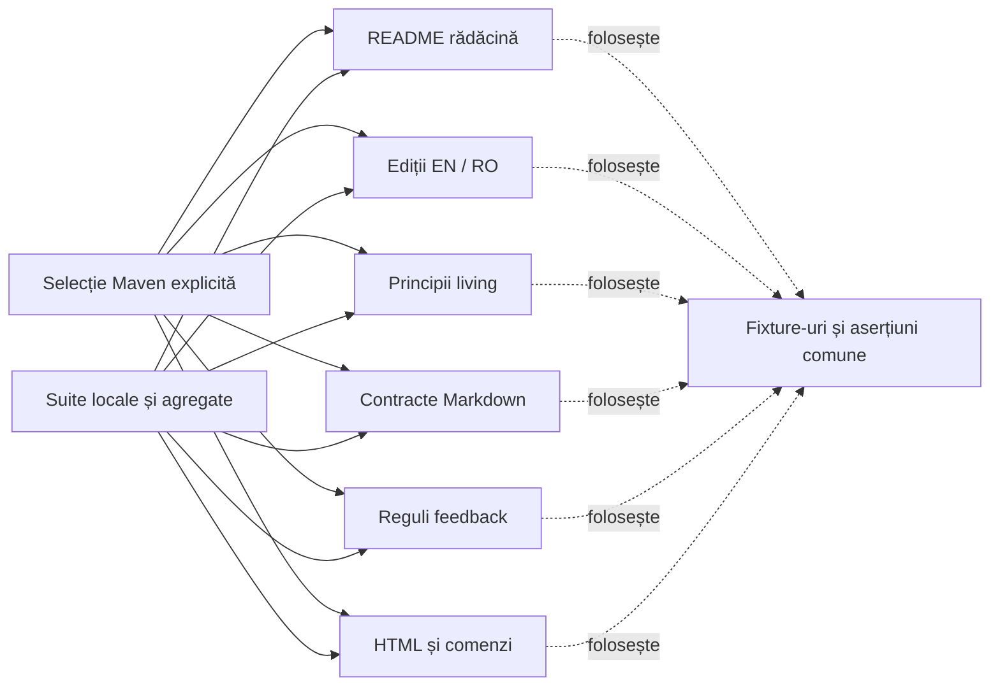

# Guvernanța codului, strategie de testare lizibilă și ediție română completă

Baza reviziei: main `3663419b34ec6adc96120b419738b77afe145e9e` și main_RO
`aebbbcfaaf32f91b87e86fdf7d7923e040202728`. J0 este inspectat numai în citire la
`96f50e5f277771ca9dfac3b7c959b47188afd0b0`; cele două modificări locale de feedback
rămân intacte. Revizia întărește guvernanța surselor, testele locale existente și
documentația. Nu adaugă fluxuri de produs, funcționalități runtime sau emulatoare.

## G-017: Regresiile existente trebuie să rămână executabile și limitate

- Responsabil: validatorul AST existent al suitelor și ConsoleSignatureContractTest.
- Prioritate: 84; impact/risc/urgență 90/80/75.
- Calitatea inițială: 76; corectitudine/verificare/claritate 80/65/80.
- Reproducere: o adnotare menținută schimbată în `@Test(enabled=false)`
  rămâne numărată ca executabilă de inventarul vechi bazat pe tipul adnotării.
  Selecția XML singură nu protejează acest contract al sursei.
- Defect independent de stabilitate: un contract de consolă selectat apelează
  `worker.join()` fără limită. Un fir de jurnalizare blocat putea bloca poarta locală.
- Corecție: inspectează atributele adnotării TestNG prin AST-ul compilatorului existent.
  Atributul enabled omis și literalul true sunt acceptate; indirectarea eșuează explicit,
  fără a pretinde că parsarea rezolvă constante Java externe.
- Fixture-urile imbricate/manuale existente își păstrează limitele revizuite. Comentariile,
  șirurile, adnotările fără legătură și tipurile Test locale sunt controale pozitive.
- Limitează așteptarea și curățarea firului existent, propagă eșecul original
  și păstrează resetarea destinației de test în finally.
- Calitate livrată: 93; corectitudine/verificare/claritate 94/92/92.
- Stare: VERIFIED pentru selecția locală observată și contractul limitat al firului;
  dovezile native local-02 de mai jos definesc afirmația de execuție.

## D-010: Strategie întâi, traducere completă și revizie bazată pe surse

- Responsabil: regulile documentației, testele de componentă pentru lizibilitate și politica edițiilor.
- Prioritate: 88; impact/risc/urgență 90/85/85.
- Calitatea inițială: 68; corectitudine/verificare/claritate 65/60/80.
- Defect observat de utilizator: main_RO/docs/Testing.md era în engleză la începutul reviziei. Politica veche
  permite deliberat traducerea numai pentru README-uri; rezultatul ei verde de paritate
  certifică astfel o ediție română incompletă a documentației.
- Semnal inițial executat: noul control local al limbii identifică exact acea cale
  Testing și alte 26 de documente englezești înaintea traducerii. Dovada inițială
  este păstrată extern; reprezintă un defect reprodus, nu o rulare finală eșuată.
- Strategia testării: păstrează selecția, ariile dovezilor API, identitatea browserului,
  observațiile independente și limitele dovezilor în Testing.md. Mută cele zece
  blocuri originale de execuție neschimbate în Testing_Commands.md, în secțiuni
  pliate cu rezumate utile. Ancorele de intrare existente se păstrează.
- Lizibilitate: adoptă principiul J0 al deciziilor clare, distingând explicit rolurile.
  Strategia folosește limita de 3 propoziții/100 de cuvinte pe paragraf logic;
  referințele operaționale detaliate folosesc 100 de cuvinte și limita de 45 pe propoziție.
  Acestea declanșează revizia; nu sunt note, cote de diagrame sau lungimi de rând.
- Toate ghidurile operaționale primesc controalele de proză acceptate; înregistrările
  istorice își păstrează forma dovezilor. Blocurile Maven executabile rămân supuse
  guvernanței plierii în ambele zone. Comenzile inline de diagnostic rămân vizibile.
- Traducere: fiecare document Markdown menținut și proiecția HTML Living primesc
  un corespondent românesc la calea identică, inclusiv feedback-ul istoric.
  Codul, comenzile, datele de cunoștințe, identificatorii, stările și literalii
  canonici citați ai politicilor rămân exacți. Rapoartele generate originale își păstrează limba.
- Controalele deterministe identifică markerii românești absenți, blocurile englezești
  semnificative neschimbate, abaterile structurale/tehnice și amprentele de revizie expirate.
  Nu pot certifica fiecare propoziție tradusă sau detecta orice inversare de sens.
- Revizie asistată de RAG: păstrează dovada recuperării deterministe existente a politicilor,
  adaugă responsabilii reali ai edițiilor/politicilor și citește fiecare pereche EN/RO completă.
  Verifică condițiile, negațiile, cronologia, actorii, limitele dovezilor și legendele.
  XML-ul comun leagă fiecare document de ambele amprente normalizate și declară
  revizorul/dimensiunile. Actualizarea amprentelor fără lectură nu înseamnă acceptanță.
- Limita parserului: paritatea structurală cere încă etichete de legătură pe un
  singur rând și poziționare canonică în listele reașezate. Două corecții ale
  traducerilor păstrează forma acceptată; nu se pretinde un parser Markdown complet.
- Calitate livrată: 92; corectitudine/verificare/claritate 94/90/92.
- Stare: VERIFIED pentru inventarul documentelor menținute, revizuirea completă
  declarată, controalele native între ediții și domeniul desktop capturat de mai jos.

## G-016: Revizuiește eliminarea unei metode de regresie existente

- Responsabil: politica de mentenanță a testelor și modulul testului modificat.
- Prioritate: 75; impact/risc/urgență 80/70/70.
- Calitatea inițială: 69; corectitudine/verificare/claritate 75/50/80.
- Calitatea livrată: 94; corectitudine/verificare/claritate 95/94/94.
- Observație: inventarul suitelor proteja selecția claselor, dar nu și
  identitatea unei metode eliminate dintr-o clasă încă selectată.
- Referință J0: TestChangeGovernanceTest și GitTestChanges separă baza imuabilă,
  calea exactă modificată, raționamentul revizorului și dovada verificării. Păstrează
  principiul fără a copia cataloage de consumatori sau a inventa cereri de aprobare.
- Corecție: responsabilul existent de guvernanță a framework-ului compară acum
  un inventar ordonat al identităților TestNG executabile, extras din AST (tip
  declarant, metodă și tipuri de parametri), cu o bază fixată prin SHA-256.
  `TEST-METHOD-REMOVED` și `TEST-METHOD-UNREGISTERED` păstrează semnături
  acționabile și trimit la responsabilul canonic.
- Acceptanță: fixture-ul negativ controlat elimină o metodă păstrând clasa,
  adaugă o înlocuitoare neînregistrată și verifică ambele constatări și indiciul
  de remediere. Inventarul menținut corespunde sursei curente de teste.

| Dovadă | Engleză | Română | Limită |
|---|---:|---:|---|
| `FrameworkArchitectureGovernanceTest` | 114/114 PASS | 114/114 PASS | Include validarea inventarului real și constatări controlate la eliminarea/adăugarea metodelor |
| Reactor local implicit complet | 742/742 PASS | 742/742 PASS | 705 verificări atf-tests și 37 de bibliotecă; zero eșecuri, erori sau omisiuni |
| Suita existentă de mentenanță Node | 203/203 PASS | 203/203 PASS | Instrumente de guvernanță/componente; fără browser sau parcurs de aplicație |
| Revizia documentelor pereche | 51/51 actuale | 51/51 actuale | Revizie EN/RO cu amprente ancorate în sursă și verificări semantice pe perechile schimbate |

Dovezi externe: `${ATF_WORK_ROOT}/reviews/20261126-method-governance/`.
Prima rulare completă în engleză a respins corect cinci amprente de documente
învechite; după revizuirea perechilor modificate și actualizarea registrului,
ambele reactoare locale complete au trecut. Nu s-a folosit selecție E2E sau emulator.
- Limită: baza detectează deriva identităților, dar nu clasifică schimbările Git,
  nu este o poartă de aprobare, nu dovedește calitatea corpului metodei și nici
  executarea fiecărei metode. Schimbările intenționate cer revizuirea explicită
  a diferenței de semnături, inventarului și amprentei împreună cu regresia responsabilă.
- Stare: VERIFICAT în limitele declarate ale guvernanței sursei. Nota inițială
  rămâne înregistrată separat în registrul de feedback.

## Note comparabile ale reviziei surselor

Acestea sunt aprecieri 1–100 ale maturității surselor pe aceleași axe inspectate.
J0 nu a fost compilat sau executat; notele nu stabilesc repetabilitatea sau acoperirea.
Diagnosticele și limitele existente sunt evaluate independent de numărul testelor.

| Axă | Pondere | AI inițial | Sursa AI corectată | Sursa J0 inspectată |
|---|---:|---:|---:|---:|
| Limitele modulelor și responsabilitățile | 25% | 92 | 92 | 94 |
| Acoperirea guvernanței executabile | 25% | 88 | 90 | 92 |
| Căi negative și criterii independente de verificare | 20% | 90 | 91 | 94 |
| Așteptări limitate și curățare | 20% | 85 | 87 | 92 |
| Diagnostice utile pentru corecții | 10% | 94 | 94 | 88 |
| Evaluarea ponderată a surselor | 100% | 89.4 | 90.5 | 92.5 |

AI îmbunătățește selecția executabilă și un responsabil al concurenței limitate.
J0 păstrează controale mai puternice ale schimbărilor și agregării ciclului de viață;
AI păstrează observații emise mai bune, distincția cauză/remediere și reverificări exacte.
F-011 era deschis în acea comparație; închiderea curentă urmează mai jos. Notele
mari cer dovezi mai puternice, nu afirmații mai largi nesusținute.

## Dovezi de acceptanță

Rădăcina externă a reviziei este `${ATF_WORK_ROOT}/reviews/20261125-code-and-documentation-governance`.
Rulările native și manifestele surselor folosesc `${ATF_WORK_ROOT}/runs/` și reactoare
izolate separate. Publicația curentă ignorată existentă își păstrează aria capturată.

- Baza: baseline-translation-language.log consemnează documentul Testing realmente
  netradus înaintea corecției. Contraexemplele de lizibilitate păstrează proza densă
  a strategiei, comenzile deschise implicit și etichetele false din literali.
- Selecțiile finale implicite local-02 ale reactorului: engleză 690/690
  și română 690/690 trecute, cu 0 eșecuri,
  0 erori și 0 cazuri omise în fiecare ediție. Fiecare include 315 cazuri de guvernanță. Toate cele cinci module s-au executat;
  selecțiile atf-tests conțin 678 și 678
  cazuri. XML-urile Surefire originale păstrate, jurnalele Maven finalizate,
  manifestele sursei și înregistrările ieșirii definesc numărătorile, nu rezumatele copiate ale rapoartelor.
- Surse executate: engleză 1b939695c7a29355bf5e67f50ccbaa0121314c9e și română
  bfa1bcc341cd4540b8f5ef70457b8483695f0d6c. Rezumatul nativ local-02 finalizat leagă înregistrările
  local-02 finalizate și rezultatele reale ale cazurilor. 29 de cazuri
  API locale existente și cazul firului de consolă limitat au trecut în fiecare ediție;
  observațiile API locale nu stabilesc acceptanța aplicației GoRest.
- Controale Node de mentenanță existente: 182/182 trecute în fiecare ediție capturată la
  a064e9f18f3528c17e109f2119b81808c32ce2e8 și
  669c2baecd3552a71651283c9eb44021e264e3de. Fiecare manifest păstrat leagă 23 de fișiere:
  19 instrumente și 4 intrări de contract, neschimbate față de sursele native finale.
  Aceasta păstrează domeniul Node capturat; nu afirmă o execuție Node nouă la commit-ul final.
- Revizuire completă a documentelor: translation-review.xml comun leagă 51 de
  documente revizuite, cuprinzând 50 de căi Markdown menținute și perechea HTML Living.
  Dovada reală a regăsirii lexicale a politicii păstrează 16 înregistrări obligatorii
  și 18 selectate. Lectura EN/RO completă, bazată pe surse, acoperă limba, sensul,
  condițiile, faptele, legăturile, diagramele și plierile; nu se afirmă recuperare semantică.
- Revizuirea nativă desktop finală a documentelor combină visual02 cu remedierea
  Architecture delimitată din visual03: 32 de înregistrări, 56 de observații SVG și
  98 de capturi selectate la lățimi 1440/900. Hash-urile surselor capturate corespund;
  constatările geometrice, erorile de pagină/consolă, cererile externe și depășirea
  documentului sunt 0. Figurile Living late folosesc derulare conținută. Randarea
  dovedește componentele documentului, nu acceptanța aplicației în framework/browser
  sau accesibilitatea universală.
- Baza inițială netradusă și prima execuție completă rămân păstrate mai jos.
  Nu s-au adăugat scenarii E2E, emulatoare sau funcționalități runtime. G-016, G-014
  și F-011 erau TODO atunci; sincronizarea era dovedită prin identitățile reale ale
  ramurilor, remote și live după verificarea închiderii exclusiv documentare.

## Prima execuție completă păstrată

Prima selecție completă implicită a reactorului trece în engleză. Modulul atf-tests
consemnează 678 de cazuri trecute. Rularea română consemnează 677 de cazuri trecute
și un control documentar pozitiv eșuat; niciun caz nu este omis. Controlul caută
un titlu HTML englezesc înainte de a insera un exemplu HTML codificat ca text, astfel că nu
modifică titlul românesc tradus integral.

Testul existent localizează acum ID-ul stabil al secțiunii retained-principles,
inserează același exemplu literal și păstrează aceeași aserțiune de proiecție.
Aserțiunile booleene ale precondițiilor evită afișarea întregului HTML la eșecul
inserării. Ambele rulări native originale rămân intacte la locațiile local-01.
Execuțiile local-02 acceptate, consemnate în dovezile de acceptanță, păstrează eșecul
anterior și stabilesc sursele și rezultatele proprii capturate separat.

## F-012: Opțiuni UI stricte și așteptare configurată comună

- Responsabil: configurația UI tipizată și utilitarele de așteptare din Core.
- Prioritate: 87, din impact/risc/urgență 90/85/80.
- Calitate inițială: 71, din corectitudine/verificare/claritate 75/60/75.
- Observație: textul boolean UI malformat devenea false fără avertizare; erau
  acceptate așteptări zero, negative sau prea mari pentru milisecunde. Conversia
  motorului dependentă de limbă și parsarea duplicată slăbeau validarea.
- Corecție: ConfigManager și UiRuntimeOptions existente dețin cititorii stricți
  pentru booleeni și așteptarea configurată. Opțiunile sesiunii și WaitUtils îi
  folosesc împreună. Motoarele necunoscute sunt respinse înaintea achiziției.
  Valorile implicite, precedența, suprasarcinile Duration explicite și normalizarea
  acceptată a măririi paginii rămân neschimbate.
- Criteriile existente acoperă șase chei booleene, valori malformate, ambele chei
  de așteptare, precedența canonică, limitele inferioară/superioară și limba turcă
  implicită. Erorile identifică cheia și valoarea reale; respingerea așteptării
  precede evaluarea repetată a condiției.
- Contract stabil: [configurația și curățarea Core](../../atf-core/README.md#validated-ui-configuration-and-cleanup).
- Stare: VERIFIED pentru limita de configurație a componentei. Calitate livrată: 94; corectitudine/verificare/claritate 95/93/94. Dovezile complete pentru ambele ediții urmează mai jos.

## F-013: Curățarea achiziției parțiale a sesiunii UI

- Responsabil: clasele existente de sesiune/furnizor Playwright și Selenium.
- Prioritate: 82, din impact/risc/urgență 85/80/75.
- Calitate inițială: 65, din corectitudine/verificare/claritate 65/50/80.
- Observație: eșecul constructorului după alocarea resurselor nu avea o cale de
  curățare deținută. Erorile imbricate la închiderea Playwright puteau înlocui
  prima eroare. Observația inițială se bazează pe surse, nu dovedește procese rămase.
- Corecție: eliberarea resurselor dobândite în ordinea inversă a deținerii,
  păstrarea RuntimeException sau Error originale și a cauzelor distincte de
  curățare ca excepții suprimate. Contextul persistent Playwright deține închiderea
  browserului; profilurile temporare sunt șterse. Eșecul fabricii Selenium nu are
  un driver dobândit pentru care să apeleze quit.
- Clasele existente de componentă injectează eșecuri pe etape fără pornirea unui
  browser: Playwright are 16 cazuri și Selenium are 12, inclusiv achiziție reușită,
  ordinea curățării, identitatea cauzei și controale împotriva auto-suprimării.
- Contracte stabile: [Playwright](../../atf-playwright/README.md#acquisition-failure-and-cleanup)
  și [Selenium](../../atf-selenium/README.md#acquisition-failure-and-cleanup).
- Stare: VERIFIED pentru căile de componentă ale achiziției și curățării. Calitate livrată: 93; corectitudine/verificare/claritate 94/92/93. Dovezile complete pentru ambele ediții urmează mai jos.

## Dovezile curente pentru mentenanța UI

Rădăcina externă este `${ATF_WORK_ROOT}/reviews/20261126-ui-lifecycle-config`.
Sursa inițială, XML-ul nativ al eșecurilor și execuția Maven focalizată rămân
separate. Selecția focalizată dovedește doar contractele selectate și nu înlocuiește
reactorul local complet. Nu se adaugă clase E2E, parcursuri de produs sau emulatoare.
Secțiunile istorice de acceptanță de mai sus își păstrează sursa și numerele capturate;
lucrarea curentă F-011 înlocuiește rezumatul anterior privind starea deschisă.

Prima selecție completă local-01 păstrează 703 de cazuri atf-tests per ediție,
cu 702 trecute și un eșec al fixture-ului invoice. Configurația acelui fixture
folosea zero; acum folosește o secundă validă. Cele trei controale negative existente
verifică și mesajul exact al rândului lipsă, astfel încât un eșec anterior de
configurație/navigare să nu satisfacă aserțiunea. Verificările de factură rămân
componente controlate, fără browser sau parcurs de produs.

## Acceptanța corecțiilor UI și notele reviziei curente

Reactoarele locale implicite complete au trecut 740/740 în fiecare ediție,
inclusiv 703 de cazuri atf-tests, 37 de bibliotecă și 315 de guvernanță.
Cele 29 de cazuri API locale existente au trecut în fiecare ediție. Fiecare
execuție are zero eșecuri, erori sau cazuri omise. Aceasta este acceptanța
framework-ului/componentelor; scrierile GoRest, E2E de produs și emulatoarele sunt
în afara acestei execuții.

| Dovadă | Rezultat | Sursă asociată sau locație păstrată |
|---|---|---|
| Reactor implicit englez | 740/740 PASS | 6a90e248e09e3b553f77bd8cb5764a6f9b427614 |
| Reactor implicit român | 740/740 PASS | 10d8974f69530c370932643a8227b73a9999decc |
| UI/configurație/furnizori focalizați | 69/69 PASS | modules-code-documentation-ui-lifecycle-focused-01 |
| Mentenanță Node | 203/203 PASS per ediție | en-node-01 și ro-node-01 |
| Referință negativă originală | 7 trecute, 18 eșuate; rezultat așteptat | baseline/native/testng-results.xml |

Manifestele complete, XML-ul nativ, jurnalele încheiate și native-summary.json
rămân în rădăcina externă a reviziei. Sursa/POM/resursele sunt fixate independent
de închiderea ulterioară a feedback-ului. Verificările finale de documentație și
guvernanță pereche asociază textul închiderii. Revizia nativă desktop acoperă
perechile Core/Living schimbate la 1440/900 CSS px, cu 8 înregistrări și 32 de
observații de diagramă. Derularea conținută a figurilor Living late este
intenționată. Este randare de fișiere, nu acceptanță de procese sau de aplicație.

Judecățile următoare de la 1–100 folosesc aceleași axe și ponderi ca în comparația
live anterioară. Ponderile însumează 100; numerele testelor nu determină notele.
Referința este revizia din 2026-11-26 la 14daf233e8039049cf6d8ba2db7421fb48c4c5be.

| Axă | Pondere | Inițial | Curent | Dovezi și limite rămase |
|---|---:|---:|---:|---|
| Arhitectură și responsabilități | 15 | 92 | 92 | Aceleași cinci module; fără clase de execuție sau funcționalități de produs noi |
| Mentenabilitate | 10 | 88 | 91 | Cititor comun de așteptare; șase responsabili tematici pentru testele de documentație sunt înregistrați în ambele suite |
| Configurație | 10 | 82 | 93 | Booleeni stricți, așteptări limitate și validare a motorului independentă de limbă |
| Ciclul de viață la eșec | 10 | 84 | 94 | Identitatea exactă a cauzei, curățare în finally și eliberarea resurselor dobândite |
| Guvernanța codului/testelor | 15 | 91 | 94 | Selecția claselor plus identități de metode fixate prin AST; constatări la eliminare/adăugare controlată |
| Stabilitate demonstrată | 15 | 90 | 92 | Responsabil focalizat 114/114 și selecții locale complete pereche; fără execuție nouă de produs |
| Documentație și ediții | 15 | 94 | 94 | Contracte EN/RO menținute, diagrame și formate Living pereche |
| Feedback și proveniență | 10 | 93 | 95 | Notele inițiale și livrate pentru G-016 rămân distincte; dovezi pereche și limite consemnate |

Maturitatea ponderată crește de la 89.75 la 93.10, rotunjită de la 90 la 93.
Niciun rezultat nu este procent de acoperire sau garanție completă a execuției.

## Revizie ATF_AI și atf-j1 pe aceleași axe

Aceste judecăți 1–100 folosesc aceleași opt axe și ponderi. ATF_AI reflectă
revizia pereche curentă a surselor. Referința atf-j1 este sursa comisă la
`4e3cac10061c95ea2b9b32cc18a6d4add1007a1e`; spațiul său de lucru separat, cu
modificări, a rămas nemodificat și a fost exclus din nota sursei. Testele J1 nu
au fost executate sau reevaluate în această corecție.

| Axă | Pondere | ATF_AI | atf-j1 | Diferență |
|---|---:|---:|---:|---:|
| Arhitectură și responsabilități | 15 | 92 | 94 | -2 |
| Mentenabilitate | 10 | 91 | 90 | +1 |
| Configurație | 10 | 93 | 90 | +3 |
| Ciclul de viață la eșec | 10 | 94 | 93 | +1 |
| Guvernanța codului/testelor | 15 | 94 | 89 | +5 |
| Stabilitate demonstrată | 15 | 92 | 80 | +12 |
| Documentație și ediții | 15 | 94 | 91 | +3 |
| Feedback și proveniență | 10 | 95 | 87 | +8 |
| **Notă ponderată** | **100** | **93.10** | **89.10** | **+4.00** |

ATF_AI conduce această comparație delimitată pe șapte din opt axe după închiderea
G-018; mentenabilitatea este cu un punct mai mare. atf-j1 păstrează un avantaj de două
puncte la arhitectură. Diferențele de guvernanță și stabilitate reflectă sursele și
dovezile capturate, nu o afirmație că testele J1 au fost rerulate aici.

Controlul G-016 pentru pierderea identităților metodelor este acum verificat în
limita declarată a sursei. G-018 de mai jos închide următoarea constatare de
mentenabilitate înregistrată. Nu este necesar niciun scenariu de produs nou.
G-014 rămâne un TODO extern deținut de J1.

## G-018: Responsabili tematici pentru testele de documentație, înregistrați explicit

Stare: VERIFICAT. Responsabil: guvernanța testelor de documentație ATF_AI.
Prioritate 70; calitate inițială 62. Intrări pentru prioritate: impact 70,
expunere 75, urgență 60. Intrări pentru calitate: corectitudine 75, verificare
45, claritate 60. Versiunea inițială avea o singură clasă
`DocumentationGovernanceTest` de 1.297 de linii, care amesteca șase domenii
distincte de revizuire, configurarea fixture-urilor și selectorul Maven public.
Aceasta era o problemă de mentenanță a testelor; niciun comportament de produs
nu eșuase.

Metodele existente sunt acum organizate în șase clase TestNG cu responsabilități
clare: README-ul rădăcină, edițiile engleză/română, principiile living, structura
Markdown, feedback-ul și publicarea HTML/configurația. `DocumentationGovernanceTest`
verifică responsabilii diagnosticelor; nu generează implicit teste. Fiecare
responsabil tematic apare exact o dată în ambele suite menținute, iar selecțiile
Maven documentate îi enumeră explicit. Fixture-urile și aserțiunile comune au un
singur responsabil la nivelul pachetului. Inventarul revizuit conține în
continuare 573 de metode executabile; 60 de identități ale metodelor de
documentație au fost reașezate la noii responsabili, fără metode adăugate sau
eliminate.

În revizia pe aceleași axe, aceste dovezi cresc cu un punct mentenabilitatea
ATF_AI, de la 90 la 91: cele șase domenii de revizuire au acum responsabili
separați și intrări explicite în suite, iar toate cele 573 de metode existente
rămân inventariate. Aceasta nu afirmă o acoperire mai largă a produsului.

Săgețile continue arată selecțiile Maven sau ale suitei; cele punctate arată
utilizarea fixture-urilor comune. Comenzile de reverificare diagnostică enumeră
direct aceiași responsabili. Nu s-au adăugat metode E2E, emulatoare,
funcționalități runtime sau metode de test noi.

Calitate livrată: 92 (corectitudine 94 / verificare 90 / claritate 92).
Selecția pereche de documentație, lizibilitate și limbă a surselor a trecut
205/205 cazuri pentru fiecare ediție. Verificările exacte ale suitei și ale
inventarului de metode au trecut 2/2 pentru fiecare ediție. Aceste rezultate
validează responsabilii testelor, selecțiile explicite și păstrarea metodelor;
nu pretind o acoperire mai bună a produsului și nu afirmă că testele atf-j1 au
fost executate.
