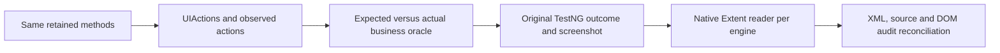

# Retained UI execution and auditable report evidence

Baseline: main source checkpoint `fe2940f`. Reference: the locally preserved
`main_mcp` checkpoint `70a7279c2a9560d39e6bd2554cd2f96a88626692`, including its
living-architecture HTML. This scope preserves the existing product methods and
improves their reporting, maintenance checks and documentation. It adds no
application journey, emulator, invoice creation or admin-order mutation.

## R-001: Make retained Playwright and Selenium evidence independently auditable

- Owner: generic UI action reporting, product validation owners, report
  publication and living-documentation governance.
- Priority: 90, from impact/risk/urgency 90/90/90.
- Baseline quality: 56, from correctness/verification/clarity 60/40/65.
- Observation: the same registration, account and profile methods exist in the
  archived branch and current framework. The neutral action/step/backend and
  listener architecture is retained. However, framework-ui/framework-browser
  select framework contracts, not these product journeys. The current reader
  publication contains no native product E2E report for either engine.
- Reporting gaps: RegistrationValidation asserts its business conditions
  without its own expected/actual validation steps. Generic typing publishes
  password values as ordinary details. A registration BeforeMethod records
  unconditional Ready/PASS without observing a precondition. These are audit
  defects, not reasons to invent new application cases.
- Correction: preserve the existing methods and their business assertions;
  use explicit three-class selections with an external run per engine. Keep
  semantic actions distinct from business validation, preserve original
  failures, mask sensitive framework value details and remove the empty Ready
  report step. Bind native readers to original XML, source and audit evidence.
- Governance: protect the retained living-principles map and its real owner/check
  links; retain the separate framework-suite opt-in boundary. Component controls
  cover expected/actual terminal validation events, unchanged typed inputs,
  original failure identity, both wait-capability paths, native audit subjects,
  verdict reconciliation and the narrow per-engine HTML publication role.
- Acceptance: execute the same retained method inventory through both native
  providers against the explicitly selected demo; preserve actual FAIL/SKIP as
  well as PASS. Reconcile native XML and report method/step nodes, source/engine
  identities, final screenshots and audit limits. Publish one original Extent
  reader per engine with three proof files, keeping complete history external.
  Pass focused maintenance/governance checks and the relevant framework baseline;
  preserve README edition parity and the paired living HTML/Markdown source hash.
- State: IN PROGRESS. Actual native executions and semantic report observations
  must qualify the final delivery before closure.

## Existing inventory and proof boundaries

| Retained class | Existing methods | Browser selection |
|---|---:|---|
| com.ai.atf.ui.RegistrationTests | 6 | Playwright and Selenium, same methods |
| com.ai.ui.tests.AccountAuthenticatedAreaTests | 5 | Playwright and Selenium, same methods |
| com.ai.ui.tests.ProfileContactAddressMemoryTests | 5 | Playwright and Selenium, same methods |

A negative application case passes when its independent rejection oracle passes.
It is distinct from a failed TestNG test. An action PASS records technical
completion; validation owns the business comparison and its terminal result.
Configuration setup evidence is not an extra application test case. Missing or
unreached evidence must remain explicit rather than receiving a fabricated PASS.

Arrows show evidence responsibility. Audit consistency is separate from
execution success and from exhaustive semantic coverage.

## Living principles and explicit limits

The [retained principles](../Living_Architecture_UI_API_doc_v1_0.md#retained-principles)
map archived intent to current owners and checks. Monolithic build rules,
hardwired Allure listeners, a blanket nested-step ban and fixed old browser
defaults must be reconciled with the chosen modular architecture. Their intent
does not authorize restoring retired MCP/skill runtime code.

The existing demo journeys create synthetic customers. They do not delete those
customers. Browser quit is session cleanup, not proof of application-data cleanup;
the living cleanup principle remains PARTIAL. Shared class setup supports the
existing read-only account/profile checks, with each method opening its own area.
No new cleanup journey or invoice/admin acceptance is inferred here.

Sensitive-input masking covers explicit framework typing details from the
declared label/selector semantics. It does not rewrite arbitrary provider
exception messages or unrelated caller logs. Native artifacts require their own
review; an error must retain its original technical identity and actual outcome.

G-014 and F-011 retain their independent TODO scopes. Historical Atlas captures
keep their captured source revisions; this work does not silently regenerate
their project understanding or reinterpret previous test outcomes.
