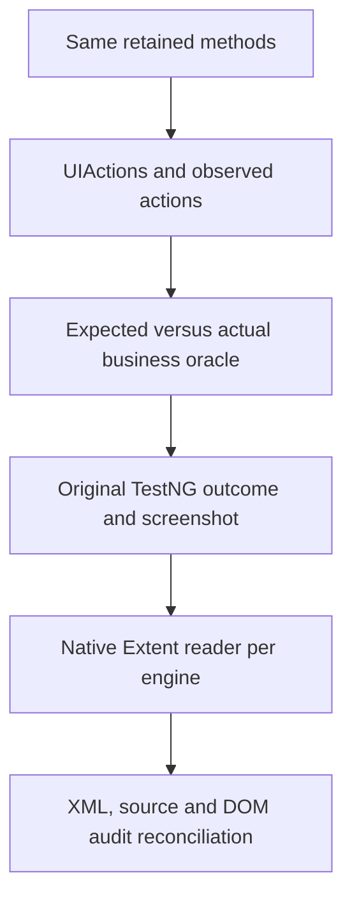

# Retained UI execution and auditable report evidence

Baseline: main source checkpoint `fe2940f`. Reference: the locally preserved
`main_mcp` checkpoint `70a7279c2a9560d39e6bd2554cd2f96a88626692`, including its
living-architecture HTML. This scope preserves the existing product methods and
improves their reporting, maintenance checks and documentation. It adds no
application journey, emulator, invoice creation or admin-order mutation.

## R-001: Make retained Playwright and Selenium evidence independently auditable

- Owner: generic UI action reporting, product validation owners, report
  publication and living-documentation governance.
- Priority: 90, from impact/risk/urgency 90/90/90.
- Baseline quality: 56, from correctness/verification/clarity 60/40/65.
- Baseline observation: the same registration, account and profile methods exist in the
  archived branch and current framework. The neutral action/step/backend and
  listener architecture is retained. However, framework-ui/framework-browser
  select framework contracts, not these product journeys. At that baseline, the reader
  publication contained no native product E2E report for either engine.
- Baseline reporting gaps: RegistrationValidation asserted its business conditions
  without its own expected/actual validation steps. Generic typing published
  password values as ordinary details. A registration BeforeMethod recorded
  unconditional Ready/PASS without observing a precondition. These were audit
  defects, not reasons to invent new application cases.
- Correction: preserve the existing methods and their business assertions;
  use explicit three-class selections with an external run per engine. Keep
  semantic actions distinct from business validation, preserve original
  failures, mask sensitive framework value details and remove the empty Ready
  report step. Bind native readers to original XML, source and audit evidence.
- Governance: protect the retained living-principles map and its real owner/check
  links; retain the separate framework-suite opt-in boundary. Component controls
  cover expected/actual terminal validation events, unchanged typed inputs,
  original failure identity, both wait-capability paths, native audit subjects,
  verdict reconciliation and the narrow per-engine HTML publication role.
- Acceptance: execute the same retained method inventory through both native
  providers against the explicitly selected demo; preserve actual FAIL/SKIP as
  well as PASS. Reconcile native XML and report method/step nodes, source/engine
  identities, final screenshots and audit limits. Publish one original Extent
  reader per engine with three proof files, keeping complete history external.
  Pass focused maintenance/governance checks and the relevant framework baseline;
  preserve README edition parity and the paired living HTML/Markdown source hash.
- State: VERIFIED for the bounded retained-UI auditability scope below.
- Delivered quality: 94, from correctness/verification/clarity 94/92/96. This is
  an evidence-backed maintenance judgment for this scope, not coverage, general
  demo stability, complete data cleanup or a whole-framework score.

## Existing inventory and proof boundaries

| Retained class | Existing methods | Browser selection |
|---|---:|---|
| com.ai.atf.ui.RegistrationTests | 6 | Playwright and Selenium, same methods |
| com.ai.ui.tests.AccountAuthenticatedAreaTests | 5 | Playwright and Selenium, same methods |
| com.ai.ui.tests.ProfileContactAddressMemoryTests | 5 | Playwright and Selenium, same methods |

A negative application case passes when its independent rejection oracle passes.
It is distinct from a failed TestNG test. An action PASS records technical
completion; validation owns the business comparison and its terminal result.
Configuration setup evidence is not an extra application test case. Missing or
unreached evidence must remain explicit rather than receiving a fabricated PASS.

Arrows show evidence responsibility. Audit consistency is separate from
execution success and from exhaustive semantic coverage.

## Living principles and explicit limits

The [retained principles](../Living_Architecture_UI_API_doc_v1_0.md#retained-principles)
map archived intent to current owners and checks. Monolithic build rules,
hardwired Allure listeners, a blanket nested-step ban and fixed old browser
defaults must be reconciled with the chosen modular architecture. Their intent
does not authorize restoring retired MCP/skill runtime code.

The existing demo journeys create synthetic customers. They do not delete those
customers. Browser quit is session cleanup, not proof of application-data cleanup;
the living cleanup principle remains PARTIAL. Shared class setup supports the
existing read-only account/profile checks, with each method opening its own area.
No new cleanup journey or invoice/admin acceptance is inferred here.

Sensitive-input masking covers explicit framework typing details from the
declared label/selector semantics. It does not rewrite arbitrary provider
exception messages or unrelated caller logs. Native artifacts require their own
review; an error must retain its original technical identity and actual outcome.

G-014 and F-011 retain their independent TODO scopes. Historical Atlas captures
keep their captured source revisions; this work does not silently regenerate
their project understanding or reinterpret previous test outcomes.

## Verified delivery and preserved observations

The same 16 retained methods passed through each native provider: **Playwright
16/16 PASS and Selenium 16/16 PASS**, with zero skipped methods. Both original
readers are reconciled against native XML for method/step identities,
expected/actual validation evidence, credential-detail masking, final PNG
containers and class setup. The two real shared setup scopes remain
configuration evidence beneath their first native serialized method in report
order; they add no product cases. Selected original screenshots and native
report rendering were reviewed separately.

| Selection | Original source | Result / external run |
|---|---|---|
| Playwright | `31db3ca93c2f302c8ceb355859a550db8fbcb37a` | 16/16 PASS; `retained-product-e2e-final-02-playwright` |
| Selenium | `31db3ca93c2f302c8ceb355859a550db8fbcb37a` | 16/16 PASS; `retained-product-e2e-final-01-selenium` |
| English default local reactor | `fc6a86fbc378f194318c0c651ee0994b3d0ce9f6` | BUILD SUCCESS; selected atf-tests XML 594/594 PASS; `modules-retained-ui-main-local-03` |
| Romanian default local reactor | `a90914f1177e85c9dfef5973096b03c822039139` | BUILD SUCCESS; selected atf-tests XML 594/594 PASS; `modules-retained-ui-ro-local-03` |
| Node component/governance tools | `fc6a86fbc378f194318c0c651ee0994b3d0ce9f6` | 181/181 PASS; `node-03` |

Native product executions retain their original source revision. The later
portability repair changes only the Node XML-rejection fixture; exact Java, POM
and resource inventories/hashes remain unchanged between the native selections
and the accepted default reactors. Compilation caches contain no previous test
results; normal Maven test phases ran again into fresh output directories.

Original evidence remains under `${ATF_WORK_ROOT}/runs` and
`${ATF_WORK_ROOT}/reviews/20261125-retained-ui-audit`, including source manifests,
process exits, native XML/HTML, captures, component TAP, rendering observations,
source-edition parity and publication journals. The [current report guide](../../artifacts/reports/README.md)
owns the portable commands and selected native readers. The generated current
selection contains 22 files; the previous 26-file publication and its 690-file
source context remain byte-identical in external history. Existing Atlas
readers retain their original captured revisions and dedicated styles.

The first full-local attempt stopped during compilation because the new
governance fixture called an existing helper with the wrong arity. The second
executed 594 atf-tests invocations in each edition and correctly failed one
portability check on an authored absolute file URI. Both observations remain
archived. The repaired URI is resolved from the current module at runtime; the
DTD/external-entity rejection assertion and portability guard remain intact.

The first final Playwright selection produced **15 PASS / 1 FAIL**: the
duplicate-email method hit a 20-second navigation timeout before its business
oracle. Its original XML, HTML, screenshot and passing *consistency* audit still
retain that failure. The same complete selection was rerun separately, with the
same timeout and no retry/skip policy or assertion relaxation. Its 16/16 result
does not erase the timeout or prove that the public demo cannot fluctuate.

The living Markdown/HTML projection retains all twelve principle IDs, real
owner/check links and matching row text; mutation controls reject missing IDs,
wrong owners, altered HTML states/hrefs and invented completion. Principle
identity remains independent of Markdown table order. The known cleanup
obligation LD-11 remains **PARTIAL**. No new E2E method, emulator, application
deletion workflow, invoice creation or admin mutation was added.

Visual review also observed a demo MFA enrollment QR/key below the profile
fields in the original full-page Playwright images. Typed-detail masking does
not sanitize credentials displayed in page pixels. The original HTML/PNGs stay
in the ignored local publication and external history; their retention is not
credential-redaction or public-sharing acceptance. No literal key, QR payload
or altered image is reproduced in this feedback.
