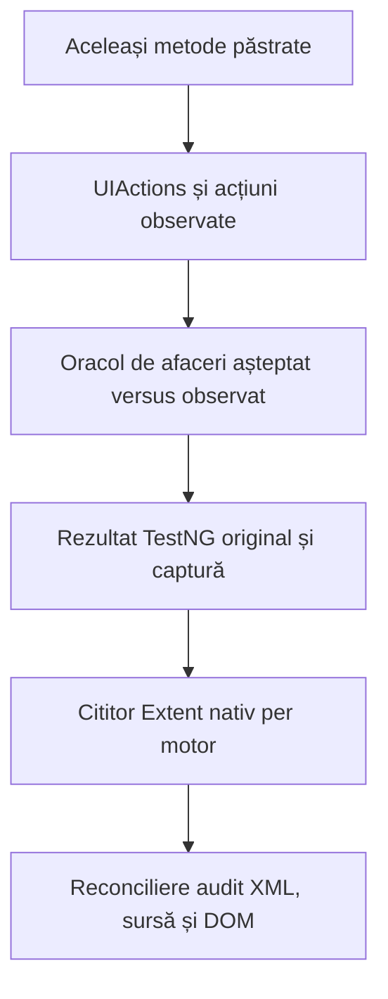

# Execuția UI păstrată și dovezi de raportare auditabile

Arie istorică: F-011 era deschis în această revizie capturată. Corecția ulterioară
a componentei și acceptanța curentă sunt în [F-011](Behavior_And_Negative_Cases.md#f-011);
aceasta nu rerulează și nu redenumește dovezile anterioare de produs/Atlas.

Bază: revizia sursă main `fe2940f`. Referință: revizia `main_mcp` păstrată local
`70a7279c2a9560d39e6bd2554cd2f96a88626692`, inclusiv HTML-ul arhitecturii vii.
Acest domeniu păstrează metodele existente de produs și îmbunătățește raportarea,
verificările de mentenanță și documentația lor. Nu adaugă scenarii de aplicație,
emulatoare, creare de facturi sau modificări ale comenzilor administrative.

## R-001: Fă dovezile Playwright și Selenium păstrate auditabile independent

- Responsabil: raportarea generică a acțiunilor UI, responsabilii validării
  de produs, publicarea rapoartelor și guvernanța documentației vii.
- Prioritate: 90, din impact/risc/urgență 90/90/90.
- Calitate inițială: 56, din corectitudine/verificare/claritate 60/40/65.
- Observație inițială: aceleași metode de înregistrare, cont și profil există
  în ramura arhivată și frameworkul curent. Arhitectura neutră de acțiuni/pași/backend
  și listener este păstrată. Totuși, framework-ui/framework-browser selectează
  contractele frameworkului, nu aceste scenarii de produs. La acea bază,
  publicarea cititoarelor nu conținea raport E2E nativ de produs pentru niciun motor.
- Lacune inițiale de raportare: RegistrationValidation verifica condițiile
  de afaceri fără pași proprii de validare așteptat/observat. Tastarea generică
  publica parole drept detalii obișnuite. Un BeforeMethod de înregistrare
  consemna Ready/PASS necondiționat fără observarea unei precondiții.
  Acestea erau defecte de audit, nu motive de a inventa cazuri noi de aplicație.
- Corecție: păstrează metodele existente și aserțiunile lor de afaceri;
  folosește selecții explicite de trei clase, cu o rulare externă per motor.
  Separă acțiunile semantice de validarea de afaceri, păstrează eșecurile
  originale, maschează detaliile valorilor sensibile din framework și elimină
  pasul gol Ready. Leagă cititoarele native de XML-urile, sursa și dovezile de audit originale.
- Guvernanță: protejează harta principiilor vii păstrate și legăturile sale
  reale responsabil/verificare; păstrează limita separată de activare a suitelor
  frameworkului. Controalele de componentă acoperă evenimentele terminale de
  validare așteptat/observat, intrările tastate neschimbate, identitatea eșecului
  original, ambele căi ale capabilității de așteptare, subiectele auditului nativ,
  reconcilierea verdictelor și rolul restrâns al publicării HTML per motor.
- Acceptanță: execută același inventar păstrat de metode prin ambii furnizori
  nativi pe demo-ul selectat explicit; păstrează FAIL/SKIP reale, precum și
  PASS. Reconciliază XML-ul nativ și nodurile de metodă/pas ale raportului,
  identitățile sursă/motor, capturile finale și limitele auditului. Publică
  un cititor Extent original per motor cu trei fișiere de dovadă, păstrând
  istoricul complet extern. Treci controalele focalizate de mentenanță/guvernanță
  și baza relevantă a frameworkului; păstrează paritatea edițiilor README și hash-ul sursei perechii vii HTML/Markdown.
- Stare: VERIFIED pentru domeniul limitat de auditabilitate UI păstrată de mai jos.
- Calitate livrată: 94, din corectitudine/verificare/claritate 94/92/96. Aceasta
  este o evaluare de mentenanță susținută de dovezi pentru acest domeniu,
  nu acoperire, stabilitate generală a demo-ului, curățare completă a datelor sau notă a întregului framework.

## Inventarul existent și limitele dovezilor

| Clasă păstrată | Metode existente | Selecție de browser |
|---|---:|---|
| com.ai.atf.ui.RegistrationTests | 6 | Playwright și Selenium, aceleași metode |
| com.ai.ui.tests.AccountAuthenticatedAreaTests | 5 | Playwright și Selenium, aceleași metode |
| com.ai.ui.tests.ProfileContactAddressMemoryTests | 5 | Playwright și Selenium, aceleași metode |

Un caz negativ de aplicație trece când trece oracolul său independent de respingere.
Este diferit de un test TestNG eșuat. Un PASS de acțiune consemnează finalizarea
tehnică; validarea deține comparația de afaceri și rezultatul său terminal.
Dovada pregătirii configurației nu este un caz suplimentar de test de aplicație.
Dovada lipsă sau neatinsă trebuie să rămână explicită, fără a primi un PASS inventat.

Săgețile arată responsabilitatea dovezilor. Consecvența auditului este
separată de succesul execuției și de acoperirea semantică exhaustivă.

## Principii vii și limite explicite

[Principiile păstrate](../Living_Architecture_UI_API_doc_v1_0.md#retained-principles)
leagă intenția arhivată de responsabilii și verificările curente. Regulile
monolitice de build, listener-ele Allure fixate, interzicerea globală a pașilor
imbricați și vechile valori implicite fixe de browser trebuie reconciliate
cu arhitectura modulară aleasă. Intenția lor nu autorizează restaurarea codului runtime MCP/skills retras.

Scenariile demo existente creează clienți sintetici. Nu șterg acești clienți.
Închiderea browserului curăță sesiunea, nu dovedește curățarea datelor aplicației;
principiul viu de curățare rămâne PARTIAL. Pregătirea comună la nivel de clasă
susține verificările existente doar pentru citire de cont/profil, fiecare
metodă deschizând propria zonă. Nu se deduce aici un nou scenariu de curățare sau acceptanță facturi/admin.

Mascarea intrărilor sensibile acoperă detaliile explicite de tastare ale
frameworkului, pe baza semanticii declarate a etichetei/selectorului. Nu rescrie
mesaje arbitrare ale excepțiilor furnizorului sau jurnale fără legătură ale
apelantului. Artefactele native necesită propria revizuire; o eroare trebuie
să-și păstreze identitatea tehnică originală și rezultatul real.

G-014 și F-011 își păstrează domeniile TODO independente. Capturile istorice
Atlas păstrează reviziile sursă capturate; această lucrare nu le regenerează
tacit înțelegerea proiectului și nu reinterpretează rezultatele testelor anterioare.

## Livrare verificată și observații păstrate

Aceleași 16 metode păstrate au trecut prin fiecare furnizor nativ: **Playwright
16/16 PASS și Selenium 16/16 PASS**, cu zero metode omise. Ambele cititoare
originale sunt reconciliate cu XML-ul nativ pentru identități de metode/pași,
dovezi de validare așteptat/observat, mascarea detaliilor acreditărilor,
containere PNG finale și pregătirea clasei. Cele două domenii reale de pregătire
comună rămân dovezi de configurare sub prima lor metodă nativă serializată
în ordinea raportului; nu adaugă cazuri de produs. Capturile originale selectate
și randarea rapoartelor native au fost revizuite separat.

| Selecție | Sursă originală | Rezultat / rulare externă |
|---|---|---|
| Playwright | `31db3ca93c2f302c8ceb355859a550db8fbcb37a` | 16/16 PASS; `retained-product-e2e-final-02-playwright` |
| Selenium | `31db3ca93c2f302c8ceb355859a550db8fbcb37a` | 16/16 PASS; `retained-product-e2e-final-01-selenium` |
| Reactorul local implicit engleză | `fc6a86fbc378f194318c0c651ee0994b3d0ce9f6` | BUILD SUCCESS; XML atf-tests selectat 594/594 PASS; `modules-retained-ui-main-local-03` |
| Reactorul local implicit română | `a90914f1177e85c9dfef5973096b03c822039139` | BUILD SUCCESS; XML atf-tests selectat 594/594 PASS; `modules-retained-ui-ro-local-03` |
| Utilitare Node de componentă/guvernanță | `fc6a86fbc378f194318c0c651ee0994b3d0ce9f6` | 181/181 PASS; `node-03` |

Execuțiile native de produs își păstrează revizia sursă originală. Repararea
ulterioară de portabilitate schimbă numai cazul Node de respingere XML;
inventarele/hash-urile exacte Java, POM și resurse rămân neschimbate între
selecțiile native și reactoarele implicite acceptate. Cache-urile de compilare
nu conțin rezultate de test anterioare; fazele normale Maven de test au rulat din nou în directoare noi de rezultate.

Dovezile originale rămân sub `${ATF_WORK_ROOT}/runs` și
`${ATF_WORK_ROOT}/reviews/20261125-retained-ui-audit`, inclusiv manifestele
sursei, codurile de ieșire, XML/HTML native, capturi, TAP de componentă,
observații de randare, paritatea edițiilor sursei și jurnalele publicării.
[Ghidul curent al rapoartelor](../../artifacts/reports/README.md) deține comenzile
portabile și cititoarele native selectate. Selecția curentă generată conține
22 de fișiere; publicarea anterioară de 26 de fișiere și contextul ei sursă
de 690 de fișiere rămân identice la nivel de octeți în istoricul extern.
Cititoarele Atlas existente păstrează reviziile capturate și stilurile dedicate originale.

Prima încercare completă locală s-a oprit la compilare deoarece noul caz de
guvernanță apela o funcție existentă cu număr greșit de argumente. A doua a
executat 594 de invocări atf-tests în fiecare ediție și a eșuat corect la o
verificare de portabilitate pentru un URI de fișier absolut scris în sursă.
Ambele observații rămân arhivate. URI-ul reparat este rezolvat din modulul
curent la runtime; aserțiunea de respingere DTD/entitate externă și controlul de portabilitate rămân intacte.

Prima selecție finală Playwright a produs **15 PASS / 1 FAIL**: metoda cu
e-mail duplicat a atins o expirare de navigare de 20 de secunde înaintea
oracolului de afaceri. XML-ul, HTML-ul, captura și auditul de *consecvență*
trecut originale păstrează acel eșec. Aceeași selecție completă a fost rerulată
separat, cu aceeași expirare, fără relaxarea politicii de reîncercare/omitere
sau a aserțiunilor. Rezultatul 16/16 nu șterge expirarea și nu dovedește că demo-ul public nu poate fluctua.

Proiecția vie Markdown/HTML păstrează toate cele douăsprezece ID-uri de
principii, legăturile reale responsabil/verificare și textul corespunzător
al rândurilor; controalele de mutație resping ID-uri lipsă, responsabili
greșiți, stări/href-uri HTML modificate și finalizări inventate. Identitatea
principiilor rămâne independentă de ordinea tabelului Markdown. Obligația
cunoscută de curățare LD-11 rămâne **PARTIAL**. Nu s-au adăugat metode E2E,
emulatoare, fluxuri de ștergere a aplicației, creare de facturi sau modificări administrative.

Revizuirea vizuală a observat și un QR/cheie de înrolare MFA demo sub câmpurile
profilului în imaginile originale Playwright ale paginii complete. Mascarea
detaliilor tastate nu curăță acreditările afișate în pixelii paginii. HTML-ul
și PNG-urile originale rămân în publicarea locală ignorată și istoricul extern;
păstrarea lor nu constituie acceptanță de redactare a acreditărilor sau de
partajare publică. Nicio cheie literală, conținut QR sau imagine modificată nu este reprodusă în acest feedback.
