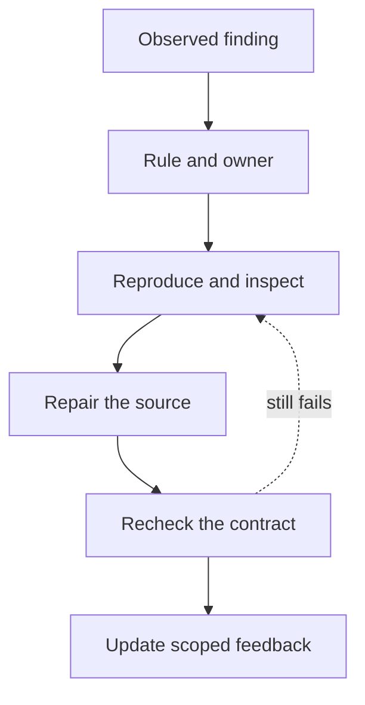

# Understanding and repairing a governance failure

## Read the evidence before changing the rule

Requirement GOV-DIAG-001: a supported governance finding MUST preserve observed
evidence and expose its failure meaning, repair hint, canonical owner and
maintained recheck selection. Hints describe plausible corrections; they do not
establish the root cause or authorize weakening a contract.

The shared formatter belongs to
[GovernanceFiles](../../atf-tests/src/test/java/com/ai/atf/governance/GovernanceFiles.java).
Architecture, documentation and English-source checks retain their existing
validators and finding codes. Messages and comments remain English in both
editions. This is existing test support, with no runtime service or rule module.



Arrows show a correction based on observed evidence. A failed recheck returns to
investigation; a suggested repair becomes verified only through inspection and
execution. Feedback closes only the demonstrated acceptance criteria.

## Message structure

| Field | Meaning | Reader action |
|---|---|---|
| Observed | Original finding, including location/code/details | Preserve it and identify the actual difference |
| Failure meaning | Why the supported rule matters | Check its boundary against current source |
| Repair hint | A correction to investigate | Reproduce before changing the source or owner guide |
| Owner | Canonical project-relative contract path/fragment | Read the contract and implementation together |
| Recheck | Maintained selection from an isolated reactor root | Execute the affected guard and inspect the result |

Order, repeated findings and multiline details are preserved. Only repeated
recheck commands are collapsed. Line numbers are shown only when supplied by the
producer; file/suite findings remain at that scope. An empty list means no
findings were supplied, not that every guard ran.

An actual IMPORT-WILDCARD finding retains its Java path and rule token, explains
explicit imports, links the [import owner](Code_And_Documentation_Policy.md#explicit-imports-and-visible-dependencies)
and selects FrameworkArchitectureGovernanceTest. DOC-LINK selects documentation
governance; ENG-COMMENT selects JavaSourceScannerTest. The original evidence is
independent of these explanatory fields.

## Choose the smallest owned correction

| Finding family | Canonical contract | Constructive correction |
|---|---|---|
| Reactor, coordinates, dependencies and cycles | [Module ownership](../Architecture.md#module-ownership) | Reconcile the reported POM/profile and existing graph |
| SDK, source reference and providers | [Provider composition](../Architecture.md#provider-composition) | Keep concrete implementations in their existing adapters |
| Imports and package/source layout | [Code policy](Code_And_Documentation_Policy.md) | Name dependencies explicitly; remove duplicate/shadow ownership |
| Waits, console, interruption and paths | [Execution and paths](Code_And_Documentation_Policy.md#visibility-and-execution) | Use established owners and caller-supplied roots |
| Suite wiring and inventory | [Existing-test quality](Code_And_Documentation_Policy.md#existing-test-quality) | Restore the affected existing regression and supported selection |
| Markdown structure, route or diagram | [Documentation and rendering](#documentation-and-rendering) | Repair the real target, syntax or explanatory legend |
| Examples, commands and defaults | [Testing](../Testing.md) | Align examples with actual public APIs and declarations |
| Documentation editions | [Edition contract](Readme_Editions.md) | Preserve code, links, anchors, commands, topology and identical non-document source |
| Inline code or numeric translation facts | [Protected documentation facts](Readme_Editions.md#existing-executable-checks) | Use the reported item ordinal to compare canonical code spans and corresponding numeric table rows; retain human semantic review |
| Living architecture pair | [Essential source](../Living_Architecture_UI_API_doc_v1_0.md) | Synchronize HTML/Markdown, source digest and navigation |
| Feedback state and lifecycle | [Feedback rubric](../feedback/README.md) | Retain baseline assessments and close only proven criteria |
| English source/prose and data exceptions | [English requirement](Code_And_Documentation_Policy.md#english-source-and-comments) | Translate authored text and keep reviewed external data exact |

Do not remove assertions, skip a gate, enable an opt-in product selection, add a
dummy route or expand an exemption just to silence a failure. If the rule is
wrong, record its reproducer, owner, proposed correction and independent negative
control before changing it. No E2E expansion is needed.

## Exact negative controls

A negative fixture must match the emitted rule token plus any requested location
or detail. DOC-EDITION-PARITY differs from DOC-EDITION. A code in a filename,
payload, explanation or repair hint is not the observed rule. The assertion must
still fail when only a related or unrelated finding remains.

Existing architecture/documentation assertion helpers enforce this identity and
require owned guidance for their emitted findings. A useful fixture proves the
invalid input is rejected, then a real correction clears its guard. New rule
codes need owned guidance and an actual negative fixture; counting assertions or
finding a matching word in a rendered message is insufficient.

## Documentation and rendering

Inspect the named document and its actual target or diagram source. Repair
malformed fences/disclosures before interpreting downstream diagram errors.
Render changed diagrams and inspect labels, arrows and overflow; a source guard
does not render Mermaid or certify appearance. Preserve an approved root map
unless an observed mismatch requires a scoped correction.

For documentation translations use the explicit peer input in
[README editions](Readme_Editions.md#synchronization-and-review). A local edition
check alone does not establish cross-branch identity.

DOC-TITLE, DOC-HEADING, DOC-FENCE-LANGUAGE and DOC-EDITORIAL apply to every
maintained Markdown document. Correct the first actual title, hierarchy, fence
or drafting token before interpreting later findings. Literal examples may
intentionally contain invalid syntax; a valid repair changes the owned prose,
not the guard's exclusions. DOC-EDITION-FACTS reports the protected item to inspect,
while DOC-EDITION-PARITY retains its structural/topology responsibility.

The retained-UI maintenance CLI has its own actual `Owner` and `Recheck` fields.
Its component regression resolves the emitted documentation route and executes
the suggested command against synthetic report inputs. That proves a usable
repair route; it does not execute an application journey or establish browser
acceptance.

## Unknown findings

Unknown/unstructured findings retain their original evidence and explicitly
unclassified meaning/selection. A code mentioned in payload must not select a
known repair. Inspect the emitting validator before choosing a correction.
Parser, I/O and infrastructure exceptions retain their stack/cause; the finding
formatter does not convert every exception into a classified result.

## Verification and feedback

From an isolated reactor copy, run the existing owners:

<details>
<summary>Run Verification and feedback commands</summary>

```powershell
mvn -B -ntp -pl atf-tests -am "-Dtest=FrameworkArchitectureGovernanceTest,DocumentationGovernanceTest,DocumentationReadabilityRulesTest,JavaSourceScannerTest" "-Dsurefire.failIfNoSpecifiedTests=false" test
```

</details>

These guards verify supported source/documentation contracts and diagnostic
controls. Runtime regression outcomes remain separate evidence. Record the exact
selection, original failure, investigated cause, correction, successful recheck
and proof limit in [feedback](../feedback/README.md). Preserve original reports
through the [report archive](../../artifacts/reports/README.md).

Readability findings explain whether to split a decision, compare alternatives in
a table, use parallel bullets or draw a real flow with a legend. Command
disclosure failures require closed details, a descriptive summary and visible
prerequisites. Translation findings distinguish a supported language signal,
unchanged source prose, technical drift and stale full-text review; follow the
[whole-document review](Readme_Editions.md#whole-document-review) before renewing
the paired hashes. A corrected hash alone is not a semantic repair.
