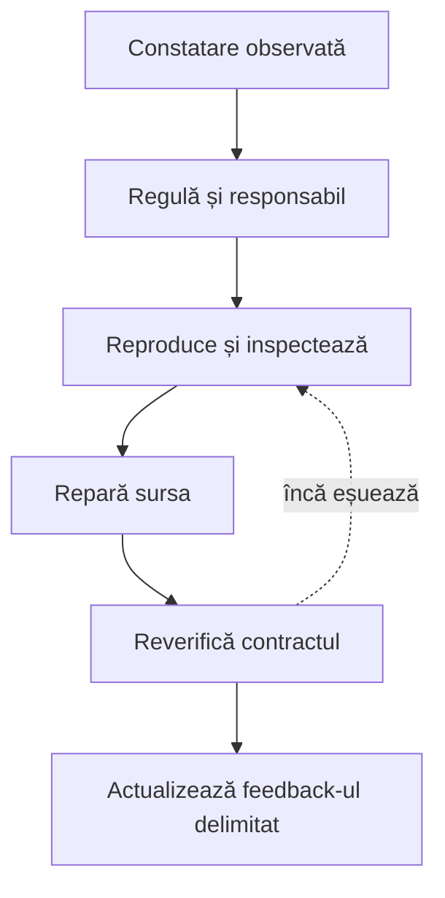

<a id="understanding-and-repairing-a-governance-failure"></a>
# Înțelegerea și repararea unui eșec de guvernanță

<a id="read-the-evidence-before-changing-the-rule"></a>
## Citește dovada înainte de schimbarea regulii

Cerința GOV-DIAG-001: o constatare de guvernanță suportată TREBUIE să păstreze
dovada observată și să expună sensul eșecului, indiciul de reparare, responsabilul
canonic și selecția întreținută de reverificare. Indiciile descriu corecții
plauzibile; nu stabilesc cauza și nu autorizează slăbirea unui contract.

Formatatorul comun aparține
[GovernanceFiles](../../atf-tests/src/test/java/com/ai/atf/governance/GovernanceFiles.java).
Controalele de arhitectură, documentație și sursă engleză își păstrează
validatorii existenți și codurile constatărilor. Mesajele și comentariile
rămân în engleză în ambele ediții. Acesta este suport de test existent, fără serviciu runtime sau modul de reguli.



Săgețile arată o corecție bazată pe dovada observată. O reverificare eșuată
revine la investigare; o remediere sugerată devine verificată numai prin
inspecție și execuție. Feedback-ul închide numai criteriile de acceptanță demonstrate.

<a id="message-structure"></a>
## Structura mesajului

| Câmp | Sens | Acțiunea cititorului |
|---|---|---|
| Observed | Constatarea originală, inclusiv locație/cod/detalii | Păstreaz-o și identifică diferența reală |
| Failure meaning | Motivul pentru care contează regula suportată | Verifică limita sa față de sursa curentă |
| Repair hint | O corecție de investigat | Reproduce înainte de schimbarea sursei sau a ghidului responsabil |
| Owner | Calea/fragmentul contractului canonic, relativ la proiect | Citește împreună contractul și implementarea |
| Recheck | Selecția întreținută din rădăcina unui reactor izolat | Execută controlul afectat și inspectează rezultatul |

Ordinea, constatările repetate și detaliile pe mai multe linii sunt păstrate.
Numai comenzile repetate de reverificare sunt grupate. Numerele liniilor sunt
afișate numai când sunt furnizate de producător; constatările de fișier/suită
rămân la acel nivel. O listă goală înseamnă că nu s-au furnizat constatări,
nu că fiecare control a rulat.

O constatare reală IMPORT-WILDCARD își păstrează calea Java și tokenul regulii,
explică importurile explicite, leagă [responsabilul importurilor](Code_And_Documentation_Policy.md#explicit-imports-and-visible-dependencies)
și selectează FrameworkArchitectureGovernanceTest. DOC-LINK selectează
guvernanța documentației; ENG-COMMENT selectează JavaSourceScannerTest.
Dovada originală este independentă de aceste câmpuri explicative.

<a id="choose-the-smallest-owned-correction"></a>
## Alege cea mai mică corecție cu responsabil

| Familia constatării | Contract canonic | Corecție constructivă |
|---|---|---|
| Reactor, coordonate, dependențe și cicluri | [Responsabilitatea modulelor](../Architecture.md#module-ownership) | Reconciliază POM-ul/profilul raportat și graful existent |
| SDK, referință sursă și furnizori | [Compunerea furnizorilor](../Architecture.md#provider-composition) | Păstrează implementările concrete în adaptoarele lor existente |
| Importuri și structură pachet/sursă | [Politica de cod](Code_And_Documentation_Policy.md) | Numește dependențele explicit; elimină responsabilitatea duplicată/ascunsă |
| Așteptări, consolă, întrerupere și căi | [Execuție și căi](Code_And_Documentation_Policy.md#visibility-and-execution) | Folosește responsabilii stabiliți și rădăcini furnizate de apelant |
| Legarea suitelor și inventarul | [Calitatea testelor existente](Code_And_Documentation_Policy.md#existing-test-quality) | Restaurează regresia existentă afectată și selecția suportată |
| Structură Markdown, rută sau diagramă | [Documentație și randare](#documentation-and-rendering) | Repară ținta reală, sintaxa sau legenda explicativă |
| Exemple, comenzi și valori implicite | [Testare](../Testing.md) | Aliniază exemplele la API-urile publice și declarațiile reale |
| Edițiile documentației | [Contractul edițiilor](Readme_Editions.md) | Păstrează codul, legăturile, ancorele, comenzile, topologia și identitatea sursei din afara documentației |
| Cod inline sau date numerice traduse | [Datele protejate ale documentației](Readme_Editions.md#existing-executable-checks) | Folosește poziția raportată pentru a compara codul inline canonic și rândurile numerice corespunzătoare; păstrează revizuirea semantică umană |
| Perechea arhitecturii vii | [Sursa esențială](../Living_Architecture_UI_API_doc_v1_0.md) | Sincronizează HTML/Markdown, digestul sursei și navigarea |
| Starea și ciclul feedback-ului | [Grila feedback-ului](../feedback/README.md) | Păstrează evaluările inițiale și închide numai criteriile dovedite |
| Sursă/proză engleză și excepții de date | [Cerința engleză](Code_And_Documentation_Policy.md#english-source-and-comments) | Traduce textul propriu și păstrează exacte datele externe revizuite |

Nu elimina aserțiuni, nu omite controale, nu activa o selecție explicită de
produs, nu adăuga o rută fictivă și nu lărgi o excepție doar pentru a reduce
la tăcere un eșec. Dacă regula este greșită, înregistrează reproducerea,
responsabilul, corecția propusă și controlul negativ independent înaintea schimbării sale. Nu este necesară extinderea E2E.

<a id="exact-negative-controls"></a>
## Controale negative exacte

Un caz negativ trebuie să potrivească tokenul regulii emise și orice locație
sau detaliu cerut. DOC-EDITION-PARITY diferă de DOC-EDITION. Un cod dintr-un
nume de fișier, conținut, explicație sau indiciu de reparare nu este regula
observată. Aserțiunea trebuie să continue să eșueze când rămâne numai o constatare înrudită sau fără legătură.

Funcțiile existente de aserțiune pentru arhitectură/documentație impun această
identitate și cer îndrumare responsabilă pentru constatările emise. Un caz
util demonstrează respingerea intrării invalide, apoi o corecție reală elimină
constatarea. Codurile noi de reguli necesită îndrumare responsabilă și un caz
negativ real; numărarea aserțiunilor sau găsirea unui cuvânt într-un mesaj randat este insuficientă.

<a id="documentation-and-rendering"></a>
## Documentație și randare

Inspectează documentul numit și ținta sa reală sau sursa diagramei. Repară
blocurile de cod/pliabile malformate înaintea interpretării erorilor ulterioare
de diagramă. Randează diagramele schimbate și inspectează etichetele, săgețile
și depășirile; controlul de sursă nu randează Mermaid și nu certifică aspectul.
Păstrează harta rădăcină aprobată, exceptând o corecție delimitată cerută de o nepotrivire observată.

Pentru traducerea documentației folosește intrarea explicită a perechii din
[edițiile README](Readme_Editions.md#synchronization-and-review). Verificarea
locală a ediției nu stabilește singură identitatea între ramuri.

DOC-TITLE, DOC-HEADING, DOC-FENCE-LANGUAGE și DOC-EDITORIAL se aplică fiecărui
Markdown întreținut. Corectează primul titlu, nivel de ierarhie, bloc sau token
editorial realmente incorect înaintea interpretării constatărilor ulterioare.
Exemplele literale pot conține intenționat sintaxă invalidă; repararea validă
schimbă proza responsabilă, nu excluderile controlului. DOC-EDITION-FACTS
raportează elementul protejat de inspectat, în timp ce DOC-EDITION-PARITY păstrează responsabilitatea structurală/de topologie.

CLI-ul de mentenanță pentru UI păstrat are propriile câmpuri reale `Owner` și
`Recheck`. Regresia sa de componentă rezolvă ruta de documentație emisă și
execută comanda sugerată pe intrări sintetice de raport. Aceasta demonstrează
o rută de reparare utilizabilă; nu execută un scenariu de aplicație și nu stabilește acceptanța de browser.

<a id="unknown-findings"></a>
## Constatări necunoscute

Constatările necunoscute/nestructurate își păstrează dovada originală și sensul/
selecția explicit neclasificate. Un cod menționat în conținut nu trebuie să
selecteze o remediere cunoscută. Inspectează validatorul emitent înaintea
alegerii corecției. Excepțiile de parsare, I/O și infrastructură își păstrează
stiva/cauza; formatatorul nu transformă orice excepție într-un rezultat clasificat.

<a id="verification-and-feedback"></a>
## Verificare și feedback

Dintr-o copie izolată a reactorului, rulează responsabilii existenți:

<details>
<summary>Rulează comenzile de verificare și feedback</summary>

```powershell
mvn -B -ntp -pl atf-tests -am "-Dtest=FrameworkArchitectureGovernanceTest,DocumentationGovernanceTest,DocumentationRootGovernanceTest,DocumentationEditionGovernanceTest,LivingPrinciplesGovernanceTest,DocumentationStructureGovernanceTest,FeedbackGovernanceTest,DocumentationPublicationGovernanceTest,DocumentationReadabilityRulesTest,JavaSourceScannerTest" "-Dsurefire.failIfNoSpecifiedTests=false" test
```

</details>

Aceste controale verifică contractele suportate de sursă/documentație și
controalele de diagnostic. Rezultatele regresiilor runtime rămân dovezi
separate. Înregistrează selecția exactă, eșecul original, cauza investigată,
corecția, reverificarea reușită și limita dovezii în
[feedback](../feedback/README.md). Păstrează rapoartele originale prin
[arhiva rapoartelor](../../artifacts/reports/README.md).

Constatările de lizibilitate explică dacă trebuie separată o decizie,
comparate alternativele într-un tabel, folosite puncte paralele sau desenat
un flux real cu legendă. Eșecurile blocurilor de comenzi cer details închis
implicit, sumar descriptiv și precondiții vizibile. Constatările de traducere
disting semnalul lingvistic suportat, proza sursă neschimbată, deriva tehnică
și revizuirea completă învechită; urmează
[revizuirea întregului document](Readme_Editions.md#whole-document-review)
înaintea reînnoirii hash-urilor pereche. Un hash corectat singur nu este o reparare semantică.
