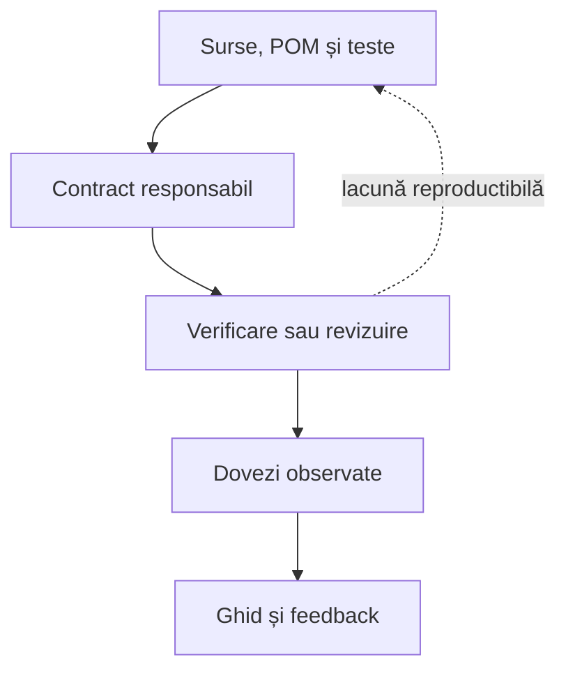

# Guvernanța framework-ului

## Scop și limite

Această zonă gestionează politicile de revizuire pentru cod, testele existente și
documentația menținută. Transformă practici istorice utile în contracte de framework
fără a restaura un registru de skill-uri, un sistem de agenți sau infrastructură de generare.

Reactorul rămâne format din cinci module Maven: atf-core, atf-playwright, atf-selenium,
atf-reporting și atf-tests. [Atlasul](../../atf-atlas/README.md) separat înseamnă
documentație și guvernanță; nu este un al șaselea modul Maven.

## Alege responsabilul revizuirii

| Întrebare | Responsabil canonic |
|---|---|
| Cum se revizuiesc codul, testele existente și documentația? | [Politica pentru cod și documentație](Code_And_Documentation_Policy.md) |
| Cum înțeleg un eșec și verific remedierea lui? | [Diagnosticarea eșecurilor și controale negative exacte](Failure_Diagnostics.md) |
| Cum se păstrează echivalența README-urilor în engleză și română? | [Edițiile README](Readme_Editions.md) |
| Ce modul gestionează contractul modificat? | [Arhitectură](../Architecture.md) și ghidul de modul indicat |
| Ce teste existente îl protejează? | [Harta de acoperire Atlas](../../atf-atlas/Coverage_Map.md) și [Testare](../Testing.md) |
| Ce rămâne nerezolvat și ce ar închide constatarea? | [Feedback](../feedback/README.md) |
| Unde se fac validarea și sincronizarea? | [Dezvoltare](../Development.md) |
| Ce practici pentru cod și teste au verificări executabile? | [Politica importurilor, responsabilităților și regresiilor stabile](Code_And_Documentation_Policy.md) |
| Cum sunt separate rapoartele generate de sursele menținute? | [Artefacte](../../artifacts/README.md) și [arhiva rapoartelor](../../artifacts/reports/README.md) |

Fluxul leagă o afirmație factuală de responsabilul și dovada sa. O verificare eșuată
revine la sursa sau documentul responsabil; nu autorizează slăbirea verificării.
Regulile stabile rămân în ghidul responsabilului, iar feedback-ul înregistrează lacunele
rămase și dovezile de închidere la limitele declarate.

## Verificările executabile existente

| Responsabil | Suprafața verificată în prezent | Ce demonstrează rezultatul |
|---|---|---|
| Arhitectură | [Regulile de arhitectură](../../atf-tests/src/test/java/com/ai/atf/governance/FrameworkArchitectureRules.java) și [fixture-urile existente](../../atf-tests/src/test/java/com/ai/atf/governance/FrameworkArchitectureGovernanceTest.java) | Limitele modulelor și furnizorilor, vizibilitatea surselor și regulile susținute de responsabilitate a execuției |
| Documentație | [Regulile Markdown](../../atf-tests/src/test/java/com/ai/atf/governance/MarkdownDocumentationRules.java) și [fixture-urile existente](../../atf-tests/src/test/java/com/ai/atf/governance/DocumentationGovernanceTest.java) | Legături, fapte declarate despre construcție și valori implicite, ciclu de viață, arhitectură în ambele formate și exemple compilabile |
| Inspecția surselor | [Fixture-urile scanerului Java](../../atf-tests/src/test/java/com/ai/atf/governance/JavaSourceScannerTest.java) | Regiuni lexicale susținute, politica markerilor cunoscuți pentru engleză și excepțiile exacte pentru date |
| Comportament | Testele indicate de [harta de acoperire](../../atf-atlas/Coverage_Map.md) | Rezultatele observate explicite și limitele fixture-urilor |

O politică scrisă nu este dovada unei verificări automate. Menține identificabile
criteriile de revizuire manuală; înregistrează verificarea lipsă ca lacună, fără a afirma
că o suită verde demonstrează întreaga politică.
