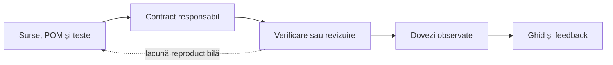
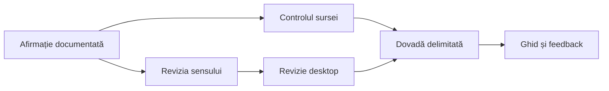

# Guvernanța framework-ului

## Scop și limite

Această zonă gestionează politicile de revizuire pentru cod, testele existente și
documentația menținută. Transformă practici istorice utile în contracte de framework
fără a restaura un registru de skill-uri, un sistem de agenți sau infrastructură de generare.

Reactorul rămâne format din cinci module Maven: atf-core, atf-playwright, atf-selenium,
atf-reporting și atf-tests. [Atlasul](../../atf-atlas/README.md) separat înseamnă
documentație și guvernanță; nu este un al șaselea modul Maven.

## Alege responsabilul revizuirii

| Întrebare | Responsabil canonic |
|---|---|
| Cum se revizuiesc codul, testele existente și documentația? | [Politica pentru cod și documentație](Code_And_Documentation_Policy.md) |
| Cum înțeleg un eșec și verific remedierea lui? | [Diagnosticarea eșecurilor și controale negative exacte](Failure_Diagnostics.md) |
| Cum se păstrează echivalența documentelor în engleză și română? | [Edițiile documentației](Readme_Editions.md) |
| Ce modul gestionează contractul modificat? | [Arhitectură](../Architecture.md) și ghidul de modul indicat |
| Ce teste existente îl protejează? | [Harta de acoperire Atlas](../../atf-atlas/Coverage_Map.md) și [Testare](../Testing.md) |
| Ce rămâne nerezolvat și ce ar închide constatarea? | [Feedback](../feedback/README.md) |
| Unde se fac validarea și sincronizarea? | [Dezvoltare](../Development.md) |
| Ce practici pentru cod și teste au verificări executabile? | [Politica importurilor, responsabilităților și regresiilor stabile](Code_And_Documentation_Policy.md) |
| Cum sunt separate rapoartele generate de sursele menținute? | [Artefacte](../../artifacts/README.md) și [arhiva rapoartelor](../../artifacts/reports/README.md) |

Legendă: relații și limita dovezii

Fluxul leagă o afirmație factuală de responsabilul și dovada sa. O verificare eșuată
revine la sursa sau documentul responsabil; nu autorizează slăbirea verificării.
Regulile stabile rămân în ghidul responsabilului, iar feedback-ul înregistrează lacunele
rămase și dovezile de închidere la limitele declarate.

## Verificările executabile existente

| Responsabil | Suprafața verificată în prezent | Ce demonstrează rezultatul |
|---|---|---|
| Arhitectură | [Regulile de arhitectură](../../atf-tests/src/test/java/com/ai/atf/governance/FrameworkArchitectureRules.java) și [fixture-urile existente](../../atf-tests/src/test/java/com/ai/atf/governance/FrameworkArchitectureGovernanceTest.java) | Limitele modulelor și furnizorilor, vizibilitatea surselor și regulile susținute de responsabilitate a execuției |
| Documentație | [Regulile Markdown](../../atf-tests/src/test/java/com/ai/atf/governance/MarkdownDocumentationRules.java) și [testele README](../../atf-tests/src/test/java/com/ai/atf/governance/DocumentationRootGovernanceTest.java) | README, ediții, Living, structură, feedback și publicare au responsabili separați; ambele suite îi înscriu |
| Lizibilitate | [Reguli pentru cititor și cazuri de componentă](../../atf-tests/src/test/java/com/ai/atf/governance/DocumentationReadabilityRulesTest.java) | Decizii în paragrafele strategiei, proză de referință limitată și rețete Maven pliate |
| Prezentare | [Regulile diagramelor](../../atf-tests/src/test/java/com/ai/atf/governance/DocumentationPresentationRules.java) | Fluxuri orizontale, legende adiacente pliate și revizie desktop a geometriei |
| Revizia edițiilor | [Controale de traducere](../../atf-tests/src/test/java/com/ai/atf/governance/DocumentationTranslationRules.java) | Semnale românești acceptate, blocuri englezești neschimbate și actualitatea amprentelor reviziei complete |
| Inspecția surselor | [Fixture-urile scanerului Java](../../atf-tests/src/test/java/com/ai/atf/governance/JavaSourceScannerTest.java) | Regiuni lexicale susținute, politica markerilor cunoscuți pentru engleză și excepțiile exacte pentru date |
| Comportament | Testele indicate de [harta de acoperire](../../atf-atlas/Coverage_Map.md) | Rezultatele observate explicite și limitele fixture-urilor |

O politică scrisă nu este dovada unei verificări automate. Menține identificabile
criteriile de revizuire manuală; înregistrează verificarea lipsă ca lacună, fără a afirma
că o suită verde demonstrează întreaga politică.

## Bune practici pentru revizuirea documentației

| Nivelul revizuirii | Întrebare concretă | Dovezi pentru finalizare |
|---|---|---|
| Faptele din surse | Există această opțiune, valoare implicită, comandă sau dependență la sursa de referință indicată? | Inspecția POM-ului, resurselor și API-ului și verificarea faptelor definită de responsabil |
| Structura documentului | Poate cititorul urmări un singur titlu, o ierarhie logică, exemple cu limbaj declarat și secțiuni pliabile echilibrate? | Verificarea existentă a documentației, cu controale care eșuează intenționat |
| Traducerea | Păstrează fiecare paragraf românesc condițiile, negațiile, literalii tehnici și limitele dovezilor? | Revizuirea umană integrală a perechilor și verificarea faptelor protejate, legăturilor, exemplelor și topologiei |
| Diagramele | Ce înseamnă săgețile și corespunde redarea lor vizibilă surselor? | Legendă alăturată, comparație cu sursele/POM-ul și inspecția fiecărei redări modificate |
| Închiderea | Ce observație exactă s-a schimbat și ce rămâne necunoscut? | Commit-urile surselor, rezultatele selecțiilor efectiv executate și feedback cu limite explicite |

Legendă: relații și limita dovezii

Săgețile disting verificările automate de revizuirea semantică și vizuală. Ambele
trasee contribuie cu dovezi; niciunul nu certifică singur o traducere sau întregul
comportament de execuție. Urmează [procedura de revizuire](Code_And_Documentation_Policy.md#apply-the-documentation-review-in-practice)
și [contractul edițiilor](Readme_Editions.md) înainte de sincronizare.

Verificările de stil susținute se aplică tuturor documentelor Markdown menținute.

- Regulile specifice README-urilor păstrează rădăcina axată pe orientarea modulelor și a execuției, impun diagrame separate pentru dependențe și flux și trimit exemplele către responsabilii Playwright/Selenium.
- README-urile modulelor/pachetelor dețin contractele și verificările locale.
- Limita pentru celulele de tabel semnalează proza densă; nu înlocuiește revizuirea la lățimea randată.
- Codul literal rămâne în engleză în ambele ediții, iar observațiile istorice își păstrează sursa și selecția capturate.
- [Ghidul eșecurilor](Failure_Diagnostics.md) explică locația emisă, regula, indicația de remediere, responsabilul și comanda de reverificare.
