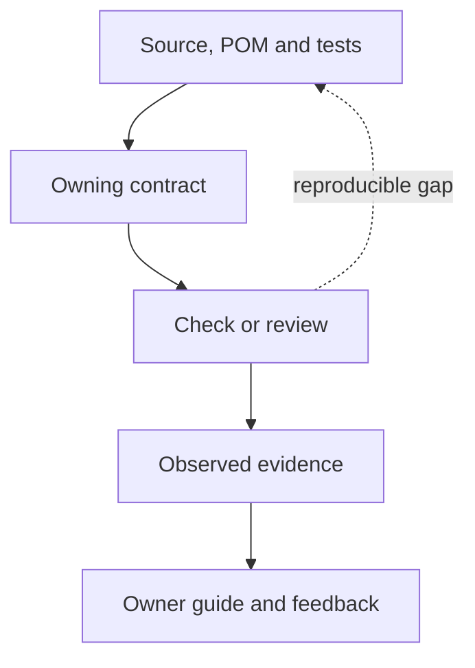
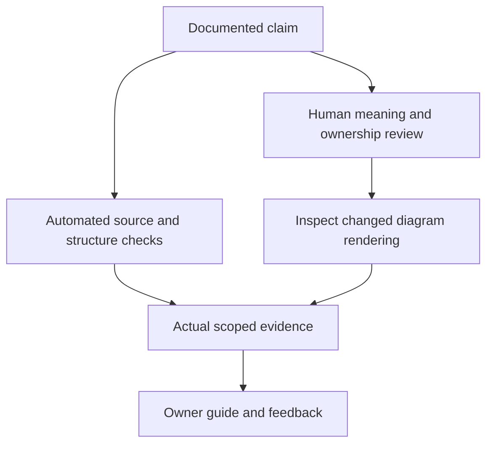

# Framework governance

## Purpose and scope

This area owns the review policies for code, existing tests and maintained
documentation. It translates useful historical practices into framework
contracts without restoring a skill registry, agent runtime or generation stack.

The reactor remains five Maven modules: atf-core, atf-playwright, atf-selenium,
atf-reporting and atf-tests. The separate [Atlas](../../atf-atlas/README.md) is
documentation and governance; it is not a sixth Maven module.

## Choose a review owner

| Question | Canonical owner |
|---|---|
| How should code, existing tests and documentation be reviewed? | [Code and documentation policy](Code_And_Documentation_Policy.md) |
| How do I understand a failure and verify its correction? | [Failure diagnostics and exact negative controls](Failure_Diagnostics.md) |
| How are English and Romanian documents kept equivalent? | [Documentation editions](Readme_Editions.md) |
| Which module owns the changed contract? | [Architecture](../Architecture.md) and its linked module guide |
| Which existing tests protect it? | [Atlas coverage map](../../atf-atlas/Coverage_Map.md) and [Testing](../Testing.md) |
| What remains unresolved, and what would close it? | [Feedback](../feedback/README.md) |
| Where do validation and synchronization happen? | [Development](../Development.md) |
| Which code and test practices are executable rules? | [Imports, ownership and stable regression policy](Code_And_Documentation_Policy.md) |
| How are generated reports separated from maintained sources? | [Artifacts](../../artifacts/README.md) and [report archive](../../artifacts/reports/README.md) |

The flow connects a factual claim to its owner and proof. A failed check returns
to the responsible source or document; it does not authorize weakening the check.
Stable rules stay in their owner guide, while feedback records remaining gaps
and scoped closure evidence.

## Existing executable surface

| Owner | Current guard surface | What its result establishes |
|---|---|---|
| Architecture | [Architecture rules](../../atf-tests/src/test/java/com/ai/atf/governance/FrameworkArchitectureRules.java) and [existing fixtures](../../atf-tests/src/test/java/com/ai/atf/governance/FrameworkArchitectureGovernanceTest.java) | Module/provider boundaries, source visibility and supported execution-ownership rules |
| Documentation | [Markdown rules](../../atf-tests/src/test/java/com/ai/atf/governance/MarkdownDocumentationRules.java) and [root tests](../../atf-tests/src/test/java/com/ai/atf/governance/DocumentationRootGovernanceTest.java) | README, editions, Living, structure, feedback and publication have separate owners; both suites register each |
| Readability | [Reader-oriented rules and component cases](../../atf-tests/src/test/java/com/ai/atf/governance/DocumentationReadabilityRulesTest.java) | Strategy paragraph decisions, bounded reference prose and closed Maven recipes |
| Edition review | [Translation controls](../../atf-tests/src/test/java/com/ai/atf/governance/DocumentationTranslationRules.java) | Supported Romanian signals, unchanged English blocks and complete review-digest freshness |
| Source inspection | [Java scanner fixtures](../../atf-tests/src/test/java/com/ai/atf/governance/JavaSourceScannerTest.java) | Supported lexical regions, English known-marker policy and exact data exceptions |
| Behavior | Tests linked by the [coverage map](../../atf-atlas/Coverage_Map.md) | Their explicit observed outcomes and fixture scope |

A written policy is not evidence of an automated guard. Keep manual review
criteria identifiable; record a missing check as a gap rather than claiming
that a green suite proves the whole policy.

## Best practices for a documentation review

| Review layer | Concrete question | Completion evidence |
|---|---|---|
| Source facts | Does this option, default, command or dependency exist at its stated owner? | POM/resource/API inspection and the owned factual check |
| Document structure | Can the reader follow one title, logical headings, typed examples and balanced disclosures? | Existing documentation guard with deliberate failing controls |
| Translation | Does each Romanian paragraph retain conditions, negations, technical literals and proof limits? | Complete paired human review plus protected-fact, link, example and topology checks |
| Diagrams | What do arrows mean, and does their visible rendering match the source? | Adjacent legend, source/POM comparison and inspection of each changed rendering |
| Closure | Which exact observation changed, and what still remains unknown? | Source commits, actual selected results and scoped feedback |

Arrows separate automated checks from semantic and visual review. Both paths
contribute evidence; neither path alone certifies a translation or complete
runtime behavior. Follow the [review procedure](Code_And_Documentation_Policy.md#apply-the-documentation-review-in-practice)
and [edition contract](Readme_Editions.md) before synchronization.

The supported style checks apply to all maintained Markdown. README-only rules
keep the root focused on module/runtime orientation, require separate
dependency and execution diagrams, and route detailed consumer examples to
their Playwright/Selenium owners. Module and package READMEs own
their specific contracts and local verification. Table-cell limits flag dense
prose for restructuring; they do not replace review at the rendered width.
Literal code stays English in both editions, and historical observations retain
their captured source and selection. The [failure guide](Failure_Diagnostics.md)
explains the emitted location, rule, repair hint, owner and recheck command.
