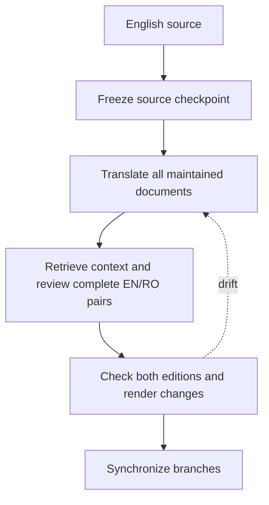

# English and Romanian documentation editions

## Ownership and scope

The main branch owns the English framework and documentation. The main_RO branch
provides a complete Romanian edition at the same project paths. This includes
all maintained Markdown, not only README.md, and the essential Living HTML
projection. Generated historical reports keep their captured language and source.

| Content | main | main_RO |
|---|---|---|
| Maintained Markdown prose, headings, tables and diagram labels | English | Complete Romanian translation with the same meaning and hierarchy |
| Paths, link destinations and incoming English anchors | Canonical | Preserved; translated headings add English anchor aliases |
| Executable code, commands, coordinates, identifiers and source comments | English canonical examples | Identical examples |
| Inline code and numeric facts in corresponding table rows | Canonical literals and quantities | Same values, order and row association |
| Mermaid topology and rendering directives | Canonical | Same nodes, edges and geometry; explanatory labels translated |
| Living HTML | English source-bound projection | Romanian source-bound projection with the same dedicated CSS and owner routes |
| Runtime, tests, POMs, configuration, knowledge records and tools | Canonical | Identical source |
| docs/governance/readme-edition.properties | language=en | language=ro |
| docs/governance/translation-review.xml | Shared EN/RO review declaration | Identical declaration with both document digests |

The historical property filename remains compatible; its language applies to the
whole maintained documentation edition. The policy accepts exactly one language
key with value en or ro. Duplicate settings, extra keys, malformed escapes and
unsupported languages fail closed.

The English source/comment requirement applies in both branches. Translation is
an exception for documentation prose and explanatory diagram labels; it does not
permit Romanian Java messages, code comments or executable examples.

## Synchronization and review



Solid arrows show delivery order; the dashed arrow returns observed drift to
its owner. Checks follow full-text review. Publishing follows the validated
source state and does not establish semantic quality by itself.

1. Use separate main and main_RO checkouts below the caller-selected work root.
   Preserve concurrent changes and the local archive reference.
2. Reconcile code/configuration and translate every maintained document completely.
   Preserve examples, facts, links, table shape and diagram topology.
3. Add explicit English heading aliases so incoming links remain valid. Regenerate
   Living HTML from the Romanian Markdown, including its own source digest.
4. Review each complete pair using the workflow below. Bind the shared declaration
   to both normalized document hashes after the review.
5. Validate disposable snapshots with an explicit peer. Record source commits,
   selection, actual outcomes and external evidence before synchronizing.

## Existing executable checks

The explicit documentation-test owners protect links, structure, examples,
defaults, commands, anchors, topology and technical facts for every maintained
Markdown. The root README, bilingual editions, Living principles, Markdown
structure, feedback and publication checks are separate TestNG classes listed
in the local and aggregate suites. `DocumentationGovernanceTest` checks that
diagnostic owners and their recheck selections remain executable.
The Living pair additionally checks language, section order, source digest and
principle rows. Non-document source must remain identical between editions.

From a disposable reactor root, select an existing peer snapshot:

<details>
<summary>Check the complete paired documentation editions</summary>

```powershell
$peerRoot = (Resolve-Path -LiteralPath $env:ATF_DOCS_PEER_ROOT -ErrorAction Stop).Path
mvn -B -ntp -pl atf-tests -am "-Dtest=DocumentationGovernanceTest,DocumentationRootGovernanceTest,DocumentationEditionGovernanceTest,LivingPrinciplesGovernanceTest,DocumentationStructureGovernanceTest,FeedbackGovernanceTest,DocumentationPublicationGovernanceTest,DocumentationReadabilityRulesTest" "-Dsurefire.failIfNoSpecifiedTests=false" "-Datf.docs.peer.root=$peerRoot" test
```

</details>

ATF_DOCS_PEER_ROOT and atf.docs.peer.root are verification inputs, not runtime
options. They may point to any existing location. Cross-edition identity is
claimed only after the explicit pair selection succeeds.

| Guard | Supported observation | Limit |
|---|---|---|
| DOC-EDITION-LANGUAGE | A declared Romanian document with meaningful prose lacks a known Romanian marker | A vocabulary signal cannot prove the language of every sentence |
| DOC-EDITION-UNTRANSLATED | A meaningful visible English block remains unchanged in the paired translation | Reworded English or a reversed meaning needs semantic review |
| DOC-EDITION-PARITY / FACTS / ANCHOR | Structure, commands, literals, numeric table facts, topology or routes drift | Technical equality does not establish faithful prose |
| DOC-TRANSLATION-REVIEW | A maintained document has no complete declared review entry | A declaration records reviewer accountability, not an automatic language verdict |
| DOC-TRANSLATION-STALE | The reviewed local document hash differs from current normalized content | Any edited document requires renewed review |

Equivalent code-span delimiters, plain-paragraph reflow and LF/CRLF remain valid.
Structural link inspection currently requires single-line link labels and
canonical link placement in wrapped list items; it is a bounded source contract,
not a complete Markdown parser.

The unchanged-block comparison excludes literal fences, inline code and link
URLs; headings, list items and table rows are separate prose units. It rejects
matching units with at least 12 letter words. Local language detection uses the
same threshold and known-marker vocabulary, with its finite limits stated above.

<a id="whole-document-review"></a>
## Whole-document review

Use retrieval to supply context, then read the complete canonical document and
its complete Romanian counterpart. Retrieved excerpts never substitute for the
full pair. The maintained Atlas retrieval is deterministic lexical retrieval;
it supplies no translation service or semantic language guarantee.

<details>
<summary>Retrieve policy context for a bilingual documentation review</summary>

```powershell
node tools/atlas-report.mjs retrieve --query "English documentation governance evidence complete source review"
```

</details>

Retain that receipt outside source, together with the current edition contract,
code/documentation policy and the complete selected EN/RO files. The source files
are the evidence; the receipt explains the requirements consulted.

- Read every section, paragraph, list item, table row, disclosure and diagram
  legend. Check purpose, actor, conditions, negations, ordering and proof limits.
- Preserve literal examples and technical status/ID tokens. Translate explanatory
  text completely; a Romanian heading over an English body is insufficient.
- Inspect the actual source/POM behind factual claims. Render changed diagrams
  and Living HTML; automated structure does not certify appearance.
- Repair discrepancies before marking the pair reviewed. Bind both normalized
  SHA-256 values in translation-review.xml and retain detailed review evidence
  outside source. Do not refresh hashes for unread or partially reviewed files.

The shared declaration enumerates every maintained Markdown and the Living HTML.
Its required dimensions are language, meaning, conditions, facts, links, diagrams
and disclosures. Missing, duplicate, foreign, partial or stale entries fail.
The declared reviewer remains responsible for semantic quality that deterministic
checks cannot establish. A passing pair check has exactly those stated limits.
