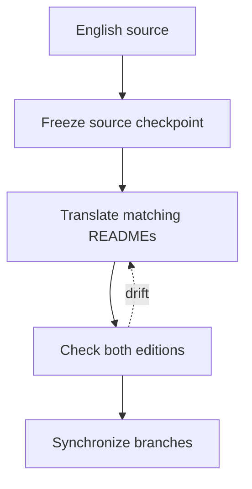

# English and Romanian README editions

## Ownership and scope

The main branch owns the English framework and documentation. The main_RO branch
provides a Romanian edition of every README.md at exactly the same project path.
Both branches contain the same runtime, tests, POMs, configuration defaults and
non-README documentation. The single edition setting is the only configuration
difference. This is a documentation edition, not a second framework variant.

| Content | main | main_RO |
|---|---|---|
| README prose, headings, tables and diagram labels | English | Romanian, with the same meaning and hierarchy |
| README paths, link destinations and incoming English anchors | Canonical | Preserved; translated headings add English anchor aliases |
| Executable code, commands, coordinates, identifiers and comments | English canonical examples | Unchanged examples |
| Inline code and numeric facts in corresponding table rows | Canonical technical literals and quantities | Same values, order and row association |
| Mermaid topology and rendering directives | Canonical | Same nodes, edges and geometry; explanatory labels translated |
| Other documentation, including the living Markdown/HTML pair | English | Same English source |
| docs/governance/readme-edition.properties | language=en | language=ro |

The edition policy accepts exactly one language key with value en or ro.
Standard properties whitespace and comments use the same parser for local and
paired validation. Duplicate settings, extra keys, malformed escapes and
unsupported languages fail closed.

The English source/comment requirement remains mandatory in both branches.
The Romanian documentation exception applies only to files named README.md;
it does not allow Romanian Java messages or comments, or silently exempt other
documents from their English policy.

## Synchronization and review



Arrows show the documentation delivery sequence. A failed comparison returns to
the owning translation or source; publishing follows the reviewed source state.
Changes to main must be reconciled into main_RO before declaring the editions
aligned. Do not merge a translated README back into main as English content.

1. Work in separate main and main_RO checkouts below the selected external work
   root. Preserve concurrent changes and the main_mcp archive.
2. Reconcile all non-README files to the chosen main checkpoint. Translate every
   README completely, preserving paths, sections, paragraphs, table shape,
   examples and link destinations. Add explicit English heading anchors beside
   translated headings so incoming links remain valid.
3. Review meaning, terminology and diagram readability in Romanian. Automated
   structural equality does not establish translation quality.
4. Validate each edition from its own disposable reactor snapshot. Select the
   other snapshot explicitly for the cross-edition check below.
5. Record both source commits, the README inventory, comparison and actual test
   results outside source checkouts. Synchronize verified branches without
   overwriting concurrent work.

## Existing executable checks

The existing DocumentationGovernanceTest checks local links, examples, style,
balanced details/summary blocks, adjacent diagram explanations and the declared
README language. Its positive and deliberate negative fixtures protect edition
inventory, commands, links, anchors, diagram topology and non-README identity.
The scanner continues checking English source and comments independently.

From a disposable reactor root, select a caller-supplied peer snapshot:

```powershell
$peerRoot = (Resolve-Path -LiteralPath $env:ATF_DOCS_PEER_ROOT -ErrorAction Stop).Path
mvn -B -ntp -pl atf-tests -am "-Dtest=DocumentationGovernanceTest" "-Dsurefire.failIfNoSpecifiedTests=false" "-Datf.docs.peer.root=$peerRoot" test
```

ATF_DOCS_PEER_ROOT and atf.docs.peer.root are verification inputs, not framework
runtime options. They may point to any existing location; no workstation path
or sibling-directory assumption is embedded in the project. Without the peer
input, the normal suite validates its own edition and fixtures. Cross-edition
identity is claimed only after the explicit pair selection runs successfully.

The comparison normalizes CRLF/LF for maintained text and permits README prose
translation, diagram labels and English anchor aliases. It rejects missing or
extra files, changed examples or commands, changed link destinations, missing
incoming anchors, changed diagram topology and other source/configuration drift.

The protected-facts comparison also preserves inline code, including multiline
code spans and embedded backticks, and numeric table facts at their row positions.
Equivalent code-span delimiters and ordinary prose reflow remain valid. A failure
names the first differing protected-item ordinal and the two inventories, rather
than printing complete source or payload values into diagnostics.

Human semantic review is required for every README pair. Check each paragraph,
table row, diagram legend and disclosure: negations, prerequisites, independent
assertion witnesses, optional retrieval receipts, source commits and scoped
execution limits must keep the same meaning. Translate readable prose rather
than abbreviating it to match only the heading structure. Technical token
equality cannot detect an inverted sentence or an omitted semantic qualifier.
