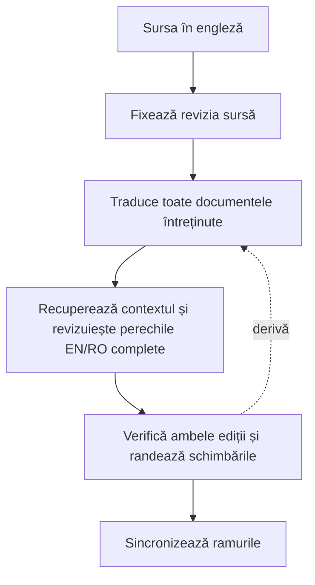

<a id="english-and-romanian-documentation-editions"></a>
# Edițiile documentației în engleză și română

<a id="ownership-and-scope"></a>
## Responsabilitate și domeniu

Ramura main deține frameworkul și documentația în engleză. Ramura main_RO
oferă o ediție română completă la aceleași căi din proiect. Aceasta include
toate documentele Markdown întreținute, nu doar README.md, și proiecția
esențială Living HTML. Rapoartele istorice generate își păstrează limba și sursa capturate.

| Conținut | main | main_RO |
|---|---|---|
| Proză, titluri, tabele și etichete de diagramă Markdown întreținute | Engleză | Traducere română completă, cu același sens și aceeași ierarhie |
| Căi, destinații ale legăturilor și ancore de intrare în engleză | Canonice | Păstrate; titlurile traduse adaugă aliasuri de ancore englezești |
| Cod executabil, comenzi, coordonate, identificatori și comentarii sursă | Exemple canonice în engleză | Exemple identice |
| Cod inline și date numerice în rândurile de tabel corespunzătoare | Literali și cantități canonice | Aceleași valori, ordine și asociere cu rândurile |
| Topologie Mermaid și directive de randare | Canonice | Aceleași noduri, muchii și geometrie; etichete explicative traduse |
| Living HTML | Proiecție legată de sursa engleză | Proiecție legată de sursa română, cu același CSS dedicat și aceleași rute responsabile |
| Runtime, teste, POM-uri, configurație, înregistrări de cunoaștere și utilitare | Canonice | Sursă identică |
| docs/governance/readme-edition.properties | language=en | language=ro |
| docs/governance/translation-review.xml | Declarație comună de revizuire EN/RO | Declarație identică, cu ambele digesturi ale documentelor |

Numele istoric al fișierului de proprietăți rămâne compatibil; limba sa se
aplică întregii ediții întreținute a documentației. Politica acceptă exact
o cheie language cu valoarea en sau ro. Setările duplicate, cheile suplimentare,
secvențele escape malformate și limbile nesuportate eșuează în mod închis.

Cerința sursei/comentariilor în engleză se aplică în ambele ramuri. Traducerea
este o excepție pentru proza documentației și etichetele explicative ale diagramelor;
nu permite mesaje Java, comentarii de cod sau exemple executabile în română.

<a id="synchronization-and-review"></a>
## Sincronizare și revizuire



Săgețile continue arată ordinea livrării; săgeata întreruptă întoarce deriva
observată la responsabil. Verificările urmează revizuirii textelor complete.
Publicarea urmează stării sursă validate și nu stabilește singură calitatea semantică.

1. Folosește copii separate main și main_RO sub rădăcina de lucru selectată
   de apelant. Păstrează schimbările concurente și referința arhivei locale.
2. Reconciliază codul/configurația și traduce complet fiecare document întreținut.
   Păstrează exemplele, datele, legăturile, structura tabelelor și topologia diagramelor.
3. Adaugă aliasuri explicite pentru titlurile englezești, astfel încât legăturile
   de intrare să rămână valide. Regenerează Living HTML din Markdown-ul românesc, inclusiv propriul digest al sursei.
4. Revizuiește fiecare pereche completă prin procesul de mai jos. Leagă declarația
   comună de ambele hash-uri normalizate ale documentelor după revizuire.
5. Validează instantanee temporare cu o pereche explicită. Înregistrează
   commiturile sursă, selecția, rezultatele reale și dovezile externe înaintea sincronizării.

<a id="existing-executable-checks"></a>
## Verificările executabile existente

Responsabilii expliciți ai testelor de documentație protejează legăturile,
structura, exemplele, valorile implicite, comenzile, ancorele, topologia și
datele tehnice ale fiecărui Markdown întreținut. README-ul rădăcină, edițiile
bilingve, principiile Living, structura Markdown, feedback-ul și publicarea sunt
clase TestNG separate, listate în suitele locale și agregate.
`DocumentationGovernanceTest` verifică responsabilii diagnosticelor și selecțiile
lor de reverificare. Perechea Living verifică suplimentar limba, ordinea
secțiunilor, digestul sursei și rândurile principiilor. Sursa din afara documentației trebuie să rămână identică între ediții.

Din rădăcina unui reactor temporar, selectează un instantaneu pereche existent:

<details>
<summary>Verifică edițiile complete pereche ale documentației</summary>

```powershell
$peerRoot = (Resolve-Path -LiteralPath $env:ATF_DOCS_PEER_ROOT -ErrorAction Stop).Path
mvn -B -ntp -pl atf-tests -am "-Dtest=DocumentationGovernanceTest,DocumentationRootGovernanceTest,DocumentationEditionGovernanceTest,LivingPrinciplesGovernanceTest,DocumentationStructureGovernanceTest,FeedbackGovernanceTest,DocumentationPublicationGovernanceTest,DocumentationReadabilityRulesTest" "-Dsurefire.failIfNoSpecifiedTests=false" "-Datf.docs.peer.root=$peerRoot" test
```

</details>

ATF_DOCS_PEER_ROOT și atf.docs.peer.root sunt intrări de verificare, nu opțiuni
runtime. Pot indica orice locație existentă. Identitatea între ediții este
afirmată numai după reușita selecției explicite a perechii.

| Control | Observație suportată | Limită |
|---|---|---|
| DOC-EDITION-LANGUAGE | Un document declarat românesc cu proză semnificativă nu conține un marcaj românesc cunoscut | Un semnal de vocabular nu poate dovedi limba fiecărei fraze |
| DOC-EDITION-UNTRANSLATED | Un bloc englezesc vizibil și semnificativ rămâne neschimbat în traducerea pereche | Engleza reformulată sau sensul inversat necesită revizuire semantică |
| DOC-EDITION-PARITY / FACTS / ANCHOR | Structura, comenzile, literalii, datele numerice din tabele, topologia sau rutele derivă | Egalitatea tehnică nu stabilește fidelitatea prozei |
| DOC-TRANSLATION-REVIEW | Un document întreținut nu are o înregistrare completă de revizuire declarată | Declarația consemnează responsabilitatea revizorului, nu un verdict lingvistic automat |
| DOC-TRANSLATION-STALE | Hash-ul documentului local revizuit diferă față de conținutul normalizat curent | Orice document editat necesită reînnoirea revizuirii |

Delimitările echivalente de cod inline, reașezarea paragrafelor simple și LF/CRLF
rămân valide. Inspecția structurală a legăturilor cere momentan etichete pe un
singur rând și poziționare canonică în elementele de listă reașezate; este un
contract limitat al sursei, nu un parser Markdown complet.

Comparația blocurilor neschimbate exclude blocurile literale,
codul inline și URL-urile legăturilor; titlurile, elementele listelor și
rândurile tabelelor sunt unități de proză separate. Respinge unitățile identice
cu cel puțin 12 cuvinte alfabetice. Detectarea lingvistică locală folosește
același prag și vocabularul de marcaje cunoscute, cu limitele finite precizate mai sus.

<a id="whole-document-review"></a>
<a id="whole-document-review-1"></a>
## Revizuirea întregului document

Folosește recuperarea pentru context, apoi citește documentul canonic complet
și corespondentul său românesc complet. Fragmentele recuperate nu înlocuiesc
niciodată perechea completă. Recuperarea Atlas întreținută este lexicală
deterministă; nu oferă un serviciu de traducere sau garanție lingvistică semantică.

<details>
<summary>Recuperează contextul politicii pentru revizuirea bilingvă a documentației</summary>

```powershell
node tools/atlas-report.mjs retrieve --query "English documentation governance evidence complete source review"
```

</details>

Păstrează acea dovadă în afara sursei, împreună cu contractul curent al ediției,
politica de cod/documentație și fișierele EN/RO selectate complete. Fișierele
sursă sunt dovada; înregistrarea recuperării explică cerințele consultate.

- Citește fiecare secțiune, paragraf, element de listă, rând de tabel, bloc pliabil
  și legendă. Verifică scopul, actorul, condițiile, negațiile, ordinea și limitele dovezilor.
- Păstrează exemplele literale și tokenurile tehnice de stare/ID. Traduce complet
  textul explicativ; un titlu românesc peste un corp englezesc este insuficient.
- Inspectează sursa/POM-ul real din spatele afirmațiilor factuale. Randează
  diagramele schimbate și Living HTML; structura automată nu certifică aspectul.
- Repară discrepanțele înainte de marcarea perechii ca revizuită. Leagă ambele
  valori SHA-256 normalizate în translation-review.xml și păstrează dovezile
  detaliate externe. Nu reîmprospăta hash-urile fișierelor necitite sau revizuite parțial.

Declarația comună enumeră fiecare Markdown întreținut și Living HTML.
Dimensiunile obligatorii sunt limba, sensul, condițiile, datele, legăturile,
diagramele și blocurile pliabile. Intrările lipsă, duplicate, străine, parțiale
sau învechite eșuează. Revizorul declarat rămâne responsabil pentru calitatea
semantică pe care verificările deterministe nu o pot stabili. O verificare
reușită a perechii are exact limitele declarate.
