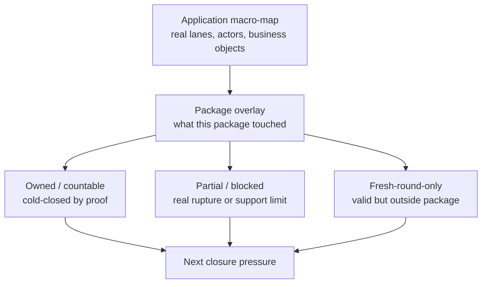
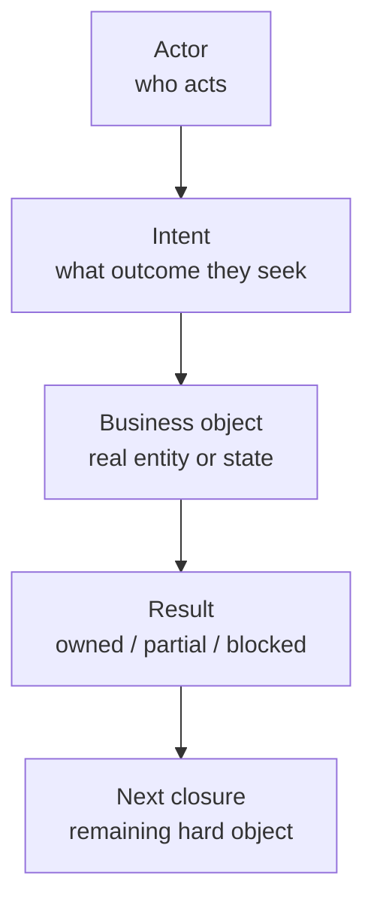

<!-- Generated from ../html_EN/mcp/business-flow-graph-rubric.html. Keep source of truth in html_EN. -->
<!-- Source stylesheet: [shared-report-reference.css](../assets/shared-report-reference.css) -->

# Business Flow Graph Rubric `APP MAP` `OVERLAY` `NODE` `CLOSURE`

- Explains only the drawing and validation of `Business Flow Graph`.
- `reporting.html` remains the owner of the final page.
- The reusable graph shape lives here.


## Overview

| Badge | Read here |
| --- | --- |
| `APP MAP` | the real application: lanes, actors, intents, business objects |
| `OVERLAY` | what the package touched: owned, partial, blocked, fresh-round-only |
| `NODE` | actor -> intent -> business object -> result |
| `ANCHOR` | the durable business record or transaction that gives the graph a center |
| `RELATION` | verb labels on edges: owns, anchors, classifies, captures, submits, confirms, awaits |
| `LEGEND` | test details, run id, repair, diff, Extent, and procedural jargon |
| `CLOSURE` | the hard object or real rupture left for the next round |
| `INVALID` | the graph becomes a package journal, technical suite, or run list |

<!-- /table -->

| Category | Scope |
| --- | --- |
| Owner | `the real application` `business map` |
| Uses | `macro-map` `overlay` `closure` |
| Does not produce | `final report` `proof mapping` `score` |
| Do not put in nodes | `run ids` `locators` `repair trail` |

<!-- /table -->

The application is the map. The package is the overlay. If the overlay becomes the map, the graph must be redrawn.

<details open>
<summary>0. Construction sequence `ANCHOR` - what made the calibrated graph work</summary>

| Step | Do this before drawing | Reject when |
| --- | --- | --- |
| 1. business anchor | Name the durable record or transaction that gives the graph a center: invoice, support case, order, message, payment ledger. | The center is a run, suite, helper, report, XML, Extent or generic "flow". |
| 2. actor and intent | Name who wants the outcome and why the product should preserve or expose it. | The first visible node is a technical action or test fixture. |
| 3. owned object | Highlight the primary owned business object with the strongest visual emphasis. | All nodes look equally important or the graph has no primary object. |
| 4. relationship labels | Label arrows with business verbs such as owns, anchors, classifies, captures, submits, confirms, reopens, awaits. | Arrows are only chronology or unlabeled plumbing. |
| 5. frontier | Render the next object as dashed/capped and explicitly not owned. | The graph ends with success even though the business lifecycle is still open. |
| 6. proof boundary | Send run IDs, XML, Extent, diff, state and method names to Proof Mapping, Run Audit or a collapsed proof strip. | Proof artifacts become business nodes. |

Start from the business object, not from the evidence. Evidence proves the map; it is not the map.
</details>

<details>
<summary>Micro-example of a good node</summary>

| Field | Good node | Bad node |
| --- | --- | --- |
| actor | authenticated customer | run_03 |
| intent | reopens post-purchase memory | checks a new helper |
| business object | order row / invoice row | selector / test class |
| result | payment success owned; order history blocked | green Extent result |

<!-- /table -->
</details>

<details>
<summary>Minimum contract � map, overlay, closure</summary>

| Block | Rule |
| --- | --- |
| layer 1 | application macro-map, including relevant untouched areas |
| layer 2 | package overlay: what was touched, owned, partial, blocked |
| layer 3 | `next closure pressure`: which hard object or real rupture remains open |
| nodes | short title + at most one short context line |
| mandatory micro-template | `actor -> intent -> business object -> result` |
| legend | collapsed, immediately under the subgraph; move test jargon and procedural detail there |
| default state | in the final report all main sections are collapsible; the slot `4. Business Flow Graph` remains the only one open by default |

<!-- /table -->

| Binary test | Answers |
| --- | --- |
| application map | what exists in the product, including what the package did not touch |
| package overlay | what the package touched, without becoming the main map |

<!-- /table -->
</details>

<details open>
<summary>1. Canonical LangGraph `APP MAP` � macro-map -> overlay -> closure</summary>

<!-- diagram-readable-table -->
| Graph layer | Answers | Invalid if |
| --- | --- | --- |
| Macro-map application | real product lanes, actors, and business objects | it starts from runs, tests, or helper classes |
| Package overlay | what this package touched on top of the application map | the overlay becomes the whole map |
| Owned / countable | business objects cold-closed by proof | green execution replaces business truth |
| Partial / blocked | real ruptures, support, and limits | blockers are hidden or softened |
| Next closure | the hard object that remains open | the graph ends with vague "more testing" |
<!-- /table -->

```text
Application macro-map
  -> package overlay
     -> owned / countable proof
     -> partial / blocked rupture
     -> fresh-round-only handoff
        -> next closure pressure
```

<details>
<summary>Optional Mermaid view</summary>



</details>

Short formula:

application macro-map -> package overlay -> next closure pressure.

<details>
<summary>1.1 Reusable Mermaid micro-template � aligned with html-ex and shared CSS</summary>

- The template is a starting point, not copied business.
- The visual style must remain compatible with `shared-report-reference.css`.
- Shape calibration uses the current examples from `HTML_EX_LIBRARY_ROOT` and `HTML_EX_LIBRARY_README`.

<!-- diagram-readable-table -->
| Template slot | Replace with | Keep out |
| --- | --- | --- |
| Actor + intent | real actor and product intent | run id, test class, helper name |
| Business object | order, invoice, message, profile, cart, comparison | selector, Java method, repair step |
| Owned | proven and countable result | score or green report as a substitute |
| Partial / blocked | real rupture or limit | cosmetic failure language |
| Next closure | next hard business object | vague plan |
<!-- /table -->

```text
Actor
  -> intent
     -> business object
        -> result: owned / partial / blocked
           -> next closure
```

<details>
<summary>Optional Mermaid view</summary>



</details>

</details>
</details>
<details>
<summary>2. Minimum rubric `NODE` � what to verify before publishing</summary>

| Rubric | Must be visible | Invalidates |
| --- | --- | --- |
| application map | real product macro-zones | the graph starts directly from runs or technical families |
| package overlay | what this package changed over the map | the overlay becomes the main map |
| visual hierarchy | primary owned object is highlighted; frontier is separated and dashed/capped | flat chain, tiny graph in a large panel, no obvious center |
| relationship labels | arrows explain business dependency | unlabeled arrows or only procedural sequence |
| node template | actor -> intent -> business object -> result owned/partial/blocked | the node cannot be read as a real business object |
| business object | actor, intent, object, result | nodes with helper, locator, class name, repair |
| closure pressure | heavy object or remaining real rupture | the graph stops without next truth |
| legend discipline | procedural detail stays below, collapsed | essay inside nodes or a legend that duplicates the whole graph |

<!-- /table -->

| Mandatory micro-template | Question | Good example |
| --- | --- | --- |
| Actor | who has the intent? | `Customer` |
| Intent | what product result do they seek? | `wants post-purchase memory` |
| Object business | what real entity must exist? | `order row / invoice row / message row` |
| Result | what remains after proof? | `Orders shell partial; order row missing` |

<!-- /table -->

- The node must read as actor -> intent -> business object -> result.
- If it does not work, move the detail into the legend/proof mapping.
- If it still does not work, redraw the node.
</details>

<details>
<summary>2.1 MCP business trace `MCP` � anti-token-spam, pro-structural evidence</summary>

| Must appear | Where | Why |
| --- | --- | --- |
| `business_object` | Business Flow Graph | the graph shows the real object, not only the test family |
| proof row | Proof Mapping | links the object to diff, state, execution proof, and cold verdict |
| run trace | Run Audit + `run-state.json` | shows which run supported the claim |
| code trace | `thin-no-index.diff` | shows the mutation, not only prose |

<!-- /table -->

- Repeating business words without a proof row is invalid.
- Candidate MCP requires structural trace; sounding good is not enough.
</details>

<details>
<summary>3. Good vs bad `NODE` � very short examples</summary>

| Type | Good | Bad |
| --- | --- | --- |
| node name | `Orders history absent after payment success` | `run_03 invoice fix` |
| overlay | `Owned: Messages thread visible` | `Extent ok + xml ok + diff ok` |
| closure | `Next: order row persistent after relogin` | `Check again in run_05` |
| commerce | `Payment success -> order history blocked` | `Checkout tests green` |
| support | `Contact message submitted -> thread/reply ownership partial` | `Support form run_02` |
| account | `Profile setting changed -> persistence after relogin owned` | `Account helper fixed` |

<!-- /table -->
</details>

<details>
<summary>4. Bad smells `INVALID` � when cooling down the graph</summary>

- If the reader remembers `run_03`, `repair`, `reentry` before the business lane, the graph is too procedural.
- If the application macro-map fits in a corner while the overlay occupies everything, the report is package-first.
- If the nodes already contain proof, diff, and explanation, the graph is trying to do too much.
- If the legend repeats the whole graph, it is no longer a legend; it is a poorly disguised essay.
</details>
