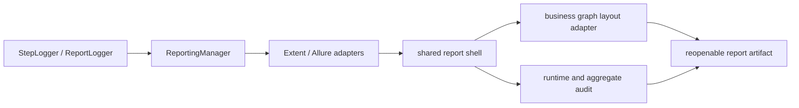

# Core Reporting

## Purpose

Core reporting owns the Reporting skill surface for reusable Extent/reporting infrastructure: adapters, aggregate writers, runtime audit, attachments, diagnostics and console-friendly step output.

It also owns neutral graph layout mechanics through `graph/`. That package may
render a `BusinessGraphConstruction` into reusable HTML/SVG layout, but it must
not decide whether the graph is true business evidence, MCP-publishable or
Atlas-quality.

The first repair map for reporting ownership is `skills/reporting/contracts/reporting-architecture.yml`. Package-shape ownership lives in `skills/reporting/contracts/reporting-package-shape.yml`, with numeric caps kept in `skills/codequality/contracts/size-budgets.yml`. Advisory guidance that helps agents pick the right Core repair target lives in `atf-core/contracts/profiles/core-advisor.yml`; it is intentionally non-blocking.

## Entry points

- `AggregateExtentReportWriter`: writes aggregate Extent reports from descriptors and case records.
- `AggregateExtentPublicationPipeline`: appends final audit, runtime audit and Spark finalization.
- `graph/BusinessGraphLayoutAdapter`: neutral adapter from Business Understanding graph semantics to report layout.
- `adapters/extent`: Extent adapter and Spark standardization.
- `diagnostic`, `step`, `utils`: reporting support used across tests.

## Change here when

- A reporting behavior is generic across ATF, MCP, Atlas or future modules.
- Extent output needs one shared visual/reporting standard.
- A public reporting extension point needs to be separated from internal adapter mechanics.
- English-facing shared report shell primitives in `docs/prompts/html_EN/shared` or their ownership manifest change.

## Reporting Flow

The implementation can serve MCP, Atlas and Core reports, but the rendered
business or package meaning must remain in the owning skill.

## Do not

- Do not add package-specific MCP/Atlas business rules here.
- Do not turn `BusinessGraphLayoutAdapter` into a business-quality or package-closeout gate.
- Do not bypass `ConsoleLogger` or framework reporting gateways.
- Do not patch generated Extent HTML in a way that cannot be audited by runtime/provenance tests.

## Verification

- Run ATF core reporting sanity/smoke tests, not MCP package close-out.
- Check small and aggregate Extent reports for the same overview/status model.
- Keep public extension points separate from internal adapters.
- When reporting ownership moves, update `reporting-architecture.yml` and run `AtfCoreYamlContractManifestTest` plus `AtfReportingPackageShapeContractTest`.
