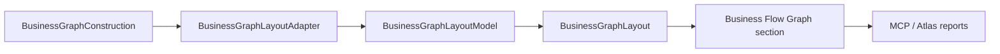

# Business Graph Layout

## Purpose

This package is the neutral Reporting adapter between shared business semantics
and reusable report layout.

`BusinessGraphConstruction` belongs to Business Understanding. Reporting does
not decide whether a graph is true, publishable or teacher-grade. Reporting owns
the shape produced from that semantic input: details section, graph panel, SVG
classes, lanes, `data-graph-role` markers, accessible SVG title/description,
readable truncated labels with `data-full-text`, legend, proof-boundary
placeholder, relationship-label fallbacks, supplemental relationship SVG cues,
supplemental relationship audit and stable layout tokens.

## Entry Points

- `BusinessGraphLayoutAdapter`: renders a `BusinessGraphConstruction` fixture into a reusable layout.
- `BusinessGraphLayoutModel`: internal layout model that separates coordinates/roles from string rendering.
- `BusinessGraphLayout`: immutable rendered layout result: HTML, SVG, node count and edge count.
- `BusinessGraphLayoutTokens`: shared CSS/data tokens used by Reporting contracts and consumers.

## Ownership Flow

Business Understanding owns the semantic recipe. Reporting owns the layout
adapter. MCP owns package/report gate checks. Atlas owns business-quality
judgment.

## Change Here When

- A shared graph layout primitive changes.
- Reporting needs a stable CSS/data token for business graph rendering.
- A reusable graph fixture should replace hand-written graph HTML in tests.
- Graph layout accessibility or auditable role markers need to stay stable.
- Long business labels need readable visible text without losing the full
  auditable value.
- Sparse relationship-label input needs safe business fallbacks without changing
  the primitive shape.
- Extra relationship-label input must not be lost; render compact supplemental
  SVG cues and preserve the full list in audit HTML without adding more nodes.
- The reusable graph primitive must stay aligned with the final-report MCP
  density gate: at least five business nodes and a meaningful vertical node
  band, not a one-row decorative chain.

## Do Not

- Do not decide MCP package publishability here.
- Do not decide Atlas business quality here.
- Do not parse generated package evidence here.
- Do not add domain-specific product objects beyond fixture-safe examples.

## Verification

- Run `src/test/resources/atf/core/reporting/testng-reporting-sanity.xml`.
- Run MCP LangGraph final-report validation only when a consumer report contract changes.
- Keep Business Understanding sanity green when changing `BusinessGraphConstruction` inputs.
