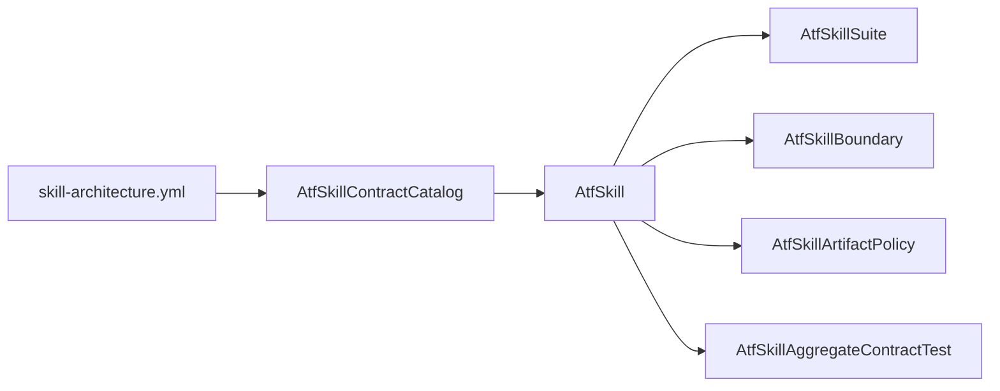

# Core Skills

## Purpose

`com.ai.core.skills` contains the Core-owned skill registry model: typed
metadata, suite routing, boundaries and artifact policy loaded from
`skill-architecture.yml`.

This package should stay small. Public skills should live under
`com.ai.skills.*` so they can be reasoned about, tested and eventually
extracted independently.

- `AtfSkill`: typed aggregate over `skill-architecture.yml` for skill id, roots, suites, boundaries and artifact policy.
- `AtfSkillContractCatalog`: facade that turns YAML skill rows into typed skill objects.
- `AtfSkillSuite`, `AtfSkillBoundary`, `AtfSkillArtifactPolicy`: small value objects used by executable skill-architecture tests.

## Surfaced Skills

Historical skill facades have been surfaced out of this package. The current
shape is:

- `com.ai.skills.business`: Business Understanding semantic kernel.
- `com.ai.skills.reporting`: Reporting skill facade over `com.ai.core.reporting`.
- `com.ai.skills.codequality`: Code Quality maintainability skill.
- `com.ai.skills.mcp`: MCP generated-package governance skill.
- `com.ai.skills.atlas`: Atlas business-understanding validator skill.

Do not add compatibility facades here by default. Add one only when a compile or
consumer contract proves that a transitional alias is required, and remove it as
soon as contracts, tests and YAML references use the surfaced skill package.

## Skill Model

`AtfSkill` should grow only when it removes duplicated skill metadata reads.
Keep behavior-specific validation in the owning skill tests.

## Placement Rule

- Put reusable business semantics in `com.ai.skills.business`.
- Put reporting-skill routing metadata in `com.ai.skills.reporting`.
- Put maintainability guardrails in `com.ai.skills.codequality`.
- Put reusable report implementation in `core.reporting`.
- Put low-level config, YAML and contract primitives in `core.support`.
- Put shared skill ownership metadata in `core.skills`, not in MCP, Atlas or a domain skill.

## Do Not

- Do not add MCP package gates here.
- Do not add Atlas-specific scoring rules here.
- Do not move product API/UI tests into skill packages.
- Do not turn `AtfSkill` into a generic bag for every validator-specific rule.
- Do not add new public skills under `core.skills`; add them under
  `com.ai.skills.*` and register them in `skill-architecture.yml`.
