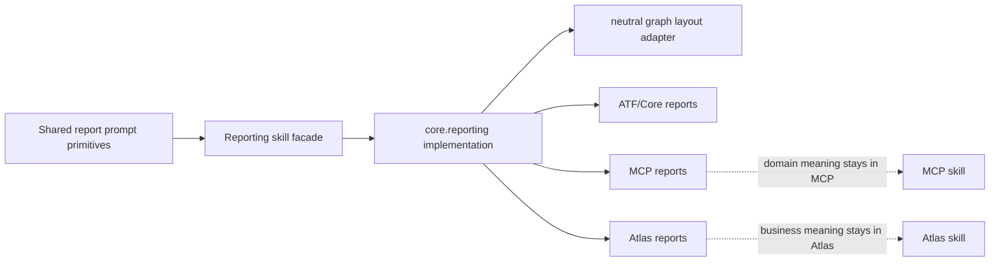

# Reporting Skill Surface

## Purpose

`com.ai.skills.reporting` is the skill-level ownership facade over
`com.ai.core.reporting` for shared reporting. It explains how agents and
maintainers should route Reporting work without mixing report presentation with
MCP package governance or Atlas business meaning.

The implementation library remains in `com.ai.core.reporting`.
Reporting skill is a facade over com.ai.core.reporting.

Shared prompt primitives are exposed through the shared prompt surface declared
in `docs/prompts/html-contract-ownership.yml`. Localized source folders remain
internal prompt-maintenance inputs and should not be hardcoded in this skill
README.
The canonical shared prompt root for Reporting is `docs/prompts/html_ro/shared`.
Extent output needs one shared visual/reporting standard.
Business graph layout now has a neutral Reporting adapter in `com.ai.core.reporting.graph`. It consumes `BusinessGraphConstruction` as semantic input and produces layout tokens/HTML/SVG only; it does not judge graph truth, package readiness or Atlas quality.
Use `testng-reporting-sanity.xml` before trusting neutral Reporting skill changes.
Use `testng-reporting-integration.xml` when MCP, Atlas or other consumers must prove they can reuse the shared report shell.
Use `testng-reporting-consumer-smoke.xml` only as a tiny cross-skill smoke for MCP/Atlas consumers; it is not the neutral Reporting skill gate.

## Ownership Flow

Reporting owns reusable report mechanics. MCP and Atlas own the meaning rendered
inside those mechanics.

## Entry Points

- `ReportSkillSurface`: stable skill metadata for the shared Reporting capability.
- `AggregateReportSurface`: stable skill metadata for aggregate report ownership.
- `com.ai.core.reporting`: reusable implementation library for Extent, diagnostics, runtime audit, attachments and aggregate reports.
- `com.ai.core.reporting.graph`: neutral `BusinessGraphConstruction -> BusinessGraphLayout` adapter and graph tokens.
- Public API surface: `ReportingManager`, `ReportLogger`, `StepLogger`, `HtmlReportShellValidator`, `BusinessGraphLayoutAdapter`.
- `src/test/resources/atf/core/reporting/testng-reporting-sanity.xml`: neutral Reporting skill sanity; it must not become an MCP/Atlas sweep.
- `src/test/resources/atf/core/reporting/testng-reporting-integration.xml`: consumer integration proof for MCP/Atlas/Core-style reports.
- `src/test/resources/atf/core/reporting/testng-reporting-consumer-smoke.xml`: tiny MCP/Atlas consumer smoke that proves consumers still load beside Reporting without moving their ownership into Reporting.

## Reading Path

1. Start here to decide whether the change is shared report presentation, not MCP publishability and not Atlas business meaning.
2. Check `src/main/resources/skills/reporting/contracts/reporting-skill-surface.yml` for the Reporting facade contract.
3. For business graph layout changes, inspect `com.ai.core.reporting.graph` and keep semantic ownership in the Business Understanding skill model.
4. Check the shared prompt surface declared in `docs/prompts/html-contract-ownership.yml` when shell, score-card, graph or artifact-linking prompt primitives change; keep localized source folders aligned through prompt ownership checks.
5. Run `src/test/resources/atf/core/reporting/testng-reporting-sanity.xml`; add integration/consumer smoke only when consumers are affected.

## Package Promotion Rule

Reporting is a real shared skill facade. New public routing metadata should be
kept in `com.ai.skills.reporting`, while reusable implementation
continues to live in `com.ai.core.reporting`.

## Routing Contract

- Use this facade when shared report shell, CSS, score primitives, business graph layout, artifact links, Extent/Spark output or runtime audit behavior changes.
- Use `BusinessGraphLayoutAdapter` when a shared `BusinessGraphConstruction` must become reusable graph layout. Reporting owns SVG/HTML composition, lanes, spacing, legend and proof-boundary placement; Business Understanding, MCP and Atlas keep semantic judgment.
- BusinessGraphLayoutAdapter renders BusinessGraphConstruction without judging business truth.
- Stop when Reporting sanity passes; run integration and consumer smoke only when MCP or Atlas report consumers may be affected.
- Keep domain ownership out: MCP owns package publishability, Atlas owns business meaning, Business Understanding owns semantic scoring.

## Change Here When

- The Reporting skill ownership, boundaries or routing changes.
- A future skill/JAR extraction needs one small metadata surface before touching the reporting implementation.
- MCP or Atlas needs shared reporting behavior clarified without importing domain rules here.

## Do Not

- Do not implement Extent/Spark rendering here; use `core.reporting`.
- Do not decide MCP package publishability here.
- Do not decide Atlas business meaning here.
- Do not let graph layout contracts assert business truth; they assert shape, classes, legend placement and accessibility.
- Do not import MCP or Atlas.

## Verification

- Run `testng-reporting-sanity.xml`.
- Run `testng-reporting-integration.xml` after changing consumer-facing report shell behavior.
- Run `testng-reporting-consumer-smoke.xml` only when the change may affect MCP/Atlas report consumers.
- Run `AtfSkillArchitectureContractTest` after changing this skill surface.
- Run `AtfReportingPackageShapeContractTest` when the underlying `core.reporting` implementation shape changes.
