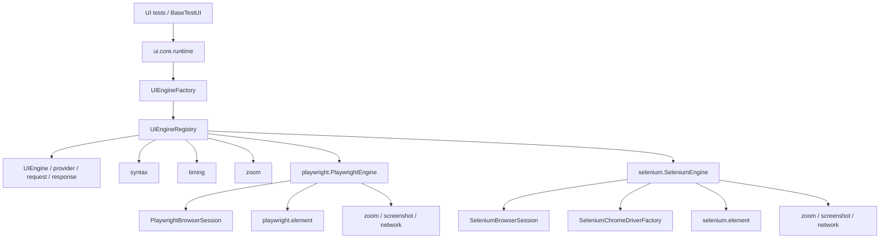
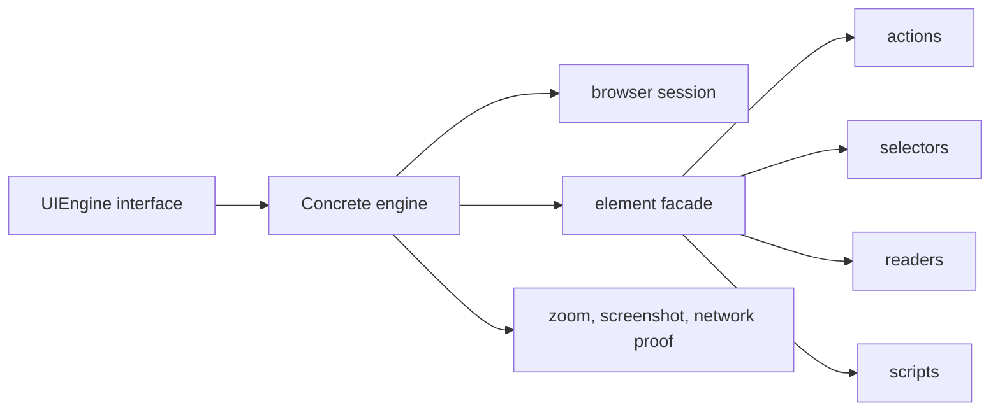
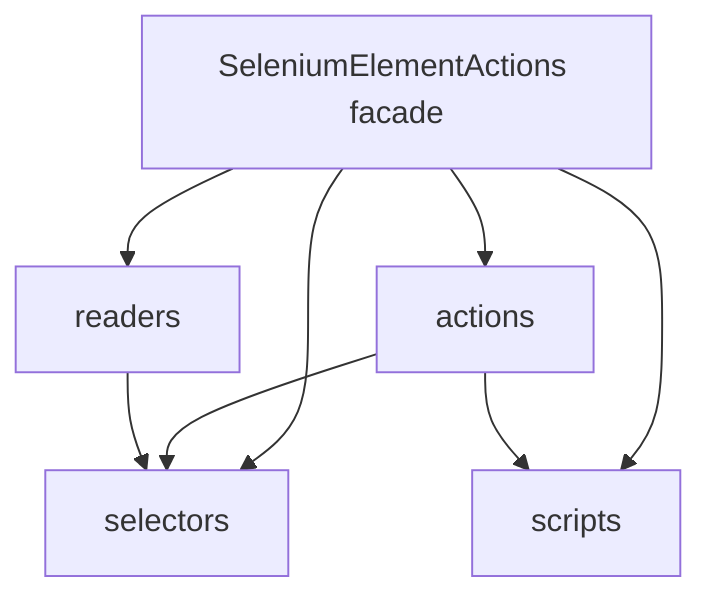
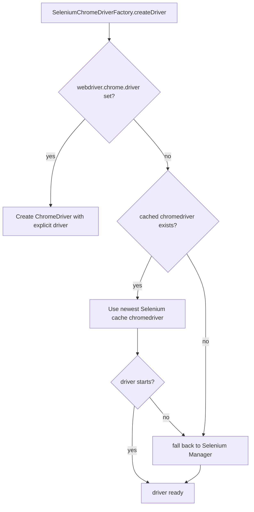
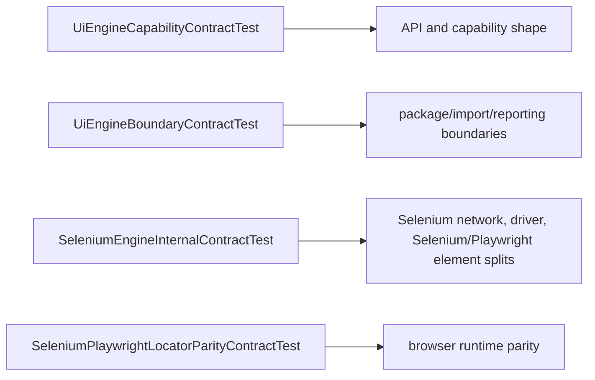

# ATF UI Engine Architecture

This package is the browser adapter layer. It owns Selenium and Playwright runtime behavior, while
`ui.core.runtime` owns test lifecycle and `ui.support` owns application-facing page/actions/validation helpers.

## Package Map

## Responsibility Boundaries

| Area | Owns | Must not own |
| --- | --- | --- |
| `UIEngine` | Stable engine-facing API and capability declarations | Raw Selenium/Playwright objects |
| `UiEngineRegistry` | Engine provider selection | Browser setup details |
| `engine.syntax` | selector syntax and option text normalization | Browser session setup |
| `engine.timing` | timeout unit conversion and duration helpers | Selector or business behavior |
| `engine.zoom` | shared zoom phase vocabulary | Browser-specific zoom implementation |
| `playwright` / `selenium` | Browser-specific session, zoom, screenshot, network | Business page objects |
| `*.element.actions` | click/type/select/upload behavior | Selector parsing or large JS bodies |
| `*.element.selectors` | selector translation and visibility discovery | Business assertions |
| `*.element.readers` | text/value/state reads | Browser session setup |
| `*.element.scripts` | audited JavaScript snippets and execution helper | Test-level reporting |

## Element Package Split

Keep `SeleniumElementActions` and `PlaywrightElementActions` as the only element facades imported by their
concrete engines. Internal element code is grouped by responsibility:

| Package | Classes |
| --- | --- |
| `selenium.element.actions` | click, type, form, select strategy, keyboard, retry pause |
| `selenium.element.selectors` | selector resolver, visible element finder, selector scripts |
| `selenium.element.readers` | text/value/state readers and reader facade |
| `selenium.element.scripts` | DOM scripts and JavaScript executor |
| `playwright.element.actions` | click, type, form, select strategy, visible-index click |
| `playwright.element.selectors` | locator resolver and visible selector handling |
| `playwright.element.readers` | text/value/state readers and DOM read scripts |

## Driver Resolution

The cache fallback is pragmatic local-runtime hygiene. It prevents tests from failing when Selenium Manager cannot
spawn its executable, while still keeping the standard Selenium Manager path available as fallback.

## Adding Or Changing Behavior

1. Add a new UI capability in `UIEngine.Capability` only when both adapters can either support it or fail with a clear unsupported diagnostic.
2. Keep browser-specific imports under `com.endava.ai.ui.core.engine`.
3. Keep reporting calls out of concrete engines; publish runtime metadata through the existing reporting/runtime helpers.
4. Put element behavior into `actions`, `selectors`, `readers`, or `scripts`; do not grow the root `*.element` packages.
5. Update contract tests under `src/test/java/com/endava/ai/atf/ui/component` or `component/engine`.
6. Run both Extent and Allure sanity when browser behavior changes.

## Contract Tests

Use the small focused contract class that matches the change. Avoid adding new source-token assertions to
`UiEngineCapabilityContractTest`; it should remain a compact API/capability contract.
